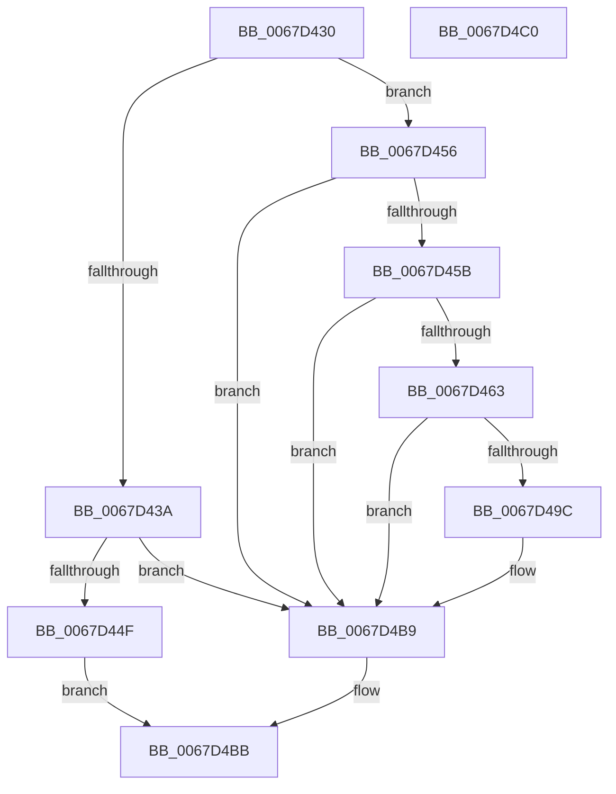

# MiCrashdumpRemovePte

- RVA: `0x0067D430`–`0x0067D4C1` (길이 `145` bytes)
- VA: `0x000000014067D430`
- 실행 섹션: `.text`
- PDB 이름 있음: `예`; PDB Function 태그: `아니요`
- unwind 정보 RVA: `0x0005D2F4`
- 디코드: `37`개 명령, `145/145` bytes 표시
- 미해석 바이트: `0` (있으면 어셈블리에 `.byte`로 보존)

> 이 문서는 커널 이미지의 기계어와 PDB 기호를 분석해 생성했습니다. 4번과 5번은 함수 원형과 자료형을 바이너리 사용 방식에서 추정한 C 해석이며 원본 소스 복구 결과는 아닙니다.

## 1. Dependencies

- 직접 호출 지점: **3**; 고유 호출 대상: **3**
- 직접 호출자로 확인된 함수: **0**
- RIP 상대 이미지 참조: **0**

### Outgoing calls
- `0x0067D43D` → [MiGetLeafVa](../27/MiGetLeafVa_function_0027C0A0.md) (function, `0x0027C0A0`)
- `0x0067D445` → [MiGetSystemRegionType](../28/MiGetSystemRegionType_function_0028EC80.md) (function, `0x0028EC80`)
- `0x0067D4B4` → [guard_dispatch_icall](../6B/guard_dispatch_icall_function_006BAAD0.md) (function, `0x006BAAD0`)

### Direct callers
- 이 함수 시작 RVA로 연결되는 직접 call은 확인되지 않았습니다. 간접 호출은 완전히 역산할 수 없습니다.

### Static image references
- 디코드된 RIP-relative 메모리 참조가 없습니다.

## 2. Other-region calls and transfers

- 다른 실행 섹션으로 향하는 call: **0**
- 별도 외부 분기/꼬리 이동을 확인하지 못했습니다.

## 3. Assembly (complete function range)

```asm
0067D430  48 83 EC 38                     sub rsp, 0x38
0067D434  41 83 F8 03                     cmp r8d, 3
0067D438  75 1C                           jne 0x14067d456
0067D43A  48 8B CA                        mov rcx, rdx
0067D43D  E8 5E EC BF FF                  call 0x14027c0a0
0067D442  48 8B C8                        mov rcx, rax
0067D445  E8 36 18 C1 FF                  call 0x14028ec80
0067D44A  83 F8 07                        cmp eax, 7
0067D44D  74 6A                           je 0x14067d4b9
0067D44F  B8 01 00 00 00                  mov eax, 1
0067D454  EB 65                           jmp 0x14067d4bb
0067D456  45 85 C0                        test r8d, r8d
0067D459  75 5E                           jne 0x14067d4b9
0067D45B  48 8B 12                        mov rdx, qword ptr [rdx]
0067D45E  F6 C2 01                        test dl, 1
0067D461  74 56                           je 0x14067d4b9
0067D463  48 B8 FF FF FF FF FF 00 00 00   movabs rax, 0xffffffffff
0067D46D  48 C1 EA 0C                     shr rdx, 0xc
0067D471  48 23 D0                        and rdx, rax
0067D474  48 8D 04 52                     lea rax, [rdx + rdx*2]
0067D478  48 03 C0                        add rax, rax
0067D47B  49 B8 18 00 00 00 00 DE FF FF   movabs r8, 0xffffde0000000018
0067D485  49 8B 04 C0                     mov rax, qword ptr [r8 + rax*8]
0067D489  49 B8 FF FF FF FF FF FF FF 3F   movabs r8, 0x3fffffffffffffff
0067D493  49 23 C0                        and rax, r8
0067D496  48 83 F8 01                     cmp rax, 1
0067D49A  75 1D                           jne 0x14067d4b9
0067D49C  48 8B 81 B8 00 00 00            mov rax, qword ptr [rcx + 0xb8]
0067D4A3  41 B9 02 00 00 00               mov r9d, 2
0067D4A9  48 8B 08                        mov rcx, qword ptr [rax]
0067D4AC  45 8D 41 FF                     lea r8d, [r9 - 1]
0067D4B0  48 8B 41 08                     mov rax, qword ptr [rcx + 8]
0067D4B4  E8 17 D6 03 00                  call 0x1406baad0
0067D4B9  33 C0                           xor eax, eax
0067D4BB  48 83 C4 38                     add rsp, 0x38
0067D4BF  C3                              ret
0067D4C0  CC                              int3
```

## 4. C-style interpretation (structured pseudocode)

```c
__int64 __fastcall MiCrashdumpRemovePte(__int64 a1, __int64 a2, int a3)
{
    __int64 result;
    __int64 v_rsp;

    v_rsp = (v_rsp) - (56);
    if (a3 != 3) goto loc_0067D456;
    result = MiGetLeafVa(a2, a2, a3, a4);
    result = MiGetSystemRegionType(result, a2, a3, a4);
    if (((unsigned int)(result)) == 7) goto loc_0067D4B9;
    goto loc_0067D4BB;
loc_0067D456:
    if (a3 != 0) goto loc_0067D4B9;
    if ((((unsigned __int8)(*(unsigned __int64 *)(a2))) & (1)) == 0) goto loc_0067D4B9;
    a2 = (*(unsigned __int64 *)(a2)) >> (12);
    a2 = (a2) & (1);
    result = (a2 + a2 * 2) + (a2 + a2 * 2);
    result = (*(unsigned __int64 *)(a3 + result * 8)) & (a3);
    if (result == 1) {
        result = *(unsigned __int64 *)(result + 184);
        a4 = 2;
        a1 = *(unsigned __int64 *)(result);
        a3 = a4 - 1;
        result = *(unsigned __int64 *)(a1 + 8);
        result = guard_dispatch_icall(a1, a2, a3, a4);
    }
    result = 0;
loc_0067D4BB:
    v_rsp = (v_rsp) + (56);
    return result;
}
```

## 5. (Beta) C Style

```c
int64_t MiCrashdumpRemovePte(void *Arg1, void *Arg2, int32_t Arg3)
{
    uint8_t *arg1 = (uint8_t *)Arg1;
    uint8_t *arg2 = (uint8_t *)Arg2;

    int64_t result;
    int64_t local_rsp;

    local_rsp = (local_rsp) - (56);
    if (Arg3 != 3) goto loc_0067D456;
    result = MiGetLeafVa(Arg2, Arg2, Arg3, a4);
    result = MiGetSystemRegionType(result, Arg2, Arg3, a4);
    if (((uint32_t)(result)) == 7) goto loc_0067D4B9;
    goto loc_0067D4BB;
loc_0067D456:
    if (Arg3 != 0) goto loc_0067D4B9;
    if ((((uint8_t)(*(uint64_t *)(arg2))) & (1)) == 0) goto loc_0067D4B9;
    Arg2 = (*(uint64_t *)(arg2)) >> (12);
    Arg2 = (Arg2) & (1);
    result = (Arg2 + Arg2 * 2) + (Arg2 + Arg2 * 2);
    result = (*(uint64_t *)(Arg3 + result * 8)) & (Arg3);
    if (result == 1) {
        result = *(uint64_t *)(result + 0xB8);
        a4 = 2;
        Arg1 = *(uint64_t *)(result);
        Arg3 = a4 - 1;
        result = *(uint64_t *)(arg1 + 0x8);
        result = guard_dispatch_icall(Arg1, Arg2, Arg3, a4);
    }
    result = 0;
loc_0067D4BB:
    local_rsp = (local_rsp) + (56);
    return result;
}
```

### 관측된 메모리 오프셋

구조체 형식이 확인되지 않은 접근은 인자 기준의 오프셋으로만 기록했습니다.

| 기준 인자 | 오프셋 표현 | 폭 (bit) | 접근 |
|---|---:|---:|---|
| `Arg1` | `+ 0xB8` | `64` | `R` |
| `Arg2` | `+ 0x0` | `64` | `R` |

## 6. Execution-region graph

[열기: 2D/3D 그래프와 함수 탐색 컨트롤 패널](../../../control-panel.html?section=text&rva=0x0067D430&view=graph)

- 2D 그래프는 위에서 아래로 흐르고, 3D 그래프는 빈 공간을 드래그해 회전합니다. Shift+드래그는 이동, 휠은 확대·축소, 함수 노드 선택은 대상 보고서 이동입니다.

### Static fallback


