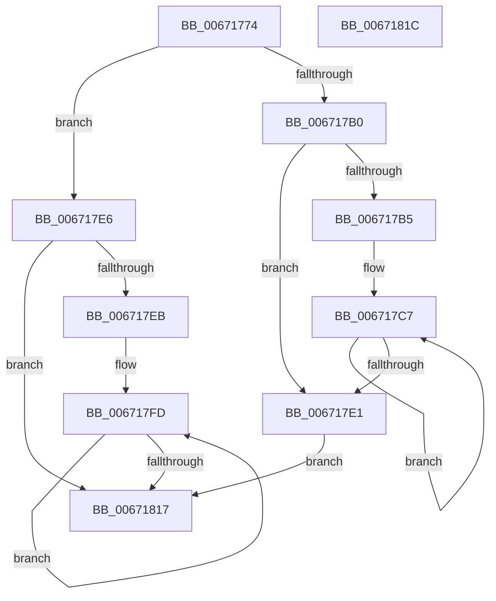

# MiCreateInitialPfns

- RVA: `0x00671774`–`0x0067181D` (길이 `169` bytes)
- VA: `0x0000000140671774`
- 실행 섹션: `.text`
- PDB 이름 있음: `예`; PDB Function 태그: `아니요`
- unwind 정보 RVA: `0x0005CC98`
- 디코드: `43`개 명령, `169/169` bytes 표시
- 미해석 바이트: `0` (있으면 어셈블리에 `.byte`로 보존)

> 이 문서는 커널 이미지의 기계어와 PDB 기호를 분석해 생성했습니다. 4번과 5번은 함수 원형과 자료형을 바이너리 사용 방식에서 추정한 C 해석이며 원본 소스 복구 결과는 아닙니다.

## 1. Dependencies

- 직접 호출 지점: **1**; 고유 호출 대상: **1**
- 직접 호출자로 확인된 함수: **3**
- RIP 상대 이미지 참조: **0**

### Outgoing calls
- `0x00671797` → [MiCopyPfnEntryRaw](../44/MiCopyPfnEntryRaw_function_00448500.md) (function, `0x00448500`)

### Direct callers
- [MiInitializeNewPfns](MiInitializeNewPfns_function_00670E94.md) at `0x00670F4B`
- [MxInsertFreePages](../../init/C6/MxInsertFreePages_function_00C63AD0.md) at `0x00C63C1D`
- [MxInsertEnclaveBootPages](../../init/C6/MxInsertEnclaveBootPages_function_00C68CB0.md) at `0x00C68E7A`

### Static image references
- 디코드된 RIP-relative 메모리 참조가 없습니다.

## 2. Other-region calls and transfers

- 다른 실행 섹션으로 향하는 call: **0**
- 별도 외부 분기/꼬리 이동을 확인하지 못했습니다.

## 3. Assembly (complete function range)

```asm
00671774  48 8B C4                        mov rax, rsp
00671777  48 83 EC 58                     sub rsp, 0x58
0067177B  0F 57 C0                        xorps xmm0, xmm0
0067177E  4C 8B CA                        mov r9, rdx
00671781  4C 8B D1                        mov r10, rcx
00671784  49 8B D0                        mov rdx, r8
00671787  48 8D 48 C8                     lea rcx, [rax - 0x38]
0067178B  0F 11 40 C8                     movups xmmword ptr [rax - 0x38], xmm0
0067178F  0F 11 40 D8                     movups xmmword ptr [rax - 0x28], xmm0
00671793  0F 11 40 E8                     movups xmmword ptr [rax - 0x18], xmm0
00671797  E8 64 6D DD FF                  call 0x140448500
0067179C  4B 8D 04 49                     lea rax, [r9 + r9*2]
006717A0  48 C1 E0 04                     shl rax, 4
006717A4  4A 8D 0C 10                     lea rcx, [rax + r10]
006717A8  48 3D 00 10 00 00               cmp rax, 0x1000
006717AE  76 36                           jbe 0x1406717e6
006717B0  4C 3B D1                        cmp r10, rcx
006717B3  74 2C                           je 0x1406717e1
006717B5  F3 0F 6F 44 24 40               movdqu xmm0, xmmword ptr [rsp + 0x40]
006717BB  F3 0F 6F 4C 24 30               movdqu xmm1, xmmword ptr [rsp + 0x30]
006717C1  F3 0F 6F 54 24 20               movdqu xmm2, xmmword ptr [rsp + 0x20]
006717C7  66 41 0F E7 12                  movntdq xmmword ptr [r10], xmm2
006717CC  66 41 0F E7 4A 10               movntdq xmmword ptr [r10 + 0x10], xmm1
006717D2  66 41 0F E7 42 20               movntdq xmmword ptr [r10 + 0x20], xmm0
006717D8  49 83 C2 30                     add r10, 0x30
006717DC  4C 3B D1                        cmp r10, rcx
006717DF  75 E6                           jne 0x1406717c7
006717E1  0F AE F8                        sfence
006717E4  EB 31                           jmp 0x140671817
006717E6  4C 3B D1                        cmp r10, rcx
006717E9  74 2C                           je 0x140671817
006717EB  F3 0F 6F 44 24 40               movdqu xmm0, xmmword ptr [rsp + 0x40]
006717F1  F3 0F 6F 4C 24 30               movdqu xmm1, xmmword ptr [rsp + 0x30]
006717F7  F3 0F 6F 54 24 20               movdqu xmm2, xmmword ptr [rsp + 0x20]
006717FD  F3 41 0F 7F 12                  movdqu xmmword ptr [r10], xmm2
00671802  F3 41 0F 7F 4A 10               movdqu xmmword ptr [r10 + 0x10], xmm1
00671808  F3 41 0F 7F 42 20               movdqu xmmword ptr [r10 + 0x20], xmm0
0067180E  49 83 C2 30                     add r10, 0x30
00671812  4C 3B D1                        cmp r10, rcx
00671815  75 E6                           jne 0x1406717fd
00671817  48 83 C4 58                     add rsp, 0x58
0067181B  C3                              ret
0067181C  CC                              int3
```

## 4. C-style interpretation (structured pseudocode)

```c
__int64 __fastcall MiCreateInitialPfns(__int64 a1, __int64 a2, __int64 a3)
{
    __int64 result;
    __int64 v_r10;
    __int64 v_rsp;
    unsigned __int64 v_stack_m18;
    unsigned __int64 v_stack_m28;
    unsigned __int64 v_stack_m38;

    v_rsp = (v_rsp) - (88);
    *(unsigned __int64 *)(v_rsp - 56) = v_xmm0;
    *(unsigned __int64 *)(v_rsp - 40) = v_xmm0;
    *(unsigned __int64 *)(v_rsp - 24) = v_xmm0;
    result = MiCopyPfnEntryRaw(v_rsp - 56, a3, a3, a2);
    result = (a2 + a2 * 2) << (4);
    if (result <= 0x1000ULL) goto loc_006717E6;
    if (a1 == (result + a1 * 1)) goto loc_006717E1;
loc_006717C7:
    *(unsigned __int64 *)(a1) = v_xmm2;
    *(unsigned __int64 *)(a1 + 16) = v_xmm1;
    *(unsigned __int64 *)(a1 + 32) = v_xmm0;
    v_r10 = (a1) + (48);
    if (v_r10 != (result + a1 * 1)) goto loc_006717C7;
loc_006717E1:
    goto loc_00671817;
loc_006717E6:
    if (v_r10 == (result + a1 * 1)) goto loc_00671817;
loc_006717FD:
    *(unsigned __int64 *)(v_r10) = v_xmm2;
    *(unsigned __int64 *)(v_r10 + 16) = v_xmm1;
    *(unsigned __int64 *)(v_r10 + 32) = v_xmm0;
    v_r10 = (v_r10) + (48);
    if (v_r10 != (result + a1 * 1)) goto loc_006717FD;
loc_00671817:
    v_rsp = (v_rsp) + (88);
    return result;
}
```

## 5. (Beta) C Style

```c
int64_t MiCreateInitialPfns(int64_t Arg1, int64_t Arg2, int64_t Arg3)
{
    int64_t result;
    int64_t local_r10;
    int64_t local_rsp;
    uint64_t v_stack_m18;
    uint64_t v_stack_m28;
    uint64_t v_stack_m38;

    local_rsp = (local_rsp) - (88);
    *(uint64_t *)(local_rsp - 0x38) = v_xmm0;
    *(uint64_t *)(local_rsp - 0x28) = v_xmm0;
    *(uint64_t *)(local_rsp - 0x18) = v_xmm0;
    result = MiCopyPfnEntryRaw(local_rsp - 56, Arg3, Arg3, Arg2);
    result = (Arg2 + Arg2 * 2) << (4);
    if (result <= 0x1000ULL) goto loc_006717E6;
    if (Arg1 == (result + Arg1 * 1)) goto loc_006717E1;
loc_006717C7:
    *(uint64_t *)(Arg1) = v_xmm2;
    *(uint64_t *)(Arg1 + 0x10) = v_xmm1;
    *(uint64_t *)(Arg1 + 0x20) = v_xmm0;
    local_r10 = (Arg1) + (48);
    if (local_r10 != (result + Arg1 * 1)) goto loc_006717C7;
loc_006717E1:
    goto loc_00671817;
loc_006717E6:
    if (local_r10 == (result + Arg1 * 1)) goto loc_00671817;
loc_006717FD:
    *(uint64_t *)(local_r10) = v_xmm2;
    *(uint64_t *)(local_r10 + 0x10) = v_xmm1;
    *(uint64_t *)(local_r10 + 0x20) = v_xmm0;
    local_r10 = (local_r10) + (48);
    if (local_r10 != (result + Arg1 * 1)) goto loc_006717FD;
loc_00671817:
    local_rsp = (local_rsp) + (88);
    return result;
}
```

## 6. Execution-region graph

[열기: 2D/3D 그래프와 함수 탐색 컨트롤 패널](../../../control-panel.html?section=text&rva=0x00671774&view=graph)

- 2D 그래프는 위에서 아래로 흐르고, 3D 그래프는 빈 공간을 드래그해 회전합니다. Shift+드래그는 이동, 휠은 확대·축소, 함수 노드 선택은 대상 보고서 이동입니다.

### Static fallback


