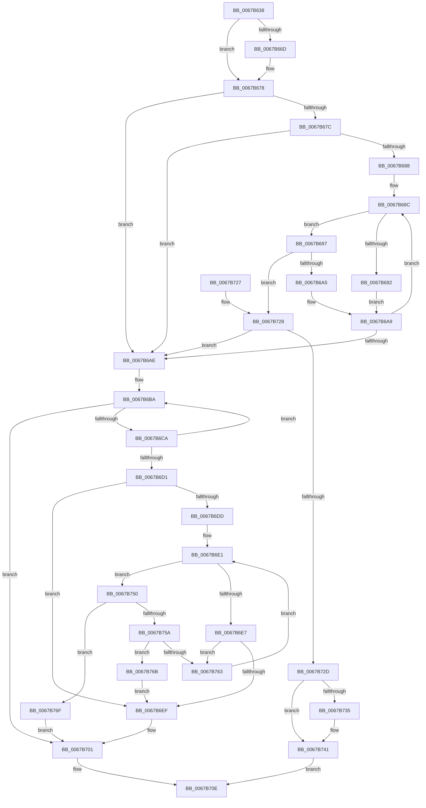

# MiCreateIoPageExclusion

- RVA: `0x0067B638`–`0x0067B776` (길이 `318` bytes)
- VA: `0x000000014067B638`
- 실행 섹션: `.text`
- PDB 이름 있음: `예`; PDB Function 태그: `아니요`
- unwind 정보 RVA: `0x000D7EE8`
- 디코드: `95`개 명령, `318/318` bytes 표시
- 미해석 바이트: `0` (있으면 어셈블리에 `.byte`로 보존)

> 이 문서는 커널 이미지의 기계어와 PDB 기호를 분석해 생성했습니다. 4번과 5번은 함수 원형과 자료형을 바이너리 사용 방식에서 추정한 C 해석이며 원본 소스 복구 결과는 아닙니다.

## 1. Dependencies

- 직접 호출 지점: **6**; 고유 호출 대상: **6**
- 직접 호출자로 확인된 함수: **1**
- RIP 상대 이미지 참조: **3**

### Outgoing calls
- `0x0067B673` → [KiRaiseIrqlProcessIrqlFlags](../4F/KiRaiseIrqlProcessIrqlFlags_function_004F56FC.md) (function, `0x004F56FC`)
- `0x0067B6B3` → [MiLockIoPfnTree](../2A/MiLockIoPfnTree_function_002AC8A4.md) (function, `0x002AC8A4`)
- `0x0067B6BF` → [MiIoPfnTreeExclusionCompatible](MiIoPfnTreeExclusionCompatible_function_0067BE9C.md) (function, `0x0067BE9C`)
- `0x0067B6FC` → [RtlAvlInsertNodeEx](../26/RtlAvlInsertNodeEx_function_00265790.md) (function, `0x00265790`)
- `0x0067B707` → [MiUnlockIoPfnTree](../2A/MiUnlockIoPfnTree_function_002AC7F8.md) (function, `0x002AC7F8`)
- `0x0067B73C` → [KiLowerIrqlProcessIrqlFlags](../4F/KiLowerIrqlProcessIrqlFlags_function_004F5698.md) (function, `0x004F5698`)

### Direct callers
- [MiMapNewPfns](../../page/7F/MiMapNewPfns_function_007FA63C.md) at `0x007FA6F5`

### Static image references
- `0x0067B665` → RVA `0x00FC6D20` (`ALMOSTRO`; read)
- `0x0067B67C` → RVA `0x00E37300` (`.data`; read)
- `0x0067B6D1` → RVA `0x00E37308` (`.data`; read)

## 2. Other-region calls and transfers

- 다른 실행 섹션으로 향하는 call: **0**
- 별도 외부 분기/꼬리 이동을 확인하지 못했습니다.

## 3. Assembly (complete function range)

```asm
0067B638  48 89 5C 24 08                  mov qword ptr [rsp + 8], rbx
0067B63D  48 89 6C 24 10                  mov qword ptr [rsp + 0x10], rbp
0067B642  48 89 74 24 18                  mov qword ptr [rsp + 0x18], rsi
0067B647  57                              push rdi
0067B648  41 56                           push r14
0067B64A  41 57                           push r15
0067B64C  48 83 EC 20                     sub rsp, 0x20
0067B650  8B FA                           mov edi, edx
0067B652  4C 8B F1                        mov r14, rcx
0067B655  44 0F 20 C5                     mov rbp, cr8
0067B659  41 BF 02 00 00 00               mov r15d, 2
0067B65F  45 0F 22 C7                     mov cr8, r15
0067B663  33 DB                           xor ebx, ebx
0067B665  39 1D B5 B6 94 00               cmp dword ptr [rip + 0x94b6b5], ebx
0067B66B  74 0B                           je 0x14067b678
0067B66D  41 8A D7                        mov dl, r15b
0067B670  40 8A CD                        mov cl, bpl
0067B673  E8 84 A0 E7 FF                  call 0x1404f56fc
0067B678  85 FF                           test edi, edi
0067B67A  75 32                           jne 0x14067b6ae
0067B67C  48 8B 0D 7D BC 7B 00            mov rcx, qword ptr [rip + 0x7bbc7d]
0067B683  48 85 C9                        test rcx, rcx
0067B686  74 26                           je 0x14067b6ae
0067B688  49 8B 56 20                     mov rdx, qword ptr [r14 + 0x20]
0067B68C  48 3B 51 18                     cmp rdx, qword ptr [rcx + 0x18]
0067B690  73 05                           jae 0x14067b697
0067B692  48 8B 09                        mov rcx, qword ptr [rcx]
0067B695  EB 12                           jmp 0x14067b6a9
0067B697  48 8B 41 20                     mov rax, qword ptr [rcx + 0x20]
0067B69B  49 39 46 18                     cmp qword ptr [r14 + 0x18], rax
0067B69F  0F 86 83 00 00 00               jbe 0x14067b728
0067B6A5  48 8B 49 08                     mov rcx, qword ptr [rcx + 8]
0067B6A9  48 85 C9                        test rcx, rcx
0067B6AC  75 DE                           jne 0x14067b68c
0067B6AE  B9 06 00 00 00                  mov ecx, 6
0067B6B3  E8 EC 11 C3 FF                  call 0x1402ac8a4
0067B6B8  8B F3                           mov esi, ebx
0067B6BA  49 8B D6                        mov rdx, r14
0067B6BD  8B CE                           mov ecx, esi
0067B6BF  E8 D8 07 00 00                  call 0x14067be9c
0067B6C4  8B F8                           mov edi, eax
0067B6C6  85 C0                           test eax, eax
0067B6C8  78 37                           js 0x14067b701
0067B6CA  FF C6                           inc esi
0067B6CC  41 3B F7                        cmp esi, r15d
0067B6CF  7C E9                           jl 0x14067b6ba
0067B6D1  48 8B 15 30 BC 7B 00            mov rdx, qword ptr [rip + 0x7bbc30]
0067B6D8  48 85 D2                        test rdx, rdx
0067B6DB  74 12                           je 0x14067b6ef
0067B6DD  49 8B 4E 20                     mov rcx, qword ptr [r14 + 0x20]
0067B6E1  48 3B 4A 18                     cmp rcx, qword ptr [rdx + 0x18]
0067B6E5  73 69                           jae 0x14067b750
0067B6E7  48 8B 02                        mov rax, qword ptr [rdx]
0067B6EA  48 85 C0                        test rax, rax
0067B6ED  75 74                           jne 0x14067b763
0067B6EF  4D 8B CE                        mov r9, r14
0067B6F2  48 8D 0D 0F BC 7B 00            lea rcx, [rip + 0x7bbc0f]
0067B6F9  44 8A C3                        mov r8b, bl
0067B6FC  E8 8F A0 BE FF                  call 0x140265790
0067B701  41 8B D7                        mov edx, r15d
0067B704  40 8A CD                        mov cl, bpl
0067B707  E8 EC 10 C3 FF                  call 0x1402ac7f8
0067B70C  8B C7                           mov eax, edi
0067B70E  48 8B 5C 24 40                  mov rbx, qword ptr [rsp + 0x40]
0067B713  48 8B 6C 24 48                  mov rbp, qword ptr [rsp + 0x48]
0067B718  48 8B 74 24 50                  mov rsi, qword ptr [rsp + 0x50]
0067B71D  48 83 C4 20                     add rsp, 0x20
0067B721  41 5F                           pop r15
0067B723  41 5E                           pop r14
0067B725  5F                              pop rdi
0067B726  C3                              ret
0067B727  CC                              int3
0067B728  48 85 C9                        test rcx, rcx
0067B72B  74 81                           je 0x14067b6ae
0067B72D  39 1D ED B5 94 00               cmp dword ptr [rip + 0x94b5ed], ebx
0067B733  74 0C                           je 0x14067b741
0067B735  44 0F 20 C1                     mov rcx, cr8
0067B739  40 8A D5                        mov dl, bpl
0067B73C  E8 57 9F E7 FF                  call 0x1404f5698
0067B741  40 0F B6 C5                     movzx eax, bpl
0067B745  44 0F 22 C0                     mov cr8, rax
0067B749  B8 18 00 00 C0                  mov eax, 0xc0000018
0067B74E  EB BE                           jmp 0x14067b70e
0067B750  48 8B 42 20                     mov rax, qword ptr [rdx + 0x20]
0067B754  49 39 46 18                     cmp qword ptr [r14 + 0x18], rax
0067B758  76 15                           jbe 0x14067b76f
0067B75A  48 8B 42 08                     mov rax, qword ptr [rdx + 8]
0067B75E  48 85 C0                        test rax, rax
0067B761  74 08                           je 0x14067b76b
0067B763  48 8B D0                        mov rdx, rax
0067B766  E9 76 FF FF FF                  jmp 0x14067b6e1
0067B76B  B3 01                           mov bl, 1
0067B76D  EB 80                           jmp 0x14067b6ef
0067B76F  BF 18 00 00 C0                  mov edi, 0xc0000018
0067B774  EB 8B                           jmp 0x14067b701
```

## 4. C-style interpretation (structured pseudocode)

```c
__int64 __fastcall MiCreateIoPageExclusion(__int64 a1, int a2)
{
    __int64 result;
    __int64 v_rbx;
    __int64 v_rsi;
    __int64 v_rsp;
    unsigned __int64 v_stack_p10;
    unsigned __int64 v_stack_p18;
    unsigned __int64 v_stack_p8;

    v_stack_p8 = v_rbx;
    v_stack_p10 = v_rbp;
    v_stack_p18 = v_rsi;
    v_rsp = (v_rsp) - (32);
    v_rbx = 0;
    if ((*(unsigned int *)(v_rip + 9746101)) != 0) {
        a2 = 2;
        a1 = (unsigned __int8)(v_cr8);
        result = KiRaiseIrqlProcessIrqlFlags(a1, a2, a3, a4);
    }
    if ((unsigned int)((unsigned int)(a2)) != 0) goto loc_0067B6AE;
    if (*(unsigned __int64 *)(v_rip + 8109181) == 0) goto loc_0067B6AE;
loc_0067B68C:
    if ((*(unsigned __int64 *)(a1 + 32)) >= (*(unsigned __int64 *)(*(unsigned __int64 *)(v_rip + 8109181) + 24))) goto loc_0067B697;
    goto loc_0067B6A9;
loc_0067B697:
    if ((*(unsigned __int64 *)(a1 + 24)) <= (*(unsigned __int64 *)(*(unsigned __int64 *)(*(unsigned __int64 *)(v_rip + 8109181)) + 32))) goto loc_0067B728;
loc_0067B6A9:
    if (*(unsigned __int64 *)(*(unsigned __int64 *)(*(unsigned __int64 *)(v_rip + 8109181)) + 8) != 0) goto loc_0067B68C;
loc_0067B6AE:
    result = MiLockIoPfnTree(6, *(unsigned __int64 *)(a1 + 32), a3, a4);
loc_0067B6BA:
    result = MiIoPfnTreeExclusionCompatible(0, a1, a3, a4);
    if (sign_flag) goto loc_0067B701;
    v_rsi = (unsigned int)((0) + 1);
    if (((unsigned int)(v_rsi)) < 2) goto loc_0067B6BA;
    if (*(unsigned __int64 *)(v_rip + 8109104) == 0) goto loc_0067B6EF;
loc_0067B6E1:
    if ((*(unsigned __int64 *)(a1 + 32)) >= (*(unsigned __int64 *)(*(unsigned __int64 *)(v_rip + 8109104) + 24))) goto loc_0067B750;
    if (*(unsigned __int64 *)(*(unsigned __int64 *)(v_rip + 8109104)) != 0) goto loc_0067B763;
loc_0067B6EF:
    result = RtlAvlInsertNodeEx(v_rip + 8109071, *(unsigned __int64 *)(v_rip + 8109104), 0, a1);
loc_0067B701:
    result = MiUnlockIoPfnTree((unsigned __int8)(v_cr8), 2, 0, a1);
loc_0067B70E:
    v_rsp = (v_rsp) + (32);
    return (unsigned int)((unsigned int)((unsigned int)((unsigned int)(result))));
loc_0067B728:
    if ((unsigned __int8)(v_cr8) == 0) goto loc_0067B6AE;
    result = (unsigned int)((unsigned int)((unsigned int)((unsigned int)(result))));
    if ((*(unsigned int *)(v_rip + 9745901)) != ((unsigned int)(v_stack_p8))) {
        a1 = 2;
        a2 = (unsigned __int8)(v_stack_p10);
        result = KiLowerIrqlProcessIrqlFlags(a1, a2, 0, a1);
    }
    goto loc_0067B70E;
loc_0067B750:
    if ((*(unsigned __int64 *)(a1 + 24)) <= (*(unsigned __int64 *)(a2 + 32))) goto loc_0067B76F;
    if (*(unsigned __int64 *)(a2 + 8) == 0) goto loc_0067B76B;
loc_0067B763:
    goto loc_0067B6E1;
loc_0067B76B:
    goto loc_0067B6EF;
loc_0067B76F:
    goto loc_0067B701;
}
```

## 5. (Beta) C Style

```c
int64_t MiCreateIoPageExclusion(void *Arg1, int32_t Arg2)
{
    uint8_t *arg1 = (uint8_t *)Arg1;

    int64_t result;
    int64_t local_rbx;
    int64_t local_rsi;
    int64_t local_rsp;
    uint64_t v_stack_p10;
    uint64_t v_stack_p18;
    uint64_t v_stack_p8;

    v_stack_p8 = local_rbx;
    v_stack_p10 = local_rbp;
    v_stack_p18 = local_rsi;
    local_rsp = (local_rsp) - (32);
    local_rbx = 0;
    if ((*(uint32_t *)(v_rip + 0x94B6B5)) != 0) {
        Arg2 = 2;
        Arg1 = (uint8_t)(v_cr8);
        result = KiRaiseIrqlProcessIrqlFlags(Arg1, Arg2, a3, a4);
    }
    if ((uint32_t)((uint32_t)(Arg2)) != 0) goto loc_0067B6AE;
    if (*(uint64_t *)(v_rip + 0x7BBC7D) == 0) goto loc_0067B6AE;
loc_0067B68C:
    if ((*(uint64_t *)(arg1 + 0x20)) >= (*(uint64_t *)(*(uint64_t *)(v_rip + 0x7BBC7D) + 0x18))) goto loc_0067B697;
    goto loc_0067B6A9;
loc_0067B697:
    if ((*(uint64_t *)(arg1 + 0x18)) <= (*(uint64_t *)(*(uint64_t *)(*(uint64_t *)(v_rip + 0x7BBC7D)) + 0x20))) goto loc_0067B728;
loc_0067B6A9:
    if (*(uint64_t *)(*(uint64_t *)(*(uint64_t *)(v_rip + 0x7BBC7D)) + 0x8) != 0) goto loc_0067B68C;
loc_0067B6AE:
    result = MiLockIoPfnTree(6, *(uint64_t *)(arg1 + 0x20), a3, a4);
loc_0067B6BA:
    result = MiIoPfnTreeExclusionCompatible(0, Arg1, a3, a4);
    if (sign_flag) goto loc_0067B701;
    local_rsi = (uint32_t)((0) + 1);
    if (((uint32_t)(local_rsi)) < 2) goto loc_0067B6BA;
    if (*(uint64_t *)(v_rip + 0x7BBC30) == 0) goto loc_0067B6EF;
loc_0067B6E1:
    if ((*(uint64_t *)(arg1 + 0x20)) >= (*(uint64_t *)(*(uint64_t *)(v_rip + 0x7BBC30) + 0x18))) goto loc_0067B750;
    if (*(uint64_t *)(*(uint64_t *)(v_rip + 0x7BBC30)) != 0) goto loc_0067B763;
loc_0067B6EF:
    result = RtlAvlInsertNodeEx(v_rip + 8109071, *(uint64_t *)(v_rip + 0x7BBC30), 0, Arg1);
loc_0067B701:
    result = MiUnlockIoPfnTree((uint8_t)(v_cr8), 2, 0, Arg1);
loc_0067B70E:
    local_rsp = (local_rsp) + (32);
    return (uint32_t)((uint32_t)((uint32_t)((uint32_t)(result))));
loc_0067B728:
    if ((uint8_t)(v_cr8) == 0) goto loc_0067B6AE;
    result = (uint32_t)((uint32_t)((uint32_t)((uint32_t)(result))));
    if ((*(uint32_t *)(v_rip + 0x94B5ED)) != ((uint32_t)(v_stack_p8))) {
        Arg1 = 2;
        Arg2 = (uint8_t)(v_stack_p10);
        result = KiLowerIrqlProcessIrqlFlags(Arg1, Arg2, 0, Arg1);
    }
    goto loc_0067B70E;
loc_0067B750:
    if ((*(uint64_t *)(arg1 + 0x18)) <= (*(uint64_t *)(Arg2 + 0x20))) goto loc_0067B76F;
    if (*(uint64_t *)(Arg2 + 0x8) == 0) goto loc_0067B76B;
loc_0067B763:
    goto loc_0067B6E1;
loc_0067B76B:
    goto loc_0067B6EF;
loc_0067B76F:
    goto loc_0067B701;
}
```

### 관측된 메모리 오프셋

구조체 형식이 확인되지 않은 접근은 인자 기준의 오프셋으로만 기록했습니다.

| 기준 인자 | 오프셋 표현 | 폭 (bit) | 접근 |
|---|---:|---:|---|
| `Arg1` | `+ 0x18` | `64` | `R` |
| `Arg1` | `+ 0x20` | `64` | `R` |

## 6. Execution-region graph

[열기: 2D/3D 그래프와 함수 탐색 컨트롤 패널](../../../control-panel.html?section=text&rva=0x0067B638&view=graph)

- 2D 그래프는 위에서 아래로 흐르고, 3D 그래프는 빈 공간을 드래그해 회전합니다. Shift+드래그는 이동, 휠은 확대·축소, 함수 노드 선택은 대상 보고서 이동입니다.

### Static fallback


