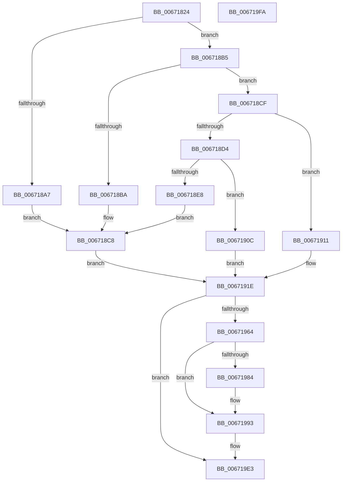

# MiCreatePfnTemplate

- RVA: `0x00671824`–`0x006719FB` (길이 `471` bytes)
- VA: `0x0000000140671824`
- 실행 섹션: `.text`
- PDB 이름 있음: `예`; PDB Function 태그: `아니요`
- unwind 정보 RVA: `0x0008DF5C`
- 디코드: `126`개 명령, `471/471` bytes 표시
- 미해석 바이트: `0` (있으면 어셈블리에 `.byte`로 보존)

> 이 문서는 커널 이미지의 기계어와 PDB 기호를 분석해 생성했습니다. 4번과 5번은 함수 원형과 자료형을 바이너리 사용 방식에서 추정한 C 해석이며 원본 소스 복구 결과는 아닙니다.

## 1. Dependencies

- 직접 호출 지점: **6**; 고유 호출 대상: **6**
- 직접 호출자로 확인된 함수: **4**
- RIP 상대 이미지 참조: **0**

### Outgoing calls
- `0x0067186F` → [MiSetPfnTbFlushStamp](../2B/MiSetPfnTbFlushStamp_function_002B7A70.md) (function, `0x002B7A70`)
- `0x006718AE` → [MiSetPfnIdentity](../2A/MiSetPfnIdentity_function_002A2350.md) (function, `0x002A2350`)
- `0x00671977` → [MiMakeDemandZeroPte](../33/MiMakeDemandZeroPte_function_00337A00.md) (function, `0x00337A00`)
- `0x0067198A` → [MiUpdatePageFileHighInPte](../36/MiUpdatePageFileHighInPte_function_0036D840.md) (function, `0x0036D840`)
- `0x006719A0` → [MiSetPfnContainingFrame](../36/MiSetPfnContainingFrame_function_00363FC0.md) (function, `0x00363FC0`)
- `0x006719B5` → [MiSetPageTablePfnBuddy](../4A/MiSetPageTablePfnBuddy_function_004A3394.md) (function, `0x004A3394`)

### Direct callers
- [MiDoGangAssignment](../4D/MiDoGangAssignment_function_004DE270.md) at `0x004DE3BF`
- [MiInitializeDynamicPfns](MiInitializeDynamicPfns_function_00672BD0.md) at `0x00672D7C`
- [MiSwitchToPfns](../../init/C6/MiSwitchToPfns_function_00C62C90.md) at `0x00C62CD8`
- [MiSwitchToPfns](../../init/C6/MiSwitchToPfns_function_00C62C90.md) at `0x00C62CE9`
- [MxInsertFreePages](../../init/C6/MxInsertFreePages_function_00C63AD0.md) at `0x00C63BE5`

### Static image references
- 디코드된 RIP-relative 메모리 참조가 없습니다.

## 2. Other-region calls and transfers

- 다른 실행 섹션으로 향하는 call: **0**
- 별도 외부 분기/꼬리 이동을 확인하지 못했습니다.

## 3. Assembly (complete function range)

```asm
00671824  48 89 5C 24 08                  mov qword ptr [rsp + 8], rbx
00671829  48 89 6C 24 10                  mov qword ptr [rsp + 0x10], rbp
0067182E  56                              push rsi
0067182F  57                              push rdi
00671830  41 54                           push r12
00671832  41 56                           push r14
00671834  41 57                           push r15
00671836  48 83 EC 20                     sub rsp, 0x20
0067183A  0F 57 C0                        xorps xmm0, xmm0
0067183D  41 0F B7 E8                     movzx ebp, r8w
00671841  0F 11 01                        movups xmmword ptr [rcx], xmm0
00671844  8B FA                           mov edi, edx
00671846  45 33 C0                        xor r8d, r8d
00671849  0F 11 41 10                     movups xmmword ptr [rcx + 0x10], xmm0
0067184D  33 D2                           xor edx, edx
0067184F  48 8B D9                        mov rbx, rcx
00671852  0F 11 41 20                     movups xmmword ptr [rcx + 0x20], xmm0
00671856  8B 41 20                        mov eax, dword ptr [rcx + 0x20]
00671859  89 44 24 60                     mov dword ptr [rsp + 0x60], eax
0067185D  C1 E8 10                        shr eax, 0x10
00671860  24 3F                           and al, 0x3f
00671862  0C 40                           or al, 0x40
00671864  88 44 24 62                     mov byte ptr [rsp + 0x62], al
00671868  8B 44 24 60                     mov eax, dword ptr [rsp + 0x60]
0067186C  89 41 20                        mov dword ptr [rcx + 0x20], eax
0067186F  E8 FC 61 C4 FF                  call 0x1402b7a70
00671874  48 8B 43 28                     mov rax, qword ptr [rbx + 0x28]
00671878  48 B9 00 00 00 00 00 00 40 00   movabs rcx, 0x40000000000000
00671882  48 0B C1                        or rax, rcx
00671885  41 BE 01 00 00 00               mov r14d, 1
0067188B  8B F7                           mov esi, edi
0067188D  48 89 43 28                     mov qword ptr [rbx + 0x28], rax
00671891  49 BC 01 00 00 00 00 00 00 C0   movabs r12, 0xc000000000000001
0067189B  45 8D 7E 01                     lea r15d, [r14 + 1]
0067189F  81 E6 00 01 00 00               and esi, 0x100
006718A5  74 0E                           je 0x1406718b5
006718A7  41 8D 56 02                     lea edx, [r14 + 2]
006718AB  48 8B CB                        mov rcx, rbx
006718AE  E8 9D 0A C3 FF                  call 0x1402a2350
006718B3  EB 13                           jmp 0x1406718c8
006718B5  40 84 FF                        test dil, dil
006718B8  79 15                           jns 0x1406718cf
006718BA  48 B8 00 00 00 00 80 F6 FF FF   movabs rax, 0xfffff68000000000
006718C4  48 89 43 08                     mov qword ptr [rbx + 8], rax
006718C8  B9 06 00 00 00                  mov ecx, 6
006718CD  EB 4F                           jmp 0x14067191e
006718CF  41 84 FF                        test r15b, dil
006718D2  74 3D                           je 0x140671911
006718D4  48 B8 00 00 00 00 00 00 20 00   movabs rax, 0x20000000000000
006718DE  48 09 43 28                     or qword ptr [rbx + 0x28], rax
006718E2  40 F6 C7 04                     test dil, 4
006718E6  74 24                           je 0x14067190c
006718E8  8B 43 20                        mov eax, dword ptr [rbx + 0x20]
006718EB  89 44 24 60                     mov dword ptr [rsp + 0x60], eax
006718EF  66 44 89 74 24 60               mov word ptr [rsp + 0x60], r14w
006718F5  8B 44 24 60                     mov eax, dword ptr [rsp + 0x60]
006718F9  89 43 20                        mov dword ptr [rbx + 0x20], eax
006718FC  48 8B 43 18                     mov rax, qword ptr [rbx + 0x18]
00671900  49 23 C4                        and rax, r12
00671903  49 0B C6                        or rax, r14
00671906  48 89 43 18                     mov qword ptr [rbx + 0x18], rax
0067190A  EB BC                           jmp 0x1406718c8
0067190C  41 8B CF                        mov ecx, r15d
0067190F  EB 0D                           jmp 0x14067191e
00671911  40 0F B6 CF                     movzx ecx, dil
00671915  41 23 CE                        and ecx, r14d
00671918  C1 E1 02                        shl ecx, 2
0067191B  41 0B CE                        or ecx, r14d
0067191E  8B 43 20                        mov eax, dword ptr [rbx + 0x20]
00671921  48 8B D5                        mov rdx, rbp
00671924  89 44 24 60                     mov dword ptr [rsp + 0x60], eax
00671928  C1 E8 10                        shr eax, 0x10
0067192B  24 F8                           and al, 0xf8
0067192D  48 C1 E2 2B                     shl rdx, 0x2b
00671931  0A C1                           or al, cl
00671933  48 8B CA                        mov rcx, rdx
00671936  88 44 24 62                     mov byte ptr [rsp + 0x62], al
0067193A  8B 44 24 60                     mov eax, dword ptr [rsp + 0x60]
0067193E  89 43 20                        mov dword ptr [rbx + 0x20], eax
00671941  48 8B 43 28                     mov rax, qword ptr [rbx + 0x28]
00671945  48 33 C8                        xor rcx, rax
00671948  48 B8 FF FF FF FF FF 07 E0 FF   movabs rax, 0xffe007ffffffffff
00671952  48 23 C8                        and rcx, rax
00671955  48 33 CA                        xor rcx, rdx
00671958  48 89 4B 28                     mov qword ptr [rbx + 0x28], rcx
0067195C  F7 C7 80 01 00 00               test edi, 0x180
00671962  74 7F                           je 0x1406719e3
00671964  48 8B 43 18                     mov rax, qword ptr [rbx + 0x18]
00671968  B9 04 00 00 00                  mov ecx, 4
0067196D  49 23 C4                        and rax, r12
00671970  49 0B C6                        or rax, r14
00671973  48 89 43 18                     mov qword ptr [rbx + 0x18], rax
00671977  E8 84 60 CC FF                  call 0x140337a00
0067197C  48 89 43 10                     mov qword ptr [rbx + 0x10], rax
00671980  85 F6                           test esi, esi
00671982  74 0F                           je 0x140671993
00671984  49 8B D6                        mov rdx, r14
00671987  48 8B C8                        mov rcx, rax
0067198A  E8 B1 BE CF FF                  call 0x14036d840
0067198F  48 89 43 10                     mov qword ptr [rbx + 0x10], rax
00671993  48 BA FE FF FF FF 3F 00 00 00   movabs rdx, 0x3ffffffffe
0067199D  48 8B CB                        mov rcx, rbx
006719A0  E8 1B 26 CF FF                  call 0x140363fc0
006719A5  45 8B C6                        mov r8d, r14d
006719A8  48 BA 01 00 00 00 00 01 00 00   movabs rdx, 0x10000000001
006719B2  48 8B CB                        mov rcx, rbx
006719B5  E8 DA 19 E3 FF                  call 0x1404a3394
006719BA  8B 43 20                        mov eax, dword ptr [rbx + 0x20]
006719BD  48 B9 00 00 00 00 00 00 00 40   movabs rcx, 0x4000000000000000
006719C7  89 44 24 60                     mov dword ptr [rsp + 0x60], eax
006719CB  66 44 89 7C 24 60               mov word ptr [rsp + 0x60], r15w
006719D1  8B 44 24 60                     mov eax, dword ptr [rsp + 0x60]
006719D5  89 43 20                        mov dword ptr [rbx + 0x20], eax
006719D8  48 8B 43 18                     mov rax, qword ptr [rbx + 0x18]
006719DC  48 0B C1                        or rax, rcx
006719DF  48 89 43 18                     mov qword ptr [rbx + 0x18], rax
006719E3  48 8B 5C 24 50                  mov rbx, qword ptr [rsp + 0x50]
006719E8  48 8B 6C 24 58                  mov rbp, qword ptr [rsp + 0x58]
006719ED  48 83 C4 20                     add rsp, 0x20
006719F1  41 5F                           pop r15
006719F3  41 5E                           pop r14
006719F5  41 5C                           pop r12
006719F7  5F                              pop rdi
006719F8  5E                              pop rsi
006719F9  C3                              ret
006719FA  CC                              int3
```

## 4. C-style interpretation (structured pseudocode)

```c
__int64 __fastcall MiCreatePfnTemplate(__int64 a1, int a2, int a3)
{
    __int64 result;
    __int64 v_rsi;
    __int64 v_rsp;
    unsigned __int64 v_stack_p10;
    unsigned int v_stack_p18;
    unsigned __int8 v_stack_p1A;
    unsigned __int64 v_stack_p8;

    v_stack_p8 = v_rbx;
    v_stack_p10 = v_rbp;
    v_rsp = (v_rsp) - (32);
    *(unsigned __int64 *)(a1) = v_xmm0;
    a3 = 0;
    *(unsigned __int64 *)(a1 + 16) = v_xmm0;
    a2 = 0;
    *(unsigned __int64 *)(a1 + 32) = v_xmm0;
    v_stack_p18 = (unsigned int)((unsigned int)(*(unsigned int *)(a1 + 32)));
    result = (unsigned int)(((unsigned int)(*(unsigned int *)(a1 + 32))) >> (16));
    result = (unsigned __int8)((result) & (63));
    result = (unsigned __int8)((result) | (64));
    v_stack_p1A = (unsigned __int8)(result);
    *(unsigned int *)(a1 + 32) = (unsigned int)((unsigned int)(v_stack_p18));
    result = MiSetPfnTbFlushStamp(a1, a2, a3, a4);
    result = (*(unsigned __int64 *)(a1 + 40)) | (a1);
    *(unsigned __int64 *)(a1 + 40) = result;
    v_rsi = (unsigned int)(((unsigned int)((unsigned int)((unsigned int)(a2)))) & (256));
    if (condition_is_equal) goto loc_006718B5;
    result = MiSetPfnIdentity(a1, 1 + 2, a3, a4);
    goto loc_006718C8;
loc_006718B5:
    if (!sign_flag) goto loc_006718CF;
    *(unsigned __int64 *)(a1 + 8) = result;
loc_006718C8:
    goto loc_0067191E;
loc_006718CF:
    if ((((unsigned __int8)(1 + 1)) & ((unsigned __int8)((unsigned int)(a2)))) == 0) goto loc_00671911;
    if ((((unsigned __int8)((unsigned int)(a2))) & (4)) == 0) goto loc_0067190C;
    v_stack_p18 = (unsigned int)((unsigned int)(*(unsigned int *)(a1 + 32)));
    v_stack_p18 = 1;
    *(unsigned int *)(a1 + 32) = (unsigned int)((unsigned int)(v_stack_p18));
    result = (*(unsigned __int64 *)(a1 + 24)) & (v_r12);
    result = (result) | (1);
    *(unsigned __int64 *)(a1 + 24) = result;
    goto loc_006718C8;
loc_0067190C:
    goto loc_0067191E;
loc_00671911:
    a1 = (unsigned int)(((unsigned __int8)((unsigned int)(a2))) & (1));
    a1 = (unsigned int)((a1) << (2));
    a1 = (unsigned int)((a1) | (1));
loc_0067191E:
    v_stack_p18 = (unsigned int)((unsigned int)(*(unsigned int *)(a1 + 32)));
    result = (unsigned int)(((unsigned int)(*(unsigned int *)(a1 + 32))) >> (16));
    result = (unsigned __int8)((result) & (248));
    a2 = ((unsigned __int16)(a3)) << (43);
    result = (unsigned __int8)((result) | ((unsigned __int8)(a1)));
    v_stack_p1A = (unsigned __int8)(result);
    *(unsigned int *)(a1 + 32) = (unsigned int)((unsigned int)(v_stack_p18));
    a1 = (a2) ^ (*(unsigned __int64 *)(a1 + 40));
    a1 = (a1) & (*(unsigned __int64 *)(a1 + 40));
    a1 = (a1) ^ (a2);
    *(unsigned __int64 *)(a1 + 40) = a1;
    if ((((unsigned int)((unsigned int)(a2))) & (384)) == 0) goto loc_006719E3;
    result = (*(unsigned __int64 *)(a1 + 24)) & (v_r12);
    result = (result) | (1);
    *(unsigned __int64 *)(a1 + 24) = result;
    result = MiMakeDemandZeroPte(4, a2, a3, a4);
    *(unsigned __int64 *)(a1 + 16) = result;
    if ((unsigned int)(v_rsi) != 0) {
        a2 = 1;
        a1 = result;
        result = MiUpdatePageFileHighInPte(a1, a2, a3, a4);
        *(unsigned __int64 *)(a1 + 16) = result;
    }
    result = MiSetPfnContainingFrame(a1, a2, a3, a4);
    result = MiSetPageTablePfnBuddy(a1, a2, 1, a4);
    v_stack_p18 = (unsigned int)((unsigned int)(*(unsigned int *)(a1 + 32)));
    v_stack_p18 = (unsigned __int16)(1 + 1);
    *(unsigned int *)(a1 + 32) = (unsigned int)((unsigned int)(v_stack_p18));
    result = (*(unsigned __int64 *)(a1 + 24)) | (a1);
    *(unsigned __int64 *)(a1 + 24) = result;
loc_006719E3:
    v_rsp = (v_rsp) + (32);
    return result;
}
```

## 5. (Beta) C Style

```c
int64_t MiCreatePfnTemplate(void *Arg1, int32_t Arg2, int32_t Arg3)
{
    uint8_t *arg1 = (uint8_t *)Arg1;

    int64_t result;
    int64_t local_rsi;
    int64_t local_rsp;
    uint64_t v_stack_p10;
    uint32_t v_stack_p18;
    uint8_t v_stack_p1A;
    uint64_t v_stack_p8;

    v_stack_p8 = local_rbx;
    v_stack_p10 = local_rbp;
    local_rsp = (local_rsp) - (32);
    *(uint64_t *)(arg1) = v_xmm0;
    Arg3 = 0;
    *(uint64_t *)(arg1 + 0x10) = v_xmm0;
    Arg2 = 0;
    *(uint64_t *)(arg1 + 0x20) = v_xmm0;
    v_stack_p18 = (uint32_t)((uint32_t)(*(uint32_t *)(arg1 + 0x20)));
    result = (uint32_t)(((uint32_t)(*(uint32_t *)(arg1 + 0x20))) >> (16));
    result = (uint8_t)((result) & (63));
    result = (uint8_t)((result) | (64));
    v_stack_p1A = (uint8_t)(result);
    *(uint32_t *)(arg1 + 0x20) = (uint32_t)((uint32_t)(v_stack_p18));
    result = MiSetPfnTbFlushStamp(Arg1, Arg2, Arg3, a4);
    result = (*(uint64_t *)(arg1 + 0x28)) | (Arg1);
    *(uint64_t *)(arg1 + 0x28) = result;
    local_rsi = (uint32_t)(((uint32_t)((uint32_t)((uint32_t)(Arg2)))) & (256));
    if (condition_is_equal) goto loc_006718B5;
    result = MiSetPfnIdentity(Arg1, 1 + 2, Arg3, a4);
    goto loc_006718C8;
loc_006718B5:
    if (!sign_flag) goto loc_006718CF;
    *(uint64_t *)(arg1 + 0x8) = result;
loc_006718C8:
    goto loc_0067191E;
loc_006718CF:
    if ((((uint8_t)(1 + 1)) & ((uint8_t)((uint32_t)(Arg2)))) == 0) goto loc_00671911;
    if ((((uint8_t)((uint32_t)(Arg2))) & (4)) == 0) goto loc_0067190C;
    v_stack_p18 = (uint32_t)((uint32_t)(*(uint32_t *)(arg1 + 0x20)));
    v_stack_p18 = 1;
    *(uint32_t *)(arg1 + 0x20) = (uint32_t)((uint32_t)(v_stack_p18));
    result = (*(uint64_t *)(arg1 + 0x18)) & (local_r12);
    result = (result) | (1);
    *(uint64_t *)(arg1 + 0x18) = result;
    goto loc_006718C8;
loc_0067190C:
    goto loc_0067191E;
loc_00671911:
    Arg1 = (uint32_t)(((uint8_t)((uint32_t)(Arg2))) & (1));
    Arg1 = (uint32_t)((Arg1) << (2));
    Arg1 = (uint32_t)((Arg1) | (1));
loc_0067191E:
    v_stack_p18 = (uint32_t)((uint32_t)(*(uint32_t *)(arg1 + 0x20)));
    result = (uint32_t)(((uint32_t)(*(uint32_t *)(arg1 + 0x20))) >> (16));
    result = (uint8_t)((result) & (248));
    Arg2 = ((uint16_t)(Arg3)) << (43);
    result = (uint8_t)((result) | ((uint8_t)(Arg1)));
    v_stack_p1A = (uint8_t)(result);
    *(uint32_t *)(arg1 + 0x20) = (uint32_t)((uint32_t)(v_stack_p18));
    Arg1 = (Arg2) ^ (*(uint64_t *)(arg1 + 0x28));
    Arg1 = (Arg1) & (*(uint64_t *)(arg1 + 0x28));
    Arg1 = (Arg1) ^ (Arg2);
    *(void **)(arg1 + 0x28) = Arg1;
    if ((((uint32_t)((uint32_t)(Arg2))) & (384)) == 0) goto loc_006719E3;
    result = (*(uint64_t *)(arg1 + 0x18)) & (local_r12);
    result = (result) | (1);
    *(uint64_t *)(arg1 + 0x18) = result;
    result = MiMakeDemandZeroPte(4, Arg2, Arg3, a4);
    *(uint64_t *)(arg1 + 0x10) = result;
    if ((uint32_t)(local_rsi) != 0) {
        Arg2 = 1;
        Arg1 = result;
        result = MiUpdatePageFileHighInPte(Arg1, Arg2, Arg3, a4);
        *(uint64_t *)(arg1 + 0x10) = result;
    }
    result = MiSetPfnContainingFrame(Arg1, Arg2, Arg3, a4);
    result = MiSetPageTablePfnBuddy(Arg1, Arg2, 1, a4);
    v_stack_p18 = (uint32_t)((uint32_t)(*(uint32_t *)(arg1 + 0x20)));
    v_stack_p18 = (uint16_t)(1 + 1);
    *(uint32_t *)(arg1 + 0x20) = (uint32_t)((uint32_t)(v_stack_p18));
    result = (*(uint64_t *)(arg1 + 0x18)) | (Arg1);
    *(uint64_t *)(arg1 + 0x18) = result;
loc_006719E3:
    local_rsp = (local_rsp) + (32);
    return result;
}
```

### 관측된 메모리 오프셋

구조체 형식이 확인되지 않은 접근은 인자 기준의 오프셋으로만 기록했습니다.

| 기준 인자 | 오프셋 표현 | 폭 (bit) | 접근 |
|---|---:|---:|---|
| `Arg1` | `+ 0x0` | `128` | `R` |
| `Arg1` | `+ 0x8` | `64` | `W` |
| `Arg1` | `+ 0x10` | `64` | `W` |
| `Arg1` | `+ 0x10` | `128` | `R` |
| `Arg1` | `+ 0x18` | `64` | `R` |
| `Arg1` | `+ 0x18` | `64` | `W` |
| `Arg1` | `+ 0x20` | `32` | `R` |
| `Arg1` | `+ 0x20` | `32` | `W` |
| `Arg1` | `+ 0x20` | `128` | `R` |
| `Arg1` | `+ 0x28` | `64` | `R` |
| `Arg1` | `+ 0x28` | `64` | `R/W` |
| `Arg1` | `+ 0x28` | `64` | `W` |

## 6. Execution-region graph

[열기: 2D/3D 그래프와 함수 탐색 컨트롤 패널](../../../control-panel.html?section=text&rva=0x00671824&view=graph)

- 2D 그래프는 위에서 아래로 흐르고, 3D 그래프는 빈 공간을 드래그해 회전합니다. Shift+드래그는 이동, 휠은 확대·축소, 함수 노드 선택은 대상 보고서 이동입니다.

### Static fallback


