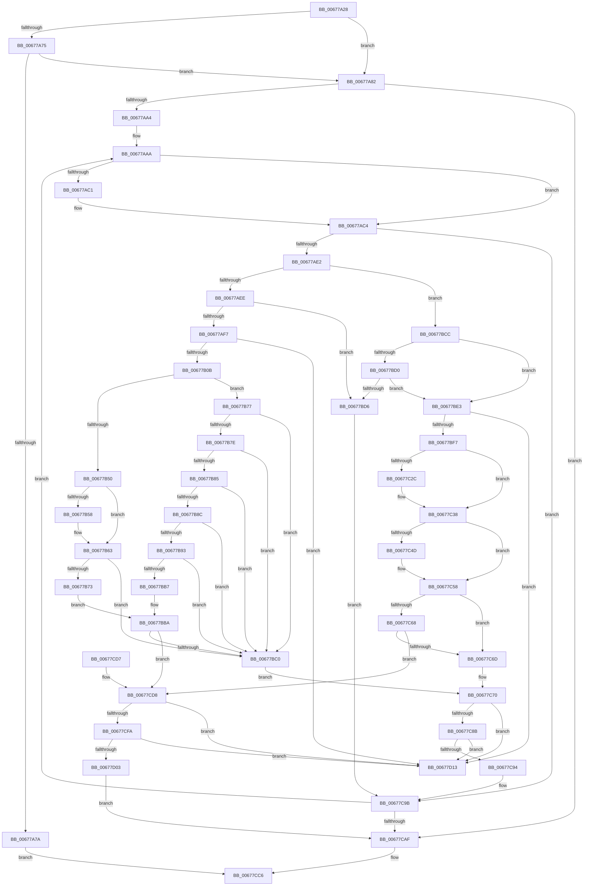

# MiDeleteCachedEntries

- RVA: `0x00677A28`–`0x00677D1A` (길이 `754` bytes)
- VA: `0x0000000140677A28`
- 실행 섹션: `.text`
- PDB 이름 있음: `예`; PDB Function 태그: `아니요`
- unwind 정보 RVA: `0x000D7C98`
- 디코드: `211`개 명령, `754/754` bytes 표시
- 미해석 바이트: `0` (있으면 어셈블리에 `.byte`로 보존)

> 이 문서는 커널 이미지의 기계어와 PDB 기호를 분석해 생성했습니다. 4번과 5번은 함수 원형과 자료형을 바이너리 사용 방식에서 추정한 C 해석이며 원본 소스 복구 결과는 아닙니다.

## 1. Dependencies

- 직접 호출 지점: **19**; 고유 호출 대상: **11**
- 직접 호출자로 확인된 함수: **2**
- RIP 상대 이미지 참조: **1**

### Outgoing calls
- `0x00677A6A` → [MiDeleteMoreUnusedSegments](MiDeleteMoreUnusedSegments_function_00677DDC.md) (function, `0x00677DDC`)
- `0x00677A90` → [ExAcquireSpinLockExclusive](../24/ExAcquireSpinLockExclusive_function_00248690.md) (function, `0x00248690`)
- `0x00677AD5` → [ExTryAcquireSpinLockExclusiveAtDpcLevel](../2B/ExTryAcquireSpinLockExclusiveAtDpcLevel_function_002BB800.md) (function, `0x002BB800`)
- `0x00677B25` → [MiUnlinkUnusedSubsection](../24/MiUnlinkUnusedSubsection_function_002496F4.md) (function, `0x002496F4`)
- `0x00677B31` → [ExReleaseSpinLockExclusiveFromDpcLevel](../24/ExReleaseSpinLockExclusiveFromDpcLevel_function_002497E0.md) (function, `0x002497E0`)
- `0x00677B47` → [MiDeleteCachedSubsection](../29/MiDeleteCachedSubsection_function_00297888.md) (function, `0x00297888`)
- `0x00677B5E` → [MiWakeCommitRequest](../48/MiWakeCommitRequest_function_00481C58.md) (function, `0x00481C58`)
- `0x00677B6A` → [MiDeleteMoreUnusedSegments](MiDeleteMoreUnusedSegments_function_00677DDC.md) (function, `0x00677DDC`)
- `0x00677BA2` → [KeDelayExecutionThread](../20/KeDelayExecutionThread_function_00209550.md) (function, `0x00209550`)
- `0x00677BAE` → [MiDeleteMoreUnusedSegments](MiDeleteMoreUnusedSegments_function_00677DDC.md) (function, `0x00677DDC`)
- `0x00677BD9` → [ExReleaseSpinLockExclusiveFromDpcLevel](../24/ExReleaseSpinLockExclusiveFromDpcLevel_function_002497E0.md) (function, `0x002497E0`)
- `0x00677C11` → [MiUnlinkUnusedControlArea](../4E/MiUnlinkUnusedControlArea_function_004ED9F8.md) (function, `0x004ED9F8`)
- `0x00677C20` → [ExReleaseSpinLockExclusiveFromDpcLevel](../24/ExReleaseSpinLockExclusiveFromDpcLevel_function_002497E0.md) (function, `0x002497E0`)
- `0x00677C3E` → [MiDestroySection](../46/MiDestroySection_function_00462FDC.md) (function, `0x00462FDC`)
- `0x00677C53` → [MiWakeCommitRequest](../48/MiWakeCommitRequest_function_00481C58.md) (function, `0x00481C58`)
- `0x00677C5F` → [MiDeleteMoreUnusedSegments](MiDeleteMoreUnusedSegments_function_00677DDC.md) (function, `0x00677DDC`)
- `0x00677C70` → [ExAcquireSpinLockExclusive](../24/ExAcquireSpinLockExclusive_function_00248690.md) (function, `0x00248690`)
- `0x00677CB9` → [MiReleaseSpinLockExclusive](../24/MiReleaseSpinLockExclusive_function_002482C0.md) (function, `0x002482C0`)
- `0x00677CE3` → [ExAcquireSpinLockExclusive](../24/ExAcquireSpinLockExclusive_function_00248690.md) (function, `0x00248690`)

### Direct callers
- [MiSegmentDereferenceWorker](../46/MiSegmentDereferenceWorker_function_00464D40.md) at `0x00464DF6`
- [MiSegmentDereferenceWorker](../46/MiSegmentDereferenceWorker_function_00464D40.md) at `0x00464E19`
- [MiRemoveUnusedSegments](../4E/MiRemoveUnusedSegments_function_004ED99C.md) at `0x004ED9B4`

### Static image references
- `0x00677B97` → RVA `0x00010780` (`.rdata`; read)

## 2. Other-region calls and transfers

- 다른 실행 섹션으로 향하는 call: **0**
- 별도 외부 분기/꼬리 이동을 확인하지 못했습니다.

## 3. Assembly (complete function range)

```asm
00677A28  48 89 54 24 10                  mov qword ptr [rsp + 0x10], rdx
00677A2D  55                              push rbp
00677A2E  53                              push rbx
00677A2F  56                              push rsi
00677A30  57                              push rdi
00677A31  41 54                           push r12
00677A33  41 55                           push r13
00677A35  41 56                           push r14
00677A37  41 57                           push r15
00677A39  48 8B EC                        mov rbp, rsp
00677A3C  48 83 EC 48                     sub rsp, 0x48
00677A40  44 8B 62 38                     mov r12d, dword ptr [rdx + 0x38]
00677A44  33 C0                           xor eax, eax
00677A46  48 89 45 E8                     mov qword ptr [rbp - 0x18], rax
00677A4A  0F 57 C0                        xorps xmm0, xmm0
00677A4D  48 8B 81 30 08 00 00            mov rax, qword ptr [rcx + 0x830]
00677A54  48 8B F9                        mov rdi, rcx
00677A57  48 83 C0 08                     add rax, 8
00677A5B  44 89 65 58                     mov dword ptr [rbp + 0x58], r12d
00677A5F  48 8B D0                        mov rdx, rax
00677A62  48 89 45 60                     mov qword ptr [rbp + 0x60], rax
00677A66  0F 11 45 D8                     movups xmmword ptr [rbp - 0x28], xmm0
00677A6A  E8 6D 03 00 00                  call 0x140677ddc
00677A6F  33 DB                           xor ebx, ebx
00677A71  85 C0                           test eax, eax
00677A73  75 0D                           jne 0x140677a82
00677A75  45 85 E4                        test r12d, r12d
00677A78  74 08                           je 0x140677a82
00677A7A  8D 43 01                        lea eax, [rbx + 1]
00677A7D  E9 44 02 00 00                  jmp 0x140677cc6
00677A82  48 8D 8F C0 06 00 00            lea rcx, [rdi + 0x6c0]
00677A89  48 8D B7 40 08 00 00            lea rsi, [rdi + 0x840]
00677A90  E8 FB 0B BD FF                  call 0x140248690
00677A95  4C 8B 3E                        mov r15, qword ptr [rsi]
00677A98  88 45 48                        mov byte ptr [rbp + 0x48], al
00677A9B  4C 3B FE                        cmp r15, rsi
00677A9E  0F 84 0B 02 00 00               je 0x140677caf
00677AA4  41 BE 01 00 00 00               mov r14d, 1
00677AAA  49 8B 0F                        mov rcx, qword ptr [r15]
00677AAD  49 8D 77 F8                     lea rsi, [r15 - 8]
00677AB1  48 89 4D E8                     mov qword ptr [rbp - 0x18], rcx
00677AB5  49 8D 47 A8                     lea rax, [r15 - 0x58]
00677AB9  48 8B 0E                        mov rcx, qword ptr [rsi]
00677ABC  48 85 C9                        test rcx, rcx
00677ABF  78 03                           js 0x140677ac4
00677AC1  48 8B 30                        mov rsi, qword ptr [rax]
00677AC4  48 85 C9                        test rcx, rcx
00677AC7  4C 8D 6E 48                     lea r13, [rsi + 0x48]
00677ACB  4C 8B E3                        mov r12, rbx
00677ACE  49 8B CD                        mov rcx, r13
00677AD1  4C 0F 49 E0                     cmovns r12, rax
00677AD5  E8 26 3D C4 FF                  call 0x1402bb800
00677ADA  85 C0                           test eax, eax
00677ADC  0F 84 B9 01 00 00               je 0x140677c9b
00677AE2  8B 46 38                        mov eax, dword ptr [rsi + 0x38]
00677AE5  4D 85 E4                        test r12, r12
00677AE8  0F 84 DE 00 00 00               je 0x140677bcc
00677AEE  41 84 C6                        test r14b, al
00677AF1  0F 85 DF 00 00 00               jne 0x140677bd6
00677AF7  4C 8D AF B8 07 00 00            lea r13, [rdi + 0x7b8]
00677AFE  49 8B 45 08                     mov rax, qword ptr [r13 + 8]
00677B02  4C 39 28                        cmp qword ptr [rax], r13
00677B05  0F 85 08 02 00 00               jne 0x140677d13
00677B0B  48 89 45 E0                     mov qword ptr [rbp - 0x20], rax
00677B0F  48 8D 4D D8                     lea rcx, [rbp - 0x28]
00677B13  4C 89 6D D8                     mov qword ptr [rbp - 0x28], r13
00677B17  48 89 08                        mov qword ptr [rax], rcx
00677B1A  48 8D 45 D8                     lea rax, [rbp - 0x28]
00677B1E  49 8B CC                        mov rcx, r12
00677B21  49 89 45 08                     mov qword ptr [r13 + 8], rax
00677B25  E8 CA 1B BD FF                  call 0x1402496f4
00677B2A  48 8D 8F C0 06 00 00            lea rcx, [rdi + 0x6c0]
00677B31  E8 AA 1C BD FF                  call 0x1402497e0
00677B36  4C 8B 6D 50                     mov r13, qword ptr [rbp + 0x50]
00677B3A  4C 8D 4D D8                     lea r9, [rbp - 0x28]
00677B3E  8A 55 48                        mov dl, byte ptr [rbp + 0x48]
00677B41  4D 8B C5                        mov r8, r13
00677B44  49 8B CC                        mov rcx, r12
00677B47  E8 3C FD C1 FF                  call 0x140297888
00677B4C  85 C0                           test eax, eax
00677B4E  78 27                           js 0x140677b77
00677B50  8B 75 58                        mov esi, dword ptr [rbp + 0x58]
00677B53  83 FE 02                        cmp esi, 2
00677B56  75 0B                           jne 0x140677b63
00677B58  41 8B D6                        mov edx, r14d
00677B5B  48 8B CF                        mov rcx, rdi
00677B5E  E8 F5 A0 E0 FF                  call 0x140481c58
00677B63  48 8B 55 60                     mov rdx, qword ptr [rbp + 0x60]
00677B67  48 8B CF                        mov rcx, rdi
00677B6A  E8 6D 02 00 00                  call 0x140677ddc
00677B6F  85 C0                           test eax, eax
00677B71  75 4D                           jne 0x140677bc0
00677B73  85 F6                           test esi, esi
00677B75  EB 43                           jmp 0x140677bba
00677B77  3D 20 00 00 C0                  cmp eax, 0xc0000020
00677B7C  74 42                           je 0x140677bc0
00677B7E  3D 43 02 00 C0                  cmp eax, 0xc0000243
00677B83  74 3B                           je 0x140677bc0
00677B85  3D 88 00 00 C0                  cmp eax, 0xc0000088
00677B8A  74 34                           je 0x140677bc0
00677B8C  3D 89 01 00 C0                  cmp eax, 0xc0000189
00677B91  74 2D                           je 0x140677bc0
00677B93  45 01 75 3C                     add dword ptr [r13 + 0x3c], r14d
00677B97  4C 8D 05 E2 8B 99 FF            lea r8, [rip - 0x66741e]
00677B9E  33 D2                           xor edx, edx
00677BA0  33 C9                           xor ecx, ecx
00677BA2  E8 A9 19 B9 FF                  call 0x140209550
00677BA7  48 8B 55 60                     mov rdx, qword ptr [rbp + 0x60]
00677BAB  48 8B CF                        mov rcx, rdi
00677BAE  E8 29 02 00 00                  call 0x140677ddc
00677BB3  85 C0                           test eax, eax
00677BB5  75 09                           jne 0x140677bc0
00677BB7  39 5D 58                        cmp dword ptr [rbp + 0x58], ebx
00677BBA  0F 85 18 01 00 00               jne 0x140677cd8
00677BC0  48 8D 8F C0 06 00 00            lea rcx, [rdi + 0x6c0]
00677BC7  E9 A4 00 00 00                  jmp 0x140677c70
00677BCC  A8 20                           test al, 0x20
00677BCE  75 13                           jne 0x140677be3
00677BD0  48 39 5E 20                     cmp qword ptr [rsi + 0x20], rbx
00677BD4  74 0D                           je 0x140677be3
00677BD6  49 8B CD                        mov rcx, r13
00677BD9  E8 02 1C BD FF                  call 0x1402497e0
00677BDE  E9 B8 00 00 00                  jmp 0x140677c9b
00677BE3  4C 8D AF B8 07 00 00            lea r13, [rdi + 0x7b8]
00677BEA  49 8B 45 08                     mov rax, qword ptr [r13 + 8]
00677BEE  4C 39 28                        cmp qword ptr [rax], r13
00677BF1  0F 85 1C 01 00 00               jne 0x140677d13
00677BF7  48 89 45 E0                     mov qword ptr [rbp - 0x20], rax
00677BFB  48 8D 4D D8                     lea rcx, [rbp - 0x28]
00677BFF  4C 89 6D D8                     mov qword ptr [rbp - 0x28], r13
00677C03  48 89 08                        mov qword ptr [rax], rcx
00677C06  48 8D 45 D8                     lea rax, [rbp - 0x28]
00677C0A  48 8B CE                        mov rcx, rsi
00677C0D  49 89 45 08                     mov qword ptr [r13 + 8], rax
00677C11  E8 E2 5D E7 FF                  call 0x1404ed9f8
00677C16  4C 8D AF C0 06 00 00            lea r13, [rdi + 0x6c0]
00677C1D  49 8B CD                        mov rcx, r13
00677C20  E8 BB 1B BD FF                  call 0x1402497e0
00677C25  8B 46 38                        mov eax, dword ptr [rsi + 0x38]
00677C28  A8 20                           test al, 0x20
00677C2A  74 0C                           je 0x140677c38
00677C2C  48 8B 4D 50                     mov rcx, qword ptr [rbp + 0x50]
00677C30  48 8B 46 20                     mov rax, qword ptr [rsi + 0x20]
00677C34  48 01 41 50                     add qword ptr [rcx + 0x50], rax
00677C38  8A 55 48                        mov dl, byte ptr [rbp + 0x48]
00677C3B  48 8B CE                        mov rcx, rsi
00677C3E  E8 99 B3 DE FF                  call 0x140462fdc
00677C43  44 8B 65 58                     mov r12d, dword ptr [rbp + 0x58]
00677C47  41 83 FC 02                     cmp r12d, 2
00677C4B  75 0B                           jne 0x140677c58
00677C4D  41 8B D6                        mov edx, r14d
00677C50  48 8B CF                        mov rcx, rdi
00677C53  E8 00 A0 E0 FF                  call 0x140481c58
00677C58  48 8B 55 60                     mov rdx, qword ptr [rbp + 0x60]
00677C5C  48 8B CF                        mov rcx, rdi
00677C5F  E8 78 01 00 00                  call 0x140677ddc
00677C64  85 C0                           test eax, eax
00677C66  75 05                           jne 0x140677c6d
00677C68  45 85 E4                        test r12d, r12d
00677C6B  75 6B                           jne 0x140677cd8
00677C6D  49 8B CD                        mov rcx, r13
00677C70  E8 1B 0A BD FF                  call 0x140248690
00677C75  48 8B 4D D8                     mov rcx, qword ptr [rbp - 0x28]
00677C79  48 8D 55 D8                     lea rdx, [rbp - 0x28]
00677C7D  48 8B 45 E0                     mov rax, qword ptr [rbp - 0x20]
00677C81  48 39 51 08                     cmp qword ptr [rcx + 8], rdx
00677C85  0F 85 88 00 00 00               jne 0x140677d13
00677C8B  48 8D 55 D8                     lea rdx, [rbp - 0x28]
00677C8F  48 39 10                        cmp qword ptr [rax], rdx
00677C92  75 7F                           jne 0x140677d13
00677C94  48 89 08                        mov qword ptr [rax], rcx
00677C97  48 89 41 08                     mov qword ptr [rcx + 8], rax
00677C9B  4C 8B 7D E8                     mov r15, qword ptr [rbp - 0x18]
00677C9F  48 8D B7 40 08 00 00            lea rsi, [rdi + 0x840]
00677CA6  4C 3B FE                        cmp r15, rsi
00677CA9  0F 85 FB FD FF FF               jne 0x140677aaa
00677CAF  8A 55 48                        mov dl, byte ptr [rbp + 0x48]
00677CB2  48 8D 8F C0 06 00 00            lea rcx, [rdi + 0x6c0]
00677CB9  E8 02 06 BD FF                  call 0x1402482c0
00677CBE  4C 3B FE                        cmp r15, rsi
00677CC1  0F 95 C3                        setne bl
00677CC4  8B C3                           mov eax, ebx
00677CC6  48 83 C4 48                     add rsp, 0x48
00677CCA  41 5F                           pop r15
00677CCC  41 5E                           pop r14
00677CCE  41 5D                           pop r13
00677CD0  41 5C                           pop r12
00677CD2  5F                              pop rdi
00677CD3  5E                              pop rsi
00677CD4  5B                              pop rbx
00677CD5  5D                              pop rbp
00677CD6  C3                              ret
00677CD7  CC                              int3
00677CD8  B8 C0 06 00 00                  mov eax, 0x6c0
00677CDD  48 8B CF                        mov rcx, rdi
00677CE0  48 03 C8                        add rcx, rax
00677CE3  E8 A8 09 BD FF                  call 0x140248690
00677CE8  48 8B 4D D8                     mov rcx, qword ptr [rbp - 0x28]
00677CEC  48 8D 55 D8                     lea rdx, [rbp - 0x28]
00677CF0  48 8B 45 E0                     mov rax, qword ptr [rbp - 0x20]
00677CF4  48 39 51 08                     cmp qword ptr [rcx + 8], rdx
00677CF8  75 19                           jne 0x140677d13
00677CFA  48 8D 55 D8                     lea rdx, [rbp - 0x28]
00677CFE  48 39 10                        cmp qword ptr [rax], rdx
00677D01  75 10                           jne 0x140677d13
00677D03  48 89 08                        mov qword ptr [rax], rcx
00677D06  48 8D B7 40 08 00 00            lea rsi, [rdi + 0x840]
00677D0D  48 89 41 08                     mov qword ptr [rcx + 8], rax
00677D11  EB 9C                           jmp 0x140677caf
00677D13  B9 03 00 00 00                  mov ecx, 3
00677D18  CD 29                           int 0x29
```

## 4. C-style interpretation (structured pseudocode)

```c
__int64 __fastcall MiDeleteCachedEntries(__int64 a1, __int64 a2)
{
    __int64 result;
    __int64 v_r12;
    __int64 v_rbx;
    __int64 v_rsi;
    __int64 v_rsp;
    unsigned __int64 v_stack_m58;
    unsigned __int64 v_stack_m60;
    unsigned __int64 v_stack_m68;
    unsigned __int64 v_stack_p10;
    unsigned int v_stack_p18;
    unsigned __int64 v_stack_p20;
    unsigned __int8 v_stack_p8;

    v_stack_p10 = a2;
    v_rsp = (v_rsp) - (72);
    result = 0;
    v_stack_m58 = 0;
    result = (*(unsigned __int64 *)(a1 + 2096)) + (8);
    v_stack_p18 = (unsigned int)((unsigned int)(*(unsigned int *)(a2 + 56)));
    v_stack_p20 = result;
    v_stack_m68 = v_xmm0;
    result = MiDeleteMoreUnusedSegments(a1, result, a3, a4);
    v_rbx = 0;
    if ((unsigned int)(result) != 0) goto loc_00677A82;
    if ((unsigned int)((unsigned int)(*(unsigned int *)(a2 + 56))) == 0) goto loc_00677A82;
    goto loc_00677CC6;
loc_00677A82:
    result = ExAcquireSpinLockExclusive(a1 + 1728, result, a3, a4);
    v_stack_p8 = (unsigned __int8)(result);
    if ((*(unsigned __int64 *)(a1 + 2112)) == (a1 + 2112)) goto loc_00677CAF;
loc_00677AAA:
    v_stack_m58 = *(unsigned __int64 *)(*(unsigned __int64 *)(a1 + 2112));
    v_rsi = *(unsigned __int64 *)(a1 + 2112) - 8;
    if (!(sign_flag)) {
        v_rsi = *(unsigned __int64 *)(*(unsigned __int64 *)(a1 + 2112) - 88);
    }
    v_r12 = 0;
    if (!sign_flag) { v_r12 = *(unsigned __int64 *)(a1 + 2112) - 88; }
    result = ExTryAcquireSpinLockExclusiveAtDpcLevel(v_rsi + 72, result, a3, a4);
    if ((unsigned int)(result) == 0) goto loc_00677C9B;
    if (v_r12 == 0) goto loc_00677BCC;
    if (((1) & ((unsigned __int8)((unsigned int)(*(unsigned int *)(v_rsi + 56))))) != 0) goto loc_00677BD6;
    if ((*(unsigned __int64 *)(*(unsigned __int64 *)(a1 + 1976 + 8))) != (a1 + 1976)) goto loc_00677D13;
    v_stack_m60 = *(unsigned __int64 *)(a1 + 1976 + 8);
    v_stack_m68 = a1 + 1976;
    *(unsigned __int64 *)(*(unsigned __int64 *)(a1 + 1976 + 8)) = v_stack_m68;
    *(unsigned __int64 *)(a1 + 1976 + 8) = v_stack_m68;
    result = MiUnlinkUnusedSubsection(v_r12, result, a3, a4);
    result = ExReleaseSpinLockExclusiveFromDpcLevel(a1 + 1728, result, a3, a4);
    result = MiDeleteCachedSubsection(v_r12, v_stack_p8, v_stack_p10, v_stack_m68);
    if (sign_flag) goto loc_00677B77;
    if (((unsigned int)((unsigned int)(v_stack_p18))) == 2) {
        a2 = 1;
        a1 = a1;
        result = MiWakeCommitRequest(a1, a2, v_stack_p10, v_stack_m68);
    }
    result = MiDeleteMoreUnusedSegments(a1, v_stack_p20, v_stack_p10, v_stack_m68);
    if ((unsigned int)(result) != 0) goto loc_00677BC0;
    goto loc_00677BBA;
loc_00677B77:
    if (((unsigned int)(result)) == 0xC0000020ULL) goto loc_00677BC0;
    if (((unsigned int)(result)) == 0xC0000243ULL) goto loc_00677BC0;
    if (((unsigned int)(result)) == 0xC0000088ULL) goto loc_00677BC0;
    if (((unsigned int)(result)) == 0xC0000189ULL) goto loc_00677BC0;
    a2 = 0;
    a1 = 0;
    result = KeDelayExecutionThread(a1, a2, v_rip - 6714398, v_stack_m68);
    result = MiDeleteMoreUnusedSegments(0, v_stack_p20, v_rip - 6714398, v_stack_m68);
    if ((unsigned int)(result) != 0) goto loc_00677BC0;
loc_00677BBA:
    if (v_stack_p18 != 0) goto loc_00677CD8;
loc_00677BC0:
    goto loc_00677C70;
loc_00677BCC:
    if ((((unsigned __int8)(result)) & (32)) != 0) goto loc_00677BE3;
    if ((*(unsigned __int64 *)((unsigned int)(v_stack_p18) + 32)) == 0) goto loc_00677BE3;
loc_00677BD6:
    result = ExReleaseSpinLockExclusiveFromDpcLevel(v_stack_p10, v_stack_p20, v_rip - 6714398, v_stack_m68);
    goto loc_00677C9B;
loc_00677BE3:
    if ((*(unsigned __int64 *)(*(unsigned __int64 *)(a1 + 1976 + 8))) != (a1 + 1976)) goto loc_00677D13;
    v_stack_m60 = *(unsigned __int64 *)(a1 + 1976 + 8);
    v_stack_m68 = a1 + 1976;
    *(unsigned __int64 *)(*(unsigned __int64 *)(a1 + 1976 + 8)) = v_stack_m68;
    *(unsigned __int64 *)(a1 + 1976 + 8) = v_stack_m68;
    result = MiUnlinkUnusedControlArea((unsigned int)(v_stack_p18), v_stack_p20, v_rip - 6714398, v_stack_m68);
    result = ExReleaseSpinLockExclusiveFromDpcLevel(a1 + 1728, v_stack_p20, v_rip - 6714398, v_stack_m68);
    result = (unsigned int)(*(unsigned int *)((unsigned int)(v_stack_p18) + 56));
    if ((((unsigned __int8)((unsigned int)(*(unsigned int *)((unsigned int)(v_stack_p18) + 56)))) & (32)) != 0) {
        a1 = v_stack_p10;
        result = *(unsigned __int64 *)((unsigned int)(v_stack_p18) + 32);
    }
    result = MiDestroySection((unsigned int)(v_stack_p18), v_stack_p8, v_rip - 6714398, v_stack_m68);
    if (((unsigned int)((unsigned int)(v_stack_p18))) == 2) {
        a2 = 1;
        a1 = a1;
        result = MiWakeCommitRequest(a1, a2, v_rip - 6714398, v_stack_m68);
    }
    result = MiDeleteMoreUnusedSegments(a1, v_stack_p20, v_rip - 6714398, v_stack_m68);
    if ((unsigned int)(result) != 0) goto loc_00677C6D;
    if ((unsigned int)((unsigned int)(v_stack_p18)) != 0) goto loc_00677CD8;
loc_00677C6D:
loc_00677C70:
    result = ExAcquireSpinLockExclusive(a1 + 1728, v_stack_p20, v_rip - 6714398, v_stack_m68);
    if ((*(unsigned __int64 *)(v_stack_m68 + 8)) != v_stack_m68) goto loc_00677D13;
    if ((*(unsigned __int64 *)(v_stack_m60)) != v_stack_m68) goto loc_00677D13;
    *(unsigned __int64 *)(v_stack_m60) = v_stack_m68;
    *(unsigned __int64 *)(v_stack_m68 + 8) = v_stack_m60;
loc_00677C9B:
    if (v_stack_m58 != (a1 + 2112)) goto loc_00677AAA;
loc_00677CAF:
    result = MiReleaseSpinLockExclusive(a1 + 1728, v_stack_p8, v_rip - 6714398, v_stack_m68);
    v_rbx = (v_stack_m58 != (a1 + 2112)) ? 1 : 0;
loc_00677CC6:
    v_rsp = (v_rsp) + (72);
    return (unsigned int)((unsigned int)(v_rbx));
loc_00677CD8:
    a1 = (a1) + ((unsigned int)(0x6C0ULL));
    result = ExAcquireSpinLockExclusive(a1, v_stack_p8, v_rip - 6714398, v_stack_m68);
    if ((*(unsigned __int64 *)(v_stack_m68 + 8)) != v_stack_m68) goto loc_00677D13;
    if ((*(unsigned __int64 *)(v_stack_m60)) != v_stack_m68) goto loc_00677D13;
    *(unsigned __int64 *)(v_stack_m60) = v_stack_m68;
    *(unsigned __int64 *)(v_stack_m68 + 8) = v_stack_m60;
    goto loc_00677CAF;
loc_00677D13:
    return v_stack_m60;
}
```

## 5. (Beta) C Style

```c
int64_t MiDeleteCachedEntries(void *Arg1, void *Arg2)
{
    uint8_t *arg1 = (uint8_t *)Arg1;
    uint8_t *arg2 = (uint8_t *)Arg2;

    int64_t result;
    int64_t local_r12;
    int64_t local_rbx;
    int64_t local_rsi;
    int64_t local_rsp;
    uint64_t v_stack_m58;
    uint64_t v_stack_m60;
    uint64_t v_stack_m68;
    uint64_t v_stack_p10;
    uint32_t v_stack_p18;
    uint64_t v_stack_p20;
    uint8_t v_stack_p8;

    v_stack_p10 = Arg2;
    local_rsp = (local_rsp) - (72);
    result = 0;
    v_stack_m58 = 0;
    result = (*(uint64_t *)(arg1 + 0x830)) + (8);
    v_stack_p18 = (uint32_t)((uint32_t)(*(uint32_t *)(arg2 + 0x38)));
    v_stack_p20 = result;
    v_stack_m68 = v_xmm0;
    result = MiDeleteMoreUnusedSegments(Arg1, result, a3, a4);
    local_rbx = 0;
    if ((uint32_t)(result) != 0) goto loc_00677A82;
    if ((uint32_t)((uint32_t)(*(uint32_t *)(arg2 + 0x38))) == 0) goto loc_00677A82;
    goto loc_00677CC6;
loc_00677A82:
    result = ExAcquireSpinLockExclusive(Arg1 + 1728, result, a3, a4);
    v_stack_p8 = (uint8_t)(result);
    if ((*(uint64_t *)(arg1 + 0x840)) == (Arg1 + 2112)) goto loc_00677CAF;
loc_00677AAA:
    v_stack_m58 = *(uint64_t *)(*(uint64_t *)(arg1 + 0x840));
    local_rsi = *(uint64_t *)(arg1 + 0x840) - 8;
    if (!(sign_flag)) {
        local_rsi = *(uint64_t *)(*(uint64_t *)(arg1 + 0x840) - 0x58);
    }
    local_r12 = 0;
    if (!sign_flag) { local_r12 = *(uint64_t *)(arg1 + 0x840) - 88; }
    result = ExTryAcquireSpinLockExclusiveAtDpcLevel(local_rsi + 72, result, a3, a4);
    if ((uint32_t)(result) == 0) goto loc_00677C9B;
    if (local_r12 == 0) goto loc_00677BCC;
    if (((1) & ((uint8_t)((uint32_t)(*(uint32_t *)(local_rsi + 0x38))))) != 0) goto loc_00677BD6;
    if ((*(uint64_t *)(*(uint64_t *)(arg1 + 0x7B8 + 0x8))) != (Arg1 + 1976)) goto loc_00677D13;
    v_stack_m60 = *(uint64_t *)(arg1 + 0x7B8 + 0x8);
    v_stack_m68 = Arg1 + 1976;
    *(uint64_t *)(*(uint64_t *)(arg1 + 0x7B8 + 0x8)) = v_stack_m68;
    *(uint64_t *)(arg1 + 0x7B8 + 0x8) = v_stack_m68;
    result = MiUnlinkUnusedSubsection(local_r12, result, a3, a4);
    result = ExReleaseSpinLockExclusiveFromDpcLevel(Arg1 + 1728, result, a3, a4);
    result = MiDeleteCachedSubsection(local_r12, v_stack_p8, v_stack_p10, v_stack_m68);
    if (sign_flag) goto loc_00677B77;
    if (((uint32_t)((uint32_t)(v_stack_p18))) == 2) {
        Arg2 = 1;
        Arg1 = Arg1;
        result = MiWakeCommitRequest(Arg1, Arg2, v_stack_p10, v_stack_m68);
    }
    result = MiDeleteMoreUnusedSegments(Arg1, v_stack_p20, v_stack_p10, v_stack_m68);
    if ((uint32_t)(result) != 0) goto loc_00677BC0;
    goto loc_00677BBA;
loc_00677B77:
    if (((uint32_t)(result)) == 0xC0000020ULL) goto loc_00677BC0;
    if (((uint32_t)(result)) == 0xC0000243ULL) goto loc_00677BC0;
    if (((uint32_t)(result)) == 0xC0000088ULL) goto loc_00677BC0;
    if (((uint32_t)(result)) == 0xC0000189ULL) goto loc_00677BC0;
    Arg2 = 0;
    Arg1 = 0;
    result = KeDelayExecutionThread(Arg1, Arg2, v_rip - 6714398, v_stack_m68);
    result = MiDeleteMoreUnusedSegments(0, v_stack_p20, v_rip - 6714398, v_stack_m68);
    if ((uint32_t)(result) != 0) goto loc_00677BC0;
loc_00677BBA:
    if (v_stack_p18 != 0) goto loc_00677CD8;
loc_00677BC0:
    goto loc_00677C70;
loc_00677BCC:
    if ((((uint8_t)(result)) & (32)) != 0) goto loc_00677BE3;
    if ((*(uint64_t *)((uint32_t)(v_stack_p18) + 0x20)) == 0) goto loc_00677BE3;
loc_00677BD6:
    result = ExReleaseSpinLockExclusiveFromDpcLevel(v_stack_p10, v_stack_p20, v_rip - 6714398, v_stack_m68);
    goto loc_00677C9B;
loc_00677BE3:
    if ((*(uint64_t *)(*(uint64_t *)(arg1 + 0x7B8 + 0x8))) != (Arg1 + 1976)) goto loc_00677D13;
    v_stack_m60 = *(uint64_t *)(arg1 + 0x7B8 + 0x8);
    v_stack_m68 = Arg1 + 1976;
    *(uint64_t *)(*(uint64_t *)(arg1 + 0x7B8 + 0x8)) = v_stack_m68;
    *(uint64_t *)(arg1 + 0x7B8 + 0x8) = v_stack_m68;
    result = MiUnlinkUnusedControlArea((uint32_t)(v_stack_p18), v_stack_p20, v_rip - 6714398, v_stack_m68);
    result = ExReleaseSpinLockExclusiveFromDpcLevel(Arg1 + 1728, v_stack_p20, v_rip - 6714398, v_stack_m68);
    result = (uint32_t)(*(uint32_t *)((uint32_t)(v_stack_p18) + 0x38));
    if ((((uint8_t)((uint32_t)(*(uint32_t *)((uint32_t)(v_stack_p18) + 0x38)))) & (32)) != 0) {
        Arg1 = v_stack_p10;
        result = *(uint64_t *)((uint32_t)(v_stack_p18) + 0x20);
    }
    result = MiDestroySection((uint32_t)(v_stack_p18), v_stack_p8, v_rip - 6714398, v_stack_m68);
    if (((uint32_t)((uint32_t)(v_stack_p18))) == 2) {
        Arg2 = 1;
        Arg1 = Arg1;
        result = MiWakeCommitRequest(Arg1, Arg2, v_rip - 6714398, v_stack_m68);
    }
    result = MiDeleteMoreUnusedSegments(Arg1, v_stack_p20, v_rip - 6714398, v_stack_m68);
    if ((uint32_t)(result) != 0) goto loc_00677C6D;
    if ((uint32_t)((uint32_t)(v_stack_p18)) != 0) goto loc_00677CD8;
loc_00677C6D:
loc_00677C70:
    result = ExAcquireSpinLockExclusive(Arg1 + 1728, v_stack_p20, v_rip - 6714398, v_stack_m68);
    if ((*(uint64_t *)(v_stack_m68 + 0x8)) != v_stack_m68) goto loc_00677D13;
    if ((*(uint64_t *)(v_stack_m60)) != v_stack_m68) goto loc_00677D13;
    *(uint64_t *)(v_stack_m60) = v_stack_m68;
    *(uint64_t *)(v_stack_m68 + 0x8) = v_stack_m60;
loc_00677C9B:
    if (v_stack_m58 != (Arg1 + 2112)) goto loc_00677AAA;
loc_00677CAF:
    result = MiReleaseSpinLockExclusive(Arg1 + 1728, v_stack_p8, v_rip - 6714398, v_stack_m68);
    local_rbx = (v_stack_m58 != (Arg1 + 2112)) ? 1 : 0;
loc_00677CC6:
    local_rsp = (local_rsp) + (72);
    return (uint32_t)((uint32_t)(local_rbx));
loc_00677CD8:
    Arg1 = (Arg1) + ((uint32_t)(0x6C0ULL));
    result = ExAcquireSpinLockExclusive(Arg1, v_stack_p8, v_rip - 6714398, v_stack_m68);
    if ((*(uint64_t *)(v_stack_m68 + 0x8)) != v_stack_m68) goto loc_00677D13;
    if ((*(uint64_t *)(v_stack_m60)) != v_stack_m68) goto loc_00677D13;
    *(uint64_t *)(v_stack_m60) = v_stack_m68;
    *(uint64_t *)(v_stack_m68 + 0x8) = v_stack_m60;
    goto loc_00677CAF;
loc_00677D13:
    return v_stack_m60;
}
```

### 관측된 메모리 오프셋

구조체 형식이 확인되지 않은 접근은 인자 기준의 오프셋으로만 기록했습니다.

| 기준 인자 | 오프셋 표현 | 폭 (bit) | 접근 |
|---|---:|---:|---|
| `Arg1` | `+ 0x0` | `64` | `R` |
| `Arg1` | `+ 0x8` | `64` | `R` |
| `Arg1` | `+ 0x8` | `64` | `W` |
| `Arg1` | `+ 0x6C0` | `64` | `R` |
| `Arg1` | `+ 0x7B8` | `64` | `R` |
| `Arg1` | `+ 0x830` | `64` | `R` |
| `Arg1` | `+ 0x840` | `64` | `R` |
| `Arg2` | `+ 0x38` | `32` | `R` |

## 6. Execution-region graph

[열기: 2D/3D 그래프와 함수 탐색 컨트롤 패널](../../../control-panel.html?section=text&rva=0x00677A28&view=graph)

- 2D 그래프는 위에서 아래로 흐르고, 3D 그래프는 빈 공간을 드래그해 회전합니다. Shift+드래그는 이동, 휠은 확대·축소, 함수 노드 선택은 대상 보고서 이동입니다.

### Static fallback


