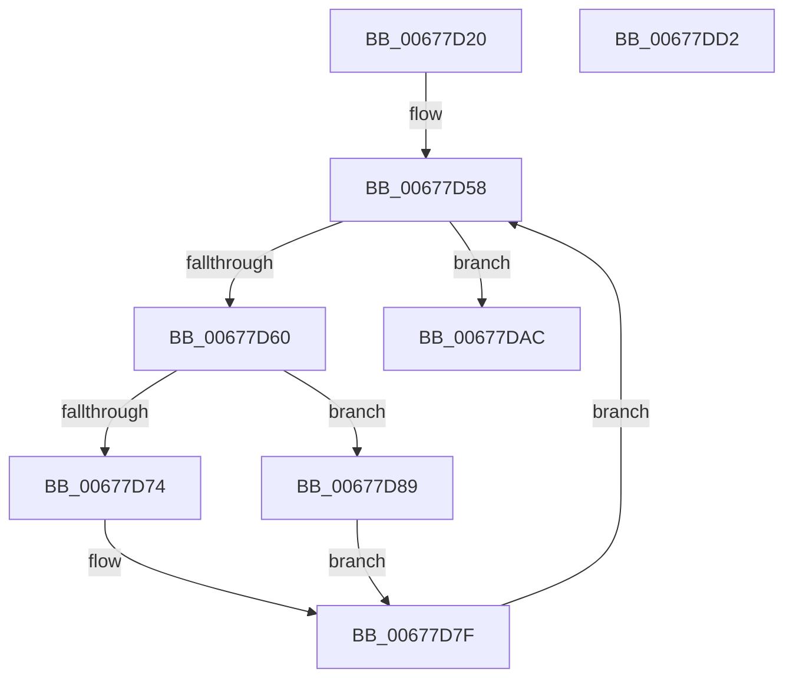

# MiDeleteDeleteOnCloseSubsections

- RVA: `0x00677D20`–`0x00677DD3` (길이 `179` bytes)
- VA: `0x0000000140677D20`
- 실행 섹션: `.text`
- PDB 이름 있음: `예`; PDB Function 태그: `아니요`
- unwind 정보 RVA: `0x0005E6B4`
- 디코드: `50`개 명령, `179/179` bytes 표시
- 미해석 바이트: `0` (있으면 어셈블리에 `.byte`로 보존)

> 이 문서는 커널 이미지의 기계어와 PDB 기호를 분석해 생성했습니다. 4번과 5번은 함수 원형과 자료형을 바이너리 사용 방식에서 추정한 C 해석이며 원본 소스 복구 결과는 아닙니다.

## 1. Dependencies

- 직접 호출 지점: **8**; 고유 호출 대상: **6**
- 직접 호출자로 확인된 함수: **1**
- RIP 상대 이미지 참조: **0**

### Outgoing calls
- `0x00677D49` → [ExAcquireSpinLockExclusive](../24/ExAcquireSpinLockExclusive_function_00248690.md) (function, `0x00248690`)
- `0x00677D6B` → [ExTryAcquireSpinLockExclusiveAtDpcLevel](../2B/ExTryAcquireSpinLockExclusiveAtDpcLevel_function_002BB800.md) (function, `0x002BB800`)
- `0x00677D7A` → [MiReleaseSpinLockExclusive](../24/MiReleaseSpinLockExclusive_function_002482C0.md) (function, `0x002482C0`)
- `0x00677D82` → [ExAcquireSpinLockExclusive](../24/ExAcquireSpinLockExclusive_function_00248690.md) (function, `0x00248690`)
- `0x00677D8C` → [MiUnlinkUnusedSubsection](../24/MiUnlinkUnusedSubsection_function_002496F4.md) (function, `0x002496F4`)
- `0x00677D94` → [ExReleaseSpinLockExclusiveFromDpcLevel](../24/ExReleaseSpinLockExclusiveFromDpcLevel_function_002497E0.md) (function, `0x002497E0`)
- `0x00677DA5` → [MiDeleteCachedSubsection](../29/MiDeleteCachedSubsection_function_00297888.md) (function, `0x00297888`)
- `0x00677DB2` → [MiReleaseSpinLockExclusive](../24/MiReleaseSpinLockExclusive_function_002482C0.md) (function, `0x002482C0`)

### Direct callers
- [MiProcessDeleteOnClose](MiProcessDeleteOnClose_function_006783D8.md) at `0x006783F7`
- [MiProcessDeleteOnClose](MiProcessDeleteOnClose_function_006783D8.md) at `0x0067847B`

### Static image references
- 디코드된 RIP-relative 메모리 참조가 없습니다.

## 2. Other-region calls and transfers

- 다른 실행 섹션으로 향하는 call: **0**
- 별도 외부 분기/꼬리 이동을 확인하지 못했습니다.

## 3. Assembly (complete function range)

```asm
00677D20  48 8B C4                        mov rax, rsp
00677D23  48 89 58 08                     mov qword ptr [rax + 8], rbx
00677D27  48 89 68 10                     mov qword ptr [rax + 0x10], rbp
00677D2B  48 89 70 18                     mov qword ptr [rax + 0x18], rsi
00677D2F  48 89 78 20                     mov qword ptr [rax + 0x20], rdi
00677D33  41 56                           push r14
00677D35  48 83 EC 20                     sub rsp, 0x20
00677D39  48 8D B9 C0 06 00 00            lea rdi, [rcx + 0x6c0]
00677D40  48 8B D9                        mov rbx, rcx
00677D43  48 8B CF                        mov rcx, rdi
00677D46  48 8B EA                        mov rbp, rdx
00677D49  E8 42 09 BD FF                  call 0x140248690
00677D4E  40 8A F0                        mov sil, al
00677D51  48 81 C3 D8 07 00 00            add rbx, 0x7d8
00677D58  48 8B 03                        mov rax, qword ptr [rbx]
00677D5B  48 3B C3                        cmp rax, rbx
00677D5E  74 4C                           je 0x140677dac
00677D60  4C 8D 70 A8                     lea r14, [rax - 0x58]
00677D64  49 8B 0E                        mov rcx, qword ptr [r14]
00677D67  48 83 C1 48                     add rcx, 0x48
00677D6B  E8 90 3A C4 FF                  call 0x1402bb800
00677D70  85 C0                           test eax, eax
00677D72  75 15                           jne 0x140677d89
00677D74  40 8A D6                        mov dl, sil
00677D77  48 8B CF                        mov rcx, rdi
00677D7A  E8 41 05 BD FF                  call 0x1402482c0
00677D7F  48 8B CF                        mov rcx, rdi
00677D82  E8 09 09 BD FF                  call 0x140248690
00677D87  EB CF                           jmp 0x140677d58
00677D89  49 8B CE                        mov rcx, r14
00677D8C  E8 63 19 BD FF                  call 0x1402496f4
00677D91  48 8B CF                        mov rcx, rdi
00677D94  E8 47 1A BD FF                  call 0x1402497e0
00677D99  45 33 C9                        xor r9d, r9d
00677D9C  4C 8B C5                        mov r8, rbp
00677D9F  40 8A D6                        mov dl, sil
00677DA2  49 8B CE                        mov rcx, r14
00677DA5  E8 DE FA C1 FF                  call 0x140297888
00677DAA  EB D3                           jmp 0x140677d7f
00677DAC  40 8A D6                        mov dl, sil
00677DAF  48 8B CF                        mov rcx, rdi
00677DB2  E8 09 05 BD FF                  call 0x1402482c0
00677DB7  48 8B 5C 24 30                  mov rbx, qword ptr [rsp + 0x30]
00677DBC  48 8B 6C 24 38                  mov rbp, qword ptr [rsp + 0x38]
00677DC1  48 8B 74 24 40                  mov rsi, qword ptr [rsp + 0x40]
00677DC6  48 8B 7C 24 48                  mov rdi, qword ptr [rsp + 0x48]
00677DCB  48 83 C4 20                     add rsp, 0x20
00677DCF  41 5E                           pop r14
00677DD1  C3                              ret
00677DD2  CC                              int3
```

## 4. C-style interpretation (structured pseudocode)

```c
__int64 __fastcall MiDeleteDeleteOnCloseSubsections(__int64 a1, __int64 a2, __int64 a3, int a4)
{
    __int64 result;
    __int64 v_rbx;
    __int64 v_rsp;
    unsigned __int64 v_stack_p10;
    unsigned __int64 v_stack_p18;
    unsigned __int64 v_stack_p20;
    unsigned __int64 v_stack_p8;

    *(unsigned __int64 *)(v_rsp + 8) = v_rbx;
    *(unsigned __int64 *)(v_rsp + 16) = v_rbp;
    *(unsigned __int64 *)(v_rsp + 24) = v_rsi;
    *(unsigned __int64 *)(v_rsp + 32) = v_rdi;
    v_rsp = (v_rsp) - (32);
    result = ExAcquireSpinLockExclusive(a1 + 1728, a2, a3, a4);
    v_rbx = (a1) + (0x7D8ULL);
loc_00677D58:
    if ((*(unsigned __int64 *)(v_rbx)) == v_rbx) goto loc_00677DAC;
    a1 = (*(unsigned __int64 *)(*(unsigned __int64 *)(v_rbx) - 88)) + (72);
    result = ExTryAcquireSpinLockExclusiveAtDpcLevel(a1, a2, a3, a4);
    if ((unsigned int)(result) != 0) goto loc_00677D89;
    result = MiReleaseSpinLockExclusive(a1 + 1728, (unsigned __int8)((unsigned __int8)(result)), a3, a4);
loc_00677D7F:
    result = ExAcquireSpinLockExclusive(a1 + 1728, (unsigned __int8)((unsigned __int8)(result)), a3, a4);
    goto loc_00677D58;
loc_00677D89:
    result = MiUnlinkUnusedSubsection(*(unsigned __int64 *)(v_rbx) - 88, (unsigned __int8)((unsigned __int8)(result)), a3, a4);
    result = ExReleaseSpinLockExclusiveFromDpcLevel(a1 + 1728, (unsigned __int8)((unsigned __int8)(result)), a3, a4);
    a4 = 0;
    result = MiDeleteCachedSubsection(*(unsigned __int64 *)(v_rbx) - 88, (unsigned __int8)((unsigned __int8)(result)), a2, a4);
    goto loc_00677D7F;
loc_00677DAC:
    result = MiReleaseSpinLockExclusive(a1 + 1728, (unsigned __int8)((unsigned __int8)(result)), a2, a4);
    v_rsp = (v_rsp) + (32);
    return result;
}
```

## 5. (Beta) C Style

```c
int64_t MiDeleteDeleteOnCloseSubsections(void *Arg1, int64_t Arg2, int64_t Arg3, int32_t Arg4)
{
    uint8_t *arg1 = (uint8_t *)Arg1;

    int64_t result;
    int64_t local_rbx;
    int64_t local_rsp;
    uint64_t v_stack_p10;
    uint64_t v_stack_p18;
    uint64_t v_stack_p20;
    uint64_t v_stack_p8;

    *(uint64_t *)(local_rsp + 0x8) = local_rbx;
    *(uint64_t *)(local_rsp + 0x10) = local_rbp;
    *(uint64_t *)(local_rsp + 0x18) = local_rsi;
    *(uint64_t *)(local_rsp + 0x20) = local_rdi;
    local_rsp = (local_rsp) - (32);
    result = ExAcquireSpinLockExclusive(Arg1 + 1728, Arg2, Arg3, Arg4);
    local_rbx = (Arg1) + (0x7D8ULL);
loc_00677D58:
    if ((*(uint64_t *)(local_rbx)) == local_rbx) goto loc_00677DAC;
    Arg1 = (*(uint64_t *)(*(uint64_t *)(local_rbx) - 0x58)) + (72);
    result = ExTryAcquireSpinLockExclusiveAtDpcLevel(Arg1, Arg2, Arg3, Arg4);
    if ((uint32_t)(result) != 0) goto loc_00677D89;
    result = MiReleaseSpinLockExclusive(Arg1 + 1728, (uint8_t)((uint8_t)(result)), Arg3, Arg4);
loc_00677D7F:
    result = ExAcquireSpinLockExclusive(Arg1 + 1728, (uint8_t)((uint8_t)(result)), Arg3, Arg4);
    goto loc_00677D58;
loc_00677D89:
    result = MiUnlinkUnusedSubsection(*(uint64_t *)(local_rbx) - 88, (uint8_t)((uint8_t)(result)), Arg3, Arg4);
    result = ExReleaseSpinLockExclusiveFromDpcLevel(Arg1 + 1728, (uint8_t)((uint8_t)(result)), Arg3, Arg4);
    Arg4 = 0;
    result = MiDeleteCachedSubsection(*(uint64_t *)(local_rbx) - 88, (uint8_t)((uint8_t)(result)), Arg2, Arg4);
    goto loc_00677D7F;
loc_00677DAC:
    result = MiReleaseSpinLockExclusive(Arg1 + 1728, (uint8_t)((uint8_t)(result)), Arg2, Arg4);
    local_rsp = (local_rsp) + (32);
    return result;
}
```

### 관측된 메모리 오프셋

구조체 형식이 확인되지 않은 접근은 인자 기준의 오프셋으로만 기록했습니다.

| 기준 인자 | 오프셋 표현 | 폭 (bit) | 접근 |
|---|---:|---:|---|
| `Arg1` | `+ 0x0` | `64` | `R` |
| `Arg1` | `+ 0x6C0` | `64` | `R` |

## 6. Execution-region graph

[열기: 2D/3D 그래프와 함수 탐색 컨트롤 패널](../../../control-panel.html?section=text&rva=0x00677D20&view=graph)

- 2D 그래프는 위에서 아래로 흐르고, 3D 그래프는 빈 공간을 드래그해 회전합니다. Shift+드래그는 이동, 휠은 확대·축소, 함수 노드 선택은 대상 보고서 이동입니다.

### Static fallback


