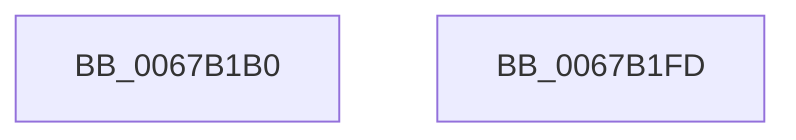

# MiDeleteKernelStackNode

- RVA: `0x0067B1B0`–`0x0067B1FE` (길이 `78` bytes)
- VA: `0x000000014067B1B0`
- 실행 섹션: `.text`
- PDB 이름 있음: `예`; PDB Function 태그: `아니요`
- unwind 정보 RVA: `0x0005CAAC`
- 디코드: `21`개 명령, `78/78` bytes 표시
- 미해석 바이트: `0` (있으면 어셈블리에 `.byte`로 보존)

> 이 문서는 커널 이미지의 기계어와 PDB 기호를 분석해 생성했습니다. 4번과 5번은 함수 원형과 자료형을 바이너리 사용 방식에서 추정한 C 해석이며 원본 소스 복구 결과는 아닙니다.

## 1. Dependencies

- 직접 호출 지점: **4**; 고유 호출 대상: **4**
- 직접 호출자로 확인된 함수: **1**
- RIP 상대 이미지 참조: **2**

### Outgoing calls
- `0x0067B1C4` → [ExAcquireSpinLockExclusive](../24/ExAcquireSpinLockExclusive_function_00248690.md) (function, `0x00248690`)
- `0x0067B1D5` → [RtlAvlRemoveNode](../29/RtlAvlRemoveNode_function_00296650.md) (function, `0x00296650`)
- `0x0067B1E3` → [MiReleaseSpinLockExclusive](../24/MiReleaseSpinLockExclusive_function_002482C0.md) (function, `0x002482C0`)
- `0x0067B1ED` → [ExFreePoolWithTag](../../poolcode/B8/ExFreePoolWithTag_function_00B82870.md) (function, `0x00B82870`)

### Direct callers
- [MiInPageSingleKernelStack](../36/MiInPageSingleKernelStack_function_0036A3E8.md) at `0x0036A7F6`

### Static image references
- `0x0067B1BD` → RVA `0x00E35FD8` (`.data`; read)
- `0x0067B1CC` → RVA `0x00E35FD0` (`.data`; read)

## 2. Other-region calls and transfers

- 다른 실행 섹션으로 향하는 call: **1**
  - `0x0067B1ED` → [ExFreePoolWithTag](../../poolcode/B8/ExFreePoolWithTag_function_00B82870.md) (`.text` → `POOLCODE`)
- 별도 외부 분기/꼬리 이동을 확인하지 못했습니다.

## 3. Assembly (complete function range)

```asm
0067B1B0  48 89 5C 24 08                  mov qword ptr [rsp + 8], rbx
0067B1B5  57                              push rdi
0067B1B6  48 83 EC 20                     sub rsp, 0x20
0067B1BA  48 8B F9                        mov rdi, rcx
0067B1BD  48 8D 0D 14 AE 7B 00            lea rcx, [rip + 0x7bae14]
0067B1C4  E8 C7 D4 BC FF                  call 0x140248690
0067B1C9  48 8B D7                        mov rdx, rdi
0067B1CC  48 8D 0D FD AD 7B 00            lea rcx, [rip + 0x7badfd]
0067B1D3  8A D8                           mov bl, al
0067B1D5  E8 76 B4 C1 FF                  call 0x140296650
0067B1DA  8A D3                           mov dl, bl
0067B1DC  48 8D 0D F5 AD 7B 00            lea rcx, [rip + 0x7badf5]
0067B1E3  E8 D8 D0 BC FF                  call 0x1402482c0
0067B1E8  33 D2                           xor edx, edx
0067B1EA  48 8B CF                        mov rcx, rdi
0067B1ED  E8 7E 76 50 00                  call 0x140b82870
0067B1F2  48 8B 5C 24 30                  mov rbx, qword ptr [rsp + 0x30]
0067B1F7  48 83 C4 20                     add rsp, 0x20
0067B1FB  5F                              pop rdi
0067B1FC  C3                              ret
0067B1FD  CC                              int3
```

## 4. C-style interpretation (structured pseudocode)

```c
__int64 __fastcall MiDeleteKernelStackNode(__int64 a1)
{
    __int64 result;
    __int64 v_rsp;
    unsigned __int64 v_stack_p8;

    v_stack_p8 = v_rbx;
    v_rsp = (v_rsp) - (32);
    result = ExAcquireSpinLockExclusive(v_rip + 8105492, a2, a3, a4);
    result = RtlAvlRemoveNode(v_rip + 8105469, a1, a3, a4);
    result = MiReleaseSpinLockExclusive(v_rip + 8105461, (unsigned __int8)((unsigned __int8)(result)), a3, a4);
    a2 = 0;
    result = ExFreePoolWithTag(a1, a2, a3, a4);
    v_rsp = (v_rsp) + (32);
    return result;
}
```

## 5. (Beta) C Style

```c
int64_t MiDeleteKernelStackNode(int64_t Arg1)
{
    int64_t result;
    int64_t local_rsp;
    uint64_t v_stack_p8;

    v_stack_p8 = local_rbx;
    local_rsp = (local_rsp) - (32);
    result = ExAcquireSpinLockExclusive(v_rip + 8105492, a2, a3, a4);
    result = RtlAvlRemoveNode(v_rip + 8105469, Arg1, a3, a4);
    result = MiReleaseSpinLockExclusive(v_rip + 8105461, (uint8_t)((uint8_t)(result)), a3, a4);
    a2 = 0;
    result = ExFreePoolWithTag(Arg1, a2, a3, a4);
    local_rsp = (local_rsp) + (32);
    return result;
}
```

## 6. Execution-region graph

[열기: 2D/3D 그래프와 함수 탐색 컨트롤 패널](../../../control-panel.html?section=text&rva=0x0067B1B0&view=graph)

- 2D 그래프는 위에서 아래로 흐르고, 3D 그래프는 빈 공간을 드래그해 회전합니다. Shift+드래그는 이동, 휠은 확대·축소, 함수 노드 선택은 대상 보고서 이동입니다.

### Static fallback


