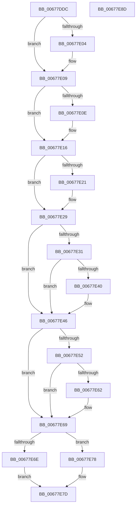

# MiDeleteMoreUnusedSegments

- RVA: `0x00677DDC`–`0x00677E8E` (길이 `178` bytes)
- VA: `0x0000000140677DDC`
- 실행 섹션: `.text`
- PDB 이름 있음: `예`; PDB Function 태그: `아니요`
- unwind 정보 RVA: `0x00060BC4`
- 디코드: `52`개 명령, `178/178` bytes 표시
- 미해석 바이트: `0` (있으면 어셈블리에 `.byte`로 보존)

> 이 문서는 커널 이미지의 기계어와 PDB 기호를 분석해 생성했습니다. 4번과 5번은 함수 원형과 자료형을 바이너리 사용 방식에서 추정한 C 해석이며 원본 소스 복구 결과는 아닙니다.

## 1. Dependencies

- 직접 호출 지점: **3**; 고유 호출 대상: **3**
- 직접 호출자로 확인된 함수: **1**
- RIP 상대 이미지 참조: **0**

### Outgoing calls
- `0x00677E04` → [MiDeleteEmptyControlAreas](../49/MiDeleteEmptyControlAreas_function_0049334C.md) (function, `0x0049334C`)
- `0x00677E11` → [MiDeleteEmptySubsections](../4E/MiDeleteEmptySubsections_function_004ED818.md) (function, `0x004ED818`)
- `0x00677E24` → [MiFreeClonePool](../49/MiFreeClonePool_function_00492EE0.md) (function, `0x00492EE0`)

### Direct callers
- [MiDeleteCachedEntries](MiDeleteCachedEntries_function_00677A28.md) at `0x00677A6A`
- [MiDeleteCachedEntries](MiDeleteCachedEntries_function_00677A28.md) at `0x00677B6A`
- [MiDeleteCachedEntries](MiDeleteCachedEntries_function_00677A28.md) at `0x00677BAE`
- [MiDeleteCachedEntries](MiDeleteCachedEntries_function_00677A28.md) at `0x00677C5F`

### Static image references
- 디코드된 RIP-relative 메모리 참조가 없습니다.

## 2. Other-region calls and transfers

- 다른 실행 섹션으로 향하는 call: **0**
- 별도 외부 분기/꼬리 이동을 확인하지 못했습니다.

## 3. Assembly (complete function range)

```asm
00677DDC  48 89 5C 24 08                  mov qword ptr [rsp + 8], rbx
00677DE1  48 89 74 24 10                  mov qword ptr [rsp + 0x10], rsi
00677DE6  57                              push rdi
00677DE7  48 83 EC 20                     sub rsp, 0x20
00677DEB  48 8D 81 88 07 00 00            lea rax, [rcx + 0x788]
00677DF2  48 8B F2                        mov rsi, rdx
00677DF5  48 8D 99 50 08 00 00            lea rbx, [rcx + 0x850]
00677DFC  48 8B F9                        mov rdi, rcx
00677DFF  48 39 00                        cmp qword ptr [rax], rax
00677E02  74 05                           je 0x140677e09
00677E04  E8 43 B5 E1 FF                  call 0x14049334c
00677E09  48 39 1B                        cmp qword ptr [rbx], rbx
00677E0C  74 08                           je 0x140677e16
00677E0E  48 8B CF                        mov rcx, rdi
00677E11  E8 02 5A E7 FF                  call 0x1404ed818
00677E16  33 DB                           xor ebx, ebx
00677E18  66 39 9F 60 09 00 00            cmp word ptr [rdi + 0x960], bx
00677E1F  74 08                           je 0x140677e29
00677E21  48 8B CF                        mov rcx, rdi
00677E24  E8 B7 B0 E1 FF                  call 0x140492ee0
00677E29  48 8B 16                        mov rdx, qword ptr [rsi]
00677E2C  48 85 D2                        test rdx, rdx
00677E2F  74 15                           je 0x140677e46
00677E31  48 8B 87 40 4B 00 00            mov rax, qword ptr [rdi + 0x4b40]
00677E38  48 8B 16                        mov rdx, qword ptr [rsi]
00677E3B  48 3B C2                        cmp rax, rdx
00677E3E  77 06                           ja 0x140677e46
00677E40  48 89 1E                        mov qword ptr [rsi], rbx
00677E43  48 8B D3                        mov rdx, rbx
00677E46  4C 8B 46 08                     mov r8, qword ptr [rsi + 8]
00677E4A  49 8B C0                        mov rax, r8
00677E4D  4D 85 C0                        test r8, r8
00677E50  74 17                           je 0x140677e69
00677E52  48 8B 8F 38 08 00 00            mov rcx, qword ptr [rdi + 0x838]
00677E59  48 C1 E9 0C                     shr rcx, 0xc
00677E5D  49 3B C8                        cmp rcx, r8
00677E60  77 07                           ja 0x140677e69
00677E62  48 89 5E 08                     mov qword ptr [rsi + 8], rbx
00677E66  48 8B C3                        mov rax, rbx
00677E69  48 85 D2                        test rdx, rdx
00677E6C  75 0A                           jne 0x140677e78
00677E6E  48 85 C0                        test rax, rax
00677E71  0F 95 C3                        setne bl
00677E74  8B C3                           mov eax, ebx
00677E76  EB 05                           jmp 0x140677e7d
00677E78  B8 01 00 00 00                  mov eax, 1
00677E7D  48 8B 5C 24 30                  mov rbx, qword ptr [rsp + 0x30]
00677E82  48 8B 74 24 38                  mov rsi, qword ptr [rsp + 0x38]
00677E87  48 83 C4 20                     add rsp, 0x20
00677E8B  5F                              pop rdi
00677E8C  C3                              ret
00677E8D  CC                              int3
```

## 4. C-style interpretation (structured pseudocode)

```c
__int64 __fastcall MiDeleteMoreUnusedSegments(__int64 a1, __int64 a2)
{
    __int64 result;
    __int64 v_rbx;
    __int64 v_rsp;
    unsigned __int64 v_stack_p10;
    unsigned __int64 v_stack_p8;

    v_stack_p8 = v_rbx;
    v_stack_p10 = v_rsi;
    v_rsp = (v_rsp) - (32);
    result = a1 + 1928;
    if ((*(unsigned __int64 *)(a1 + 1928)) != (a1 + 1928)) {
        result = MiDeleteEmptyControlAreas(a1, a2, a3, a4);
    }
    if ((*(unsigned __int64 *)(a1 + 2128)) != (a1 + 2128)) {
        a1 = a1;
        result = MiDeleteEmptySubsections(a1, a2, a3, a4);
    }
    v_rbx = 0;
    if ((*(unsigned __int16 *)(a1 + 2400)) != 0) {
        a1 = a1;
        result = MiFreeClonePool(a1, a2, a3, a4);
    }
    if (*(unsigned __int64 *)(a2) == 0) goto loc_00677E46;
    if ((*(unsigned __int64 *)(a1 + 19264)) <= (*(unsigned __int64 *)(a2))) {
        *(unsigned __int64 *)(a2) = 0;
        a2 = 0;
    }
    if (*(unsigned __int64 *)(a2 + 8) == 0) goto loc_00677E69;
    a1 = (*(unsigned __int64 *)(a1 + 2104)) >> (12);
    result = *(unsigned __int64 *)(a2 + 8);
    if (a1 <= (*(unsigned __int64 *)(a2 + 8))) {
        *(unsigned __int64 *)(a2 + 8) = 0;
        result = 0;
    }
    if (a2 != 0) goto loc_00677E78;
    v_rbx = (result != 0) ? 1 : 0;
    goto loc_00677E7D;
loc_00677E78:
loc_00677E7D:
    v_rsp = (v_rsp) + (32);
    return 1;
}
```

## 5. (Beta) C Style

```c
int64_t MiDeleteMoreUnusedSegments(void *Arg1, void *Arg2)
{
    uint8_t *arg1 = (uint8_t *)Arg1;
    uint8_t *arg2 = (uint8_t *)Arg2;

    int64_t result;
    int64_t local_rbx;
    int64_t local_rsp;
    uint64_t v_stack_p10;
    uint64_t v_stack_p8;

    v_stack_p8 = local_rbx;
    v_stack_p10 = local_rsi;
    local_rsp = (local_rsp) - (32);
    result = Arg1 + 1928;
    if ((*(uint64_t *)(arg1 + 0x788)) != (Arg1 + 1928)) {
        result = MiDeleteEmptyControlAreas(Arg1, Arg2, a3, a4);
    }
    if ((*(uint64_t *)(arg1 + 0x850)) != (Arg1 + 2128)) {
        Arg1 = Arg1;
        result = MiDeleteEmptySubsections(Arg1, Arg2, a3, a4);
    }
    local_rbx = 0;
    if ((*(uint16_t *)(arg1 + 0x960)) != 0) {
        Arg1 = Arg1;
        result = MiFreeClonePool(Arg1, Arg2, a3, a4);
    }
    if (*(uint64_t *)(arg2) == 0) goto loc_00677E46;
    if ((*(uint64_t *)(arg1 + 0x4B40)) <= (*(uint64_t *)(arg2))) {
        *(uint64_t *)(arg2) = 0;
        Arg2 = 0;
    }
    if (*(uint64_t *)(arg2 + 0x8) == 0) goto loc_00677E69;
    Arg1 = (*(uint64_t *)(arg1 + 0x838)) >> (12);
    result = *(uint64_t *)(arg2 + 0x8);
    if (Arg1 <= (*(uint64_t *)(arg2 + 0x8))) {
        *(uint64_t *)(arg2 + 0x8) = 0;
        result = 0;
    }
    if (Arg2 != NULL) goto loc_00677E78;
    local_rbx = (result != 0) ? 1 : 0;
    goto loc_00677E7D;
loc_00677E78:
loc_00677E7D:
    local_rsp = (local_rsp) + (32);
    return 1;
}
```

### 관측된 메모리 오프셋

구조체 형식이 확인되지 않은 접근은 인자 기준의 오프셋으로만 기록했습니다.

| 기준 인자 | 오프셋 표현 | 폭 (bit) | 접근 |
|---|---:|---:|---|
| `Arg1` | `+ 0x0` | `64` | `R` |
| `Arg1` | `+ 0x788` | `64` | `R` |
| `Arg1` | `+ 0x838` | `64` | `R` |
| `Arg1` | `+ 0x850` | `64` | `R` |
| `Arg1` | `+ 0x960` | `16` | `R` |
| `Arg1` | `+ 0x4B40` | `64` | `R` |
| `Arg2` | `+ 0x0` | `64` | `R` |
| `Arg2` | `+ 0x0` | `64` | `W` |
| `Arg2` | `+ 0x8` | `64` | `R` |
| `Arg2` | `+ 0x8` | `64` | `W` |

## 6. Execution-region graph

[열기: 2D/3D 그래프와 함수 탐색 컨트롤 패널](../../../control-panel.html?section=text&rva=0x00677DDC&view=graph)

- 2D 그래프는 위에서 아래로 흐르고, 3D 그래프는 빈 공간을 드래그해 회전합니다. Shift+드래그는 이동, 휠은 확대·축소, 함수 노드 선택은 대상 보고서 이동입니다.

### Static fallback


