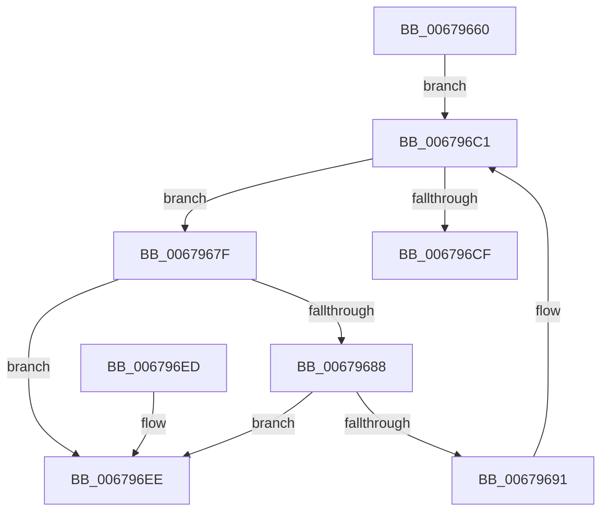

# MiDeletePendingBadPageNodesAwaitingDeleteList

- RVA: `0x00679660`–`0x006796F5` (길이 `149` bytes)
- VA: `0x0000000140679660`
- 실행 섹션: `.text`
- PDB 이름 있음: `예`; PDB Function 태그: `아니요`
- unwind 정보 RVA: `0x000D7DC8`
- 디코드: `37`개 명령, `149/149` bytes 표시
- 미해석 바이트: `0` (있으면 어셈블리에 `.byte`로 보존)

> 이 문서는 커널 이미지의 기계어와 PDB 기호를 분석해 생성했습니다. 4번과 5번은 함수 원형과 자료형을 바이너리 사용 방식에서 추정한 C 해석이며 원본 소스 복구 결과는 아닙니다.

## 1. Dependencies

- 직접 호출 지점: **5**; 고유 호출 대상: **3**
- 직접 호출자로 확인된 함수: **0**
- RIP 상대 이미지 참조: **4**

### Outgoing calls
- `0x00679671` → [ExAcquireSpinLockExclusive](../24/ExAcquireSpinLockExclusive_function_00248690.md) (function, `0x00248690`)
- `0x006796A6` → [MiReleaseSpinLockExclusive](../24/MiReleaseSpinLockExclusive_function_002482C0.md) (function, `0x002482C0`)
- `0x006796B0` → [ExFreePoolWithTag](../../poolcode/B8/ExFreePoolWithTag_function_00B82870.md) (function, `0x00B82870`)
- `0x006796BC` → [ExAcquireSpinLockExclusive](../24/ExAcquireSpinLockExclusive_function_00248690.md) (function, `0x00248690`)
- `0x006796DD` → [MiReleaseSpinLockExclusive](../24/MiReleaseSpinLockExclusive_function_002482C0.md) (function, `0x002482C0`)

### Direct callers
- 이 함수 시작 RVA로 연결되는 직접 call은 확인되지 않았습니다. 간접 호출은 완전히 역산할 수 없습니다.

### Static image references
- `0x0067966A` → RVA `0x00E2FFD0` (`.data`; read)
- `0x00679676` → RVA `0x00E2FFE0` (`.data`; read)
- `0x0067969F` → RVA `0x00E2FFF0` (`.data`; read/write)
- `0x006796D6` → RVA `0x00E2FFF8` (`.data`; write)

## 2. Other-region calls and transfers

- 다른 실행 섹션으로 향하는 call: **1**
  - `0x006796B0` → [ExFreePoolWithTag](../../poolcode/B8/ExFreePoolWithTag_function_00B82870.md) (`.text` → `POOLCODE`)
- 별도 외부 분기/꼬리 이동을 확인하지 못했습니다.

## 3. Assembly (complete function range)

```asm
00679660  48 89 5C 24 08                  mov qword ptr [rsp + 8], rbx
00679665  56                              push rsi
00679666  48 83 EC 20                     sub rsp, 0x20
0067966A  48 8D 0D 5F 69 7B 00            lea rcx, [rip + 0x7b695f]
00679671  E8 1A F0 BC FF                  call 0x140248690
00679676  48 8D 35 63 69 7B 00            lea rsi, [rip + 0x7b6963]
0067967D  EB 42                           jmp 0x1406796c1
0067967F  48 8B 0B                        mov rcx, qword ptr [rbx]
00679682  48 39 59 08                     cmp qword ptr [rcx + 8], rbx
00679686  75 66                           jne 0x1406796ee
00679688  48 8B 43 08                     mov rax, qword ptr [rbx + 8]
0067968C  48 39 18                        cmp qword ptr [rax], rbx
0067968F  75 5D                           jne 0x1406796ee
00679691  48 89 08                        mov qword ptr [rax], rcx
00679694  48 89 41 08                     mov qword ptr [rcx + 8], rax
00679698  48 8D 0D 31 69 7B 00            lea rcx, [rip + 0x7b6931]
0067969F  48 FF 0D 4A 69 7B 00            dec qword ptr [rip + 0x7b694a]
006796A6  E8 15 EC BC FF                  call 0x1402482c0
006796AB  33 D2                           xor edx, edx
006796AD  48 8B CB                        mov rcx, rbx
006796B0  E8 BB 91 50 00                  call 0x140b82870
006796B5  48 8D 0D 14 69 7B 00            lea rcx, [rip + 0x7b6914]
006796BC  E8 CF EF BC FF                  call 0x140248690
006796C1  48 8B 1D 18 69 7B 00            mov rbx, qword ptr [rip + 0x7b6918]
006796C8  8A D0                           mov dl, al
006796CA  48 3B DE                        cmp rbx, rsi
006796CD  75 B0                           jne 0x14067967f
006796CF  48 8D 0D FA 68 7B 00            lea rcx, [rip + 0x7b68fa]
006796D6  C6 05 1B 69 7B 00 00            mov byte ptr [rip + 0x7b691b], 0
006796DD  E8 DE EB BC FF                  call 0x1402482c0
006796E2  48 8B 5C 24 30                  mov rbx, qword ptr [rsp + 0x30]
006796E7  48 83 C4 20                     add rsp, 0x20
006796EB  5E                              pop rsi
006796EC  C3                              ret
006796ED  CC                              int3
006796EE  B9 03 00 00 00                  mov ecx, 3
006796F3  CD 29                           int 0x29
```

## 4. C-style interpretation (structured pseudocode)

```c
__int64 __fastcall MiDeletePendingBadPageNodesAwaitingDeleteList(__int64 a1, int a2)
{
    __int64 result;
    __int64 v_rsp;
    unsigned __int64 v_stack_p8;

    v_stack_p8 = v_rbx;
    v_rsp = (v_rsp) - (32);
    result = ExAcquireSpinLockExclusive(v_rip + 8087903, a2, a3, a4);
    goto loc_006796C1;
loc_0067967F:
    if ((*(unsigned __int64 *)(*(unsigned __int64 *)(v_rbx) + 8)) != v_rbx) goto loc_006796EE;
    if ((*(unsigned __int64 *)(*(unsigned __int64 *)(v_rbx + 8))) != v_rbx) goto loc_006796EE;
    *(unsigned __int64 *)(*(unsigned __int64 *)(v_rbx + 8)) = *(unsigned __int64 *)(v_rbx);
    *(unsigned __int64 *)(*(unsigned __int64 *)(v_rbx) + 8) = *(unsigned __int64 *)(v_rbx + 8);
    result = MiReleaseSpinLockExclusive(v_rip + 8087857, a2, a3, a4);
    a2 = 0;
    result = ExFreePoolWithTag(v_rbx, a2, a3, a4);
    result = ExAcquireSpinLockExclusive(v_rip + 8087828, a2, a3, a4);
loc_006796C1:
    if ((*(unsigned __int64 *)(v_rip + 8087832)) != (v_rip + 8087907)) goto loc_0067967F;
    *(unsigned __int8 *)(v_rip + 8087835) = 0;
    result = MiReleaseSpinLockExclusive(v_rip + 8087802, (unsigned __int8)(result), a3, a4);
    v_rsp = (v_rsp) + (32);
    return result;
loc_006796EE:
    return result;
}
```

## 5. (Beta) C Style

```c
int64_t MiDeletePendingBadPageNodesAwaitingDeleteList(int64_t Arg1, int32_t Arg2)
{
    int64_t result;
    int64_t local_rsp;
    uint64_t v_stack_p8;

    v_stack_p8 = local_rbx;
    local_rsp = (local_rsp) - (32);
    result = ExAcquireSpinLockExclusive(v_rip + 8087903, Arg2, a3, a4);
    goto loc_006796C1;
loc_0067967F:
    if ((*(uint64_t *)(*(uint64_t *)(local_rbx) + 0x8)) != local_rbx) goto loc_006796EE;
    if ((*(uint64_t *)(*(uint64_t *)(local_rbx + 0x8))) != local_rbx) goto loc_006796EE;
    *(uint64_t *)(*(uint64_t *)(local_rbx + 0x8)) = *(uint64_t *)(local_rbx);
    *(uint64_t *)(*(uint64_t *)(local_rbx) + 0x8) = *(uint64_t *)(local_rbx + 0x8);
    result = MiReleaseSpinLockExclusive(v_rip + 8087857, Arg2, a3, a4);
    Arg2 = 0;
    result = ExFreePoolWithTag(local_rbx, Arg2, a3, a4);
    result = ExAcquireSpinLockExclusive(v_rip + 8087828, Arg2, a3, a4);
loc_006796C1:
    if ((*(uint64_t *)(v_rip + 0x7B6918)) != (v_rip + 8087907)) goto loc_0067967F;
    *(uint8_t *)(v_rip + 0x7B691B) = 0;
    result = MiReleaseSpinLockExclusive(v_rip + 8087802, (uint8_t)(result), a3, a4);
    local_rsp = (local_rsp) + (32);
    return result;
loc_006796EE:
    return result;
}
```

## 6. Execution-region graph

[열기: 2D/3D 그래프와 함수 탐색 컨트롤 패널](../../../control-panel.html?section=text&rva=0x00679660&view=graph)

- 2D 그래프는 위에서 아래로 흐르고, 3D 그래프는 빈 공간을 드래그해 회전합니다. Shift+드래그는 이동, 휠은 확대·축소, 함수 노드 선택은 대상 보고서 이동입니다.

### Static fallback


