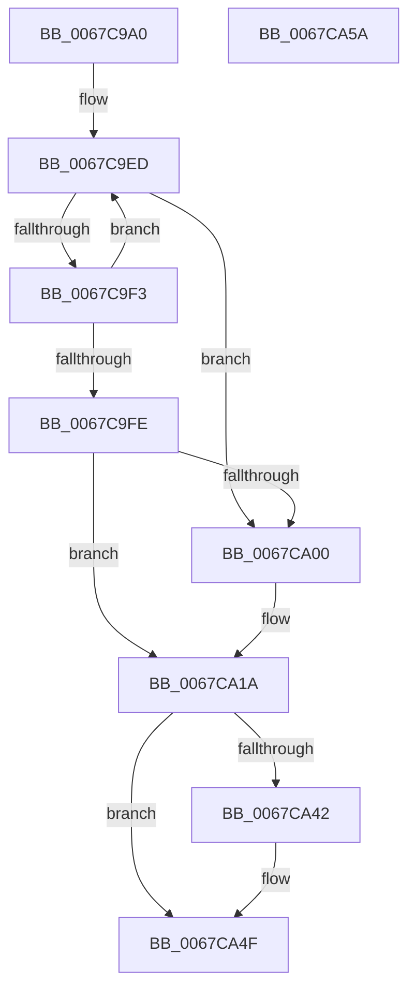

# MiDeleteUnmappedSystemCacheViews

- RVA: `0x0067C9A0`–`0x0067CA5B` (길이 `187` bytes)
- VA: `0x000000014067C9A0`
- 실행 섹션: `.text`
- PDB 이름 있음: `예`; PDB Function 태그: `아니요`
- unwind 정보 RVA: `0x00084AC0`
- 디코드: `50`개 명령, `187/187` bytes 표시
- 미해석 바이트: `0` (있으면 어셈블리에 `.byte`로 보존)

> 이 문서는 커널 이미지의 기계어와 PDB 기호를 분석해 생성했습니다. 4번과 5번은 함수 원형과 자료형을 바이너리 사용 방식에서 추정한 C 해석이며 원본 소스 복구 결과는 아닙니다.

## 1. Dependencies

- 직접 호출 지점: **7**; 고유 호출 대상: **6**
- 직접 호출자로 확인된 함수: **2**
- RIP 상대 이미지 참조: **2**

### Outgoing calls
- `0x0067C9C6` → [ExAcquireSpinLockExclusive](../24/ExAcquireSpinLockExclusive_function_00248690.md) (function, `0x00248690`)
- `0x0067C9DF` → [MiRebalanceSystemCacheFreedViews](../41/MiRebalanceSystemCacheFreedViews_function_00419620.md) (function, `0x00419620`)
- `0x0067CA07` → [MI_FLUSH_ENTIRE_TB](../31/MI_FLUSH_ENTIRE_TB_function_00314110.md) (function, `0x00314110`)
- `0x0067CA15` → [MiRebalanceSystemCacheFreedViews](../41/MiRebalanceSystemCacheFreedViews_function_00419620.md) (function, `0x00419620`)
- `0x0067CA22` → [MiGetSystemCacheRegionsToFree](../48/MiGetSystemCacheRegionsToFree_function_004896F4.md) (function, `0x004896F4`)
- `0x0067CA31` → [MiReleaseSpinLockExclusive](../24/MiReleaseSpinLockExclusive_function_002482C0.md) (function, `0x002482C0`)
- `0x0067CA4A` → [MiReturnSystemCacheRegionsToKva](../49/MiReturnSystemCacheRegionsToKva_function_00494DFC.md) (function, `0x00494DFC`)

### Direct callers
- [MiReduceSystemCache](MiReduceSystemCache_function_006784F4.md) at `0x0067850D`
- [MiDeletePartitionResources](../../page/80/MiDeletePartitionResources_function_0080D074.md) at `0x0080D100`

### Static image references
- `0x0067C9B7` → RVA `0x00E2F3B8` (`.data`; read)
- `0x0067C9D3` → RVA `0x00FCF080` (`CACHEALI`; read)

## 2. Other-region calls and transfers

- 다른 실행 섹션으로 향하는 call: **0**
- 별도 외부 분기/꼬리 이동을 확인하지 못했습니다.

## 3. Assembly (complete function range)

```asm
0067C9A0  4C 8B DC                        mov r11, rsp
0067C9A3  49 89 5B 08                     mov qword ptr [r11 + 8], rbx
0067C9A7  57                              push rdi
0067C9A8  48 83 EC 30                     sub rsp, 0x30
0067C9AC  49 8D 43 E8                     lea rax, [r11 - 0x18]
0067C9B0  48 8B D9                        mov rbx, rcx
0067C9B3  49 89 43 F0                     mov qword ptr [r11 - 0x10], rax
0067C9B7  48 8D 0D FA 29 7B 00            lea rcx, [rip + 0x7b29fa]
0067C9BE  49 8D 43 E8                     lea rax, [r11 - 0x18]
0067C9C2  49 89 43 E8                     mov qword ptr [r11 - 0x18], rax
0067C9C6  E8 C5 BC BC FF                  call 0x140248690
0067C9CB  40 8A F8                        mov dil, al
0067C9CE  F0 83 0C 24 00                  lock or dword ptr [rsp], 0
0067C9D3  8B 15 A7 26 95 00               mov edx, dword ptr [rip + 0x9526a7]
0067C9D9  45 33 C0                        xor r8d, r8d
0067C9DC  48 8B CB                        mov rcx, rbx
0067C9DF  E8 3C CC D9 FF                  call 0x140419620
0067C9E4  33 C9                           xor ecx, ecx
0067C9E6  48 8D 93 90 08 00 00            lea rdx, [rbx + 0x890]
0067C9ED  48 83 3A 00                     cmp qword ptr [rdx], 0
0067C9F1  75 0D                           jne 0x14067ca00
0067C9F3  48 83 C2 20                     add rdx, 0x20
0067C9F7  FF C1                           inc ecx
0067C9F9  83 F9 04                        cmp ecx, 4
0067C9FC  72 EF                           jb 0x14067c9ed
0067C9FE  74 1A                           je 0x14067ca1a
0067CA00  B9 02 00 00 00                  mov ecx, 2
0067CA05  8B D1                           mov edx, ecx
0067CA07  E8 04 77 C9 FF                  call 0x140314110
0067CA0C  33 D2                           xor edx, edx
0067CA0E  48 8B CB                        mov rcx, rbx
0067CA11  44 8D 42 01                     lea r8d, [rdx + 1]
0067CA15  E8 06 CC D9 FF                  call 0x140419620
0067CA1A  48 8D 54 24 20                  lea rdx, [rsp + 0x20]
0067CA1F  48 8B CB                        mov rcx, rbx
0067CA22  E8 CD CC E0 FF                  call 0x1404896f4
0067CA27  48 8D 0D 8A 29 7B 00            lea rcx, [rip + 0x7b298a]
0067CA2E  40 8A D7                        mov dl, dil
0067CA31  E8 8A B8 BC FF                  call 0x1402482c0
0067CA36  48 8D 44 24 20                  lea rax, [rsp + 0x20]
0067CA3B  48 39 44 24 20                  cmp qword ptr [rsp + 0x20], rax
0067CA40  74 0D                           je 0x14067ca4f
0067CA42  48 8D 54 24 20                  lea rdx, [rsp + 0x20]
0067CA47  48 8B CB                        mov rcx, rbx
0067CA4A  E8 AD 83 E1 FF                  call 0x140494dfc
0067CA4F  48 8B 5C 24 40                  mov rbx, qword ptr [rsp + 0x40]
0067CA54  48 83 C4 30                     add rsp, 0x30
0067CA58  5F                              pop rdi
0067CA59  C3                              ret
0067CA5A  CC                              int3
```

## 4. C-style interpretation (structured pseudocode)

```c
__int64 __fastcall MiDeleteUnmappedSystemCacheViews(__int64 a1, __int64 a2, int a3)
{
    __int64 result;
    __int64 v_rsp;
    unsigned __int64 v_stack_m18;
    unsigned int v_stack_m38;
    unsigned __int64 v_stack_p8;

    *(unsigned __int64 *)(v_rsp + 8) = v_rbx;
    v_rsp = (v_rsp) - (48);
    *(unsigned __int64 *)(v_rsp - 16) = v_rsp - 24;
    *(unsigned __int64 *)(v_rsp - 24) = v_rsp - 24;
    result = ExAcquireSpinLockExclusive(v_rip + 8071674, a2, a3, a4);
    a3 = 0;
    result = MiRebalanceSystemCacheFreedViews(a1, (unsigned int)(*(unsigned int *)(v_rip + 9774759)), a3, a4);
    a1 = 0;
loc_0067C9ED:
    if ((*(unsigned __int64 *)(a1 + 2192)) != 0) goto loc_0067CA00;
    a2 = (a1 + 2192) + (32);
    a1 = (unsigned int)((a1) + 1);
    if (((unsigned int)(a1)) < 4) goto loc_0067C9ED;
    if (((unsigned int)(a1)) != 4) {
        a1 = 2;
        a2 = (unsigned int)(a1);
        result = MI_FLUSH_ENTIRE_TB(a1, a2, a3, a4);
        a2 = 0;
        a1 = a1;
        a3 = a2 + 1;
        result = MiRebalanceSystemCacheFreedViews(a1, a2, a3, a4);
    }
    result = MiGetSystemCacheRegionsToFree(a1, v_stack_m18, a3, a4);
    result = MiReleaseSpinLockExclusive(v_rip + 8071562, (unsigned __int8)((unsigned __int8)(result)), a3, a4);
    result = v_stack_m18;
    if (v_stack_m18 != v_stack_m18) {
        a2 = v_stack_m18;
        a1 = a1;
        result = MiReturnSystemCacheRegionsToKva(a1, a2, a3, a4);
    }
    v_rsp = (v_rsp) + (48);
    return result;
}
```

## 5. (Beta) C Style

```c
int64_t MiDeleteUnmappedSystemCacheViews(void *Arg1, int64_t Arg2, int32_t Arg3)
{
    uint8_t *arg1 = (uint8_t *)Arg1;

    int64_t result;
    int64_t local_rsp;
    uint64_t v_stack_m18;
    uint32_t v_stack_m38;
    uint64_t v_stack_p8;

    *(uint64_t *)(local_rsp + 0x8) = local_rbx;
    local_rsp = (local_rsp) - (48);
    *(uint64_t *)(local_rsp - 0x10) = local_rsp - 24;
    *(uint64_t *)(local_rsp - 0x18) = local_rsp - 24;
    result = ExAcquireSpinLockExclusive(v_rip + 8071674, Arg2, Arg3, a4);
    Arg3 = 0;
    result = MiRebalanceSystemCacheFreedViews(Arg1, (uint32_t)(*(uint32_t *)(v_rip + 0x9526A7)), Arg3, a4);
    Arg1 = 0;
loc_0067C9ED:
    if ((*(uint64_t *)(arg1 + 0x890)) != 0) goto loc_0067CA00;
    Arg2 = (Arg1 + 2192) + (32);
    Arg1 = (uint32_t)((Arg1) + 1);
    if (((uint32_t)(Arg1)) < 4) goto loc_0067C9ED;
    if (((uint32_t)(Arg1)) != 4) {
        Arg1 = 2;
        Arg2 = (uint32_t)(Arg1);
        result = MI_FLUSH_ENTIRE_TB(Arg1, Arg2, Arg3, a4);
        Arg2 = 0;
        Arg1 = Arg1;
        Arg3 = Arg2 + 1;
        result = MiRebalanceSystemCacheFreedViews(Arg1, Arg2, Arg3, a4);
    }
    result = MiGetSystemCacheRegionsToFree(Arg1, v_stack_m18, Arg3, a4);
    result = MiReleaseSpinLockExclusive(v_rip + 8071562, (uint8_t)((uint8_t)(result)), Arg3, a4);
    result = v_stack_m18;
    if (v_stack_m18 != v_stack_m18) {
        Arg2 = v_stack_m18;
        Arg1 = Arg1;
        result = MiReturnSystemCacheRegionsToKva(Arg1, Arg2, Arg3, a4);
    }
    local_rsp = (local_rsp) + (48);
    return result;
}
```

### 관측된 메모리 오프셋

구조체 형식이 확인되지 않은 접근은 인자 기준의 오프셋으로만 기록했습니다.

| 기준 인자 | 오프셋 표현 | 폭 (bit) | 접근 |
|---|---:|---:|---|
| `Arg1` | `+ 0x0` | `64` | `R` |
| `Arg1` | `+ 0x890` | `64` | `R` |

## 6. Execution-region graph

[열기: 2D/3D 그래프와 함수 탐색 컨트롤 패널](../../../control-panel.html?section=text&rva=0x0067C9A0&view=graph)

- 2D 그래프는 위에서 아래로 흐르고, 3D 그래프는 빈 공간을 드래그해 회전합니다. Shift+드래그는 이동, 휠은 확대·축소, 함수 노드 선택은 대상 보고서 이동입니다.

### Static fallback


