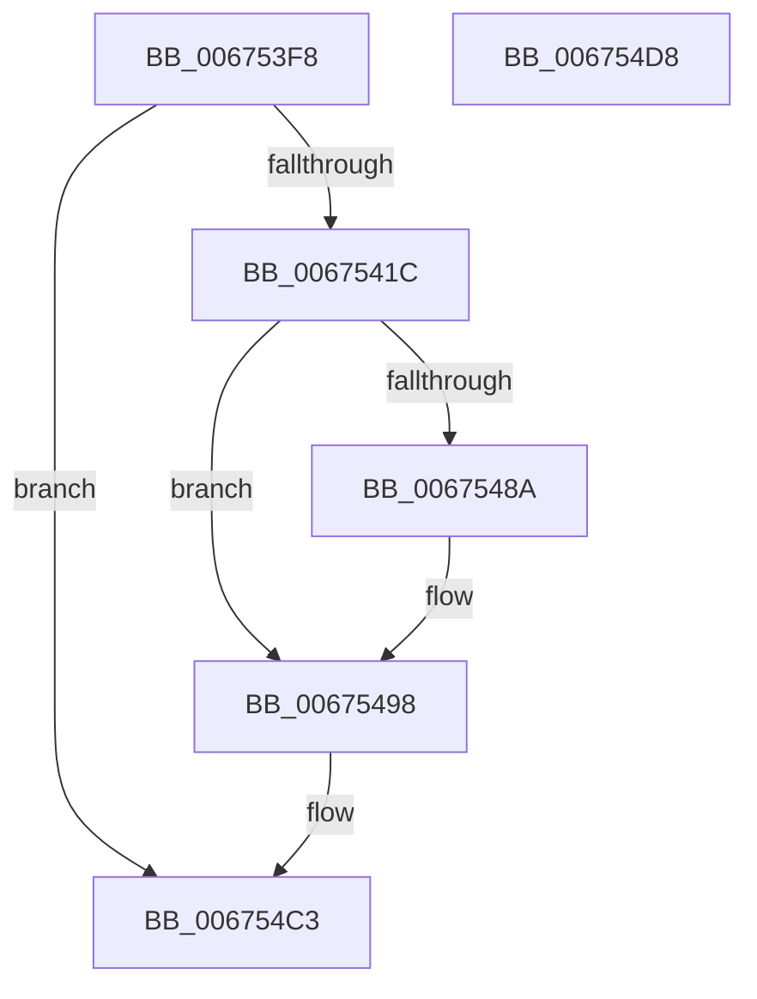

# MiDereferenceIoHugeRange

- RVA: `0x006753F8`–`0x006754D9` (길이 `225` bytes)
- VA: `0x00000001406753F8`
- 실행 섹션: `.text`
- PDB 이름 있음: `예`; PDB Function 태그: `아니요`
- unwind 정보 RVA: `0x000B6A1C`
- 디코드: `58`개 명령, `225/225` bytes 표시
- 미해석 바이트: `0` (있으면 어셈블리에 `.byte`로 보존)

> 이 문서는 커널 이미지의 기계어와 PDB 기호를 분석해 생성했습니다. 4번과 5번은 함수 원형과 자료형을 바이너리 사용 방식에서 추정한 C 해석이며 원본 소스 복구 결과는 아닙니다.

## 1. Dependencies

- 직접 호출 지점: **4**; 고유 호출 대상: **4**
- 직접 호출자로 확인된 함수: **1**
- RIP 상대 이미지 참조: **2**

### Outgoing calls
- `0x0067540F` → [MiIsPageInIoHugeRangeTransition](../2A/MiIsPageInIoHugeRangeTransition_function_002AB7A0.md) (function, `0x002AB7A0`)
- `0x0067543E` → [MiHugePfnPartition](../43/MiHugePfnPartition_function_004371B4.md) (function, `0x004371B4`)
- `0x00675449` → [MiLockHugePfnInternal](../3F/MiLockHugePfnInternal_function_003FBC80.md) (function, `0x003FBC80`)
- `0x00675493` → [MiInsertHugeRangeInList](../43/MiInsertHugeRangeInList_function_004371E8.md) (function, `0x004371E8`)

### Direct callers
- [MiDeleteStaleCacheMaps](MiDeleteStaleCacheMaps_function_0067B780.md) at `0x0067BB9A`

### Static image references
- `0x0067541C` → RVA `0x00E300C0` (`.data`; read)
- `0x0067549F` → RVA `0x00E300C8` (`.data`; read)

## 2. Other-region calls and transfers

- 다른 실행 섹션으로 향하는 call: **0**
- 별도 외부 분기/꼬리 이동을 확인하지 못했습니다.

## 3. Assembly (complete function range)

```asm
006753F8  48 89 5C 24 08                  mov qword ptr [rsp + 8], rbx
006753FD  48 89 6C 24 18                  mov qword ptr [rsp + 0x18], rbp
00675402  48 89 74 24 20                  mov qword ptr [rsp + 0x20], rsi
00675407  57                              push rdi
00675408  48 83 EC 20                     sub rsp, 0x20
0067540C  48 8B D9                        mov rbx, rcx
0067540F  E8 8C 63 C3 FF                  call 0x1402ab7a0
00675414  85 C0                           test eax, eax
00675416  0F 84 A7 00 00 00               je 0x1406754c3
0067541C  48 8B 05 9D AC 7B 00            mov rax, qword ptr [rip + 0x7bac9d]
00675423  48 8D 4C 24 38                  lea rcx, [rsp + 0x38]
00675428  48 C1 EB 12                     shr rbx, 0x12
0067542C  81 E3 FF FF 3F 00               and ebx, 0x3fffff
00675432  48 8D 3C D8                     lea rdi, [rax + rbx*8]
00675436  48 8B 07                        mov rax, qword ptr [rdi]
00675439  48 89 44 24 38                  mov qword ptr [rsp + 0x38], rax
0067543E  E8 71 1D DC FF                  call 0x1404371b4
00675443  48 8B CF                        mov rcx, rdi
00675446  48 8B E8                        mov rbp, rax
00675449  E8 32 68 D8 FF                  call 0x1403fbc80
0067544E  48 8B 17                        mov rdx, qword ptr [rdi]
00675451  BE 01 00 00 00                  mov esi, 1
00675456  4C 8B C2                        mov r8, rdx
00675459  49 C1 E8 0F                     shr r8, 0xf
0067545D  41 81 E0 FF 01 00 00            and r8d, 0x1ff
00675464  44 2B C6                        sub r8d, esi
00675467  41 8B C8                        mov ecx, r8d
0067546A  48 C1 E1 0F                     shl rcx, 0xf
0067546E  48 8B C1                        mov rax, rcx
00675471  48 33 C2                        xor rax, rdx
00675474  48 25 FF 7F 00 FF               and rax, 0xffffffffff007fff
0067547A  48 33 C1                        xor rax, rcx
0067547D  48 89 44 24 38                  mov qword ptr [rsp + 0x38], rax
00675482  48 89 07                        mov qword ptr [rdi], rax
00675485  45 85 C0                        test r8d, r8d
00675488  75 0E                           jne 0x140675498
0067548A  44 8D 46 11                     lea r8d, [rsi + 0x11]
0067548E  8B D3                           mov edx, ebx
00675490  48 8B CD                        mov rcx, rbp
00675493  E8 50 1D DC FF                  call 0x1404371e8
00675498  48 2B 3D 21 AC 7B 00            sub rdi, qword ptr [rip + 0x7bac21]
0067549F  48 8B 05 22 AC 7B 00            mov rax, qword ptr [rip + 0x7bac22]
006754A6  48 C1 FF 03                     sar rdi, 3
006754AA  81 E7 FF FF 3F 00               and edi, 0x3fffff
006754B0  8B CF                           mov ecx, edi
006754B2  83 E1 1F                        and ecx, 0x1f
006754B5  D3 E6                           shl esi, cl
006754B7  8B CF                           mov ecx, edi
006754B9  F7 D6                           not esi
006754BB  48 C1 E9 05                     shr rcx, 5
006754BF  F0 21 34 88                     lock and dword ptr [rax + rcx*4], esi
006754C3  48 8B 5C 24 30                  mov rbx, qword ptr [rsp + 0x30]
006754C8  48 8B 6C 24 40                  mov rbp, qword ptr [rsp + 0x40]
006754CD  48 8B 74 24 48                  mov rsi, qword ptr [rsp + 0x48]
006754D2  48 83 C4 20                     add rsp, 0x20
006754D6  5F                              pop rdi
006754D7  C3                              ret
006754D8  CC                              int3
```

## 4. C-style interpretation (structured pseudocode)

```c
__int64 __fastcall MiDereferenceIoHugeRange(__int64 a1)
{
    __int64 result;
    __int64 v_rbx;
    __int64 v_rdi;
    __int64 v_rsi;
    __int64 v_rsp;
    unsigned __int64 v_stack_p10;
    unsigned __int64 v_stack_p18;
    unsigned __int64 v_stack_p20;
    unsigned __int64 v_stack_p8;

    v_stack_p8 = v_rbx;
    v_stack_p18 = v_rbp;
    v_stack_p20 = v_rsi;
    v_rsp = (v_rsp) - (32);
    result = MiIsPageInIoHugeRangeTransition(a1, a2, a3, a4);
    if ((unsigned int)(result) == 0) goto loc_006754C3;
    v_rbx = (a1) >> (18);
    v_rbx = (unsigned int)((v_rbx) & (0x3FFFFFULL));
    v_stack_p10 = *(unsigned __int64 *)(*(unsigned __int64 *)(v_rip + 8105117) + v_rbx * 8);
    result = MiHugePfnPartition(v_stack_p10, a2, a3, a4);
    result = MiLockHugePfnInternal(*(unsigned __int64 *)(v_rip + 8105117) + v_rbx * 8, a2, a3, a4);
    a3 = (*(unsigned __int64 *)(*(unsigned __int64 *)(v_rip + 8105117) + v_rbx * 8)) >> (15);
    a3 = (unsigned int)((a3) & (511));
    a3 = (unsigned int)((a3) - (1));
    a1 = ((unsigned int)((unsigned int)(a3))) << (15);
    result = (a1) ^ (*(unsigned __int64 *)(*(unsigned __int64 *)(v_rip + 8105117) + v_rbx * 8));
    result = (result) & (0xFFFFFFFFFF007FFFULL);
    result = (result) ^ (a1);
    v_stack_p10 = result;
    *(unsigned __int64 *)(*(unsigned __int64 *)(v_rip + 8105117) + v_rbx * 8) = result;
    if ((unsigned int)(a3) == 0) {
        a3 = 1 + 17;
        a2 = (unsigned int)(v_rbx);
        a1 = result;
        result = MiInsertHugeRangeInList(a1, a2, a3, a4);
    }
    v_rdi = (*(unsigned __int64 *)(v_rip + 8105117) + v_rbx * 8) - (*(unsigned __int64 *)(v_rip + 8104993));
    v_rdi = (v_rdi) >> (3);
    v_rdi = (unsigned int)((v_rdi) & (0x3FFFFFULL));
    a1 = (unsigned int)(((unsigned int)((unsigned int)(v_rdi))) & (31));
    v_rsi = (unsigned int)((1) << ((unsigned __int8)(a1)));
    v_rsi = (unsigned int)(~(v_rsi));
    a1 = ((unsigned int)((unsigned int)(v_rdi))) >> (5);
loc_006754C3:
    v_rsp = (v_rsp) + (32);
    return *(unsigned __int64 *)(v_rip + 8104994);
}
```

## 5. (Beta) C Style

```c
int64_t MiDereferenceIoHugeRange(int64_t Arg1)
{
    int64_t result;
    int64_t local_rbx;
    int64_t local_rdi;
    int64_t local_rsi;
    int64_t local_rsp;
    uint64_t v_stack_p10;
    uint64_t v_stack_p18;
    uint64_t v_stack_p20;
    uint64_t v_stack_p8;

    v_stack_p8 = local_rbx;
    v_stack_p18 = local_rbp;
    v_stack_p20 = local_rsi;
    local_rsp = (local_rsp) - (32);
    result = MiIsPageInIoHugeRangeTransition(Arg1, a2, a3, a4);
    if ((uint32_t)(result) == 0) goto loc_006754C3;
    local_rbx = (Arg1) >> (18);
    local_rbx = (uint32_t)((local_rbx) & (0x3FFFFFULL));
    v_stack_p10 = *(uint64_t *)(*(uint64_t *)(v_rip + 0x7BAC9D) + local_rbx * 8);
    result = MiHugePfnPartition(v_stack_p10, a2, a3, a4);
    result = MiLockHugePfnInternal(*(uint64_t *)(v_rip + 0x7BAC9D) + local_rbx * 8, a2, a3, a4);
    a3 = (*(uint64_t *)(*(uint64_t *)(v_rip + 0x7BAC9D) + local_rbx * 8)) >> (15);
    a3 = (uint32_t)((a3) & (511));
    a3 = (uint32_t)((a3) - (1));
    Arg1 = ((uint32_t)((uint32_t)(a3))) << (15);
    result = (Arg1) ^ (*(uint64_t *)(*(uint64_t *)(v_rip + 0x7BAC9D) + local_rbx * 8));
    result = (result) & (0xFFFFFFFFFF007FFFULL);
    result = (result) ^ (Arg1);
    v_stack_p10 = result;
    *(uint64_t *)(*(uint64_t *)(v_rip + 0x7BAC9D) + local_rbx * 8) = result;
    if ((uint32_t)(a3) == 0) {
        a3 = 1 + 17;
        a2 = (uint32_t)(local_rbx);
        Arg1 = result;
        result = MiInsertHugeRangeInList(Arg1, a2, a3, a4);
    }
    local_rdi = (*(uint64_t *)(v_rip + 0x7BAC9D) + local_rbx * 8) - (*(uint64_t *)(v_rip + 0x7BAC21));
    local_rdi = (local_rdi) >> (3);
    local_rdi = (uint32_t)((local_rdi) & (0x3FFFFFULL));
    Arg1 = (uint32_t)(((uint32_t)((uint32_t)(local_rdi))) & (31));
    local_rsi = (uint32_t)((1) << ((uint8_t)(Arg1)));
    local_rsi = (uint32_t)(~(local_rsi));
    Arg1 = ((uint32_t)((uint32_t)(local_rdi))) >> (5);
loc_006754C3:
    local_rsp = (local_rsp) + (32);
    return *(uint64_t *)(v_rip + 0x7BAC22);
}
```

## 6. Execution-region graph

[열기: 2D/3D 그래프와 함수 탐색 컨트롤 패널](../../../control-panel.html?section=text&rva=0x006753F8&view=graph)

- 2D 그래프는 위에서 아래로 흐르고, 3D 그래프는 빈 공간을 드래그해 회전합니다. Shift+드래그는 이동, 휠은 확대·축소, 함수 노드 선택은 대상 보고서 이동입니다.

### Static fallback


