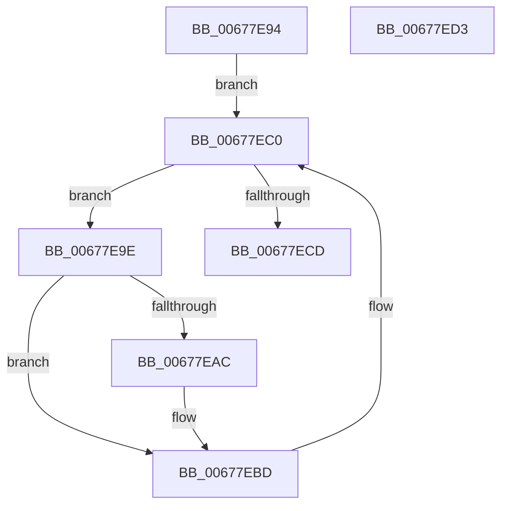

# MiDistributeSystemCacheVaReductions

- RVA: `0x00677E94`–`0x00677ED4` (길이 `64` bytes)
- VA: `0x0000000140677E94`
- 실행 섹션: `.text`
- PDB 이름 있음: `예`; PDB Function 태그: `아니요`
- unwind 정보 RVA: `0x0005CF00`
- 디코드: `21`개 명령, `64/64` bytes 표시
- 미해석 바이트: `0` (있으면 어셈블리에 `.byte`로 보존)

> 이 문서는 커널 이미지의 기계어와 PDB 기호를 분석해 생성했습니다. 4번과 5번은 함수 원형과 자료형을 바이너리 사용 방식에서 추정한 C 해석이며 원본 소스 복구 결과는 아닙니다.

## 1. Dependencies

- 직접 호출 지점: **2**; 고유 호출 대상: **2**
- 직접 호출자로 확인된 함수: **1**
- RIP 상대 이미지 참조: **0**

### Outgoing calls
- `0x00677EB8` → [KeSetEvent](../33/KeSetEvent_function_0033F310.md) (function, `0x0033F310`)
- `0x00677EC0` → [PsGetNextPartition](../3B/PsGetNextPartition_function_003B9D5C.md) (function, `0x003B9D5C`)

### Direct callers
- [MiSegmentDereferenceWorker](../46/MiSegmentDereferenceWorker_function_00464D40.md) at `0x00464D99`

### Static image references
- 디코드된 RIP-relative 메모리 참조가 없습니다.

## 2. Other-region calls and transfers

- 다른 실행 섹션으로 향하는 call: **0**
- 별도 외부 분기/꼬리 이동을 확인하지 못했습니다.

## 3. Assembly (complete function range)

```asm
00677E94  40 53                           push rbx
00677E96  48 83 EC 20                     sub rsp, 0x20
00677E9A  33 C9                           xor ecx, ecx
00677E9C  EB 22                           jmp 0x140677ec0
00677E9E  48 8B 03                        mov rax, qword ptr [rbx]
00677EA1  8B 88 78 09 00 00               mov ecx, dword ptr [rax + 0x978]
00677EA7  83 F9 10                        cmp ecx, 0x10
00677EAA  76 11                           jbe 0x140677ebd
00677EAC  48 8D 88 80 09 00 00            lea rcx, [rax + 0x980]
00677EB3  45 33 C0                        xor r8d, r8d
00677EB6  33 D2                           xor edx, edx
00677EB8  E8 53 74 CC FF                  call 0x14033f310
00677EBD  48 8B CB                        mov rcx, rbx
00677EC0  E8 97 1E D4 FF                  call 0x1403b9d5c
00677EC5  48 8B D8                        mov rbx, rax
00677EC8  48 85 C0                        test rax, rax
00677ECB  75 D1                           jne 0x140677e9e
00677ECD  48 83 C4 20                     add rsp, 0x20
00677ED1  5B                              pop rbx
00677ED2  C3                              ret
00677ED3  CC                              int3
```

## 4. C-style interpretation (structured pseudocode)

```c
__int64 __fastcall MiDistributeSystemCacheVaReductions(int a1, int a2, int a3)
{
    __int64 result;
    __int64 v_rsp;

    v_rsp = (v_rsp) - (32);
    a1 = 0;
    goto loc_00677EC0;
loc_00677E9E:
    result = *(unsigned __int64 *)(v_rbx);
    if (((unsigned int)((unsigned int)(*(unsigned int *)(*(unsigned __int64 *)(v_rbx) + 2424)))) >= = 16) {
        a1 = *(unsigned __int64 *)(v_rbx) + 2432;
        a3 = 0;
        a2 = 0;
        result = KeSetEvent(a1, a2, a3, a4);
    }
loc_00677EC0:
    result = PsGetNextPartition(v_rbx, a2, a3, a4);
    if (result != 0) goto loc_00677E9E;
    v_rsp = (v_rsp) + (32);
    return result;
}
```

## 5. (Beta) C Style

```c
int64_t MiDistributeSystemCacheVaReductions(int32_t Arg1, int32_t Arg2, int32_t Arg3)
{
    int64_t result;
    int64_t local_rsp;

    local_rsp = (local_rsp) - (32);
    Arg1 = 0;
    goto loc_00677EC0;
loc_00677E9E:
    result = *(uint64_t *)(local_rbx);
    if (((uint32_t)((uint32_t)(*(uint32_t *)(*(uint64_t *)(local_rbx) + 0x978)))) >= = 16) {
        Arg1 = *(uint64_t *)(local_rbx) + 2432;
        Arg3 = 0;
        Arg2 = 0;
        result = KeSetEvent(Arg1, Arg2, Arg3, a4);
    }
loc_00677EC0:
    result = PsGetNextPartition(local_rbx, Arg2, Arg3, a4);
    if (result != 0) goto loc_00677E9E;
    local_rsp = (local_rsp) + (32);
    return result;
}
```

## 6. Execution-region graph

[열기: 2D/3D 그래프와 함수 탐색 컨트롤 패널](../../../control-panel.html?section=text&rva=0x00677E94&view=graph)

- 2D 그래프는 위에서 아래로 흐르고, 3D 그래프는 빈 공간을 드래그해 회전합니다. Shift+드래그는 이동, 휠은 확대·축소, 함수 노드 선택은 대상 보고서 이동입니다.

### Static fallback


