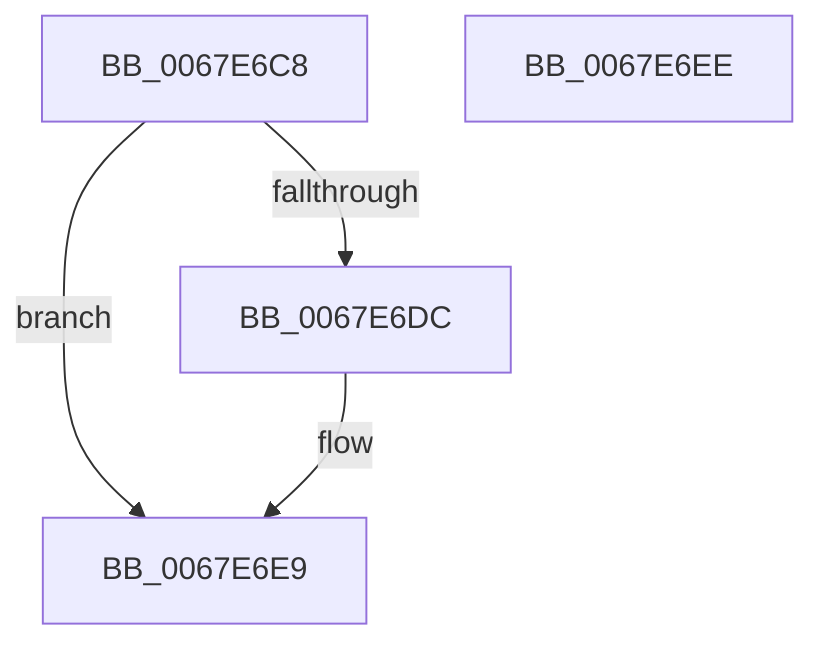

# MiEmptyAllWorkingSets

- RVA: `0x0067E6C8`–`0x0067E6EF` (길이 `39` bytes)
- VA: `0x000000014067E6C8`
- 실행 섹션: `.text`
- PDB 이름 있음: `예`; PDB Function 태그: `아니요`
- unwind 정보 RVA: `0x0005C788`
- 디코드: `10`개 명령, `39/39` bytes 표시
- 미해석 바이트: `0` (있으면 어셈블리에 `.byte`로 보존)

> 이 문서는 커널 이미지의 기계어와 PDB 기호를 분석해 생성했습니다. 4번과 5번은 함수 원형과 자료형을 바이너리 사용 방식에서 추정한 C 해석이며 원본 소스 복구 결과는 아닙니다.

## 1. Dependencies

- 직접 호출 지점: **1**; 고유 호출 대상: **1**
- 직접 호출자로 확인된 함수: **4**
- RIP 상대 이미지 참조: **1**

### Outgoing calls
- `0x0067E6E4` → [MiQueueWorkingSetRequest](../4F/MiQueueWorkingSetRequest_function_004F7168.md) (function, `0x004F7168`)

### Direct callers
- [MiFlushAllFilesystemPages](../4E/MiFlushAllFilesystemPages_function_004E141C.md) at `0x004E1492`
- [MmEmptyAllWorkingSets](MmEmptyAllWorkingSets_function_0067EF2C.md) at `0x0067EF39`
- [MiMirrorBrownPhase](../../pagelk/B7/MiMirrorBrownPhase_function_00B7C6B4.md) at `0x00B7C76E`
- [MmPerformMemoryListCommand](../../pagelk/B7/MmPerformMemoryListCommand_function_00B7D730.md) at `0x00B7D7A3`

### Static image references
- `0x0067E6CC` → RVA `0x00E37614` (`.data`; read)

## 2. Other-region calls and transfers

- 다른 실행 섹션으로 향하는 call: **0**
- 별도 외부 분기/꼬리 이동을 확인하지 못했습니다.

## 3. Assembly (complete function range)

```asm
0067E6C8  48 83 EC 28                     sub rsp, 0x28
0067E6CC  80 3D 41 8F 7B 00 00            cmp byte ptr [rip + 0x7b8f41], 0
0067E6D3  48 8B 81 C0 44 00 00            mov rax, qword ptr [rcx + 0x44c0]
0067E6DA  74 0D                           je 0x14067e6e9
0067E6DC  FF 40 1C                        inc dword ptr [rax + 0x1c]
0067E6DF  BA 04 00 00 00                  mov edx, 4
0067E6E4  E8 7F 8A E7 FF                  call 0x1404f7168
0067E6E9  48 83 C4 28                     add rsp, 0x28
0067E6ED  C3                              ret
0067E6EE  CC                              int3
```

## 4. C-style interpretation (structured pseudocode)

```c
__int64 __fastcall MiEmptyAllWorkingSets(__int64 a1)
{
    __int64 result;
    __int64 v_rsp;

    v_rsp = (v_rsp) - (40);
    result = *(unsigned __int64 *)(a1 + 17600);
    if ((*(unsigned __int8 *)(v_rip + 8097601)) != 0) {
        a2 = 4;
        result = MiQueueWorkingSetRequest(a1, a2, a3, a4);
    }
    v_rsp = (v_rsp) + (40);
    return result;
}
```

## 5. (Beta) C Style

```c
int64_t MiEmptyAllWorkingSets(void *Arg1)
{
    uint8_t *arg1 = (uint8_t *)Arg1;

    int64_t result;
    int64_t local_rsp;

    local_rsp = (local_rsp) - (40);
    result = *(uint64_t *)(arg1 + 0x44C0);
    if ((*(uint8_t *)(v_rip + 0x7B8F41)) != 0) {
        a2 = 4;
        result = MiQueueWorkingSetRequest(Arg1, a2, a3, a4);
    }
    local_rsp = (local_rsp) + (40);
    return result;
}
```

### 관측된 메모리 오프셋

구조체 형식이 확인되지 않은 접근은 인자 기준의 오프셋으로만 기록했습니다.

| 기준 인자 | 오프셋 표현 | 폭 (bit) | 접근 |
|---|---:|---:|---|
| `Arg1` | `+ 0x44C0` | `64` | `R` |

## 6. Execution-region graph

[열기: 2D/3D 그래프와 함수 탐색 컨트롤 패널](../../../control-panel.html?section=text&rva=0x0067E6C8&view=graph)

- 2D 그래프는 위에서 아래로 흐르고, 3D 그래프는 빈 공간을 드래그해 회전합니다. Shift+드래그는 이동, 휠은 확대·축소, 함수 노드 선택은 대상 보고서 이동입니다.

### Static fallback


