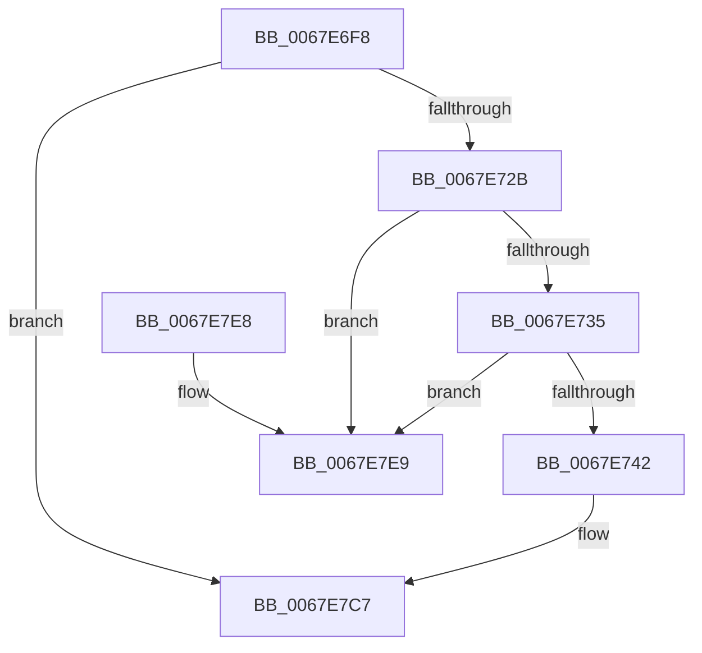

# MiEmptyTargetedWorkingSet

- RVA: `0x0067E6F8`–`0x0067E7F0` (길이 `248` bytes)
- VA: `0x000000014067E6F8`
- 실행 섹션: `.text`
- PDB 이름 있음: `예`; PDB Function 태그: `아니요`
- unwind 정보 RVA: `0x000D7FC0`
- 디코드: `62`개 명령, `248/248` bytes 표시
- 미해석 바이트: `0` (있으면 어셈블리에 `.byte`로 보존)

> 이 문서는 커널 이미지의 기계어와 PDB 기호를 분석해 생성했습니다. 4번과 5번은 함수 원형과 자료형을 바이너리 사용 방식에서 추정한 C 해석이며 원본 소스 복구 결과는 아닙니다.

## 1. Dependencies

- 직접 호출 지점: **6**; 고유 호출 대상: **4**
- 직접 호출자로 확인된 함수: **1**
- RIP 상대 이미지 참조: **1**

### Outgoing calls
- `0x0067E713` → [ExAcquireSpinLockExclusive](../24/ExAcquireSpinLockExclusive_function_00248690.md) (function, `0x00248690`)
- `0x0067E777` → [MiReleaseSpinLockExclusive](../24/MiReleaseSpinLockExclusive_function_002482C0.md) (function, `0x002482C0`)
- `0x0067E788` → [MiEmptyWorkingSetInitiate](../2A/MiEmptyWorkingSetInitiate_function_002A7128.md) (function, `0x002A7128`)
- `0x0067E799` → [ExAcquireSpinLockExclusive](../24/ExAcquireSpinLockExclusive_function_00248690.md) (function, `0x00248690`)
- `0x0067E7C2` → [MiReturnWsToExpansionList](../35/MiReturnWsToExpansionList_function_003504E0.md) (function, `0x003504E0`)
- `0x0067E7D1` → [MiReleaseSpinLockExclusive](../24/MiReleaseSpinLockExclusive_function_002482C0.md) (function, `0x002482C0`)

### Direct callers
- [MiTrimAllSystemPagableMemory](MiTrimAllSystemPagableMemory_function_0067EDF0.md) at `0x0067EEA1`

### Static image references
- `0x0067E70C` → RVA `0x00E374C0` (`.data`; read)

## 2. Other-region calls and transfers

- 다른 실행 섹션으로 향하는 call: **0**
- 별도 외부 분기/꼬리 이동을 확인하지 못했습니다.

## 3. Assembly (complete function range)

```asm
0067E6F8  48 89 5C 24 10                  mov qword ptr [rsp + 0x10], rbx
0067E6FD  48 89 74 24 18                  mov qword ptr [rsp + 0x18], rsi
0067E702  57                              push rdi
0067E703  48 83 EC 20                     sub rsp, 0x20
0067E707  48 8B F9                        mov rdi, rcx
0067E70A  33 DB                           xor ebx, ebx
0067E70C  48 8D 0D AD 8D 7B 00            lea rcx, [rip + 0x7b8dad]
0067E713  E8 78 9F BC FF                  call 0x140248690
0067E718  40 8A F0                        mov sil, al
0067E71B  48 8D 47 18                     lea rax, [rdi + 0x18]
0067E71F  48 8B 10                        mov rdx, qword ptr [rax]
0067E722  48 85 D2                        test rdx, rdx
0067E725  0F 84 9C 00 00 00               je 0x14067e7c7
0067E72B  48 39 42 08                     cmp qword ptr [rdx + 8], rax
0067E72F  0F 85 B4 00 00 00               jne 0x14067e7e9
0067E735  48 8B 48 08                     mov rcx, qword ptr [rax + 8]
0067E739  48 39 01                        cmp qword ptr [rcx], rax
0067E73C  0F 85 A7 00 00 00               jne 0x14067e7e9
0067E742  48 89 11                        mov qword ptr [rcx], rdx
0067E745  48 89 4A 08                     mov qword ptr [rdx + 8], rcx
0067E749  40 8A D6                        mov dl, sil
0067E74C  48 89 18                        mov qword ptr [rax], rbx
0067E74F  48 8D 0D 6A 8D 7B 00            lea rcx, [rip + 0x7b8d6a]
0067E756  8B 87 B8 00 00 00               mov eax, dword ptr [rdi + 0xb8]
0067E75C  89 44 24 30                     mov dword ptr [rsp + 0x30], eax
0067E760  C1 E8 08                        shr eax, 8
0067E763  24 FB                           and al, 0xfb
0067E765  0C 02                           or al, 2
0067E767  88 44 24 31                     mov byte ptr [rsp + 0x31], al
0067E76B  0F B7 44 24 30                  movzx eax, word ptr [rsp + 0x30]
0067E770  66 89 87 B8 00 00 00            mov word ptr [rdi + 0xb8], ax
0067E777  E8 44 9B BC FF                  call 0x1402482c0
0067E77C  49 83 C9 FF                     or r9, 0xffffffffffffffff
0067E780  45 33 C0                        xor r8d, r8d
0067E783  33 D2                           xor edx, edx
0067E785  48 8B CF                        mov rcx, rdi
0067E788  E8 9B 89 C2 FF                  call 0x1402a7128
0067E78D  48 8D 0D 2C 8D 7B 00            lea rcx, [rip + 0x7b8d2c]
0067E794  BB 01 00 00 00                  mov ebx, 1
0067E799  E8 F2 9E BC FF                  call 0x140248690
0067E79E  8B 87 B8 00 00 00               mov eax, dword ptr [rdi + 0xb8]
0067E7A4  33 D2                           xor edx, edx
0067E7A6  89 44 24 30                     mov dword ptr [rsp + 0x30], eax
0067E7AA  48 8B CF                        mov rcx, rdi
0067E7AD  C1 E8 08                        shr eax, 8
0067E7B0  24 F9                           and al, 0xf9
0067E7B2  88 44 24 31                     mov byte ptr [rsp + 0x31], al
0067E7B6  0F B7 44 24 30                  movzx eax, word ptr [rsp + 0x30]
0067E7BB  66 89 87 B8 00 00 00            mov word ptr [rdi + 0xb8], ax
0067E7C2  E8 19 1D CD FF                  call 0x1403504e0
0067E7C7  40 8A D6                        mov dl, sil
0067E7CA  48 8D 0D EF 8C 7B 00            lea rcx, [rip + 0x7b8cef]
0067E7D1  E8 EA 9A BC FF                  call 0x1402482c0
0067E7D6  48 8B 74 24 40                  mov rsi, qword ptr [rsp + 0x40]
0067E7DB  8B C3                           mov eax, ebx
0067E7DD  48 8B 5C 24 38                  mov rbx, qword ptr [rsp + 0x38]
0067E7E2  48 83 C4 20                     add rsp, 0x20
0067E7E6  5F                              pop rdi
0067E7E7  C3                              ret
0067E7E8  CC                              int3
0067E7E9  B9 03 00 00 00                  mov ecx, 3
0067E7EE  CD 29                           int 0x29
```

## 4. C-style interpretation (structured pseudocode)

```c
__int64 __fastcall MiEmptyTargetedWorkingSet(__int64 a1, __int64 a2, int a3, __int64 a4)
{
    __int64 result;
    __int64 v_rbx;
    __int64 v_rsp;
    unsigned __int64 v_stack_p10;
    unsigned __int64 v_stack_p18;
    unsigned int v_stack_p8;
    unsigned __int8 v_stack_p9;

    v_stack_p10 = v_rbx;
    v_stack_p18 = v_rsi;
    v_rsp = (v_rsp) - (32);
    v_rbx = 0;
    result = ExAcquireSpinLockExclusive(v_rip + 8097197, a2, a3, a4);
    if (*(unsigned __int64 *)(a1 + 24) == 0) goto loc_0067E7C7;
    if ((*(unsigned __int64 *)(*(unsigned __int64 *)(a1 + 24) + 8)) != (a1 + 24)) goto loc_0067E7E9;
    if ((*(unsigned __int64 *)(*(unsigned __int64 *)(a1 + 24 + 8))) != (a1 + 24)) goto loc_0067E7E9;
    *(unsigned __int64 *)(*(unsigned __int64 *)(a1 + 24 + 8)) = *(unsigned __int64 *)(a1 + 24);
    *(unsigned __int64 *)(*(unsigned __int64 *)(a1 + 24) + 8) = *(unsigned __int64 *)(a1 + 24 + 8);
    *(unsigned __int64 *)(a1 + 24) = 0;
    v_stack_p8 = (unsigned int)((unsigned int)(*(unsigned int *)(a1 + 184)));
    result = (unsigned int)(((unsigned int)(*(unsigned int *)(a1 + 184))) >> (8));
    result = (unsigned __int8)((result) & (251));
    result = (unsigned __int8)((result) | (2));
    v_stack_p9 = (unsigned __int8)(result);
    *(unsigned __int16 *)(a1 + 184) = (unsigned __int16)(v_stack_p8);
    result = MiReleaseSpinLockExclusive(v_rip + 8097130, (unsigned __int8)((unsigned __int8)(result)), a3, a4);
    a4 = (a4) | (-1);
    a3 = 0;
    a2 = 0;
    result = MiEmptyWorkingSetInitiate(a1, a2, a3, a4);
    result = ExAcquireSpinLockExclusive(v_rip + 8097068, a2, a3, a4);
    a2 = 0;
    v_stack_p8 = (unsigned int)((unsigned int)(*(unsigned int *)(a1 + 184)));
    result = (unsigned int)(((unsigned int)(*(unsigned int *)(a1 + 184))) >> (8));
    result = (unsigned __int8)((result) & (249));
    v_stack_p9 = (unsigned __int8)(result);
    *(unsigned __int16 *)(a1 + 184) = (unsigned __int16)(v_stack_p8);
    result = MiReturnWsToExpansionList(a1, a2, a3, a4);
loc_0067E7C7:
    result = MiReleaseSpinLockExclusive(v_rip + 8097007, (unsigned __int8)((unsigned __int8)(result)), a3, a4);
    v_rsp = (v_rsp) + (32);
    return 1;
loc_0067E7E9:
    return 1;
}
```

## 5. (Beta) C Style

```c
int64_t MiEmptyTargetedWorkingSet(void *Arg1, int64_t Arg2, int32_t Arg3, int64_t Arg4)
{
    uint8_t *arg1 = (uint8_t *)Arg1;

    int64_t result;
    int64_t local_rbx;
    int64_t local_rsp;
    uint64_t v_stack_p10;
    uint64_t v_stack_p18;
    uint32_t v_stack_p8;
    uint8_t v_stack_p9;

    v_stack_p10 = local_rbx;
    v_stack_p18 = local_rsi;
    local_rsp = (local_rsp) - (32);
    local_rbx = 0;
    result = ExAcquireSpinLockExclusive(v_rip + 8097197, Arg2, Arg3, Arg4);
    if (*(uint64_t *)(arg1 + 0x18) == 0) goto loc_0067E7C7;
    if ((*(uint64_t *)(*(uint64_t *)(arg1 + 0x18) + 0x8)) != (Arg1 + 24)) goto loc_0067E7E9;
    if ((*(uint64_t *)(*(uint64_t *)(arg1 + 0x18 + 0x8))) != (Arg1 + 24)) goto loc_0067E7E9;
    *(uint64_t *)(*(uint64_t *)(arg1 + 0x18 + 0x8)) = *(uint64_t *)(arg1 + 0x18);
    *(uint64_t *)(*(uint64_t *)(arg1 + 0x18) + 0x8) = *(uint64_t *)(arg1 + 0x18 + 0x8);
    *(uint64_t *)(arg1 + 0x18) = 0;
    v_stack_p8 = (uint32_t)((uint32_t)(*(uint32_t *)(arg1 + 0xB8)));
    result = (uint32_t)(((uint32_t)(*(uint32_t *)(arg1 + 0xB8))) >> (8));
    result = (uint8_t)((result) & (251));
    result = (uint8_t)((result) | (2));
    v_stack_p9 = (uint8_t)(result);
    *(uint16_t *)(arg1 + 0xB8) = (uint16_t)(v_stack_p8);
    result = MiReleaseSpinLockExclusive(v_rip + 8097130, (uint8_t)((uint8_t)(result)), Arg3, Arg4);
    Arg4 = (Arg4) | (-1);
    Arg3 = 0;
    Arg2 = 0;
    result = MiEmptyWorkingSetInitiate(Arg1, Arg2, Arg3, Arg4);
    result = ExAcquireSpinLockExclusive(v_rip + 8097068, Arg2, Arg3, Arg4);
    Arg2 = 0;
    v_stack_p8 = (uint32_t)((uint32_t)(*(uint32_t *)(arg1 + 0xB8)));
    result = (uint32_t)(((uint32_t)(*(uint32_t *)(arg1 + 0xB8))) >> (8));
    result = (uint8_t)((result) & (249));
    v_stack_p9 = (uint8_t)(result);
    *(uint16_t *)(arg1 + 0xB8) = (uint16_t)(v_stack_p8);
    result = MiReturnWsToExpansionList(Arg1, Arg2, Arg3, Arg4);
loc_0067E7C7:
    result = MiReleaseSpinLockExclusive(v_rip + 8097007, (uint8_t)((uint8_t)(result)), Arg3, Arg4);
    local_rsp = (local_rsp) + (32);
    return 1;
loc_0067E7E9:
    return 1;
}
```

### 관측된 메모리 오프셋

구조체 형식이 확인되지 않은 접근은 인자 기준의 오프셋으로만 기록했습니다.

| 기준 인자 | 오프셋 표현 | 폭 (bit) | 접근 |
|---|---:|---:|---|
| `Arg1` | `+ 0x0` | `64` | `R` |
| `Arg1` | `+ 0x0` | `64` | `W` |
| `Arg1` | `+ 0x8` | `64` | `R` |
| `Arg1` | `+ 0x18` | `64` | `R` |
| `Arg1` | `+ 0xB8` | `16` | `W` |
| `Arg1` | `+ 0xB8` | `32` | `R` |

## 6. Execution-region graph

[열기: 2D/3D 그래프와 함수 탐색 컨트롤 패널](../../../control-panel.html?section=text&rva=0x0067E6F8&view=graph)

- 2D 그래프는 위에서 아래로 흐르고, 3D 그래프는 빈 공간을 드래그해 회전합니다. Shift+드래그는 이동, 휠은 확대·축소, 함수 노드 선택은 대상 보고서 이동입니다.

### Static fallback


