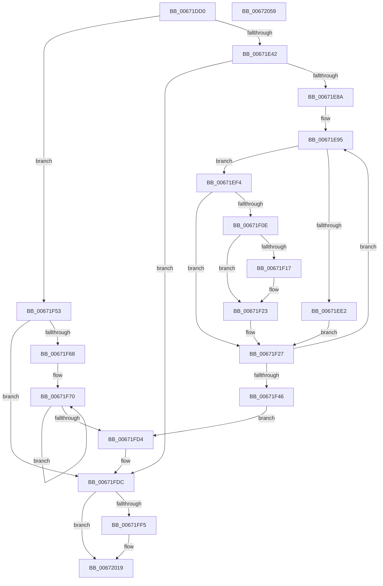

# MiEnableNewPfns

- RVA: `0x00671DD0`–`0x0067205A` (길이 `650` bytes)
- VA: `0x0000000140671DD0`
- 실행 섹션: `.text`
- PDB 이름 있음: `예`; PDB Function 태그: `아니요`
- unwind 정보 RVA: `0x000BE498`
- 디코드: `164`개 명령, `650/650` bytes 표시
- 미해석 바이트: `0` (있으면 어셈블리에 `.byte`로 보존)

> 이 문서는 커널 이미지의 기계어와 PDB 기호를 분석해 생성했습니다. 4번과 5번은 함수 원형과 자료형을 바이너리 사용 방식에서 추정한 C 해석이며 원본 소스 복구 결과는 아닙니다.

## 1. Dependencies

- 직접 호출 지점: **16**; 고유 호출 대상: **10**
- 직접 호출자로 확인된 함수: **1**
- RIP 상대 이미지 참조: **3**

### Outgoing calls
- `0x00671E98` → [MiPageToNode](../33/MiPageToNode_function_00338CD0.md) (function, `0x00338CD0`)
- `0x00671EB4` → [MiDetermineNewPfnHeatState](../45/MiDetermineNewPfnHeatState_function_004586A8.md) (function, `0x004586A8`)
- `0x00671EBE` → [MiLockPageInline](../31/MiLockPageInline_function_0031A340.md) (function, `0x0031A340`)
- `0x00671ECC` → [MiSetFreeZeroPfnCold](../37/MiSetFreeZeroPfnCold_function_00379428.md) (function, `0x00379428`)
- `0x00671EE2` → [MiInsertPageInFreeOrZeroedList](../33/MiInsertPageInFreeOrZeroedList_function_00334D20.md) (function, `0x00334D20`)
- `0x00671EED` → [MiUnlockPage](../31/MiUnlockPage_function_0031A3E0.md) (function, `0x0031A3E0`)
- `0x00671F03` → [MiInsertPossiblyBadPage](../68/MiInsertPossiblyBadPage_function_00689DF0.md) (function, `0x00689DF0`)
- `0x00671F1E` → [KiLowerIrqlProcessIrqlFlags](../4F/KiLowerIrqlProcessIrqlFlags_function_004F5698.md) (function, `0x004F5698`)
- `0x00671F73` → [MiPageToNode](../33/MiPageToNode_function_00338CD0.md) (function, `0x00338CD0`)
- `0x00671F8D` → [MiDetermineNewPfnHeatState](../45/MiDetermineNewPfnHeatState_function_004586A8.md) (function, `0x004586A8`)
- `0x00671FA7` → [MiLockPageInline](../31/MiLockPageInline_function_0031A340.md) (function, `0x0031A340`)
- `0x00671FB4` → [MiInsertPageInFreeOrZeroedList](../33/MiInsertPageInFreeOrZeroedList_function_00334D20.md) (function, `0x00334D20`)
- `0x00671FBE` → [MiUnlockPage](../31/MiUnlockPage_function_0031A3E0.md) (function, `0x0031A3E0`)
- `0x00672014` → [MiIncreaseCommitLimits](../68/MiIncreaseCommitLimits_function_0068CADC.md) (function, `0x0068CADC`)
- `0x00672034` → [MiIncreaseCommitLimits](../68/MiIncreaseCommitLimits_function_0068CADC.md) (function, `0x0068CADC`)
- `0x00672043` → [MiReturnResident](../28/MiReturnResident_function_00286890.md) (function, `0x00286890`)

### Direct callers
- [MiCompleteMemoryAddition](../../page/7F/MiCompleteMemoryAddition_function_007F9FAC.md) at `0x007FA086`

### Static image references
- `0x00671E44` → RVA `0x00000000` (`image boundary/outside`; read)
- `0x00671F0E` → RVA `0x00FC6D20` (`ALMOSTRO`; read)
- `0x00671FF9` → RVA `0x00E38D00` (`.data`; read)

## 2. Other-region calls and transfers

- 다른 실행 섹션으로 향하는 call: **0**
- 별도 외부 분기/꼬리 이동을 확인하지 못했습니다.

## 3. Assembly (complete function range)

```asm
00671DD0  48 89 54 24 10                  mov qword ptr [rsp + 0x10], rdx
00671DD5  48 89 4C 24 08                  mov qword ptr [rsp + 8], rcx
00671DDA  53                              push rbx
00671DDB  55                              push rbp
00671DDC  56                              push rsi
00671DDD  57                              push rdi
00671DDE  41 54                           push r12
00671DE0  41 55                           push r13
00671DE2  41 56                           push r14
00671DE4  41 57                           push r15
00671DE6  48 83 EC 58                     sub rsp, 0x58
00671DEA  48 8B 79 10                     mov rdi, qword ptr [rcx + 0x10]
00671DEE  4C 8B EA                        mov r13, rdx
00671DF1  48 8B 59 30                     mov rbx, qword ptr [rcx + 0x30]
00671DF5  BA 00 00 00 00                  mov edx, 0
00671DFA  4C 8B 79 20                     mov r15, qword ptr [rcx + 0x20]
00671DFE  48 8B F1                        mov rsi, rcx
00671E01  8B 49 28                        mov ecx, dword ptr [rcx + 0x28]
00671E04  8B C1                           mov eax, ecx
00671E06  25 00 02 00 00                  and eax, 0x200
00671E0B  48 89 5C 24 30                  mov qword ptr [rsp + 0x30], rbx
00671E10  48 8D 2C 7F                     lea rbp, [rdi + rdi*2]
00671E14  89 8C 24 B8 00 00 00            mov dword ptr [rsp + 0xb8], ecx
00671E1B  0F 94 C2                        sete dl
00671E1E  4D 8D 24 3F                     lea r12, [r15 + rdi]
00671E22  F7 D8                           neg eax
00671E24  89 94 24 B0 00 00 00            mov dword ptr [rsp + 0xb0], edx
00671E2B  45 1B F6                        sbb r14d, r14d
00671E2E  48 C1 E5 04                     shl rbp, 4
00671E32  41 83 C6 02                     add r14d, 2
00671E36  F7 C1 00 30 00 00               test ecx, 0x3000
00671E3C  0F 84 11 01 00 00               je 0x140671f53
00671E42  8B C1                           mov eax, ecx
00671E44  4C 8D 05 B5 E1 98 FF            lea r8, [rip - 0x671e4b]
00671E4B  C1 E8 0C                        shr eax, 0xc
00671E4E  83 E0 01                        and eax, 1
00671E51  44 8B E0                        mov r12d, eax
00671E54  4C 89 64 24 48                  mov qword ptr [rsp + 0x48], r12
00671E59  49 8B 94 C0 60 1C 01 00         mov rdx, qword ptr [r8 + rax*8 + 0x11c60]
00671E61  48 89 54 24 40                  mov qword ptr [rsp + 0x40], rdx
00671E66  48 B8 00 00 00 00 00 DE FF FF   movabs rax, 0xffffde0000000000
00671E70  48 8B C0                        mov rax, rax
00671E73  43 8B 8C A0 E8 35 01 00         mov ecx, dword ptr [r8 + r12*4 + 0x135e8]
00671E7B  48 03 E8                        add rbp, rax
00671E7E  49 D3 EF                        shr r15, cl
00671E81  4D 85 FF                        test r15, r15
00671E84  0F 84 52 01 00 00               je 0x140671fdc
00671E8A  48 8D 34 52                     lea rsi, [rdx + rdx*2]
00671E8E  4C 8B ED                        mov r13, rbp
00671E91  48 C1 E6 04                     shl rsi, 4
00671E95  48 8B CF                        mov rcx, rdi
00671E98  E8 33 6E CC FF                  call 0x140338cd0
00671E9D  8B C8                           mov ecx, eax
00671E9F  41 8B D4                        mov edx, r12d
00671EA2  4C 69 C1 80 DF 00 00            imul r8, rcx, 0xdf80
00671EA9  8B 8C 24 B0 00 00 00            mov ecx, dword ptr [rsp + 0xb0]
00671EB0  4C 03 43 10                     add r8, qword ptr [rbx + 0x10]
00671EB4  E8 EF 67 DE FF                  call 0x1404586a8
00671EB9  48 8B CD                        mov rcx, rbp
00671EBC  8B D8                           mov ebx, eax
00671EBE  E8 7D 84 CA FF                  call 0x14031a340
00671EC3  8B D3                           mov edx, ebx
00671EC5  44 0F B6 E0                     movzx r12d, al
00671EC9  48 8B CD                        mov rcx, rbp
00671ECC  E8 57 75 D0 FF                  call 0x140379428
00671ED1  48 8B 55 28                     mov rdx, qword ptr [rbp + 0x28]
00671ED5  48 8B CF                        mov rcx, rdi
00671ED8  48 0F BA E2 29                  bt rdx, 0x29
00671EDD  41 8B D6                        mov edx, r14d
00671EE0  72 12                           jb 0x140671ef4
00671EE2  E8 39 2E CC FF                  call 0x140334d20
00671EE7  41 8A D4                        mov dl, r12b
00671EEA  48 8B CD                        mov rcx, rbp
00671EED  E8 EE 84 CA FF                  call 0x14031a3e0
00671EF2  EB 33                           jmp 0x140671f27
00671EF4  48 B8 FF FF FF FF FF FF FF 7F   movabs rax, 0x7fffffffffffffff
00671EFE  F0 48 21 45 18                  lock and qword ptr [rbp + 0x18], rax
00671F03  E8 E8 7E 01 00                  call 0x140689df0
00671F08  41 80 FC 02                     cmp r12b, 2
00671F0C  73 19                           jae 0x140671f27
00671F0E  83 3D 0B 4E 95 00 00            cmp dword ptr [rip + 0x954e0b], 0
00671F15  74 0C                           je 0x140671f23
00671F17  44 0F 20 C1                     mov rcx, cr8
00671F1B  41 8A D4                        mov dl, r12b
00671F1E  E8 75 37 E8 FF                  call 0x1404f5698
00671F23  45 0F 22 C4                     mov cr8, r12
00671F27  48 03 7C 24 40                  add rdi, qword ptr [rsp + 0x40]
00671F2C  4C 03 EE                        add r13, rsi
00671F2F  48 8B 5C 24 30                  mov rbx, qword ptr [rsp + 0x30]
00671F34  49 8B ED                        mov rbp, r13
00671F37  4C 8B 64 24 48                  mov r12, qword ptr [rsp + 0x48]
00671F3C  49 83 EF 01                     sub r15, 1
00671F40  0F 85 4F FF FF FF               jne 0x140671e95
00671F46  48 8B B4 24 A0 00 00 00         mov rsi, qword ptr [rsp + 0xa0]
00671F4E  E9 81 00 00 00                  jmp 0x140671fd4
00671F53  48 B8 00 00 00 00 00 DE FF FF   movabs rax, 0xffffde0000000000
00671F5D  48 8B C0                        mov rax, rax
00671F60  48 03 E8                        add rbp, rax
00671F63  49 3B FC                        cmp rdi, r12
00671F66  73 74                           jae 0x140671fdc
00671F68  44 8B AC 24 B0 00 00 00         mov r13d, dword ptr [rsp + 0xb0]
00671F70  48 8B CF                        mov rcx, rdi
00671F73  E8 58 6D CC FF                  call 0x140338cd0
00671F78  8B C8                           mov ecx, eax
00671F7A  BA 03 00 00 00                  mov edx, 3
00671F7F  4C 69 C1 80 DF 00 00            imul r8, rcx, 0xdf80
00671F86  41 8B CD                        mov ecx, r13d
00671F89  4C 03 43 10                     add r8, qword ptr [rbx + 0x10]
00671F8D  E8 16 67 DE FF                  call 0x1404586a8
00671F92  41 8B CE                        mov ecx, r14d
00671F95  41 0F BA EE 0A                  bts r14d, 0xa
00671F9A  0F BA F1 0A                     btr ecx, 0xa
00671F9E  85 C0                           test eax, eax
00671FA0  44 0F 44 F1                     cmove r14d, ecx
00671FA4  48 8B CD                        mov rcx, rbp
00671FA7  E8 94 83 CA FF                  call 0x14031a340
00671FAC  41 8B D6                        mov edx, r14d
00671FAF  48 8B CF                        mov rcx, rdi
00671FB2  8A D8                           mov bl, al
00671FB4  E8 67 2D CC FF                  call 0x140334d20
00671FB9  8A D3                           mov dl, bl
00671FBB  48 8B CD                        mov rcx, rbp
00671FBE  E8 1D 84 CA FF                  call 0x14031a3e0
00671FC3  48 8B 5C 24 30                  mov rbx, qword ptr [rsp + 0x30]
00671FC8  48 FF C7                        inc rdi
00671FCB  48 83 C5 30                     add rbp, 0x30
00671FCF  49 3B FC                        cmp rdi, r12
00671FD2  72 9C                           jb 0x140671f70
00671FD4  4C 8B AC 24 A8 00 00 00         mov r13, qword ptr [rsp + 0xa8]
00671FDC  F7 46 28 00 00 08 00            test dword ptr [rsi + 0x28], 0x80000
00671FE3  0F 94 C1                        sete cl
00671FE6  F6 84 24 B8 00 00 00 08         test byte ptr [rsp + 0xb8], 8
00671FEE  0F 95 C0                        setne al
00671FF1  84 C8                           test al, cl
00671FF3  74 24                           je 0x140672019
00671FF5  48 8B 56 20                     mov rdx, qword ptr [rsi + 0x20]
00671FF9  48 8D 0D 00 6D 7C 00            lea rcx, [rip + 0x7c6d00]
00672000  48 83 64 24 28 00               and qword ptr [rsp + 0x28], 0
00672006  4C 8B CA                        mov r9, rdx
00672009  4C 8B C2                        mov r8, rdx
0067200C  C7 44 24 20 01 00 00 00         mov dword ptr [rsp + 0x20], 1
00672014  E8 C3 AA 01 00                  call 0x14068cadc
00672019  48 8B 56 20                     mov rdx, qword ptr [rsi + 0x20]
0067201D  4D 8B CD                        mov r9, r13
00672020  48 83 64 24 28 00               and qword ptr [rsp + 0x28], 0
00672026  4C 8B C2                        mov r8, rdx
00672029  48 8B CB                        mov rcx, rbx
0067202C  C7 44 24 20 01 00 00 00         mov dword ptr [rsp + 0x20], 1
00672034  E8 A3 AA 01 00                  call 0x14068cadc
00672039  48 8B 56 20                     mov rdx, qword ptr [rsi + 0x20]
0067203D  48 8B CB                        mov rcx, rbx
00672040  49 2B D5                        sub rdx, r13
00672043  E8 48 48 C1 FF                  call 0x140286890
00672048  48 83 C4 58                     add rsp, 0x58
0067204C  41 5F                           pop r15
0067204E  41 5E                           pop r14
00672050  41 5D                           pop r13
00672052  41 5C                           pop r12
00672054  5F                              pop rdi
00672055  5E                              pop rsi
00672056  5D                              pop rbp
00672057  5B                              pop rbx
00672058  C3                              ret
00672059  CC                              int3
```

## 4. C-style interpretation (structured pseudocode)

```c
__int64 __fastcall MiEnableNewPfns(__int64 a1, __int64 a2)
{
    __int64 result;
    __int64 v_r13;
    __int64 v_r14;
    __int64 v_r15;
    __int64 v_rbp;
    __int64 v_rdi;
    __int64 v_rsi;
    __int64 v_rsp;
    unsigned __int64 v_stack_m50;
    unsigned __int64 v_stack_m58;
    unsigned __int64 v_stack_m68;
    unsigned __int64 v_stack_m70;
    unsigned int v_stack_m78;
    unsigned __int64 v_stack_p10;
    unsigned int v_stack_p18;
    unsigned int v_stack_p20;
    unsigned __int64 v_stack_p8;

    v_stack_p10 = a2;
    v_stack_p8 = a1;
    v_rsp = (v_rsp) - (88);
    result = (unsigned int)(((unsigned int)((unsigned int)((unsigned int)(*(unsigned int *)(a1 + 40))))) & (512));
    v_stack_m68 = *(unsigned __int64 *)(a1 + 48);
    v_stack_p20 = (unsigned int)((unsigned int)(*(unsigned int *)(a1 + 40)));
    a2 = (condition_is_equal) ? 1 : 0;
    result = (unsigned int)(-(result));
    v_stack_p18 = (unsigned int)(a2);
    v_rbp = (*(unsigned __int64 *)(a1 + 16) + *(unsigned __int64 *)(a1 + 16) * 2) << (4);
    v_r14 = (unsigned int)((v_r14) + (2));
    if ((((unsigned int)((unsigned int)(*(unsigned int *)(a1 + 40)))) & (0x3000ULL)) == 0) goto loc_00671F53;
    result = (unsigned int)(((unsigned int)((unsigned int)((unsigned int)(*(unsigned int *)(a1 + 40))))) >> (12));
    result = (unsigned int)((result) & (1));
    v_stack_m50 = (unsigned int)((unsigned int)(result));
    v_stack_m58 = *(unsigned __int64 *)(v_rip - 6757963 + result * 8 + 72800);
    v_rbp = (v_rbp) + (result);
    v_r15 = (*(unsigned __int64 *)(a1 + 32)) >> ((unsigned __int8)((unsigned int)(*(unsigned int *)(v_rip - 6757963 + (unsigned int)((unsigned int)(result)) * 4 + 79336))));
    if (v_r15 == 0) goto loc_00671FDC;
    v_rsi = (*(unsigned __int64 *)(v_rip - 6757963 + result * 8 + 72800) + *(unsigned __int64 *)(v_rip - 6757963 + result * 8 + 72800) * 2) << (4);
loc_00671E95:
    result = MiPageToNode(*(unsigned __int64 *)(a1 + 16), *(unsigned __int64 *)(v_rip - 6757963 + result * 8 + 72800), v_rip - 6757963, a4);
    a3 = (v_rip - 6757963) * ((unsigned int)((unsigned int)(result)));
    a3 = (a3) + (*(unsigned __int64 *)(*(unsigned __int64 *)(a1 + 48) + 16));
    result = MiDetermineNewPfnHeatState((unsigned int)(v_stack_p18), (unsigned int)((unsigned int)((unsigned int)((unsigned int)(result)))), a3, a4);
    result = MiLockPageInline(v_rbp, (unsigned int)((unsigned int)((unsigned int)((unsigned int)(result)))), a3, a4);
    result = MiSetFreeZeroPfnCold(v_rbp, (unsigned int)((unsigned int)((unsigned int)((unsigned int)(result)))), a3, a4);
    if (condition_is_below) goto loc_00671EF4;
    result = MiInsertPageInFreeOrZeroedList(*(unsigned __int64 *)(a1 + 16), (unsigned int)((unsigned int)(v_r14)), a3, a4);
    result = MiUnlockPage(v_rbp, (unsigned __int8)((unsigned __int8)(result)), a3, a4);
    goto loc_00671F27;
loc_00671EF4:
    result = MiInsertPossiblyBadPage(v_rbp, (unsigned __int8)((unsigned __int8)(result)), a3, a4);
    if (((unsigned __int8)((unsigned __int8)(result))) >= 2) goto loc_00671F27;
    if ((*(unsigned int *)(v_rip + 9784843)) != 0) {
        a1 = v_cr8;
        a2 = (unsigned __int8)((unsigned __int8)(result));
        result = KiLowerIrqlProcessIrqlFlags(a1, a2, a3, a4);
    }
loc_00671F27:
    v_rdi = (*(unsigned __int64 *)(a1 + 16)) + (v_stack_m58);
    v_r13 = (v_rbp) + (v_rsi);
    v_r15 = (v_r15) - (1);
    if (condition_is_not_equal) goto loc_00671E95;
    goto loc_00671FD4;
loc_00671F53:
    v_rbp = (v_r13) + (result);
    if (v_rdi >= v_stack_m50) goto loc_00671FDC;
loc_00671F70:
    result = MiPageToNode(v_rdi, a2, a3, a4);
    a3 = (a3) * ((unsigned int)((unsigned int)(result)));
    a3 = (a3) + (*(unsigned __int64 *)(v_stack_m68 + 16));
    result = MiDetermineNewPfnHeatState((unsigned int)((unsigned int)((unsigned int)(v_stack_p18))), 3, a3, a4);
    if ((unsigned int)(result) == 0) { v_r14 = (unsigned int)((unsigned int)((unsigned int)(v_r14))); }
    result = MiLockPageInline(v_rbp, 3, a3, a4);
    result = MiInsertPageInFreeOrZeroedList(v_rdi, (unsigned int)((unsigned int)(v_r14)), a3, a4);
    result = MiUnlockPage(v_rbp, (unsigned __int8)((unsigned __int8)(result)), a3, a4);
    v_rdi = (v_rdi) + 1;
    v_rbp = (v_rbp) + (48);
    if (v_rdi < v_stack_m50) goto loc_00671F70;
loc_00671FD4:
loc_00671FDC:
    a1 = (((*(unsigned int *)(v_stack_p8 + 40)) & (0x80000ULL)) == 0) ? 1 : 0;
    result = (((v_stack_p20) & (8)) != 0) ? 1 : 0;
    if ((((unsigned __int8)(result)) & ((unsigned __int8)(a1))) != 0) {
        a2 = *(unsigned __int64 *)(v_stack_p8 + 32);
        a1 = v_rip + 8154368;
        a4 = a2;
        a3 = a2;
        v_stack_m78 = 1;
        result = MiIncreaseCommitLimits(a1, a2, a3, a4);
    }
    v_stack_m78 = 1;
    result = MiIncreaseCommitLimits(v_stack_m68, *(unsigned __int64 *)(v_stack_p8 + 32), *(unsigned __int64 *)(v_stack_p8 + 32), v_stack_p10);
    a2 = (*(unsigned __int64 *)(v_stack_p8 + 32)) - (v_stack_p10);
    result = MiReturnResident(v_stack_m68, a2, *(unsigned __int64 *)(v_stack_p8 + 32), v_stack_p10);
    v_rsp = (v_rsp) + (88);
    return result;
}
```

## 5. (Beta) C Style

```c
int64_t MiEnableNewPfns(void *Arg1, int64_t Arg2)
{
    uint8_t *arg1 = (uint8_t *)Arg1;

    int64_t result;
    int64_t local_r13;
    int64_t local_r14;
    int64_t local_r15;
    int64_t local_rbp;
    int64_t local_rdi;
    int64_t local_rsi;
    int64_t local_rsp;
    uint64_t v_stack_m50;
    uint64_t v_stack_m58;
    uint64_t v_stack_m68;
    uint64_t v_stack_m70;
    uint32_t v_stack_m78;
    uint64_t v_stack_p10;
    uint32_t v_stack_p18;
    uint32_t v_stack_p20;
    uint64_t v_stack_p8;

    v_stack_p10 = Arg2;
    v_stack_p8 = Arg1;
    local_rsp = (local_rsp) - (88);
    result = (uint32_t)(((uint32_t)((uint32_t)((uint32_t)(*(uint32_t *)(arg1 + 0x28))))) & (512));
    v_stack_m68 = *(uint64_t *)(arg1 + 0x30);
    v_stack_p20 = (uint32_t)((uint32_t)(*(uint32_t *)(arg1 + 0x28)));
    Arg2 = (condition_is_equal) ? 1 : 0;
    result = (uint32_t)(-(result));
    v_stack_p18 = (uint32_t)(Arg2);
    local_rbp = (*(uint64_t *)(arg1 + 0x10) + *(uint64_t *)(arg1 + 0x10) * 2) << (4);
    local_r14 = (uint32_t)((local_r14) + (2));
    if ((((uint32_t)((uint32_t)(*(uint32_t *)(arg1 + 0x28)))) & (0x3000ULL)) == 0) goto loc_00671F53;
    result = (uint32_t)(((uint32_t)((uint32_t)((uint32_t)(*(uint32_t *)(arg1 + 0x28))))) >> (12));
    result = (uint32_t)((result) & (1));
    v_stack_m50 = (uint32_t)((uint32_t)(result));
    v_stack_m58 = *(uint64_t *)(v_rip - 0x671E4B + result * 8 + 0x11C60);
    local_rbp = (local_rbp) + (result);
    local_r15 = (*(uint64_t *)(arg1 + 0x20)) >> ((uint8_t)((uint32_t)(*(uint32_t *)(v_rip - 0x671E4B + (uint32_t)((uint32_t)(result)) * 4 + 0x135E8))));
    if (local_r15 == 0) goto loc_00671FDC;
    local_rsi = (*(uint64_t *)(v_rip - 0x671E4B + result * 8 + 0x11C60) + *(uint64_t *)(v_rip - 0x671E4B + result * 8 + 0x11C60) * 2) << (4);
loc_00671E95:
    result = MiPageToNode(*(uint64_t *)(arg1 + 0x10), *(uint64_t *)(v_rip - 0x671E4B + result * 8 + 0x11C60), v_rip - 6757963, a4);
    a3 = (v_rip - 6757963) * ((uint32_t)((uint32_t)(result)));
    a3 = (a3) + (*(uint64_t *)(*(uint64_t *)(arg1 + 0x30) + 0x10));
    result = MiDetermineNewPfnHeatState((uint32_t)(v_stack_p18), (uint32_t)((uint32_t)((uint32_t)((uint32_t)(result)))), a3, a4);
    result = MiLockPageInline(local_rbp, (uint32_t)((uint32_t)((uint32_t)((uint32_t)(result)))), a3, a4);
    result = MiSetFreeZeroPfnCold(local_rbp, (uint32_t)((uint32_t)((uint32_t)((uint32_t)(result)))), a3, a4);
    if (condition_is_below) goto loc_00671EF4;
    result = MiInsertPageInFreeOrZeroedList(*(uint64_t *)(arg1 + 0x10), (uint32_t)((uint32_t)(local_r14)), a3, a4);
    result = MiUnlockPage(local_rbp, (uint8_t)((uint8_t)(result)), a3, a4);
    goto loc_00671F27;
loc_00671EF4:
    result = MiInsertPossiblyBadPage(local_rbp, (uint8_t)((uint8_t)(result)), a3, a4);
    if (((uint8_t)((uint8_t)(result))) >= 2) goto loc_00671F27;
    if ((*(uint32_t *)(v_rip + 0x954E0B)) != 0) {
        Arg1 = v_cr8;
        Arg2 = (uint8_t)((uint8_t)(result));
        result = KiLowerIrqlProcessIrqlFlags(Arg1, Arg2, a3, a4);
    }
loc_00671F27:
    local_rdi = (*(uint64_t *)(arg1 + 0x10)) + (v_stack_m58);
    local_r13 = (local_rbp) + (local_rsi);
    local_r15 = (local_r15) - (1);
    if (condition_is_not_equal) goto loc_00671E95;
    goto loc_00671FD4;
loc_00671F53:
    local_rbp = (local_r13) + (result);
    if (local_rdi >= v_stack_m50) goto loc_00671FDC;
loc_00671F70:
    result = MiPageToNode(local_rdi, Arg2, a3, a4);
    a3 = (a3) * ((uint32_t)((uint32_t)(result)));
    a3 = (a3) + (*(uint64_t *)(v_stack_m68 + 0x10));
    result = MiDetermineNewPfnHeatState((uint32_t)((uint32_t)((uint32_t)(v_stack_p18))), 3, a3, a4);
    if ((uint32_t)(result) == 0) { local_r14 = (uint32_t)((uint32_t)((uint32_t)(local_r14))); }
    result = MiLockPageInline(local_rbp, 3, a3, a4);
    result = MiInsertPageInFreeOrZeroedList(local_rdi, (uint32_t)((uint32_t)(local_r14)), a3, a4);
    result = MiUnlockPage(local_rbp, (uint8_t)((uint8_t)(result)), a3, a4);
    local_rdi = (local_rdi) + 1;
    local_rbp = (local_rbp) + (48);
    if (local_rdi < v_stack_m50) goto loc_00671F70;
loc_00671FD4:
loc_00671FDC:
    Arg1 = (((*(uint32_t *)(v_stack_p8 + 0x28)) & (0x80000ULL)) == 0) ? 1 : 0;
    result = (((v_stack_p20) & (8)) != 0) ? 1 : 0;
    if ((((uint8_t)(result)) & ((uint8_t)(Arg1))) != 0) {
        Arg2 = *(uint64_t *)(v_stack_p8 + 0x20);
        Arg1 = v_rip + 8154368;
        a4 = Arg2;
        a3 = Arg2;
        v_stack_m78 = 1;
        result = MiIncreaseCommitLimits(Arg1, Arg2, a3, a4);
    }
    v_stack_m78 = 1;
    result = MiIncreaseCommitLimits(v_stack_m68, *(uint64_t *)(v_stack_p8 + 0x20), *(uint64_t *)(v_stack_p8 + 0x20), v_stack_p10);
    Arg2 = (*(uint64_t *)(v_stack_p8 + 0x20)) - (v_stack_p10);
    result = MiReturnResident(v_stack_m68, Arg2, *(uint64_t *)(v_stack_p8 + 0x20), v_stack_p10);
    local_rsp = (local_rsp) + (88);
    return result;
}
```

### 관측된 메모리 오프셋

구조체 형식이 확인되지 않은 접근은 인자 기준의 오프셋으로만 기록했습니다.

| 기준 인자 | 오프셋 표현 | 폭 (bit) | 접근 |
|---|---:|---:|---|
| `Arg1` | `+ 0x10` | `64` | `R` |
| `Arg1` | `+ 0x20` | `64` | `R` |
| `Arg1` | `+ 0x28` | `32` | `R` |
| `Arg1` | `+ 0x30` | `64` | `R` |

## 6. Execution-region graph

[열기: 2D/3D 그래프와 함수 탐색 컨트롤 패널](../../../control-panel.html?section=text&rva=0x00671DD0&view=graph)

- 2D 그래프는 위에서 아래로 흐르고, 3D 그래프는 빈 공간을 드래그해 회전합니다. Shift+드래그는 이동, 휠은 확대·축소, 함수 노드 선택은 대상 보고서 이동입니다.

### Static fallback


