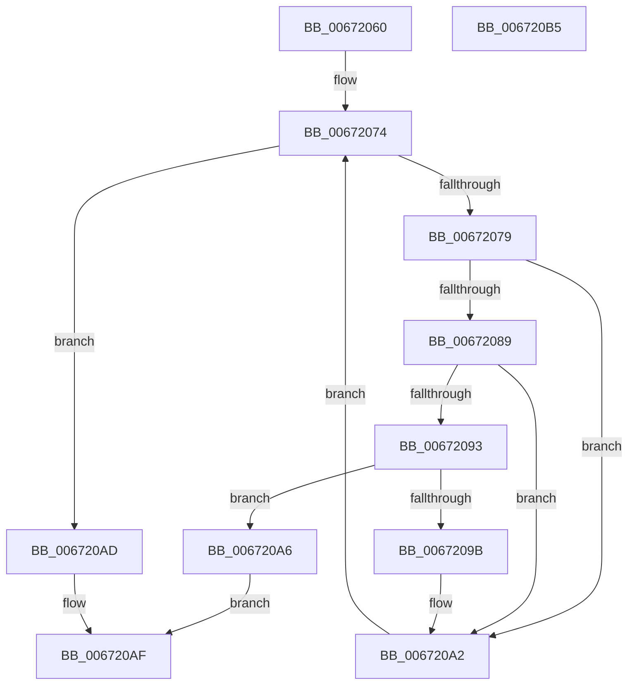

# MiEntireRangeAlreadyExists

- RVA: `0x00672060`–`0x006720B6` (길이 `86` bytes)
- VA: `0x0000000140672060`
- 실행 섹션: `.text`
- PDB 이름 있음: `예`; PDB Function 태그: `아니요`
- unwind 정보 RVA: `0x00071750`
- 디코드: `28`개 명령, `86/86` bytes 표시
- 미해석 바이트: `0` (있으면 어셈블리에 `.byte`로 보존)

> 이 문서는 커널 이미지의 기계어와 PDB 기호를 분석해 생성했습니다. 4번과 5번은 함수 원형과 자료형을 바이너리 사용 방식에서 추정한 C 해석이며 원본 소스 복구 결과는 아닙니다.

## 1. Dependencies

- 직접 호출 지점: **0**; 고유 호출 대상: **0**
- 직접 호출자로 확인된 함수: **1**
- RIP 상대 이미지 참조: **1**

### Outgoing calls
- 직접 디코드된 call 명령이 없습니다.

### Direct callers
- [MiRemovePhysicalMemory](../../page/7F/MiRemovePhysicalMemory_function_007FAD3C.md) at `0x007FAEE2`

### Static image references
- `0x00672065` → RVA `0x00FC6B88` (`ALMOSTRO`; read)

## 2. Other-region calls and transfers

- 다른 실행 섹션으로 향하는 call: **0**
- 별도 외부 분기/꼬리 이동을 확인하지 못했습니다.

## 3. Assembly (complete function range)

```asm
00672060  48 89 5C 24 08                  mov qword ptr [rsp + 8], rbx
00672065  4C 8B 0D 1C 4B 95 00            mov r9, qword ptr [rip + 0x954b1c]
0067206C  48 8B DA                        mov rbx, rdx
0067206F  33 C0                           xor eax, eax
00672071  45 8B 19                        mov r11d, dword ptr [r9]
00672074  41 3B C3                        cmp eax, r11d
00672077  73 34                           jae 0x1406720ad
00672079  44 8B C0                        mov r8d, eax
0067207C  4D 03 C0                        add r8, r8
0067207F  4F 8B 54 C1 18                  mov r10, qword ptr [r9 + r8*8 + 0x18]
00672084  4D 85 D2                        test r10, r10
00672087  74 19                           je 0x1406720a2
00672089  4B 8B 54 C1 10                  mov rdx, qword ptr [r9 + r8*8 + 0x10]
0067208E  48 3B CA                        cmp rcx, rdx
00672091  72 0F                           jb 0x1406720a2
00672093  49 03 D2                        add rdx, r10
00672096  48 3B DA                        cmp rbx, rdx
00672099  76 0B                           jbe 0x1406720a6
0067209B  48 3B CA                        cmp rcx, rdx
0067209E  48 0F 42 CA                     cmovb rcx, rdx
006720A2  FF C0                           inc eax
006720A4  EB CE                           jmp 0x140672074
006720A6  B8 01 00 00 00                  mov eax, 1
006720AB  EB 02                           jmp 0x1406720af
006720AD  33 C0                           xor eax, eax
006720AF  48 8B 5C 24 08                  mov rbx, qword ptr [rsp + 8]
006720B4  C3                              ret
006720B5  CC                              int3
```

## 4. C-style interpretation (structured pseudocode)

```c
__int64 __fastcall MiEntireRangeAlreadyExists(__int64 a1, __int64 a2)
{
    __int64 result;
    unsigned __int64 v_stack_p8;

    v_stack_p8 = v_rbx;
    result = 0;
loc_00672074:
    if (0 >= ((unsigned int)((unsigned int)(*(unsigned int *)(*(unsigned __int64 *)(v_rip + 9784092)))))) goto loc_006720AD;
    a3 = (0) + (0);
    if (*(unsigned __int64 *)(*(unsigned __int64 *)(v_rip + 9784092) + a3 * 8 + 24) == 0) goto loc_006720A2;
    if (a1 < (*(unsigned __int64 *)(*(unsigned __int64 *)(v_rip + 9784092) + a3 * 8 + 16))) goto loc_006720A2;
    a2 = (*(unsigned __int64 *)(*(unsigned __int64 *)(v_rip + 9784092) + a3 * 8 + 16)) + (*(unsigned __int64 *)(*(unsigned __int64 *)(v_rip + 9784092) + a3 * 8 + 24));
    if (a2 <= a2) goto loc_006720A6;
    if (a1 < a2) { a1 = a2; }
loc_006720A2:
    result = (unsigned int)((result) + 1);
    goto loc_00672074;
loc_006720A6:
    goto loc_006720AF;
loc_006720AD:
    result = 0;
loc_006720AF:
    return result;
}
```

## 5. (Beta) C Style

```c
int64_t MiEntireRangeAlreadyExists(int64_t Arg1, int64_t Arg2)
{
    int64_t result;
    uint64_t v_stack_p8;

    v_stack_p8 = local_rbx;
    result = 0;
loc_00672074:
    if (0 >= ((uint32_t)((uint32_t)(*(uint32_t *)(*(uint64_t *)(v_rip + 0x954B1C)))))) goto loc_006720AD;
    a3 = (0) + (0);
    if (*(uint64_t *)(*(uint64_t *)(v_rip + 0x954B1C) + a3 * 8 + 0x18) == 0) goto loc_006720A2;
    if (Arg1 < (*(uint64_t *)(*(uint64_t *)(v_rip + 0x954B1C) + a3 * 8 + 0x10))) goto loc_006720A2;
    Arg2 = (*(uint64_t *)(*(uint64_t *)(v_rip + 0x954B1C) + a3 * 8 + 0x10)) + (*(uint64_t *)(*(uint64_t *)(v_rip + 0x954B1C) + a3 * 8 + 0x18));
    if (Arg2 <= Arg2) goto loc_006720A6;
    if (Arg1 < Arg2) { Arg1 = Arg2; }
loc_006720A2:
    result = (uint32_t)((result) + 1);
    goto loc_00672074;
loc_006720A6:
    goto loc_006720AF;
loc_006720AD:
    result = 0;
loc_006720AF:
    return result;
}
```

## 6. Execution-region graph

[열기: 2D/3D 그래프와 함수 탐색 컨트롤 패널](../../../control-panel.html?section=text&rva=0x00672060&view=graph)

- 2D 그래프는 위에서 아래로 흐르고, 3D 그래프는 빈 공간을 드래그해 회전합니다. Shift+드래그는 이동, 휠은 확대·축소, 함수 노드 선택은 대상 보고서 이동입니다.

### Static fallback


