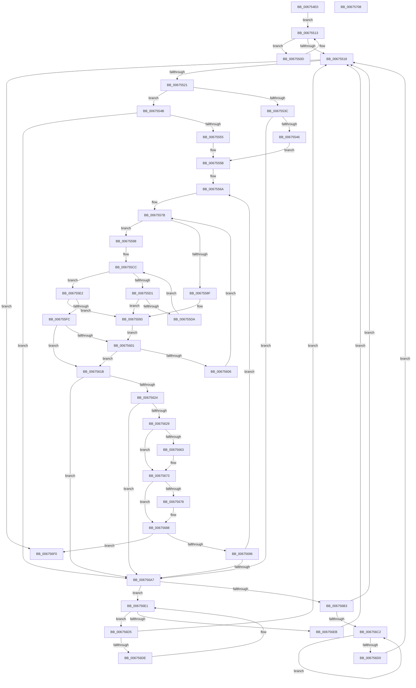

# MiEnumerateBadHugeRangePages

- RVA: `0x006754E0`–`0x00675709` (길이 `553` bytes)
- VA: `0x00000001406754E0`
- 실행 섹션: `.text`
- PDB 이름 있음: `예`; PDB Function 태그: `아니요`
- unwind 정보 RVA: `0x000D7C48`
- 디코드: `160`개 명령, `553/553` bytes 표시
- 미해석 바이트: `0` (있으면 어셈블리에 `.byte`로 보존)

> 이 문서는 커널 이미지의 기계어와 PDB 기호를 분석해 생성했습니다. 4번과 5번은 함수 원형과 자료형을 바이너리 사용 방식에서 추정한 C 해석이며 원본 소스 복구 결과는 아닙니다.

## 1. Dependencies

- 직접 호출 지점: **0**; 고유 호출 대상: **0**
- 직접 호출자로 확인된 함수: **2**
- RIP 상대 이미지 참조: **2**

### Outgoing calls
- 직접 디코드된 call 명령이 없습니다.

### Direct callers
- [MiEnumerateQuarantinedBadHugeRangePages](MiEnumerateQuarantinedBadHugeRangePages_function_006798AC.md) at `0x0067995D`
- [MiGetListOfPendingBadPages](MiGetListOfPendingBadPages_function_006799D0.md) at `0x00679AF6`
- [MiGetListOfPendingBadPages](MiGetListOfPendingBadPages_function_006799D0.md) at `0x00679C1B`

### Static image references
- `0x006754F9` → RVA `0x00E30020` (`.data`; read)
- `0x00675525` → RVA `0x00E300C0` (`.data`; read)

## 2. Other-region calls and transfers

- 다른 실행 섹션으로 향하는 call: **0**
- 별도 외부 분기/꼬리 이동을 확인하지 못했습니다.

## 3. Assembly (complete function range)

```asm
006754E0  48 89 5C 24 08                  mov qword ptr [rsp + 8], rbx
006754E5  48 89 54 24 10                  mov qword ptr [rsp + 0x10], rdx
006754EA  55                              push rbp
006754EB  56                              push rsi
006754EC  57                              push rdi
006754ED  41 54                           push r12
006754EF  41 55                           push r13
006754F1  41 56                           push r14
006754F3  41 57                           push r15
006754F5  48 83 EC 10                     sub rsp, 0x10
006754F9  48 8B 05 20 AB 7B 00            mov rax, qword ptr [rip + 0x7bab20]
00675500  33 FF                           xor edi, edi
00675502  45 33 C9                        xor r9d, r9d
00675505  45 8B E8                        mov r13d, r8d
00675508  4C 8B F1                        mov r14, rcx
0067550B  EB 06                           jmp 0x140675513
0067550D  4C 8B C8                        mov r9, rax
00675510  48 8B 00                        mov rax, qword ptr [rax]
00675513  48 85 C0                        test rax, rax
00675516  75 F5                           jne 0x14067550d
00675518  4D 85 C9                        test r9, r9
0067551B  0F 84 CF 01 00 00               je 0x1406756f0
00675521  41 8B 49 18                     mov ecx, dword ptr [r9 + 0x18]
00675525  48 8B 05 94 AB 7B 00            mov rax, qword ptr [rip + 0x7bab94]
0067552C  81 E1 FF FF 3F 00               and ecx, 0x3fffff
00675532  48 8B 04 C8                     mov rax, qword ptr [rax + rcx*8]
00675536  24 07                           and al, 7
00675538  3C 04                           cmp al, 4
0067553A  75 0F                           jne 0x14067554b
0067553C  41 F6 C5 01                     test r13b, 1
00675540  0F 84 61 01 00 00               je 0x1406756a7
00675546  45 33 FF                        xor r15d, r15d
00675549  EB 10                           jmp 0x14067555b
0067554B  41 F6 C5 02                     test r13b, 2
0067554F  0F 84 52 01 00 00               je 0x1406756a7
00675555  41 BF 01 00 00 00               mov r15d, 1
0067555B  4D 8B 61 20                     mov r12, qword ptr [r9 + 0x20]
0067555F  45 33 DB                        xor r11d, r11d
00675562  48 C7 04 24 00 00 04 00         mov qword ptr [rsp], 0x40000
0067556A  48 8B 34 24                     mov rsi, qword ptr [rsp]
0067556E  4C 3B DE                        cmp r11, rsi
00675571  48 1B DB                        sbb rbx, rbx
00675574  49 23 DB                        and rbx, r11
00675577  4C 8D 46 FF                     lea r8, [rsi - 1]
0067557B  83 64 24 68 00                  and dword ptr [rsp + 0x68], 0
00675580  49 8B C0                        mov rax, r8
00675583  48 2B C3                        sub rax, rbx
00675586  48 FF C0                        inc rax
00675589  48 83 F8 01                     cmp rax, 1
0067558D  73 09                           jae 0x140675598
0067558F  48 83 C9 FF                     or rcx, 0xffffffffffffffff
00675593  48 8B D1                        mov rdx, rcx
00675596  EB 69                           jmp 0x140675601
00675598  8A CB                           mov cl, bl
0067559A  49 8B C0                        mov rax, r8
0067559D  48 C1 E8 06                     shr rax, 6
006755A1  80 E1 3F                        and cl, 0x3f
006755A4  41 BA 01 00 00 00               mov r10d, 1
006755AA  49 D3 E2                        shl r10, cl
006755AD  49 FF CA                        dec r10
006755B0  49 8D 2C C4                     lea rbp, [r12 + rax*8]
006755B4  48 8B C3                        mov rax, rbx
006755B7  48 C1 E8 06                     shr rax, 6
006755BB  49 8D 14 C4                     lea rdx, [r12 + rax*8]
006755BF  48 8B 02                        mov rax, qword ptr [rdx]
006755C2  48 F7 D0                        not rax
006755C5  4C 0B D0                        or r10, rax
006755C8  48 83 C9 FF                     or rcx, 0xffffffffffffffff
006755CC  4C 3B D1                        cmp r10, rcx
006755CF  75 11                           jne 0x1406755e2
006755D1  48 83 C2 08                     add rdx, 8
006755D5  48 3B D5                        cmp rdx, rbp
006755D8  77 B9                           ja 0x140675593
006755DA  4C 8B 12                        mov r10, qword ptr [rdx]
006755DD  49 F7 D2                        not r10
006755E0  EB EA                           jmp 0x1406755cc
006755E2  49 2B D4                        sub rdx, r12
006755E5  49 F7 D2                        not r10
006755E8  48 C1 FA 03                     sar rdx, 3
006755EC  49 0F BC C2                     bsf rax, r10
006755F0  48 C1 E2 06                     shl rdx, 6
006755F4  48 03 D0                        add rdx, rax
006755F7  49 3B D0                        cmp rdx, r8
006755FA  77 97                           ja 0x140675593
006755FC  48 3B D1                        cmp rdx, rcx
006755FF  75 1A                           jne 0x14067561b
00675601  48 85 DB                        test rbx, rbx
00675604  74 15                           je 0x14067561b
00675606  4D 8D 43 01                     lea r8, [r11 + 1]
0067560A  4C 3B C6                        cmp r8, rsi
0067560D  4C 0F 47 C6                     cmova r8, rsi
00675611  49 FF C8                        dec r8
00675614  33 DB                           xor ebx, ebx
00675616  E9 60 FF FF FF                  jmp 0x14067557b
0067561B  49 3B D3                        cmp rdx, r11
0067561E  0F 82 83 00 00 00               jb 0x1406756a7
00675624  48 3B D1                        cmp rdx, rcx
00675627  74 7E                           je 0x1406756a7
00675629  41 8B 49 18                     mov ecx, dword ptr [r9 + 0x18]
0067562D  48 B8 00 00 00 00 00 00 F0 FF   movabs rax, 0xfff0000000000000
00675637  81 E1 FF FF 3F 00               and ecx, 0x3fffff
0067563D  48 C1 E1 12                     shl rcx, 0x12
00675641  48 03 CA                        add rcx, rdx
00675644  4C 8B C1                        mov r8, rcx
00675647  4D 33 06                        xor r8, qword ptr [r14]
0067564A  4C 23 C0                        and r8, rax
0067564D  4C 33 C1                        xor r8, rcx
00675650  4D 89 06                        mov qword ptr [r14], r8
00675653  49 0F A3 94 24 00 80 00 00      bt qword ptr [r12 + 0x8000], rdx
0067565C  0F 92 C0                        setb al
0067565F  84 C0                           test al, al
00675661  74 10                           je 0x140675673
00675663  48 B8 00 00 00 00 00 00 00 80   movabs rax, 0x8000000000000000
0067566D  4C 0B C0                        or r8, rax
00675670  4D 89 06                        mov qword ptr [r14], r8
00675673  45 85 FF                        test r15d, r15d
00675676  74 10                           je 0x140675688
00675678  48 B8 00 00 00 00 00 00 00 40   movabs rax, 0x4000000000000000
00675682  4C 0B C0                        or r8, rax
00675685  4D 89 06                        mov qword ptr [r14], r8
00675688  49 83 C6 08                     add r14, 8
0067568C  48 FF C7                        inc rdi
0067568F  48 3B 7C 24 58                  cmp rdi, qword ptr [rsp + 0x58]
00675694  74 5A                           je 0x1406756f0
00675696  4C 8D 5A 01                     lea r11, [rdx + 1]
0067569A  49 81 FB 00 00 04 00            cmp r11, 0x40000
006756A1  0F 82 C3 FE FF FF               jb 0x14067556a
006756A7  49 8B 41 08                     mov rax, qword ptr [r9 + 8]
006756AB  49 8B C9                        mov rcx, r9
006756AE  48 85 C0                        test rax, rax
006756B1  74 2E                           je 0x1406756e1
006756B3  48 8B 08                        mov rcx, qword ptr [rax]
006756B6  4C 8B C8                        mov r9, rax
006756B9  48 85 C9                        test rcx, rcx
006756BC  0F 84 56 FE FF FF               je 0x140675518
006756C2  48 8B 01                        mov rax, qword ptr [rcx]
006756C5  4C 8B C9                        mov r9, rcx
006756C8  48 8B C8                        mov rcx, rax
006756CB  48 85 C0                        test rax, rax
006756CE  75 F2                           jne 0x1406756c2
006756D0  E9 43 FE FF FF                  jmp 0x140675518
006756D5  49 39 09                        cmp qword ptr [r9], rcx
006756D8  0F 84 3A FE FF FF               je 0x140675518
006756DE  49 8B C9                        mov rcx, r9
006756E1  4D 8B 49 10                     mov r9, qword ptr [r9 + 0x10]
006756E5  49 83 E1 FC                     and r9, 0xfffffffffffffffc
006756E9  75 EA                           jne 0x1406756d5
006756EB  E9 28 FE FF FF                  jmp 0x140675518
006756F0  48 8B 5C 24 50                  mov rbx, qword ptr [rsp + 0x50]
006756F5  48 8B C7                        mov rax, rdi
006756F8  48 83 C4 10                     add rsp, 0x10
006756FC  41 5F                           pop r15
006756FE  41 5E                           pop r14
00675700  41 5D                           pop r13
00675702  41 5C                           pop r12
00675704  5F                              pop rdi
00675705  5E                              pop rsi
00675706  5D                              pop rbp
00675707  C3                              ret
00675708  CC                              int3
```

## 4. C-style interpretation (structured pseudocode)

```c
__int64 __fastcall MiEnumerateBadHugeRangePages(__int64 a1, __int64 a2, int a3, int a4)
{
    __int64 result;
    __int64 v_r10;
    __int64 v_r11;
    __int64 v_r14;
    __int64 v_r15;
    __int64 v_rbx;
    __int64 v_rdi;
    __int64 v_rsp;
    unsigned __int64 v_stack_m48;
    unsigned __int64 v_stack_p10;
    unsigned int v_stack_p20;
    unsigned __int64 v_stack_p8;

    v_stack_p8 = v_rbx;
    v_stack_p10 = a2;
    v_rsp = (v_rsp) - (16);
    v_rdi = 0;
    a4 = 0;
    goto loc_00675513;
loc_0067550D:
loc_00675513:
    if (*(unsigned __int64 *)(*(unsigned __int64 *)(v_rip + 8104736)) != 0) goto loc_0067550D;
loc_00675518:
    if (*(unsigned __int64 *)(v_rip + 8104736) == 0) goto loc_006756F0;
    a1 = (unsigned int)(((unsigned int)(*(unsigned int *)(*(unsigned __int64 *)(v_rip + 8104736) + 24))) & (0x3FFFFFULL));
    result = (unsigned __int8)((*(unsigned __int64 *)(*(unsigned __int64 *)(v_rip + 8104852) + a1 * 8)) & (7));
    if (((unsigned __int8)(result)) != 4) goto loc_0067554B;
    if ((((unsigned __int8)((unsigned int)(a3))) & (1)) == 0) goto loc_006756A7;
    v_r15 = 0;
    goto loc_0067555B;
loc_0067554B:
    if ((((unsigned __int8)((unsigned int)(a3))) & (2)) == 0) goto loc_006756A7;
loc_0067555B:
    v_r11 = 0;
    v_stack_m48 = 0x40000ULL;
loc_0067556A:
    v_rbx = (v_rbx) & (0);
loc_0067557B:
    result = (v_stack_m48 - 1) - (v_rbx);
    result = (result) + 1;
    if (result >= 1) goto loc_00675598;
    a1 = (a1) | (-1);
loc_00675593:
    goto loc_00675601;
loc_00675598:
    result = (v_stack_m48 - 1) >> (6);
    a1 = (unsigned __int8)(((unsigned __int8)(v_rbx)) & (63));
    v_r10 = (1) << ((unsigned __int8)(a1));
    v_r10 = (v_r10) - 1;
    result = (v_rbx) >> (6);
    result = ~(*(unsigned __int64 *)(*(unsigned __int64 *)(*(unsigned __int64 *)(v_rip + 8104736) + 32) + result * 8));
    v_r10 = (v_r10) | (result);
    a1 = (a1) | (-1);
loc_006755CC:
    if (v_r10 != a1) goto loc_006755E2;
    a2 = (*(unsigned __int64 *)(*(unsigned __int64 *)(v_rip + 8104736) + 32) + result * 8) + (8);
    if (a2 > (*(unsigned __int64 *)(*(unsigned __int64 *)(v_rip + 8104736) + 32) + result * 8)) goto loc_00675593;
    v_r10 = ~(*(unsigned __int64 *)(a2));
    goto loc_006755CC;
loc_006755E2:
    a2 = (a2) - (*(unsigned __int64 *)(*(unsigned __int64 *)(v_rip + 8104736) + 32));
    v_r10 = ~(v_r10);
    a2 = (a2) >> (3);
    a2 = (a2) << (6);
    a2 = (a2) + (result);
    if (a2 > (v_stack_m48 - 1)) goto loc_00675593;
    if (a2 != a1) goto loc_0067561B;
loc_00675601:
    if (v_rbx == 0) goto loc_0067561B;
    a3 = v_r11 + 1;
    if ((v_r11 + 1) > v_stack_m48) { a3 = v_stack_m48; }
    a3 = (a3) - 1;
    v_rbx = 0;
    goto loc_0067557B;
loc_0067561B:
    if (a2 < 0) goto loc_006756A7;
    if (a2 == a1) goto loc_006756A7;
    a1 = (unsigned int)(((unsigned int)(*(unsigned int *)(*(unsigned __int64 *)(v_rip + 8104736) + 24))) & (0x3FFFFFULL));
    a1 = (a1) << (18);
    a1 = (a1) + (a2);
    a3 = (a1) ^ (*(unsigned __int64 *)(a1));
    a3 = (a3) & (result);
    a3 = (a3) ^ (a1);
    *(unsigned __int64 *)(a1) = a3;
    result = (condition_is_below) ? 1 : 0;
    if ((unsigned __int8)(result) != 0) {
        a3 = (a3) | (result);
        *(unsigned __int64 *)(a1) = a3;
    }
    if (1 != 0) {
        a3 = (a3) | (result);
        *(unsigned __int64 *)(a1) = a3;
    }
    v_r14 = (a1) + (8);
    v_rdi = (v_rdi) + 1;
    if (v_rdi == v_stack_p10) goto loc_006756F0;
    if ((a2 + 1) < 0x40000ULL) goto loc_0067556A;
loc_006756A7:
    if (*(unsigned __int64 *)(*(unsigned __int64 *)(v_rip + 8104736) + 8) == 0) goto loc_006756E1;
    if (*(unsigned __int64 *)(*(unsigned __int64 *)(*(unsigned __int64 *)(v_rip + 8104736) + 8)) == 0) goto loc_00675518;
loc_006756C2:
    if (*(unsigned __int64 *)(*(unsigned __int64 *)(*(unsigned __int64 *)(*(unsigned __int64 *)(v_rip + 8104736) + 8))) != 0) goto loc_006756C2;
    goto loc_00675518;
loc_006756D5:
    if ((*(unsigned __int64 *)(*(unsigned __int64 *)(*(unsigned __int64 *)(*(unsigned __int64 *)(v_rip + 8104736) + 8)))) == (*(unsigned __int64 *)(*(unsigned __int64 *)(*(unsigned __int64 *)(*(unsigned __int64 *)(v_rip + 8104736) + 8))))) goto loc_00675518;
loc_006756E1:
    a4 = (*(unsigned __int64 *)(*(unsigned __int64 *)(*(unsigned __int64 *)(*(unsigned __int64 *)(v_rip + 8104736) + 8)) + 16)) & (-4);
    if (condition_is_not_equal) goto loc_006756D5;
    goto loc_00675518;
loc_006756F0:
    v_rsp = (v_rsp) + (16);
    return v_rdi;
}
```

## 5. (Beta) C Style

```c
int64_t MiEnumerateBadHugeRangePages(void *Arg1, int64_t Arg2, int32_t Arg3, int32_t Arg4)
{
    uint8_t *arg1 = (uint8_t *)Arg1;

    int64_t result;
    int64_t local_r10;
    int64_t local_r11;
    int64_t local_r14;
    int64_t local_r15;
    int64_t local_rbx;
    int64_t local_rdi;
    int64_t local_rsp;
    uint64_t v_stack_m48;
    uint64_t v_stack_p10;
    uint32_t v_stack_p20;
    uint64_t v_stack_p8;

    v_stack_p8 = local_rbx;
    v_stack_p10 = Arg2;
    local_rsp = (local_rsp) - (16);
    local_rdi = 0;
    Arg4 = 0;
    goto loc_00675513;
loc_0067550D:
loc_00675513:
    if (*(uint64_t *)(*(uint64_t *)(v_rip + 0x7BAB20)) != 0) goto loc_0067550D;
loc_00675518:
    if (*(uint64_t *)(v_rip + 0x7BAB20) == 0) goto loc_006756F0;
    Arg1 = (uint32_t)(((uint32_t)(*(uint32_t *)(*(uint64_t *)(v_rip + 0x7BAB20) + 0x18))) & (0x3FFFFFULL));
    result = (uint8_t)((*(uint64_t *)(*(uint64_t *)(v_rip + 0x7BAB94) + arg1 * 8)) & (7));
    if (((uint8_t)(result)) != 4) goto loc_0067554B;
    if ((((uint8_t)((uint32_t)(Arg3))) & (1)) == 0) goto loc_006756A7;
    local_r15 = 0;
    goto loc_0067555B;
loc_0067554B:
    if ((((uint8_t)((uint32_t)(Arg3))) & (2)) == 0) goto loc_006756A7;
loc_0067555B:
    local_r11 = 0;
    v_stack_m48 = 0x40000ULL;
loc_0067556A:
    local_rbx = (local_rbx) & (0);
loc_0067557B:
    result = (v_stack_m48 - 1) - (local_rbx);
    result = (result) + 1;
    if (result >= 1) goto loc_00675598;
    Arg1 = (Arg1) | (-1);
loc_00675593:
    goto loc_00675601;
loc_00675598:
    result = (v_stack_m48 - 1) >> (6);
    Arg1 = (uint8_t)(((uint8_t)(local_rbx)) & (63));
    local_r10 = (1) << ((uint8_t)(Arg1));
    local_r10 = (local_r10) - 1;
    result = (local_rbx) >> (6);
    result = ~(*(uint64_t *)(*(uint64_t *)(*(uint64_t *)(v_rip + 0x7BAB20) + 0x20) + result * 8));
    local_r10 = (local_r10) | (result);
    Arg1 = (Arg1) | (-1);
loc_006755CC:
    if (local_r10 != Arg1) goto loc_006755E2;
    Arg2 = (*(uint64_t *)(*(uint64_t *)(v_rip + 0x7BAB20) + 0x20) + result * 8) + (8);
    if (Arg2 > (*(uint64_t *)(*(uint64_t *)(v_rip + 0x7BAB20) + 0x20) + result * 8)) goto loc_00675593;
    local_r10 = ~(*(uint64_t *)(Arg2));
    goto loc_006755CC;
loc_006755E2:
    Arg2 = (Arg2) - (*(uint64_t *)(*(uint64_t *)(v_rip + 0x7BAB20) + 0x20));
    local_r10 = ~(local_r10);
    Arg2 = (Arg2) >> (3);
    Arg2 = (Arg2) << (6);
    Arg2 = (Arg2) + (result);
    if (Arg2 > (v_stack_m48 - 1)) goto loc_00675593;
    if (Arg2 != Arg1) goto loc_0067561B;
loc_00675601:
    if (local_rbx == 0) goto loc_0067561B;
    Arg3 = local_r11 + 1;
    if ((local_r11 + 1) > v_stack_m48) { Arg3 = v_stack_m48; }
    Arg3 = (Arg3) - 1;
    local_rbx = 0;
    goto loc_0067557B;
loc_0067561B:
    if (Arg2 < 0) goto loc_006756A7;
    if (Arg2 == Arg1) goto loc_006756A7;
    Arg1 = (uint32_t)(((uint32_t)(*(uint32_t *)(*(uint64_t *)(v_rip + 0x7BAB20) + 0x18))) & (0x3FFFFFULL));
    Arg1 = (Arg1) << (18);
    Arg1 = (Arg1) + (Arg2);
    Arg3 = (Arg1) ^ (*(uint64_t *)(arg1));
    Arg3 = (Arg3) & (result);
    Arg3 = (Arg3) ^ (Arg1);
    *(uint64_t *)(arg1) = Arg3;
    result = (condition_is_below) ? 1 : 0;
    if ((uint8_t)(result) != 0) {
        Arg3 = (Arg3) | (result);
        *(uint64_t *)(arg1) = Arg3;
    }
    if (1 != 0) {
        Arg3 = (Arg3) | (result);
        *(uint64_t *)(arg1) = Arg3;
    }
    local_r14 = (Arg1) + (8);
    local_rdi = (local_rdi) + 1;
    if (local_rdi == v_stack_p10) goto loc_006756F0;
    if ((Arg2 + 1) < 0x40000ULL) goto loc_0067556A;
loc_006756A7:
    if (*(uint64_t *)(*(uint64_t *)(v_rip + 0x7BAB20) + 0x8) == 0) goto loc_006756E1;
    if (*(uint64_t *)(*(uint64_t *)(*(uint64_t *)(v_rip + 0x7BAB20) + 0x8)) == 0) goto loc_00675518;
loc_006756C2:
    if (*(uint64_t *)(*(uint64_t *)(*(uint64_t *)(*(uint64_t *)(v_rip + 0x7BAB20) + 0x8))) != 0) goto loc_006756C2;
    goto loc_00675518;
loc_006756D5:
    if ((*(uint64_t *)(*(uint64_t *)(*(uint64_t *)(*(uint64_t *)(v_rip + 0x7BAB20) + 0x8)))) == (*(uint64_t *)(*(uint64_t *)(*(uint64_t *)(*(uint64_t *)(v_rip + 0x7BAB20) + 0x8))))) goto loc_00675518;
loc_006756E1:
    Arg4 = (*(uint64_t *)(*(uint64_t *)(*(uint64_t *)(*(uint64_t *)(v_rip + 0x7BAB20) + 0x8)) + 0x10)) & (-4);
    if (condition_is_not_equal) goto loc_006756D5;
    goto loc_00675518;
loc_006756F0:
    local_rsp = (local_rsp) + (16);
    return local_rdi;
}
```

### 관측된 메모리 오프셋

구조체 형식이 확인되지 않은 접근은 인자 기준의 오프셋으로만 기록했습니다.

| 기준 인자 | 오프셋 표현 | 폭 (bit) | 접근 |
|---|---:|---:|---|
| `Arg1` | `+ 0x0` | `64` | `R` |
| `Arg1` | `+ 0x0` | `64` | `W` |

## 6. Execution-region graph

[열기: 2D/3D 그래프와 함수 탐색 컨트롤 패널](../../../control-panel.html?section=text&rva=0x006754E0&view=graph)

- 2D 그래프는 위에서 아래로 흐르고, 3D 그래프는 빈 공간을 드래그해 회전합니다. Shift+드래그는 이동, 휠은 확대·축소, 함수 노드 선택은 대상 보고서 이동입니다.

### Static fallback


