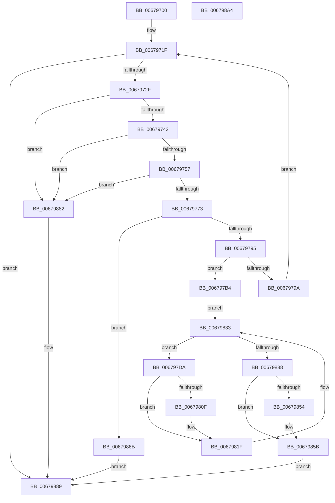

# MiEnumeratePartitionBadPages

- RVA: `0x00679700`–`0x006798A5` (길이 `421` bytes)
- VA: `0x0000000140679700`
- 실행 섹션: `.text`
- PDB 이름 있음: `예`; PDB Function 태그: `아니요`
- unwind 정보 RVA: `0x0005E6B4`
- 디코드: `100`개 명령, `421/421` bytes 표시
- 미해석 바이트: `0` (있으면 어셈블리에 `.byte`로 보존)

> 이 문서는 커널 이미지의 기계어와 PDB 기호를 분석해 생성했습니다. 4번과 5번은 함수 원형과 자료형을 바이너리 사용 방식에서 추정한 C 해석이며 원본 소스 복구 결과는 아닙니다.

## 1. Dependencies

- 직접 호출 지점: **7**; 고유 호출 대상: **4**
- 직접 호출자로 확인된 함수: **0**
- RIP 상대 이미지 참조: **0**

### Outgoing calls
- `0x00679762` → [MiAllocatePool](../35/MiAllocatePool_function_0035B540.md) (function, `0x0035B540`)
- `0x0067977D` → [ExAcquireSpinLockExclusive](../24/ExAcquireSpinLockExclusive_function_00248690.md) (function, `0x00248690`)
- `0x006797A0` → [MiReleaseSpinLockExclusive](../24/MiReleaseSpinLockExclusive_function_002482C0.md) (function, `0x002482C0`)
- `0x006797AA` → [ExFreePoolWithTag](../../poolcode/B8/ExFreePoolWithTag_function_00B82870.md) (function, `0x00B82870`)
- `0x0067983E` → [MiReleaseSpinLockExclusive](../24/MiReleaseSpinLockExclusive_function_002482C0.md) (function, `0x002482C0`)
- `0x00679871` → [MiReleaseSpinLockExclusive](../24/MiReleaseSpinLockExclusive_function_002482C0.md) (function, `0x002482C0`)
- `0x0067987B` → [ExFreePoolWithTag](../../poolcode/B8/ExFreePoolWithTag_function_00B82870.md) (function, `0x00B82870`)

### Direct callers
- 이 함수 시작 RVA로 연결되는 직접 call은 확인되지 않았습니다. 간접 호출은 완전히 역산할 수 없습니다.

### Static image references
- 디코드된 RIP-relative 메모리 참조가 없습니다.

## 2. Other-region calls and transfers

- 다른 실행 섹션으로 향하는 call: **2**
  - `0x006797AA` → [ExFreePoolWithTag](../../poolcode/B8/ExFreePoolWithTag_function_00B82870.md) (`.text` → `POOLCODE`)
  - `0x0067987B` → [ExFreePoolWithTag](../../poolcode/B8/ExFreePoolWithTag_function_00B82870.md) (`.text` → `POOLCODE`)
- 별도 외부 분기/꼬리 이동을 확인하지 못했습니다.

## 3. Assembly (complete function range)

```asm
00679700  48 8B C4                        mov rax, rsp
00679703  48 89 58 08                     mov qword ptr [rax + 8], rbx
00679707  48 89 68 10                     mov qword ptr [rax + 0x10], rbp
0067970B  48 89 70 18                     mov qword ptr [rax + 0x18], rsi
0067970F  48 89 78 20                     mov qword ptr [rax + 0x20], rdi
00679713  41 56                           push r14
00679715  48 83 EC 20                     sub rsp, 0x20
00679719  48 8B FA                        mov rdi, rdx
0067971C  48 8B E9                        mov rbp, rcx
0067971F  48 8B B5 80 1B 00 00            mov rsi, qword ptr [rbp + 0x1b80]
00679726  48 85 F6                        test rsi, rsi
00679729  0F 84 5A 01 00 00               je 0x140679889
0067972F  48 B8 FF FF FF FF FF FF FF 1F   movabs rax, 0x1fffffffffffffff
00679739  48 3B F0                        cmp rsi, rax
0067973C  0F 87 40 01 00 00               ja 0x140679882
00679742  48 8D 04 F5 00 00 00 00         lea rax, [rsi*8]
0067974A  48 8D 50 20                     lea rdx, [rax + 0x20]
0067974E  48 3B D0                        cmp rdx, rax
00679751  0F 86 2B 01 00 00               jbe 0x140679882
00679757  B9 40 00 00 00                  mov ecx, 0x40
0067975C  41 B8 4D 6D 42 61               mov r8d, 0x61426d4d
00679762  E8 D9 1D CE FF                  call 0x14035b540
00679767  48 8B D8                        mov rbx, rax
0067976A  48 85 C0                        test rax, rax
0067976D  0F 84 0F 01 00 00               je 0x140679882
00679773  4C 8D B5 A0 1B 00 00            lea r14, [rbp + 0x1ba0]
0067977A  49 8B CE                        mov rcx, r14
0067977D  E8 0E EF BC FF                  call 0x140248690
00679782  44 8A C0                        mov r8b, al
00679785  48 8B 85 80 1B 00 00            mov rax, qword ptr [rbp + 0x1b80]
0067978C  48 85 C0                        test rax, rax
0067978F  0F 84 D6 00 00 00               je 0x14067986b
00679795  48 3B F0                        cmp rsi, rax
00679798  73 1A                           jae 0x1406797b4
0067979A  41 8A D0                        mov dl, r8b
0067979D  49 8B CE                        mov rcx, r14
006797A0  E8 1B EB BC FF                  call 0x1402482c0
006797A5  33 D2                           xor edx, edx
006797A7  48 8B CB                        mov rcx, rbx
006797AA  E8 C1 90 50 00                  call 0x140b82870
006797AF  E9 6B FF FF FF                  jmp 0x14067971f
006797B4  48 8B 85 80 1B 00 00            mov rax, qword ptr [rbp + 0x1b80]
006797BB  48 8D 53 20                     lea rdx, [rbx + 0x20]
006797BF  48 89 43 10                     mov qword ptr [rbx + 0x10], rax
006797C3  49 BB FF FF FF FF 3F 00 00 00   movabs r11, 0x3fffffffff
006797CD  48 89 53 18                     mov qword ptr [rbx + 0x18], rdx
006797D1  48 8B 85 90 1B 00 00            mov rax, qword ptr [rbp + 0x1b90]
006797D8  EB 59                           jmp 0x140679833
006797DA  4C 8D 0C 40                     lea r9, [rax + rax*2]
006797DE  49 C1 E1 04                     shl r9, 4
006797E2  48 B9 00 00 00 00 00 DE FF FF   movabs rcx, 0xffffde0000000000
006797EC  4C 03 C9                        add r9, rcx
006797EF  49 BA 00 00 00 00 00 00 F0 FF   movabs r10, 0xfff0000000000000
006797F9  48 8B C8                        mov rcx, rax
006797FC  48 33 0A                        xor rcx, qword ptr [rdx]
006797FF  49 23 CA                        and rcx, r10
00679802  48 33 C8                        xor rcx, rax
00679805  48 89 0A                        mov qword ptr [rdx], rcx
00679808  41 80 79 23 00                  cmp byte ptr [r9 + 0x23], 0
0067980D  7D 10                           jge 0x14067981f
0067980F  48 B8 00 00 00 00 00 00 00 80   movabs rax, 0x8000000000000000
00679819  48 0B C8                        or rcx, rax
0067981C  48 89 0A                        mov qword ptr [rdx], rcx
0067981F  49 8B 01                        mov rax, qword ptr [r9]
00679822  48 83 C2 08                     add rdx, 8
00679826  48 B9 FF FF FF FF FF 00 00 00   movabs rcx, 0xffffffffff
00679830  48 23 C1                        and rax, rcx
00679833  49 3B C3                        cmp rax, r11
00679836  75 A2                           jne 0x1406797da
00679838  41 8A D0                        mov dl, r8b
0067983B  49 8B CE                        mov rcx, r14
0067983E  E8 7D EA BC FF                  call 0x1402482c0
00679843  48 8B 43 10                     mov rax, qword ptr [rbx + 0x10]
00679847  48 01 47 18                     add qword ptr [rdi + 0x18], rax
0067984B  48 8B 47 08                     mov rax, qword ptr [rdi + 8]
0067984F  48 39 38                        cmp qword ptr [rax], rdi
00679852  74 07                           je 0x14067985b
00679854  B9 03 00 00 00                  mov ecx, 3
00679859  CD 29                           int 0x29
0067985B  48 89 3B                        mov qword ptr [rbx], rdi
0067985E  48 89 43 08                     mov qword ptr [rbx + 8], rax
00679862  48 89 18                        mov qword ptr [rax], rbx
00679865  48 89 5F 08                     mov qword ptr [rdi + 8], rbx
00679869  EB 1E                           jmp 0x140679889
0067986B  41 8A D0                        mov dl, r8b
0067986E  49 8B CE                        mov rcx, r14
00679871  E8 4A EA BC FF                  call 0x1402482c0
00679876  33 D2                           xor edx, edx
00679878  48 8B CB                        mov rcx, rbx
0067987B  E8 F0 8F 50 00                  call 0x140b82870
00679880  EB 07                           jmp 0x140679889
00679882  C7 47 10 9A 00 00 C0            mov dword ptr [rdi + 0x10], 0xc000009a
00679889  48 8B 5C 24 30                  mov rbx, qword ptr [rsp + 0x30]
0067988E  48 8B 6C 24 38                  mov rbp, qword ptr [rsp + 0x38]
00679893  48 8B 74 24 40                  mov rsi, qword ptr [rsp + 0x40]
00679898  48 8B 7C 24 48                  mov rdi, qword ptr [rsp + 0x48]
0067989D  48 83 C4 20                     add rsp, 0x20
006798A1  41 5E                           pop r14
006798A3  C3                              ret
006798A4  CC                              int3
```

## 4. C-style interpretation (structured pseudocode)

```c
__int64 __fastcall MiEnumeratePartitionBadPages(__int64 a1, __int64 a2)
{
    __int64 result;
    __int64 v_rsp;
    unsigned __int64 v_stack_p10;
    unsigned __int64 v_stack_p18;
    unsigned __int64 v_stack_p20;
    unsigned __int64 v_stack_p8;

    *(unsigned __int64 *)(v_rsp + 8) = v_rbx;
    *(unsigned __int64 *)(v_rsp + 16) = v_rbp;
    *(unsigned __int64 *)(v_rsp + 24) = v_rsi;
    *(unsigned __int64 *)(v_rsp + 32) = v_rdi;
    v_rsp = (v_rsp) - (32);
loc_0067971F:
    if (*(unsigned __int64 *)(a1 + 7040) == 0) goto loc_00679889;
    if ((*(unsigned __int64 *)(a1 + 7040)) > v_rsp) goto loc_00679882;
    if ((*(unsigned __int64 *)(a1 + 7040) * 8 + 32) <= (*(unsigned __int64 *)(a1 + 7040) * 8)) goto loc_00679882;
    result = MiAllocatePool(64, *(unsigned __int64 *)(a1 + 7040) * 8 + 32, (unsigned int)(0x61426D4DULL), a4);
    if (result == 0) goto loc_00679882;
    result = ExAcquireSpinLockExclusive(a1 + 7072, *(unsigned __int64 *)(a1 + 7040) * 8 + 32, (unsigned int)(0x61426D4DULL), a4);
    if (*(unsigned __int64 *)(a1 + 7040) == 0) goto loc_0067986B;
    if ((*(unsigned __int64 *)(a1 + 7040)) >= (*(unsigned __int64 *)(a1 + 7040))) goto loc_006797B4;
    result = MiReleaseSpinLockExclusive(a1 + 7072, (unsigned __int8)((unsigned __int8)(result)), (unsigned __int8)(result), a4);
    a2 = 0;
    result = ExFreePoolWithTag(result, a2, (unsigned __int8)(result), a4);
    goto loc_0067971F;
loc_006797B4:
    *(unsigned __int64 *)(result + 16) = *(unsigned __int64 *)(a1 + 7040);
    *(unsigned __int64 *)(result + 24) = result + 32;
    goto loc_00679833;
loc_006797DA:
    a4 = (*(unsigned __int64 *)(a1 + 7056) + *(unsigned __int64 *)(a1 + 7056) * 2) << (4);
    a4 = (a4) + (result);
    a1 = (*(unsigned __int64 *)(a1 + 7056)) ^ (*(unsigned __int64 *)(result + 32));
    a1 = (a1) & (v_r10);
    a1 = (a1) ^ (*(unsigned __int64 *)(a1 + 7056));
    *(unsigned __int64 *)(result + 32) = a1;
    if ((*(unsigned __int8 *)(a4 + 35)) < 0) {
        a1 = (a1) | (*(unsigned __int64 *)(a1 + 7056));
        *(unsigned __int64 *)(result + 32) = a1;
    }
    a2 = (result + 32) + (8);
    result = (*(unsigned __int64 *)(a4)) & (a1);
loc_00679833:
    if (result != v_r11) goto loc_006797DA;
    result = MiReleaseSpinLockExclusive(a1 + 7072, (unsigned __int8)((unsigned __int8)(result)), (unsigned __int8)(result), a4);
    if ((*(unsigned __int64 *)(*(unsigned __int64 *)(a2 + 8))) != a2) {
        a1 = 3;
    }
    *(unsigned __int64 *)(result) = a2;
    *(unsigned __int64 *)(result + 8) = *(unsigned __int64 *)(a2 + 8);
    *(unsigned __int64 *)(*(unsigned __int64 *)(a2 + 8)) = result;
    *(unsigned __int64 *)(a2 + 8) = result;
    goto loc_00679889;
loc_0067986B:
    result = MiReleaseSpinLockExclusive(a1 + 7072, (unsigned __int8)((unsigned __int8)(result)), (unsigned __int8)(result), a4);
    a2 = 0;
    result = ExFreePoolWithTag(result, a2, (unsigned __int8)(result), a4);
    goto loc_00679889;
loc_00679882:
    *(unsigned int *)(a2 + 16) = 0xC000009AULL;
loc_00679889:
    v_rsp = (v_rsp) + (32);
    return result;
}
```

## 5. (Beta) C Style

```c
int64_t MiEnumeratePartitionBadPages(void *Arg1, void *Arg2)
{
    uint8_t *arg1 = (uint8_t *)Arg1;
    uint8_t *arg2 = (uint8_t *)Arg2;

    int64_t result;
    int64_t local_rsp;
    uint64_t v_stack_p10;
    uint64_t v_stack_p18;
    uint64_t v_stack_p20;
    uint64_t v_stack_p8;

    *(uint64_t *)(local_rsp + 0x8) = local_rbx;
    *(uint64_t *)(local_rsp + 0x10) = local_rbp;
    *(uint64_t *)(local_rsp + 0x18) = local_rsi;
    *(uint64_t *)(local_rsp + 0x20) = local_rdi;
    local_rsp = (local_rsp) - (32);
loc_0067971F:
    if (*(uint64_t *)(arg1 + 0x1B80) == 0) goto loc_00679889;
    if ((*(uint64_t *)(arg1 + 0x1B80)) > local_rsp) goto loc_00679882;
    if ((*(uint64_t *)(arg1 + 0x1B80) * 8 + 32) <= (*(uint64_t *)(arg1 + 0x1B80) * 8)) goto loc_00679882;
    result = MiAllocatePool(64, *(uint64_t *)(arg1 + 0x1B80) * 8 + 32, (uint32_t)(0x61426D4DULL), a4);
    if (result == 0) goto loc_00679882;
    result = ExAcquireSpinLockExclusive(Arg1 + 7072, *(uint64_t *)(arg1 + 0x1B80) * 8 + 32, (uint32_t)(0x61426D4DULL), a4);
    if (*(uint64_t *)(arg1 + 0x1B80) == 0) goto loc_0067986B;
    if ((*(uint64_t *)(arg1 + 0x1B80)) >= (*(uint64_t *)(arg1 + 0x1B80))) goto loc_006797B4;
    result = MiReleaseSpinLockExclusive(Arg1 + 7072, (uint8_t)((uint8_t)(result)), (uint8_t)(result), a4);
    Arg2 = 0;
    result = ExFreePoolWithTag(result, Arg2, (uint8_t)(result), a4);
    goto loc_0067971F;
loc_006797B4:
    *(uint64_t *)(result + 0x10) = *(uint64_t *)(arg1 + 0x1B80);
    *(uint64_t *)(result + 0x18) = result + 32;
    goto loc_00679833;
loc_006797DA:
    a4 = (*(uint64_t *)(arg1 + 0x1B90) + *(uint64_t *)(arg1 + 0x1B90) * 2) << (4);
    a4 = (a4) + (result);
    Arg1 = (*(uint64_t *)(arg1 + 0x1B90)) ^ (*(uint64_t *)(result + 0x20));
    Arg1 = (Arg1) & (local_r10);
    Arg1 = (Arg1) ^ (*(uint64_t *)(arg1 + 0x1B90));
    *(void **)(result + 0x20) = Arg1;
    if ((*(uint8_t *)(a4 + 0x23)) < 0) {
        Arg1 = (Arg1) | (*(uint64_t *)(arg1 + 0x1B90));
        *(void **)(result + 0x20) = Arg1;
    }
    Arg2 = (result + 32) + (8);
    result = (*(uint64_t *)(a4)) & (Arg1);
loc_00679833:
    if (result != local_r11) goto loc_006797DA;
    result = MiReleaseSpinLockExclusive(Arg1 + 7072, (uint8_t)((uint8_t)(result)), (uint8_t)(result), a4);
    if ((*(uint64_t *)(*(uint64_t *)(arg2 + 0x8))) != Arg2) {
        Arg1 = 3;
    }
    *(void **)(result) = Arg2;
    *(uint64_t *)(result + 0x8) = *(uint64_t *)(arg2 + 0x8);
    *(uint64_t *)(*(uint64_t *)(arg2 + 0x8)) = result;
    *(uint64_t *)(arg2 + 0x8) = result;
    goto loc_00679889;
loc_0067986B:
    result = MiReleaseSpinLockExclusive(Arg1 + 7072, (uint8_t)((uint8_t)(result)), (uint8_t)(result), a4);
    Arg2 = 0;
    result = ExFreePoolWithTag(result, Arg2, (uint8_t)(result), a4);
    goto loc_00679889;
loc_00679882:
    *(uint32_t *)(arg2 + 0x10) = 0xC000009AULL;
loc_00679889:
    local_rsp = (local_rsp) + (32);
    return result;
}
```

### 관측된 메모리 오프셋

구조체 형식이 확인되지 않은 접근은 인자 기준의 오프셋으로만 기록했습니다.

| 기준 인자 | 오프셋 표현 | 폭 (bit) | 접근 |
|---|---:|---:|---|
| `Arg1` | `+ 0x1B80` | `64` | `R` |
| `Arg1` | `+ 0x1B90` | `64` | `R` |
| `Arg1` | `+ 0x1BA0` | `64` | `R` |
| `Arg2` | `+ 0x8` | `64` | `R` |
| `Arg2` | `+ 0x8` | `64` | `W` |
| `Arg2` | `+ 0x10` | `32` | `W` |
| `Arg2` | `+ 0x18` | `64` | `R/W` |

## 6. Execution-region graph

[열기: 2D/3D 그래프와 함수 탐색 컨트롤 패널](../../../control-panel.html?section=text&rva=0x00679700&view=graph)

- 2D 그래프는 위에서 아래로 흐르고, 3D 그래프는 빈 공간을 드래그해 회전합니다. Shift+드래그는 이동, 휠은 확대·축소, 함수 노드 선택은 대상 보고서 이동입니다.

### Static fallback


