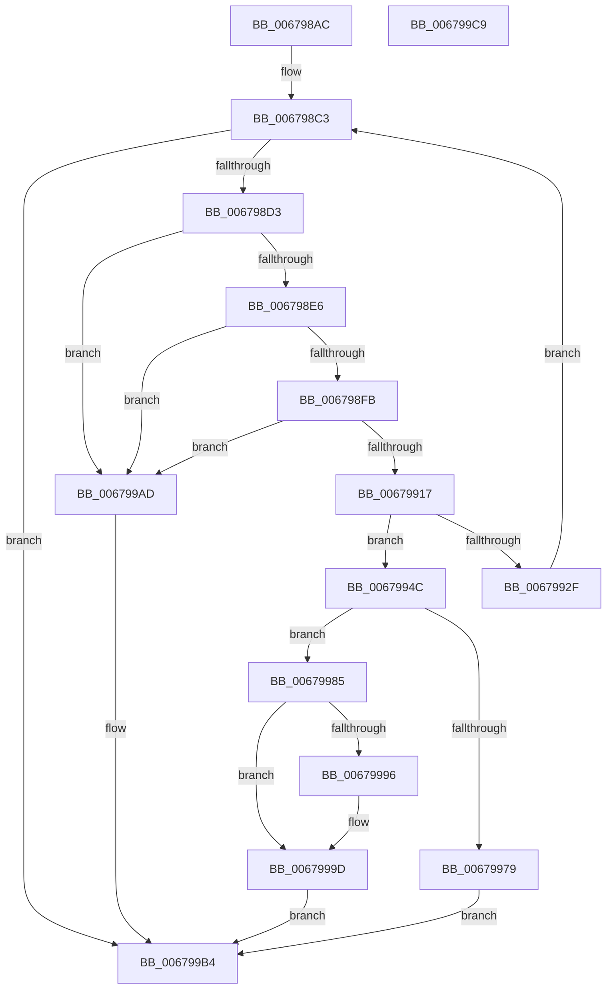

# MiEnumerateQuarantinedBadHugeRangePages

- RVA: `0x006798AC`–`0x006799CA` (길이 `286` bytes)
- VA: `0x00000001406798AC`
- 실행 섹션: `.text`
- PDB 이름 있음: `예`; PDB Function 태그: `아니요`
- unwind 정보 RVA: `0x0005C954`
- 디코드: `69`개 명령, `286/286` bytes 표시
- 미해석 바이트: `0` (있으면 어셈블리에 `.byte`로 보존)

> 이 문서는 커널 이미지의 기계어와 PDB 기호를 분석해 생성했습니다. 4번과 5번은 함수 원형과 자료형을 바이너리 사용 방식에서 추정한 C 해석이며 원본 소스 복구 결과는 아닙니다.

## 1. Dependencies

- 직접 호출 지점: **7**; 고유 호출 대상: **5**
- 직접 호출자로 확인된 함수: **1**
- RIP 상대 이미지 참조: **2**

### Outgoing calls
- `0x00679906` → [MiAllocatePool](../35/MiAllocatePool_function_0035B540.md) (function, `0x0035B540`)
- `0x0067991E` → [ExAcquireSpinLockShared](../24/ExAcquireSpinLockShared_function_0024DCE0.md) (function, `0x0024DCE0`)
- `0x00679938` → [MiReleaseSpinLockShared](../34/MiReleaseSpinLockShared_function_00348BF0.md) (function, `0x00348BF0`)
- `0x00679942` → [ExFreePoolWithTag](../../poolcode/B8/ExFreePoolWithTag_function_00B82870.md) (function, `0x00B82870`)
- `0x0067995D` → [MiEnumerateBadHugeRangePages](MiEnumerateBadHugeRangePages_function_006754E0.md) (function, `0x006754E0`)
- `0x0067996F` → [MiReleaseSpinLockShared](../34/MiReleaseSpinLockShared_function_00348BF0.md) (function, `0x00348BF0`)
- `0x0067997E` → [ExFreePoolWithTag](../../poolcode/B8/ExFreePoolWithTag_function_00B82870.md) (function, `0x00B82870`)

### Direct callers
- [MmEnumerateBadPages](../../page/7F/MmEnumerateBadPages_function_007FDE28.md) at `0x007FDF2B`

### Static image references
- `0x006798C3` → RVA `0x00E30028` (`.data`; read)
- `0x00679917` → RVA `0x00E2FFD0` (`.data`; read)

## 2. Other-region calls and transfers

- 다른 실행 섹션으로 향하는 call: **2**
  - `0x00679942` → [ExFreePoolWithTag](../../poolcode/B8/ExFreePoolWithTag_function_00B82870.md) (`.text` → `POOLCODE`)
  - `0x0067997E` → [ExFreePoolWithTag](../../poolcode/B8/ExFreePoolWithTag_function_00B82870.md) (`.text` → `POOLCODE`)
- 별도 외부 분기/꼬리 이동을 확인하지 못했습니다.

## 3. Assembly (complete function range)

```asm
006798AC  48 89 5C 24 08                  mov qword ptr [rsp + 8], rbx
006798B1  48 89 6C 24 10                  mov qword ptr [rsp + 0x10], rbp
006798B6  48 89 74 24 18                  mov qword ptr [rsp + 0x18], rsi
006798BB  57                              push rdi
006798BC  48 83 EC 20                     sub rsp, 0x20
006798C0  48 8B F9                        mov rdi, rcx
006798C3  48 8B 35 5E 67 7B 00            mov rsi, qword ptr [rip + 0x7b675e]
006798CA  48 85 F6                        test rsi, rsi
006798CD  0F 84 E1 00 00 00               je 0x1406799b4
006798D3  48 B8 FF FF FF FF FF FF FF 1F   movabs rax, 0x1fffffffffffffff
006798DD  48 3B F0                        cmp rsi, rax
006798E0  0F 87 C7 00 00 00               ja 0x1406799ad
006798E6  48 8D 04 F5 00 00 00 00         lea rax, [rsi*8]
006798EE  48 8D 50 20                     lea rdx, [rax + 0x20]
006798F2  48 3B D0                        cmp rdx, rax
006798F5  0F 86 B2 00 00 00               jbe 0x1406799ad
006798FB  B9 40 00 00 00                  mov ecx, 0x40
00679900  41 B8 4D 6D 42 61               mov r8d, 0x61426d4d
00679906  E8 35 1C CE FF                  call 0x14035b540
0067990B  48 8B D8                        mov rbx, rax
0067990E  48 85 C0                        test rax, rax
00679911  0F 84 96 00 00 00               je 0x1406799ad
00679917  48 8D 0D B2 66 7B 00            lea rcx, [rip + 0x7b66b2]
0067991E  E8 BD 43 BD FF                  call 0x14024dce0
00679923  48 3B 35 FE 66 7B 00            cmp rsi, qword ptr [rip + 0x7b66fe]
0067992A  40 8A E8                        mov bpl, al
0067992D  73 1D                           jae 0x14067994c
0067992F  8A D0                           mov dl, al
00679931  48 8D 0D 98 66 7B 00            lea rcx, [rip + 0x7b6698]
00679938  E8 B3 F2 CC FF                  call 0x140348bf0
0067993D  33 D2                           xor edx, edx
0067993F  48 8B CB                        mov rcx, rbx
00679942  E8 29 8F 50 00                  call 0x140b82870
00679947  E9 77 FF FF FF                  jmp 0x1406798c3
0067994C  48 8D 4B 20                     lea rcx, [rbx + 0x20]
00679950  41 B8 01 00 00 00               mov r8d, 1
00679956  48 8B D6                        mov rdx, rsi
00679959  48 89 4B 18                     mov qword ptr [rbx + 0x18], rcx
0067995D  E8 7E BB FF FF                  call 0x1406754e0
00679962  40 8A D5                        mov dl, bpl
00679965  48 8D 0D 64 66 7B 00            lea rcx, [rip + 0x7b6664]
0067996C  48 8B F0                        mov rsi, rax
0067996F  E8 7C F2 CC FF                  call 0x140348bf0
00679974  48 85 F6                        test rsi, rsi
00679977  75 0C                           jne 0x140679985
00679979  33 D2                           xor edx, edx
0067997B  48 8B CB                        mov rcx, rbx
0067997E  E8 ED 8E 50 00                  call 0x140b82870
00679983  EB 2F                           jmp 0x1406799b4
00679985  48 89 73 10                     mov qword ptr [rbx + 0x10], rsi
00679989  48 01 77 18                     add qword ptr [rdi + 0x18], rsi
0067998D  48 8B 47 08                     mov rax, qword ptr [rdi + 8]
00679991  48 39 38                        cmp qword ptr [rax], rdi
00679994  74 07                           je 0x14067999d
00679996  B9 03 00 00 00                  mov ecx, 3
0067999B  CD 29                           int 0x29
0067999D  48 89 3B                        mov qword ptr [rbx], rdi
006799A0  48 89 43 08                     mov qword ptr [rbx + 8], rax
006799A4  48 89 18                        mov qword ptr [rax], rbx
006799A7  48 89 5F 08                     mov qword ptr [rdi + 8], rbx
006799AB  EB 07                           jmp 0x1406799b4
006799AD  C7 47 10 9A 00 00 C0            mov dword ptr [rdi + 0x10], 0xc000009a
006799B4  48 8B 5C 24 30                  mov rbx, qword ptr [rsp + 0x30]
006799B9  48 8B 6C 24 38                  mov rbp, qword ptr [rsp + 0x38]
006799BE  48 8B 74 24 40                  mov rsi, qword ptr [rsp + 0x40]
006799C3  48 83 C4 20                     add rsp, 0x20
006799C7  5F                              pop rdi
006799C8  C3                              ret
006799C9  CC                              int3
```

## 4. C-style interpretation (structured pseudocode)

```c
__int64 __fastcall MiEnumerateQuarantinedBadHugeRangePages(__int64 a1)
{
    __int64 result;
    __int64 v_rsp;
    unsigned __int64 v_stack_p10;
    unsigned __int64 v_stack_p18;
    unsigned __int64 v_stack_p8;

    v_stack_p8 = v_rbx;
    v_stack_p10 = v_rbp;
    v_stack_p18 = v_rsi;
    v_rsp = (v_rsp) - (32);
loc_006798C3:
    if (*(unsigned __int64 *)(v_rip + 8087390) == 0) goto loc_006799B4;
    if ((*(unsigned __int64 *)(v_rip + 8087390)) > result) goto loc_006799AD;
    if ((*(unsigned __int64 *)(v_rip + 8087390) * 8 + 32) <= (*(unsigned __int64 *)(v_rip + 8087390) * 8)) goto loc_006799AD;
    result = MiAllocatePool(64, *(unsigned __int64 *)(v_rip + 8087390) * 8 + 32, (unsigned int)(0x61426D4DULL), a4);
    if (result == 0) goto loc_006799AD;
    result = ExAcquireSpinLockShared(v_rip + 8087218, *(unsigned __int64 *)(v_rip + 8087390) * 8 + 32, (unsigned int)(0x61426D4DULL), a4);
    if ((*(unsigned __int64 *)(v_rip + 8087390)) >= (*(unsigned __int64 *)(v_rip + 8087294))) goto loc_0067994C;
    result = MiReleaseSpinLockShared(v_rip + 8087192, (unsigned __int8)(result), (unsigned int)(0x61426D4DULL), a4);
    a2 = 0;
    result = ExFreePoolWithTag(result, a2, (unsigned int)(0x61426D4DULL), a4);
    goto loc_006798C3;
loc_0067994C:
    *(unsigned __int64 *)(result + 24) = result + 32;
    result = MiEnumerateBadHugeRangePages(result + 32, *(unsigned __int64 *)(v_rip + 8087390), 1, a4);
    result = MiReleaseSpinLockShared(v_rip + 8087140, (unsigned __int8)((unsigned __int8)(result)), 1, a4);
    if (result != 0) goto loc_00679985;
    a2 = 0;
    result = ExFreePoolWithTag(result, a2, 1, a4);
    goto loc_006799B4;
loc_00679985:
    *(unsigned __int64 *)(result + 16) = result;
    if ((*(unsigned __int64 *)(*(unsigned __int64 *)(a1 + 8))) != a1) {
        a1 = 3;
    }
    *(unsigned __int64 *)(result) = a1;
    *(unsigned __int64 *)(result + 8) = *(unsigned __int64 *)(a1 + 8);
    *(unsigned __int64 *)(*(unsigned __int64 *)(a1 + 8)) = result;
    *(unsigned __int64 *)(a1 + 8) = result;
    goto loc_006799B4;
loc_006799AD:
    *(unsigned int *)(a1 + 16) = 0xC000009AULL;
loc_006799B4:
    v_rsp = (v_rsp) + (32);
    return *(unsigned __int64 *)(a1 + 8);
}
```

## 5. (Beta) C Style

```c
int64_t MiEnumerateQuarantinedBadHugeRangePages(void *Arg1)
{
    uint8_t *arg1 = (uint8_t *)Arg1;

    int64_t result;
    int64_t local_rsp;
    uint64_t v_stack_p10;
    uint64_t v_stack_p18;
    uint64_t v_stack_p8;

    v_stack_p8 = local_rbx;
    v_stack_p10 = local_rbp;
    v_stack_p18 = local_rsi;
    local_rsp = (local_rsp) - (32);
loc_006798C3:
    if (*(uint64_t *)(v_rip + 0x7B675E) == 0) goto loc_006799B4;
    if ((*(uint64_t *)(v_rip + 0x7B675E)) > result) goto loc_006799AD;
    if ((*(uint64_t *)(v_rip + 0x7B675E) * 8 + 32) <= (*(uint64_t *)(v_rip + 0x7B675E) * 8)) goto loc_006799AD;
    result = MiAllocatePool(64, *(uint64_t *)(v_rip + 0x7B675E) * 8 + 32, (uint32_t)(0x61426D4DULL), a4);
    if (result == 0) goto loc_006799AD;
    result = ExAcquireSpinLockShared(v_rip + 8087218, *(uint64_t *)(v_rip + 0x7B675E) * 8 + 32, (uint32_t)(0x61426D4DULL), a4);
    if ((*(uint64_t *)(v_rip + 0x7B675E)) >= (*(uint64_t *)(v_rip + 0x7B66FE))) goto loc_0067994C;
    result = MiReleaseSpinLockShared(v_rip + 8087192, (uint8_t)(result), (uint32_t)(0x61426D4DULL), a4);
    a2 = 0;
    result = ExFreePoolWithTag(result, a2, (uint32_t)(0x61426D4DULL), a4);
    goto loc_006798C3;
loc_0067994C:
    *(uint64_t *)(result + 0x18) = result + 32;
    result = MiEnumerateBadHugeRangePages(result + 32, *(uint64_t *)(v_rip + 0x7B675E), 1, a4);
    result = MiReleaseSpinLockShared(v_rip + 8087140, (uint8_t)((uint8_t)(result)), 1, a4);
    if (result != 0) goto loc_00679985;
    a2 = 0;
    result = ExFreePoolWithTag(result, a2, 1, a4);
    goto loc_006799B4;
loc_00679985:
    *(uint64_t *)(result + 0x10) = result;
    if ((*(uint64_t *)(*(uint64_t *)(arg1 + 0x8))) != Arg1) {
        Arg1 = 3;
    }
    *(void **)(result) = Arg1;
    *(uint64_t *)(result + 0x8) = *(uint64_t *)(arg1 + 0x8);
    *(uint64_t *)(*(uint64_t *)(arg1 + 0x8)) = result;
    *(uint64_t *)(arg1 + 0x8) = result;
    goto loc_006799B4;
loc_006799AD:
    *(uint32_t *)(arg1 + 0x10) = 0xC000009AULL;
loc_006799B4:
    local_rsp = (local_rsp) + (32);
    return *(uint64_t *)(arg1 + 0x8);
}
```

### 관측된 메모리 오프셋

구조체 형식이 확인되지 않은 접근은 인자 기준의 오프셋으로만 기록했습니다.

| 기준 인자 | 오프셋 표현 | 폭 (bit) | 접근 |
|---|---:|---:|---|
| `Arg1` | `+ 0x8` | `64` | `R` |
| `Arg1` | `+ 0x8` | `64` | `W` |
| `Arg1` | `+ 0x10` | `32` | `W` |
| `Arg1` | `+ 0x18` | `64` | `R/W` |

## 6. Execution-region graph

[열기: 2D/3D 그래프와 함수 탐색 컨트롤 패널](../../../control-panel.html?section=text&rva=0x006798AC&view=graph)

- 2D 그래프는 위에서 아래로 흐르고, 3D 그래프는 빈 공간을 드래그해 회전합니다. Shift+드래그는 이동, 휠은 확대·축소, 함수 노드 선택은 대상 보고서 이동입니다.

### Static fallback


