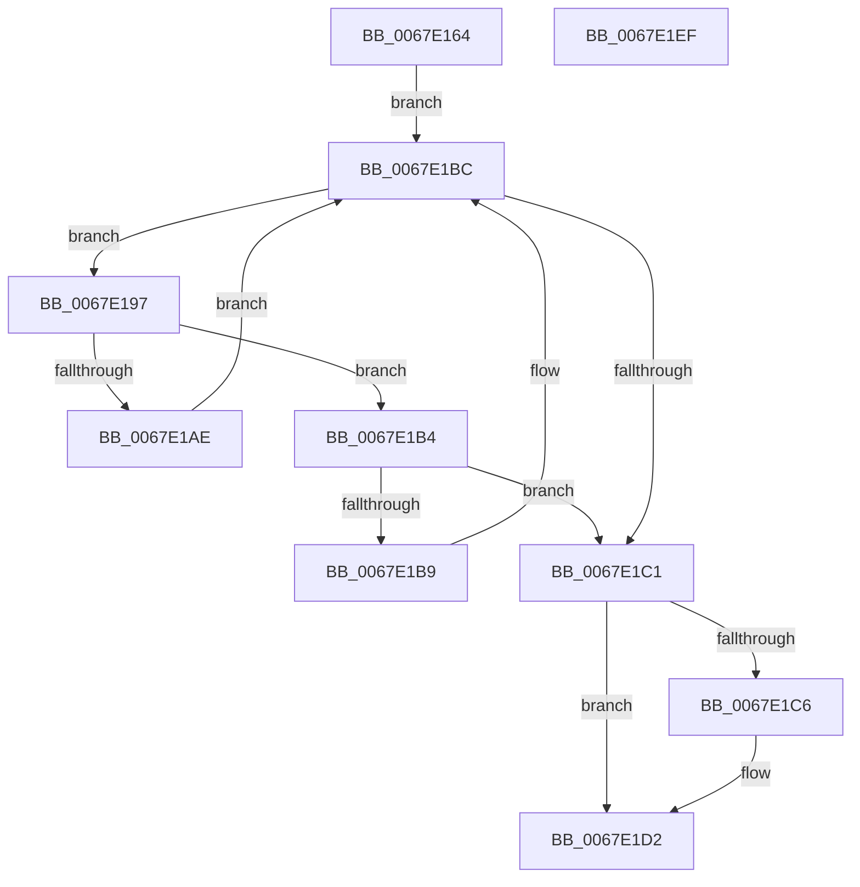

# MiExceptionForMappedVa

- RVA: `0x0067E164`–`0x0067E1F0` (길이 `140` bytes)
- VA: `0x000000014067E164`
- 실행 섹션: `.text`
- PDB 이름 있음: `예`; PDB Function 태그: `아니요`
- unwind 정보 RVA: `0x00060BC4`
- 디코드: `42`개 명령, `140/140` bytes 표시
- 미해석 바이트: `0` (있으면 어셈블리에 `.byte`로 보존)

> 이 문서는 커널 이미지의 기계어와 PDB 기호를 분석해 생성했습니다. 4번과 5번은 함수 원형과 자료형을 바이너리 사용 방식에서 추정한 C 해석이며 원본 소스 복구 결과는 아닙니다.

## 1. Dependencies

- 직접 호출 지점: **3**; 고유 호출 대상: **3**
- 직접 호출자로 확인된 함수: **1**
- RIP 상대 이미지 참조: **1**

### Outgoing calls
- `0x0067E17B` → [MiGetAnyMultiplexedVm](../44/MiGetAnyMultiplexedVm_function_00448BD0.md) (function, `0x00448BD0`)
- `0x0067E186` → [MiLockWorkingSetShared](../27/MiLockWorkingSetShared_function_0027CBF0.md) (function, `0x0027CBF0`)
- `0x0067E1D8` → [MiUnlockWorkingSetShared](../27/MiUnlockWorkingSetShared_function_0027D690.md) (function, `0x0027D690`)

### Direct callers
- [sub_006E4582](../6E/Unknown_function_006E4582.md) at `0x006E4682`

### Static image references
- `0x0067E18B` → RVA `0x00E36048` (`.data`; read)

## 2. Other-region calls and transfers

- 다른 실행 섹션으로 향하는 call: **0**
- 별도 외부 분기/꼬리 이동을 확인하지 못했습니다.

## 3. Assembly (complete function range)

```asm
0067E164  48 89 5C 24 08                  mov qword ptr [rsp + 8], rbx
0067E169  48 89 74 24 10                  mov qword ptr [rsp + 0x10], rsi
0067E16E  57                              push rdi
0067E16F  48 83 EC 20                     sub rsp, 0x20
0067E173  48 8B F9                        mov rdi, rcx
0067E176  33 DB                           xor ebx, ebx
0067E178  8D 4B 02                        lea ecx, [rbx + 2]
0067E17B  E8 50 AA DC FF                  call 0x140448bd0
0067E180  48 8B C8                        mov rcx, rax
0067E183  48 8B F0                        mov rsi, rax
0067E186  E8 65 EA BF FF                  call 0x14027cbf0
0067E18B  48 8B 15 B6 7E 7B 00            mov rdx, qword ptr [rip + 0x7b7eb6]
0067E192  44 8A C8                        mov r9b, al
0067E195  EB 25                           jmp 0x14067e1bc
0067E197  4C 8B 42 58                     mov r8, qword ptr [rdx + 0x58]
0067E19B  48 8B 4A 20                     mov rcx, qword ptr [rdx + 0x20]
0067E19F  49 81 E0 00 F0 FF FF            and r8, 0xfffffffffffff000
0067E1A6  49 03 C8                        add rcx, r8
0067E1A9  48 3B F9                        cmp rdi, rcx
0067E1AC  72 06                           jb 0x14067e1b4
0067E1AE  48 8B 52 08                     mov rdx, qword ptr [rdx + 8]
0067E1B2  EB 08                           jmp 0x14067e1bc
0067E1B4  49 3B F8                        cmp rdi, r8
0067E1B7  73 08                           jae 0x14067e1c1
0067E1B9  48 8B 12                        mov rdx, qword ptr [rdx]
0067E1BC  48 85 D2                        test rdx, rdx
0067E1BF  75 D6                           jne 0x14067e197
0067E1C1  48 85 D2                        test rdx, rdx
0067E1C4  74 0C                           je 0x14067e1d2
0067E1C6  F6 42 38 02                     test byte ptr [rdx + 0x38], 2
0067E1CA  B8 01 00 00 00                  mov eax, 1
0067E1CF  0F 45 D8                        cmovne ebx, eax
0067E1D2  41 8A D1                        mov dl, r9b
0067E1D5  48 8B CE                        mov rcx, rsi
0067E1D8  E8 B3 F4 BF FF                  call 0x14027d690
0067E1DD  48 8B 74 24 38                  mov rsi, qword ptr [rsp + 0x38]
0067E1E2  8B C3                           mov eax, ebx
0067E1E4  48 8B 5C 24 30                  mov rbx, qword ptr [rsp + 0x30]
0067E1E9  48 83 C4 20                     add rsp, 0x20
0067E1ED  5F                              pop rdi
0067E1EE  C3                              ret
0067E1EF  CC                              int3
```

## 4. C-style interpretation (structured pseudocode)

```c
__int64 __fastcall MiExceptionForMappedVa(__int64 a1)
{
    __int64 result;
    __int64 v_rbx;
    __int64 v_rsp;
    unsigned __int64 v_stack_p10;
    unsigned __int64 v_stack_p8;

    v_stack_p8 = v_rbx;
    v_stack_p10 = v_rsi;
    v_rsp = (v_rsp) - (32);
    v_rbx = 0;
    result = MiGetAnyMultiplexedVm(v_rbx + 2, a2, a3, a4);
    result = MiLockWorkingSetShared(result, a2, a3, a4);
    goto loc_0067E1BC;
loc_0067E197:
    a3 = (*(unsigned __int64 *)(*(unsigned __int64 *)(v_rip + 8093366) + 88)) & (0xFFFFFFFFFFFFF000ULL);
    a1 = (*(unsigned __int64 *)(*(unsigned __int64 *)(v_rip + 8093366) + 32)) + (a3);
    if (a1 < a1) goto loc_0067E1B4;
    goto loc_0067E1BC;
loc_0067E1B4:
    if (a1 >= a3) goto loc_0067E1C1;
loc_0067E1BC:
    if (*(unsigned __int64 *)(*(unsigned __int64 *)(*(unsigned __int64 *)(v_rip + 8093366) + 8)) != 0) goto loc_0067E197;
loc_0067E1C1:
    if (*(unsigned __int64 *)(*(unsigned __int64 *)(*(unsigned __int64 *)(v_rip + 8093366) + 8)) != 0) {
        result = 1;
        if (((*(unsigned __int8 *)(*(unsigned __int64 *)(*(unsigned __int64 *)(*(unsigned __int64 *)(v_rip + 8093366) + 8)) + 56)) & (2)) != 0) { v_rbx = (unsigned int)(result); }
    }
    result = MiUnlockWorkingSetShared(result, (unsigned __int8)((unsigned __int8)(result)), a3, (unsigned __int8)(result));
    v_rsp = (v_rsp) + (32);
    return (unsigned int)((unsigned int)(v_rbx));
}
```

## 5. (Beta) C Style

```c
int64_t MiExceptionForMappedVa(int64_t Arg1)
{
    int64_t result;
    int64_t local_rbx;
    int64_t local_rsp;
    uint64_t v_stack_p10;
    uint64_t v_stack_p8;

    v_stack_p8 = local_rbx;
    v_stack_p10 = local_rsi;
    local_rsp = (local_rsp) - (32);
    local_rbx = 0;
    result = MiGetAnyMultiplexedVm(local_rbx + 2, a2, a3, a4);
    result = MiLockWorkingSetShared(result, a2, a3, a4);
    goto loc_0067E1BC;
loc_0067E197:
    a3 = (*(uint64_t *)(*(uint64_t *)(v_rip + 0x7B7EB6) + 0x58)) & (0xFFFFFFFFFFFFF000ULL);
    Arg1 = (*(uint64_t *)(*(uint64_t *)(v_rip + 0x7B7EB6) + 0x20)) + (a3);
    if (Arg1 < Arg1) goto loc_0067E1B4;
    goto loc_0067E1BC;
loc_0067E1B4:
    if (Arg1 >= a3) goto loc_0067E1C1;
loc_0067E1BC:
    if (*(uint64_t *)(*(uint64_t *)(*(uint64_t *)(v_rip + 0x7B7EB6) + 0x8)) != 0) goto loc_0067E197;
loc_0067E1C1:
    if (*(uint64_t *)(*(uint64_t *)(*(uint64_t *)(v_rip + 0x7B7EB6) + 0x8)) != 0) {
        result = 1;
        if (((*(uint8_t *)(*(uint64_t *)(*(uint64_t *)(*(uint64_t *)(v_rip + 0x7B7EB6) + 0x8)) + 0x38)) & (2)) != 0) { local_rbx = (uint32_t)(result); }
    }
    result = MiUnlockWorkingSetShared(result, (uint8_t)((uint8_t)(result)), a3, (uint8_t)(result));
    local_rsp = (local_rsp) + (32);
    return (uint32_t)((uint32_t)(local_rbx));
}
```

## 6. Execution-region graph

[열기: 2D/3D 그래프와 함수 탐색 컨트롤 패널](../../../control-panel.html?section=text&rva=0x0067E164&view=graph)

- 2D 그래프는 위에서 아래로 흐르고, 3D 그래프는 빈 공간을 드래그해 회전합니다. Shift+드래그는 이동, 휠은 확대·축소, 함수 노드 선택은 대상 보고서 이동입니다.

### Static fallback


