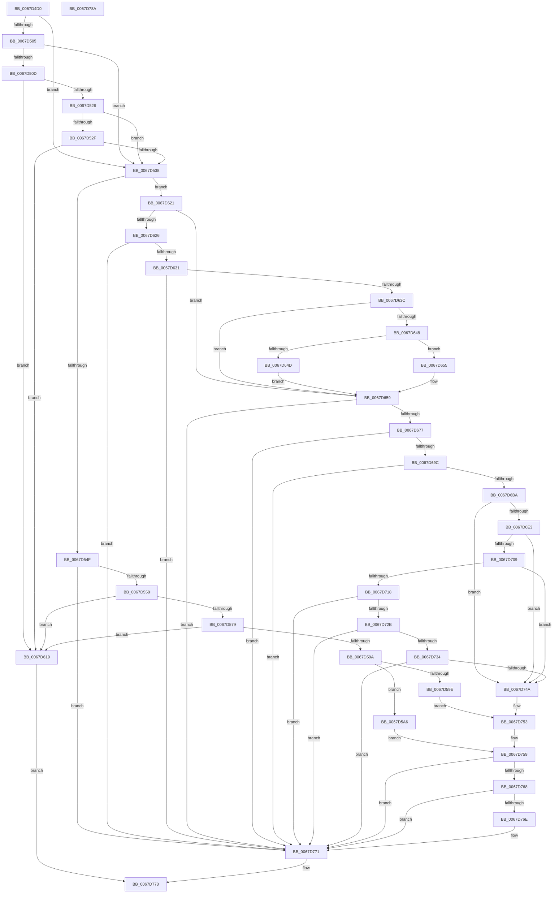

# MiFilterCrashDumpPte

- RVA: `0x0067D4D0`–`0x0067D78B` (길이 `699` bytes)
- VA: `0x000000014067D4D0`
- 실행 섹션: `.text`
- PDB 이름 있음: `예`; PDB Function 태그: `아니요`
- unwind 정보 RVA: `0x000733F8`
- 디코드: `176`개 명령, `699/699` bytes 표시
- 미해석 바이트: `0` (있으면 어셈블리에 `.byte`로 보존)

> 이 문서는 커널 이미지의 기계어와 PDB 기호를 분석해 생성했습니다. 4번과 5번은 함수 원형과 자료형을 바이너리 사용 방식에서 추정한 C 해석이며 원본 소스 복구 결과는 아닙니다.

## 1. Dependencies

- 직접 호출 지점: **8**; 고유 호출 대상: **5**
- 직접 호출자로 확인된 함수: **0**
- RIP 상대 이미지 참조: **2**

### Outgoing calls
- `0x0067D510` → [MiGetLeafVa](../27/MiGetLeafVa_function_0027C0A0.md) (function, `0x0027C0A0`)
- `0x0067D518` → [MiGetSystemRegionType](../28/MiGetSystemRegionType_function_0028EC80.md) (function, `0x0028EC80`)
- `0x0067D53B` → [MI_READ_PTE_LOCK_FREE](../28/MI_READ_PTE_LOCK_FREE_function_002828A0.md) (function, `0x002828A0`)
- `0x0067D5A9` → [MiGetLeafVa](../27/MiGetLeafVa_function_0027C0A0.md) (function, `0x0027C0A0`)
- `0x0067D5B5` → [MiGetLeafVa](../27/MiGetLeafVa_function_0027C0A0.md) (function, `0x0027C0A0`)
- `0x0067D6AD` → [MiIsPageSecured](../22/MiIsPageSecured_function_00228524.md) (function, `0x00228524`)
- `0x0067D6D9` → [MiGetSystemRegionType](../28/MiGetSystemRegionType_function_0028EC80.md) (function, `0x0028EC80`)
- `0x0067D75F` → [guard_dispatch_icall](../6B/guard_dispatch_icall_function_006BAAD0.md) (function, `0x006BAAD0`)

### Direct callers
- 이 함수 시작 RVA로 연결되는 직접 call은 확인되지 않았습니다. 간접 호출은 완전히 역산할 수 없습니다.

### Static image references
- `0x0067D56C` → RVA `0x00E2DCE0` (`.data`; read)
- `0x0067D63C` → RVA `0x00E2DC80` (`.data`; read)

## 2. Other-region calls and transfers

- 다른 실행 섹션으로 향하는 call: **0**
- 별도 외부 분기/꼬리 이동을 확인하지 못했습니다.

## 3. Assembly (complete function range)

```asm
0067D4D0  48 89 5C 24 08                  mov qword ptr [rsp + 8], rbx
0067D4D5  48 89 6C 24 10                  mov qword ptr [rsp + 0x10], rbp
0067D4DA  56                              push rsi
0067D4DB  57                              push rdi
0067D4DC  41 54                           push r12
0067D4DE  41 56                           push r14
0067D4E0  41 57                           push r15
0067D4E2  48 83 EC 30                     sub rsp, 0x30
0067D4E6  48 8B B1 B8 00 00 00            mov rsi, qword ptr [rcx + 0xb8]
0067D4ED  45 8B F8                        mov r15d, r8d
0067D4F0  48 8B FA                        mov rdi, rdx
0067D4F3  48 8B E9                        mov rbp, rcx
0067D4F6  41 BC 01 00 00 00               mov r12d, 1
0067D4FC  4C 8B 36                        mov r14, qword ptr [rsi]
0067D4FF  41 83 F8 03                     cmp r8d, 3
0067D503  75 33                           jne 0x14067d538
0067D505  F7 01 00 20 02 00               test dword ptr [rcx], 0x22000
0067D50B  74 2B                           je 0x14067d538
0067D50D  48 8B CA                        mov rcx, rdx
0067D510  E8 8B EB BF FF                  call 0x14027c0a0
0067D515  48 8B C8                        mov rcx, rax
0067D518  E8 63 17 C1 FF                  call 0x14028ec80
0067D51D  83 F8 07                        cmp eax, 7
0067D520  0F 84 F3 00 00 00               je 0x14067d619
0067D526  41 8B 4E 28                     mov ecx, dword ptr [r14 + 0x28]
0067D52A  F6 C1 04                        test cl, 4
0067D52D  74 09                           je 0x14067d538
0067D52F  41 3B C7                        cmp eax, r15d
0067D532  0F 84 E1 00 00 00               je 0x14067d619
0067D538  48 8B CF                        mov rcx, rdi
0067D53B  E8 60 53 C0 FF                  call 0x1402828a0
0067D540  48 8B D8                        mov rbx, rax
0067D543  49 23 C4                        and rax, r12
0067D546  45 85 FF                        test r15d, r15d
0067D549  0F 84 D2 00 00 00               je 0x14067d621
0067D54F  48 85 C0                        test rax, rax
0067D552  0F 84 19 02 00 00               je 0x14067d771
0067D558  48 8B D3                        mov rdx, rbx
0067D55B  49 BF FF FF FF FF FF 00 00 00   movabs r15, 0xffffffffff
0067D565  48 C1 EA 0C                     shr rdx, 0xc
0067D569  49 23 D7                        and rdx, r15
0067D56C  48 3B 15 6D 07 7B 00            cmp rdx, qword ptr [rip + 0x7b076d]
0067D573  0F 87 A0 00 00 00               ja 0x14067d619
0067D579  48 8D 0C 52                     lea rcx, [rdx + rdx*2]
0067D57D  48 B8 28 00 00 00 00 DE FF FF   movabs rax, 0xffffde0000000028
0067D587  48 03 C9                        add rcx, rcx
0067D58A  48 8B C0                        mov rax, rax
0067D58D  48 8B 04 C8                     mov rax, qword ptr [rax + rcx*8]
0067D591  48 C1 E8 36                     shr rax, 0x36
0067D595  41 85 C4                        test r12d, eax
0067D598  74 7F                           je 0x14067d619
0067D59A  84 DB                           test bl, bl
0067D59C  78 08                           js 0x14067d5a6
0067D59E  4D 8B C4                        mov r8, r12
0067D5A1  E9 AD 01 00 00                  jmp 0x14067d753
0067D5A6  48 8B CF                        mov rcx, rdi
0067D5A9  E8 F2 EA BF FF                  call 0x14027c0a0
0067D5AE  48 8D 4F 08                     lea rcx, [rdi + 8]
0067D5B2  4C 8B C8                        mov r9, rax
0067D5B5  E8 E6 EA BF FF                  call 0x14027c0a0
0067D5BA  48 FF C8                        dec rax
0067D5BD  49 BC 00 00 00 00 80 F6 FF FF   movabs r12, 0xfffff68000000000
0067D5C7  49 8B CC                        mov rcx, r12
0067D5CA  48 8B 55 60                     mov rdx, qword ptr [rbp + 0x60]
0067D5CE  4C 8B 85 80 00 00 00            mov r8, qword ptr [rbp + 0x80]
0067D5D5  48 C1 E2 19                     shl rdx, 0x19
0067D5D9  48 C1 E1 19                     shl rcx, 0x19
0067D5DD  48 2B D1                        sub rdx, rcx
0067D5E0  48 C1 FA 10                     sar rdx, 0x10
0067D5E4  4C 3B CA                        cmp r9, rdx
0067D5E7  49 0F 43 D1                     cmovae rdx, r9
0067D5EB  49 C1 E0 19                     shl r8, 0x19
0067D5EF  4C 2B C1                        sub r8, rcx
0067D5F2  41 B9 01 00 00 00               mov r9d, 1
0067D5F8  49 81 C8 00 00 FF 0F            or r8, 0xfff0000
0067D5FF  49 C1 F8 10                     sar r8, 0x10
0067D603  49 3B C0                        cmp rax, r8
0067D606  4C 0F 46 C0                     cmovbe r8, rax
0067D60A  4C 2B C2                        sub r8, rdx
0067D60D  49 FF C0                        inc r8
0067D610  49 C1 E8 0C                     shr r8, 0xc
0067D614  E9 40 01 00 00                  jmp 0x14067d759
0067D619  41 8B C4                        mov eax, r12d
0067D61C  E9 52 01 00 00                  jmp 0x14067d773
0067D621  48 85 C0                        test rax, rax
0067D624  75 33                           jne 0x14067d659
0067D626  48 0F BA E3 0A                  bt rbx, 0xa
0067D62B  0F 82 40 01 00 00               jb 0x14067d771
0067D631  48 0F BA E3 0B                  bt rbx, 0xb
0067D636  0F 83 35 01 00 00               jae 0x14067d771
0067D63C  48 8B 05 3D 06 7B 00            mov rax, qword ptr [rip + 0x7b063d]
0067D643  48 85 C0                        test rax, rax
0067D646  74 11                           je 0x14067d659
0067D648  F6 C3 10                        test bl, 0x10
0067D64B  75 08                           jne 0x14067d655
0067D64D  48 F7 D0                        not rax
0067D650  48 23 D8                        and rbx, rax
0067D653  EB 04                           jmp 0x14067d659
0067D655  48 83 E3 EF                     and rbx, 0xffffffffffffffef
0067D659  48 C1 EB 0C                     shr rbx, 0xc
0067D65D  49 BF FF FF FF FF FF 00 00 00   movabs r15, 0xffffffffff
0067D667  49 23 DF                        and rbx, r15
0067D66A  48 3B 1D 6F 06 7B 00            cmp rbx, qword ptr [rip + 0x7b066f]
0067D671  0F 87 FA 00 00 00               ja 0x14067d771
0067D677  48 8D 0C 5B                     lea rcx, [rbx + rbx*2]
0067D67B  48 B8 28 00 00 00 00 DE FF FF   movabs rax, 0xffffde0000000028
0067D685  48 03 C9                        add rcx, rcx
0067D688  48 8B C0                        mov rax, rax
0067D68B  48 8B 04 C8                     mov rax, qword ptr [rax + rcx*8]
0067D68F  48 C1 E8 36                     shr rax, 0x36
0067D693  41 85 C4                        test r12d, eax
0067D696  0F 84 D5 00 00 00               je 0x14067d771
0067D69C  48 B8 00 00 00 00 00 DE FF FF   movabs rax, 0xffffde0000000000
0067D6A6  48 8D 2C C8                     lea rbp, [rax + rcx*8]
0067D6AA  48 8B CD                        mov rcx, rbp
0067D6AD  E8 72 AE BA FF                  call 0x140228524
0067D6B2  85 C0                           test eax, eax
0067D6B4  0F 85 B7 00 00 00               jne 0x14067d771
0067D6BA  48 C1 E7 19                     shl rdi, 0x19
0067D6BE  49 BC 00 00 00 00 80 F6 FF FF   movabs r12, 0xfffff68000000000
0067D6C8  49 8B C4                        mov rax, r12
0067D6CB  48 C1 E0 19                     shl rax, 0x19
0067D6CF  48 2B F8                        sub rdi, rax
0067D6D2  48 C1 FF 10                     sar rdi, 0x10
0067D6D6  48 8B CF                        mov rcx, rdi
0067D6D9  E8 A2 15 C1 FF                  call 0x14028ec80
0067D6DE  83 F8 08                        cmp eax, 8
0067D6E1  75 67                           jne 0x14067d74a
0067D6E3  48 8B 4D 08                     mov rcx, qword ptr [rbp + 8]
0067D6E7  49 B8 00 00 00 00 00 00 00 80   movabs r8, 0x8000000000000000
0067D6F1  49 0B C8                        or rcx, r8
0067D6F4  49 8B C4                        mov rax, r12
0067D6F7  48 BA 78 FF FF FF 3F 00 00 00   movabs rdx, 0x3fffffff78
0067D701  48 03 C2                        add rax, rdx
0067D704  48 3B C8                        cmp rcx, rax
0067D707  77 41                           ja 0x14067d74a
0067D709  48 8B 4D 08                     mov rcx, qword ptr [rbp + 8]
0067D70D  49 0B C8                        or rcx, r8
0067D710  49 8B C4                        mov rax, r12
0067D713  48 3B C8                        cmp rcx, rax
0067D716  72 32                           jb 0x14067d74a
0067D718  48 8B 45 18                     mov rax, qword ptr [rbp + 0x18]
0067D71C  48 B9 FF FF FF FF FF FF FF 3F   movabs rcx, 0x3fffffffffffffff
0067D726  48 85 C1                        test rcx, rax
0067D729  74 46                           je 0x14067d771
0067D72B  8A 45 22                        mov al, byte ptr [rbp + 0x22]
0067D72E  24 07                           and al, 7
0067D730  3C 06                           cmp al, 6
0067D732  75 3D                           jne 0x14067d771
0067D734  48 8B 45 28                     mov rax, qword ptr [rbp + 0x28]
0067D738  48 B9 FE FF FF FF 3F 00 00 00   movabs rcx, 0x3ffffffffe
0067D742  49 23 C7                        and rax, r15
0067D745  48 3B C1                        cmp rax, rcx
0067D748  75 27                           jne 0x14067d771
0067D74A  41 B8 01 00 00 00               mov r8d, 1
0067D750  48 8B D3                        mov rdx, rbx
0067D753  41 B9 02 00 00 00               mov r9d, 2
0067D759  49 8B 06                        mov rax, qword ptr [r14]
0067D75C  49 8B CE                        mov rcx, r14
0067D75F  E8 6C D3 03 00                  call 0x1406baad0
0067D764  85 C0                           test eax, eax
0067D766  79 09                           jns 0x14067d771
0067D768  83 7E 08 00                     cmp dword ptr [rsi + 8], 0
0067D76C  7C 03                           jl 0x14067d771
0067D76E  89 46 08                        mov dword ptr [rsi + 8], eax
0067D771  33 C0                           xor eax, eax
0067D773  48 8B 5C 24 60                  mov rbx, qword ptr [rsp + 0x60]
0067D778  48 8B 6C 24 68                  mov rbp, qword ptr [rsp + 0x68]
0067D77D  48 83 C4 30                     add rsp, 0x30
0067D781  41 5F                           pop r15
0067D783  41 5E                           pop r14
0067D785  41 5C                           pop r12
0067D787  5F                              pop rdi
0067D788  5E                              pop rsi
0067D789  C3                              ret
0067D78A  CC                              int3
```

## 4. C-style interpretation (structured pseudocode)

```c
__int64 __fastcall MiFilterCrashDumpPte(__int64 a1, __int64 a2, int a3)
{
    __int64 result;
    __int64 v_rbx;
    __int64 v_rdi;
    __int64 v_rsp;
    unsigned __int64 v_stack_p10;
    unsigned __int64 v_stack_p8;

    v_stack_p8 = v_rbx;
    v_stack_p10 = v_rbp;
    v_rsp = (v_rsp) - (48);
    if (a3 != 3) goto loc_0067D538;
    if (((*(unsigned int *)(a1)) & (0x22000ULL)) == 0) goto loc_0067D538;
    result = MiGetLeafVa(a2, a2, a3, a4);
    result = MiGetSystemRegionType(result, a2, a3, a4);
    if (((unsigned int)(result)) == 7) goto loc_0067D619;
    if ((((unsigned __int8)((unsigned int)(*(unsigned int *)(*(unsigned __int64 *)(*(unsigned __int64 *)(a1 + 184)) + 40)))) & (4)) == 0) goto loc_0067D538;
    if (((unsigned int)(result)) == ((unsigned int)((unsigned int)(a3)))) goto loc_0067D619;
loc_0067D538:
    result = MI_READ_PTE_LOCK_FREE(a2, a2, a3, a4);
    result = (result) & (1);
    if ((unsigned int)((unsigned int)(a3)) == 0) goto loc_0067D621;
    if (result == 0) goto loc_0067D771;
    a2 = (result) >> (12);
    a2 = (a2) & ((unsigned int)(a3));
    if (a2 > (*(unsigned __int64 *)(v_rip + 8062829))) goto loc_0067D619;
    a1 = (a2 + a2 * 2) + (a2 + a2 * 2);
    result = (*(unsigned __int64 *)(result + a1 * 8)) >> (54);
    if (((1) & ((unsigned int)(result))) == 0) goto loc_0067D619;
    if (sign_flag) goto loc_0067D5A6;
    goto loc_0067D753;
loc_0067D5A6:
    result = MiGetLeafVa(a2, a2, 1, a4);
    result = MiGetLeafVa(a2 + 8, a2, 1, result);
    result = (result) - 1;
    a2 = (*(unsigned __int64 *)(a1 + 96)) << (25);
    a1 = (1) << (25);
    a2 = (a2) - (a1);
    a2 = (a2) >> (16);
    if (result >= a2) { a2 = result; }
    a3 = (*(unsigned __int64 *)(a1 + 128)) << (25);
    a3 = (a3) - (a1);
    a3 = (a3) | (0xFFF0000ULL);
    a3 = (a3) >> (16);
    if (result <= a3) { a3 = result; }
    a3 = (a3) - (a2);
    a3 = (a3) + 1;
    a3 = (a3) >> (12);
    goto loc_0067D759;
loc_0067D619:
    goto loc_0067D773;
loc_0067D621:
    if (1 != 0) goto loc_0067D659;
    if (condition_is_below) goto loc_0067D771;
    if (condition_is_above_or_equal) goto loc_0067D771;
    if (*(unsigned __int64 *)(v_rip + 8062525) == 0) goto loc_0067D659;
    if ((((unsigned __int8)(result)) & (16)) != 0) goto loc_0067D655;
    result = ~(*(unsigned __int64 *)(v_rip + 8062525));
    v_rbx = (result) & (result);
    goto loc_0067D659;
loc_0067D655:
    v_rbx = (v_rbx) & (-17);
loc_0067D659:
    v_rbx = (v_rbx) >> (12);
    v_rbx = (v_rbx) & ((unsigned int)(a3));
    if (v_rbx > (*(unsigned __int64 *)(v_rip + 8062575))) goto loc_0067D771;
    a1 = (v_rbx + v_rbx * 2) + (v_rbx + v_rbx * 2);
    result = (*(unsigned __int64 *)(result + a1 * 8)) >> (54);
    if (((1) & ((unsigned int)(result))) == 0) goto loc_0067D771;
    result = MiIsPageSecured(result + a1 * 8, a2, a3, 1);
    if ((unsigned int)(result) != 0) goto loc_0067D771;
    v_rdi = (a2) << (25);
    result = (1) << (25);
    v_rdi = (v_rdi) - (result);
    v_rdi = (v_rdi) >> (16);
    result = MiGetSystemRegionType(v_rdi, a2, a3, 1);
    if (((unsigned int)(result)) != 8) goto loc_0067D74A;
    a1 = (*(unsigned __int64 *)(result + a1 * 8 + 8)) | (a3);
    result = (1) + (a2);
    if (a1 > result) goto loc_0067D74A;
    a1 = (*(unsigned __int64 *)(result + a1 * 8 + 8)) | (a3);
    if (a1 < 1) goto loc_0067D74A;
    if (((a1) & (*(unsigned __int64 *)(result + a1 * 8 + 24))) == 0) goto loc_0067D771;
    result = (unsigned __int8)((*(unsigned __int8 *)(result + a1 * 8 + 34)) & (7));
    if (((unsigned __int8)(result)) != 6) goto loc_0067D771;
    result = (*(unsigned __int64 *)(result + a1 * 8 + 40)) & ((unsigned int)(a3));
    if (result != a1) goto loc_0067D771;
loc_0067D74A:
loc_0067D753:
loc_0067D759:
    result = guard_dispatch_icall(*(unsigned __int64 *)(*(unsigned __int64 *)(a1 + 184)), v_rbx, 1, 2);
    if (!sign_flag) goto loc_0067D771;
    if ((*(unsigned int *)(*(unsigned __int64 *)(a1 + 184) + 8)) >= 0) {
        *(unsigned int *)(*(unsigned __int64 *)(a1 + 184) + 8) = (unsigned int)(result);
    }
    result = 0;
loc_0067D773:
    v_rsp = (v_rsp) + (48);
    return result;
}
```

## 5. (Beta) C Style

```c
int64_t MiFilterCrashDumpPte(void *Arg1, void *Arg2, int32_t Arg3)
{
    uint8_t *arg1 = (uint8_t *)Arg1;
    uint8_t *arg2 = (uint8_t *)Arg2;

    int64_t result;
    int64_t local_rbx;
    int64_t local_rdi;
    int64_t local_rsp;
    uint64_t v_stack_p10;
    uint64_t v_stack_p8;

    v_stack_p8 = local_rbx;
    v_stack_p10 = local_rbp;
    local_rsp = (local_rsp) - (48);
    if (Arg3 != 3) goto loc_0067D538;
    if (((*(uint32_t *)(arg1)) & (0x22000ULL)) == 0) goto loc_0067D538;
    result = MiGetLeafVa(Arg2, Arg2, Arg3, a4);
    result = MiGetSystemRegionType(result, Arg2, Arg3, a4);
    if (((uint32_t)(result)) == 7) goto loc_0067D619;
    if ((((uint8_t)((uint32_t)(*(uint32_t *)(*(uint64_t *)(*(uint64_t *)(arg1 + 0xB8)) + 0x28)))) & (4)) == 0) goto loc_0067D538;
    if (((uint32_t)(result)) == ((uint32_t)((uint32_t)(Arg3)))) goto loc_0067D619;
loc_0067D538:
    result = MI_READ_PTE_LOCK_FREE(Arg2, Arg2, Arg3, a4);
    result = (result) & (1);
    if ((uint32_t)((uint32_t)(Arg3)) == 0) goto loc_0067D621;
    if (result == 0) goto loc_0067D771;
    Arg2 = (result) >> (12);
    Arg2 = (Arg2) & ((uint32_t)(Arg3));
    if (Arg2 > (*(uint64_t *)(v_rip + 0x7B076D))) goto loc_0067D619;
    Arg1 = (Arg2 + Arg2 * 2) + (Arg2 + Arg2 * 2);
    result = (*(uint64_t *)(result + arg1 * 8)) >> (54);
    if (((1) & ((uint32_t)(result))) == 0) goto loc_0067D619;
    if (sign_flag) goto loc_0067D5A6;
    goto loc_0067D753;
loc_0067D5A6:
    result = MiGetLeafVa(Arg2, Arg2, 1, a4);
    result = MiGetLeafVa(Arg2 + 8, Arg2, 1, result);
    result = (result) - 1;
    Arg2 = (*(uint64_t *)(arg1 + 0x60)) << (25);
    Arg1 = (1) << (25);
    Arg2 = (Arg2) - (Arg1);
    Arg2 = (Arg2) >> (16);
    if (result >= Arg2) { Arg2 = result; }
    Arg3 = (*(uint64_t *)(arg1 + 0x80)) << (25);
    Arg3 = (Arg3) - (Arg1);
    Arg3 = (Arg3) | (0xFFF0000ULL);
    Arg3 = (Arg3) >> (16);
    if (result <= Arg3) { Arg3 = result; }
    Arg3 = (Arg3) - (Arg2);
    Arg3 = (Arg3) + 1;
    Arg3 = (Arg3) >> (12);
    goto loc_0067D759;
loc_0067D619:
    goto loc_0067D773;
loc_0067D621:
    if (1 != 0) goto loc_0067D659;
    if (condition_is_below) goto loc_0067D771;
    if (condition_is_above_or_equal) goto loc_0067D771;
    if (*(uint64_t *)(v_rip + 0x7B063D) == 0) goto loc_0067D659;
    if ((((uint8_t)(result)) & (16)) != 0) goto loc_0067D655;
    result = ~(*(uint64_t *)(v_rip + 0x7B063D));
    local_rbx = (result) & (result);
    goto loc_0067D659;
loc_0067D655:
    local_rbx = (local_rbx) & (-17);
loc_0067D659:
    local_rbx = (local_rbx) >> (12);
    local_rbx = (local_rbx) & ((uint32_t)(Arg3));
    if (local_rbx > (*(uint64_t *)(v_rip + 0x7B066F))) goto loc_0067D771;
    Arg1 = (local_rbx + local_rbx * 2) + (local_rbx + local_rbx * 2);
    result = (*(uint64_t *)(result + arg1 * 8)) >> (54);
    if (((1) & ((uint32_t)(result))) == 0) goto loc_0067D771;
    result = MiIsPageSecured(result + Arg1 * 8, Arg2, Arg3, 1);
    if ((uint32_t)(result) != 0) goto loc_0067D771;
    local_rdi = (Arg2) << (25);
    result = (1) << (25);
    local_rdi = (local_rdi) - (result);
    local_rdi = (local_rdi) >> (16);
    result = MiGetSystemRegionType(local_rdi, Arg2, Arg3, 1);
    if (((uint32_t)(result)) != 8) goto loc_0067D74A;
    Arg1 = (*(uint64_t *)(result + arg1 * 8 + 0x8)) | (Arg3);
    result = (1) + (Arg2);
    if (Arg1 > result) goto loc_0067D74A;
    Arg1 = (*(uint64_t *)(result + arg1 * 8 + 0x8)) | (Arg3);
    if (Arg1 < 1) goto loc_0067D74A;
    if (((Arg1) & (*(uint64_t *)(result + arg1 * 8 + 0x18))) == 0) goto loc_0067D771;
    result = (uint8_t)((*(uint8_t *)(result + arg1 * 8 + 0x22)) & (7));
    if (((uint8_t)(result)) != 6) goto loc_0067D771;
    result = (*(uint64_t *)(result + arg1 * 8 + 0x28)) & ((uint32_t)(Arg3));
    if (result != Arg1) goto loc_0067D771;
loc_0067D74A:
loc_0067D753:
loc_0067D759:
    result = guard_dispatch_icall(*(uint64_t *)(*(uint64_t *)(arg1 + 0xB8)), local_rbx, 1, 2);
    if (!sign_flag) goto loc_0067D771;
    if ((*(uint32_t *)(*(uint64_t *)(arg1 + 0xB8) + 0x8)) >= 0) {
        *(uint32_t *)(*(uint64_t *)(arg1 + 0xB8) + 0x8) = (uint32_t)(result);
    }
    result = 0;
loc_0067D773:
    local_rsp = (local_rsp) + (48);
    return result;
}
```

### 관측된 메모리 오프셋

구조체 형식이 확인되지 않은 접근은 인자 기준의 오프셋으로만 기록했습니다.

| 기준 인자 | 오프셋 표현 | 폭 (bit) | 접근 |
|---|---:|---:|---|
| `Arg1` | `+ 0x0` | `32` | `R` |
| `Arg1` | `+ 0x60` | `64` | `R` |
| `Arg1` | `+ 0x80` | `64` | `R` |
| `Arg1` | `+ 0xB8` | `64` | `R` |
| `Arg2` | `+ 0x8` | `64` | `R` |

## 6. Execution-region graph

[열기: 2D/3D 그래프와 함수 탐색 컨트롤 패널](../../../control-panel.html?section=text&rva=0x0067D4D0&view=graph)

- 2D 그래프는 위에서 아래로 흐르고, 3D 그래프는 빈 공간을 드래그해 회전합니다. Shift+드래그는 이동, 휠은 확대·축소, 함수 노드 선택은 대상 보고서 이동입니다.

### Static fallback


