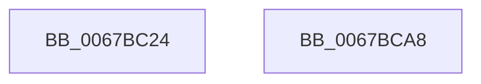

# MiFlushCachedIoPfnRange

- RVA: `0x0067BC24`–`0x0067BCA9` (길이 `133` bytes)
- VA: `0x000000014067BC24`
- 실행 섹션: `.text`
- PDB 이름 있음: `예`; PDB Function 태그: `아니요`
- unwind 정보 RVA: `0x000D7ED4`
- 디코드: `30`개 명령, `133/133` bytes 표시
- 미해석 바이트: `0` (있으면 어셈블리에 `.byte`로 보존)

> 이 문서는 커널 이미지의 기계어와 PDB 기호를 분석해 생성했습니다. 4번과 5번은 함수 원형과 자료형을 바이너리 사용 방식에서 추정한 C 해석이며 원본 소스 복구 결과는 아닙니다.

## 1. Dependencies

- 직접 호출 지점: **3**; 고유 호출 대상: **3**
- 직접 호출자로 확인된 함수: **4**
- RIP 상대 이미지 참조: **3**

### Outgoing calls
- `0x0067BC7B` → [memset](../6C/memset_function_006C6C40.md) (function, `0x006C6C40`)
- `0x0067BC86` → [KeInvalidateAllCaches](../30/KeInvalidateAllCaches_function_00308CC0.md) (function, `0x00308CC0`)
- `0x0067BC9B` → [_security_check_cookie](../6A/_security_check_cookie_function_006AC640.md) (function, `0x006AC640`)

### Direct callers
- [MiReferenceIoPages](../23/MiReferenceIoPages_function_0023C804.md) at `0x0023D03C`
- [MiReferenceIoPages](../23/MiReferenceIoPages_function_0023C804.md) at `0x0023D05A`
- [MiReferenceIoPages](../23/MiReferenceIoPages_function_0023C804.md) at `0x0023D0A1`
- [MiFlushStaleCacheMap](MiFlushStaleCacheMap_function_0067BCB0.md) at `0x0067BD48`
- [MiFlushStaleCacheMap](MiFlushStaleCacheMap_function_0067BCB0.md) at `0x0067BD78`
- [MiIoPfnTreeExclusionCompatible](MiIoPfnTreeExclusionCompatible_function_0067BE9C.md) at `0x0067C050`
- [MiIoPfnTreeExclusionCompatible](MiIoPfnTreeExclusionCompatible_function_0067BE9C.md) at `0x0067C0DC`
- [sub_006D79AA](../6D/Unknown_function_006D79AA.md) at `0x006D7AC1`

### Static image references
- `0x0067BC2B` → RVA `0x00E0A740` (`.data`; read)
- `0x0067BC75` → RVA `0x00E37338` (`.data`; read/write)
- `0x0067BC80` → RVA `0x00E2DC54` (`.data`; read/write)

## 2. Other-region calls and transfers

- 다른 실행 섹션으로 향하는 call: **0**
- 별도 외부 분기/꼬리 이동을 확인하지 못했습니다.

## 3. Assembly (complete function range)

```asm
0067BC24  48 81 EC 08 01 00 00            sub rsp, 0x108
0067BC2B  48 8B 05 0E EB 78 00            mov rax, qword ptr [rip + 0x78eb0e]
0067BC32  48 33 C4                        xor rax, rsp
0067BC35  48 89 84 24 F0 00 00 00         mov qword ptr [rsp + 0xf0], rax
0067BC3D  45 33 C0                        xor r8d, r8d
0067BC40  C1 E2 0C                        shl edx, 0xc
0067BC43  4C 89 01                        mov qword ptr [rcx], r8
0067BC46  8B C2                           mov eax, edx
0067BC48  4C 89 41 20                     mov qword ptr [rcx + 0x20], r8
0067BC4C  44 89 41 2C                     mov dword ptr [rcx + 0x2c], r8d
0067BC50  41 B8 C8 00 00 00               mov r8d, 0xc8
0067BC56  89 51 28                        mov dword ptr [rcx + 0x28], edx
0067BC59  33 D2                           xor edx, edx
0067BC5B  C1 E8 0C                        shr eax, 0xc
0067BC5E  66 C7 41 0A 02 00               mov word ptr [rcx + 0xa], 2
0067BC64  66 83 C0 06                     add ax, 6
0067BC68  66 C1 E0 03                     shl ax, 3
0067BC6C  66 89 41 08                     mov word ptr [rcx + 8], ax
0067BC70  48 8D 4C 24 20                  lea rcx, [rsp + 0x20]
0067BC75  FF 05 BD B6 7B 00               inc dword ptr [rip + 0x7bb6bd]
0067BC7B  E8 C0 AF 04 00                  call 0x1406c6c40
0067BC80  FF 05 CE 1F 7B 00               inc dword ptr [rip + 0x7b1fce]
0067BC86  E8 35 D0 C8 FF                  call 0x140308cc0
0067BC8B  B8 01 00 00 00                  mov eax, 1
0067BC90  48 8B 8C 24 F0 00 00 00         mov rcx, qword ptr [rsp + 0xf0]
0067BC98  48 33 CC                        xor rcx, rsp
0067BC9B  E8 A0 09 03 00                  call 0x1406ac640
0067BCA0  48 81 C4 08 01 00 00            add rsp, 0x108
0067BCA7  C3                              ret
0067BCA8  CC                              int3
```

## 4. C-style interpretation (structured pseudocode)

```c
__int64 __fastcall MiFlushCachedIoPfnRange(__int64 a1, int a2, int a3)
{
    __int64 result;
    __int64 v_rsp;
    unsigned __int64 v_stack_m18;
    unsigned __int64 v_stack_mE8;

    v_rsp = (v_rsp) - (264);
    result = (*(unsigned __int64 *)(v_rip + 7924494)) ^ (v_rsp);
    v_stack_m18 = result;
    a3 = 0;
    a2 = (unsigned int)((a2) << (12));
    *(unsigned __int64 *)(a1) = 0;
    *(unsigned __int64 *)(a1 + 32) = 0;
    *(unsigned int *)(a1 + 44) = 0;
    *(unsigned int *)(a1 + 40) = a2;
    a2 = 0;
    result = (unsigned int)(((unsigned int)(a2)) >> (12));
    *(unsigned __int16 *)(a1 + 10) = 2;
    result = (unsigned __int16)((result) + (6));
    result = (unsigned __int16)((result) << (3));
    *(unsigned __int16 *)(a1 + 8) = (unsigned __int16)(result);
    result = memset(v_stack_mE8, a2, 200, a4);
    result = KeInvalidateAllCaches(v_stack_mE8, a2, 200, a4);
    a1 = (v_stack_m18) ^ (v_rsp);
    result = _security_check_cookie(a1, a2, 200, a4);
    v_rsp = (v_rsp) + (264);
    return result;
}
```

## 5. (Beta) C Style

```c
int64_t MiFlushCachedIoPfnRange(void *Arg1, int32_t Arg2, int32_t Arg3)
{
    uint8_t *arg1 = (uint8_t *)Arg1;

    int64_t result;
    int64_t local_rsp;
    uint64_t v_stack_m18;
    uint64_t v_stack_mE8;

    local_rsp = (local_rsp) - (264);
    result = (*(uint64_t *)(v_rip + 0x78EB0E)) ^ (local_rsp);
    v_stack_m18 = result;
    Arg3 = 0;
    Arg2 = (uint32_t)((Arg2) << (12));
    *(uint64_t *)(arg1) = 0;
    *(uint64_t *)(arg1 + 0x20) = 0;
    *(uint32_t *)(arg1 + 0x2C) = 0;
    *(uint32_t *)(arg1 + 0x28) = Arg2;
    Arg2 = 0;
    result = (uint32_t)(((uint32_t)(Arg2)) >> (12));
    *(uint16_t *)(arg1 + 0xA) = 2;
    result = (uint16_t)((result) + (6));
    result = (uint16_t)((result) << (3));
    *(uint16_t *)(arg1 + 0x8) = (uint16_t)(result);
    result = memset(v_stack_mE8, Arg2, 200, a4);
    result = KeInvalidateAllCaches(v_stack_mE8, Arg2, 200, a4);
    Arg1 = (v_stack_m18) ^ (local_rsp);
    result = _security_check_cookie(Arg1, Arg2, 200, a4);
    local_rsp = (local_rsp) + (264);
    return result;
}
```

### 관측된 메모리 오프셋

구조체 형식이 확인되지 않은 접근은 인자 기준의 오프셋으로만 기록했습니다.

| 기준 인자 | 오프셋 표현 | 폭 (bit) | 접근 |
|---|---:|---:|---|
| `Arg1` | `+ 0x0` | `64` | `W` |
| `Arg1` | `+ 0x8` | `16` | `W` |
| `Arg1` | `+ 0xA` | `16` | `W` |
| `Arg1` | `+ 0x20` | `64` | `W` |
| `Arg1` | `+ 0x28` | `32` | `W` |
| `Arg1` | `+ 0x2C` | `32` | `W` |

## 6. Execution-region graph

[열기: 2D/3D 그래프와 함수 탐색 컨트롤 패널](../../../control-panel.html?section=text&rva=0x0067BC24&view=graph)

- 2D 그래프는 위에서 아래로 흐르고, 3D 그래프는 빈 공간을 드래그해 회전합니다. Shift+드래그는 이동, 휠은 확대·축소, 함수 노드 선택은 대상 보고서 이동입니다.

### Static fallback


