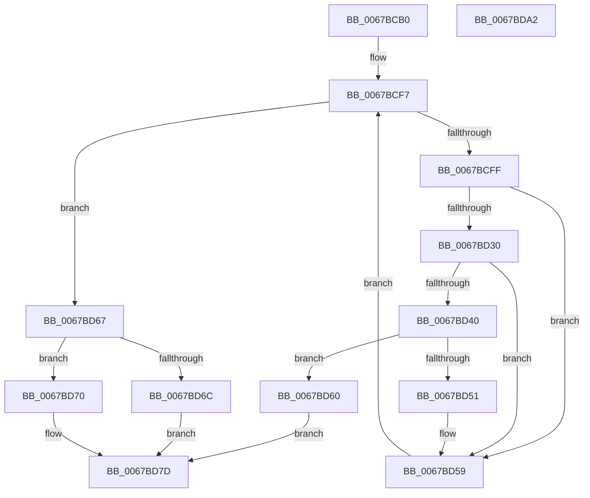

# MiFlushStaleCacheMap

- RVA: `0x0067BCB0`–`0x0067BDA3` (길이 `243` bytes)
- VA: `0x000000014067BCB0`
- 실행 섹션: `.text`
- PDB 이름 있음: `예`; PDB Function 태그: `아니요`
- unwind 정보 RVA: `0x000D7EB4`
- 디코드: `68`개 명령, `243/243` bytes 표시
- 미해석 바이트: `0` (있으면 어셈블리에 `.byte`로 보존)

> 이 문서는 커널 이미지의 기계어와 PDB 기호를 분석해 생성했습니다. 4번과 5번은 함수 원형과 자료형을 바이너리 사용 방식에서 추정한 C 해석이며 원본 소스 복구 결과는 아닙니다.

## 1. Dependencies

- 직접 호출 지점: **4**; 고유 호출 대상: **3**
- 직접 호출자로 확인된 함수: **1**
- RIP 상대 이미지 참조: **2**

### Outgoing calls
- `0x0067BCE4` → [memset](../6C/memset_function_006C6C40.md) (function, `0x006C6C40`)
- `0x0067BD48` → [MiFlushCachedIoPfnRange](MiFlushCachedIoPfnRange_function_0067BC24.md) (function, `0x0067BC24`)
- `0x0067BD78` → [MiFlushCachedIoPfnRange](MiFlushCachedIoPfnRange_function_0067BC24.md) (function, `0x0067BC24`)
- `0x0067BD88` → [_security_check_cookie](../6A/_security_check_cookie_function_006AC640.md) (function, `0x006AC640`)

### Direct callers
- [MiDeleteStaleCacheMaps](MiDeleteStaleCacheMaps_function_0067B780.md) at `0x0067B996`

### Static image references
- `0x0067BCC2` → RVA `0x00E0A740` (`.data`; read)
- `0x0067BCFF` → RVA `0x00E2DC38` (`.data`; read)

## 2. Other-region calls and transfers

- 다른 실행 섹션으로 향하는 call: **0**
- 별도 외부 분기/꼬리 이동을 확인하지 못했습니다.

## 3. Assembly (complete function range)

```asm
0067BCB0  48 89 5C 24 08                  mov qword ptr [rsp + 8], rbx
0067BCB5  48 89 74 24 10                  mov qword ptr [rsp + 0x10], rsi
0067BCBA  57                              push rdi
0067BCBB  48 81 EC E0 00 00 00            sub rsp, 0xe0
0067BCC2  48 8B 05 77 EA 78 00            mov rax, qword ptr [rip + 0x78ea77]
0067BCC9  48 33 C4                        xor rax, rsp
0067BCCC  48 89 84 24 D0 00 00 00         mov qword ptr [rsp + 0xd0], rax
0067BCD4  48 8B F1                        mov rsi, rcx
0067BCD7  33 D2                           xor edx, edx
0067BCD9  48 8D 4C 24 20                  lea rcx, [rsp + 0x20]
0067BCDE  41 B8 B0 00 00 00               mov r8d, 0xb0
0067BCE4  E8 57 AF 04 00                  call 0x1406c6c40
0067BCE9  48 8B 5E 18                     mov rbx, qword ptr [rsi + 0x18]
0067BCED  4C 8D 4C 24 50                  lea r9, [rsp + 0x50]
0067BCF2  45 33 C0                        xor r8d, r8d
0067BCF5  33 FF                           xor edi, edi
0067BCF7  81 FF 00 02 00 00               cmp edi, 0x200
0067BCFD  73 68                           jae 0x14067bd67
0067BCFF  8A 0D 33 1F 7B 00               mov cl, byte ptr [rip + 0x7b1f33]
0067BD05  B8 01 00 00 00                  mov eax, 1
0067BD0A  80 C1 F4                        add cl, 0xf4
0067BD0D  48 D3 E0                        shl rax, cl
0067BD10  FF C8                           dec eax
0067BD12  23 C3                           and eax, ebx
0067BD14  2B 46 18                        sub eax, dword ptr [rsi + 0x18]
0067BD17  03 C0                           add eax, eax
0067BD19  8B C8                           mov ecx, eax
0067BD1B  48 C1 E8 05                     shr rax, 5
0067BD1F  83 E1 1F                        and ecx, 0x1f
0067BD22  8B 54 86 2C                     mov edx, dword ptr [rsi + rax*4 + 0x2c]
0067BD26  D3 EA                           shr edx, cl
0067BD28  80 E2 03                        and dl, 3
0067BD2B  80 FA 01                        cmp dl, 1
0067BD2E  75 29                           jne 0x14067bd59
0067BD30  49 89 19                        mov qword ptr [r9], rbx
0067BD33  41 FF C0                        inc r8d
0067BD36  49 83 C1 08                     add r9, 8
0067BD3A  41 83 F8 10                     cmp r8d, 0x10
0067BD3E  75 19                           jne 0x14067bd59
0067BD40  41 8B D0                        mov edx, r8d
0067BD43  48 8D 4C 24 20                  lea rcx, [rsp + 0x20]
0067BD48  E8 D7 FE FF FF                  call 0x14067bc24
0067BD4D  85 C0                           test eax, eax
0067BD4F  75 0F                           jne 0x14067bd60
0067BD51  45 33 C0                        xor r8d, r8d
0067BD54  4C 8D 4C 24 50                  lea r9, [rsp + 0x50]
0067BD59  FF C7                           inc edi
0067BD5B  48 FF C3                        inc rbx
0067BD5E  EB 97                           jmp 0x14067bcf7
0067BD60  B8 01 00 00 00                  mov eax, 1
0067BD65  EB 16                           jmp 0x14067bd7d
0067BD67  45 85 C0                        test r8d, r8d
0067BD6A  75 04                           jne 0x14067bd70
0067BD6C  33 C0                           xor eax, eax
0067BD6E  EB 0D                           jmp 0x14067bd7d
0067BD70  41 8B D0                        mov edx, r8d
0067BD73  48 8D 4C 24 20                  lea rcx, [rsp + 0x20]
0067BD78  E8 A7 FE FF FF                  call 0x14067bc24
0067BD7D  48 8B 8C 24 D0 00 00 00         mov rcx, qword ptr [rsp + 0xd0]
0067BD85  48 33 CC                        xor rcx, rsp
0067BD88  E8 B3 08 03 00                  call 0x1406ac640
0067BD8D  4C 8D 9C 24 E0 00 00 00         lea r11, [rsp + 0xe0]
0067BD95  49 8B 5B 10                     mov rbx, qword ptr [r11 + 0x10]
0067BD99  49 8B 73 18                     mov rsi, qword ptr [r11 + 0x18]
0067BD9D  49 8B E3                        mov rsp, r11
0067BDA0  5F                              pop rdi
0067BDA1  C3                              ret
0067BDA2  CC                              int3
```

## 4. C-style interpretation (structured pseudocode)

```c
__int64 __fastcall MiFlushStaleCacheMap(__int64 a1, int a2)
{
    __int64 result;
    __int64 v_rbx;
    __int64 v_rdi;
    __int64 v_rsp;
    unsigned __int64 v_stack_m18;
    unsigned __int64 v_stack_m8;
    unsigned __int64 v_stack_m98;
    unsigned __int64 v_stack_mC8;
    unsigned __int64 v_stack_p10;
    unsigned __int64 v_stack_p8;

    v_stack_p8 = v_rbx;
    v_stack_p10 = v_rsi;
    v_rsp = (v_rsp) - (224);
    result = (*(unsigned __int64 *)(v_rip + 7924343)) ^ (v_rsp);
    v_stack_m18 = result;
    a2 = 0;
    result = memset(v_stack_mC8, a2, 176, a4);
    a3 = 0;
    v_rdi = 0;
loc_0067BCF7:
    if (0 >= 512) goto loc_0067BD67;
    a1 = (unsigned __int8)((*(unsigned __int8 *)(v_rip + 8068915)) + (244));
    result = (1) << ((unsigned __int8)(a1));
    result = (unsigned int)((result) - 1);
    result = (unsigned int)((result) & ((unsigned int)(*(unsigned __int64 *)(a1 + 24))));
    result = (unsigned int)((result) - (*(unsigned int *)(a1 + 24)));
    result = (unsigned int)((result) + ((unsigned int)(result)));
    result = (result) >> (5);
    a1 = (unsigned int)(((unsigned int)((unsigned int)(result))) & (31));
    a2 = (unsigned int)(((unsigned int)(*(unsigned int *)(a1 + result * 4 + 44))) >> ((unsigned __int8)(a1)));
    a2 = (unsigned __int8)((a2) & (3));
    if (((unsigned __int8)(a2)) != 1) goto loc_0067BD59;
    *(unsigned __int64 *)(v_stack_m98) = *(unsigned __int64 *)(a1 + 24);
    a3 = (unsigned int)((a3) + 1);
    a4 = (v_stack_m98) + (8);
    if (((unsigned int)(a3)) != 16) goto loc_0067BD59;
    result = MiFlushCachedIoPfnRange(v_stack_mC8, (unsigned int)((unsigned int)(a3)), a3, a4);
    if ((unsigned int)(result) != 0) goto loc_0067BD60;
    a3 = 0;
loc_0067BD59:
    v_rdi = (unsigned int)((v_rdi) + 1);
    v_rbx = (*(unsigned __int64 *)(a1 + 24)) + 1;
    goto loc_0067BCF7;
loc_0067BD60:
    goto loc_0067BD7D;
loc_0067BD67:
    if (0 != 0) goto loc_0067BD70;
    result = 0;
    goto loc_0067BD7D;
loc_0067BD70:
    result = MiFlushCachedIoPfnRange(v_stack_mC8, 0, a3, v_stack_m98);
loc_0067BD7D:
    a1 = (v_stack_m18) ^ (v_rsp);
    result = _security_check_cookie(a1, 0, a3, v_stack_m98);
    return result;
}
```

## 5. (Beta) C Style

```c
int64_t MiFlushStaleCacheMap(void *Arg1, int32_t Arg2)
{
    uint8_t *arg1 = (uint8_t *)Arg1;

    int64_t result;
    int64_t local_rbx;
    int64_t local_rdi;
    int64_t local_rsp;
    uint64_t v_stack_m18;
    uint64_t v_stack_m8;
    uint64_t v_stack_m98;
    uint64_t v_stack_mC8;
    uint64_t v_stack_p10;
    uint64_t v_stack_p8;

    v_stack_p8 = local_rbx;
    v_stack_p10 = local_rsi;
    local_rsp = (local_rsp) - (224);
    result = (*(uint64_t *)(v_rip + 0x78EA77)) ^ (local_rsp);
    v_stack_m18 = result;
    Arg2 = 0;
    result = memset(v_stack_mC8, Arg2, 176, a4);
    a3 = 0;
    local_rdi = 0;
loc_0067BCF7:
    if (0 >= 512) goto loc_0067BD67;
    Arg1 = (uint8_t)((*(uint8_t *)(v_rip + 0x7B1F33)) + (244));
    result = (1) << ((uint8_t)(Arg1));
    result = (uint32_t)((result) - 1);
    result = (uint32_t)((result) & ((uint32_t)(*(uint64_t *)(arg1 + 0x18))));
    result = (uint32_t)((result) - (*(uint32_t *)(arg1 + 0x18)));
    result = (uint32_t)((result) + ((uint32_t)(result)));
    result = (result) >> (5);
    Arg1 = (uint32_t)(((uint32_t)((uint32_t)(result))) & (31));
    Arg2 = (uint32_t)(((uint32_t)(*(uint32_t *)(arg1 + result * 4 + 0x2C))) >> ((uint8_t)(Arg1)));
    Arg2 = (uint8_t)((Arg2) & (3));
    if (((uint8_t)(Arg2)) != 1) goto loc_0067BD59;
    *(uint64_t *)(v_stack_m98) = *(uint64_t *)(arg1 + 0x18);
    a3 = (uint32_t)((a3) + 1);
    a4 = (v_stack_m98) + (8);
    if (((uint32_t)(a3)) != 16) goto loc_0067BD59;
    result = MiFlushCachedIoPfnRange(v_stack_mC8, (uint32_t)((uint32_t)(a3)), a3, a4);
    if ((uint32_t)(result) != 0) goto loc_0067BD60;
    a3 = 0;
loc_0067BD59:
    local_rdi = (uint32_t)((local_rdi) + 1);
    local_rbx = (*(uint64_t *)(arg1 + 0x18)) + 1;
    goto loc_0067BCF7;
loc_0067BD60:
    goto loc_0067BD7D;
loc_0067BD67:
    if (0 != 0) goto loc_0067BD70;
    result = 0;
    goto loc_0067BD7D;
loc_0067BD70:
    result = MiFlushCachedIoPfnRange(v_stack_mC8, 0, a3, v_stack_m98);
loc_0067BD7D:
    Arg1 = (v_stack_m18) ^ (local_rsp);
    result = _security_check_cookie(Arg1, 0, a3, v_stack_m98);
    return result;
}
```

### 관측된 메모리 오프셋

구조체 형식이 확인되지 않은 접근은 인자 기준의 오프셋으로만 기록했습니다.

| 기준 인자 | 오프셋 표현 | 폭 (bit) | 접근 |
|---|---:|---:|---|
| `Arg1` | `+ 0x18` | `32` | `R` |
| `Arg1` | `+ 0x18` | `64` | `R` |
| `Arg1` | `+ 0x2C + rax*4` | `32` | `R` |

## 6. Execution-region graph

[열기: 2D/3D 그래프와 함수 탐색 컨트롤 패널](../../../control-panel.html?section=text&rva=0x0067BCB0&view=graph)

- 2D 그래프는 위에서 아래로 흐르고, 3D 그래프는 빈 공간을 드래그해 회전합니다. Shift+드래그는 이동, 휠은 확대·축소, 함수 노드 선택은 대상 보고서 이동입니다.

### Static fallback


