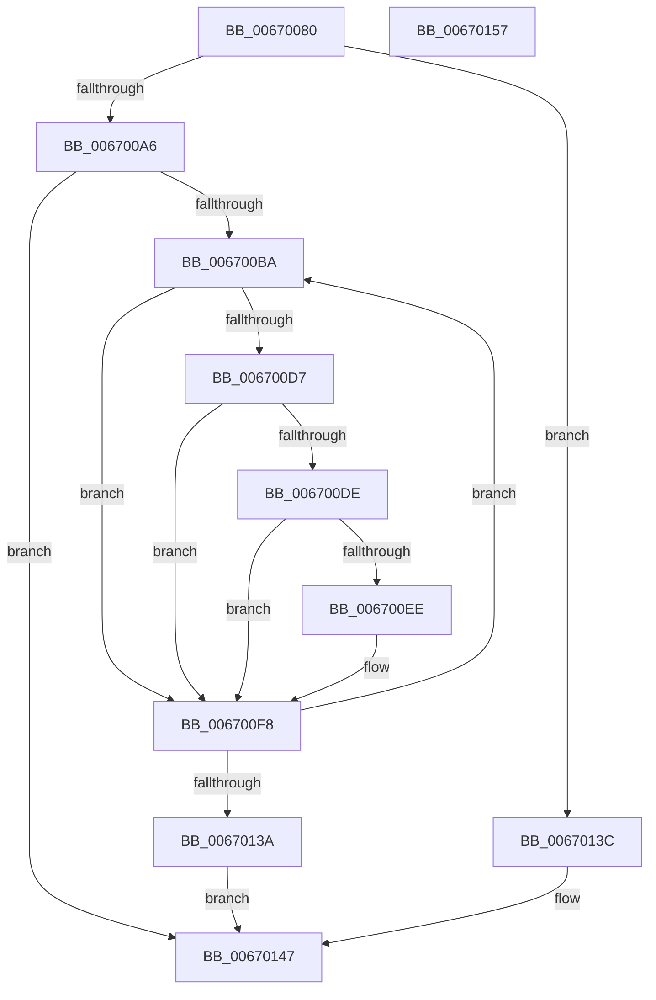

# MiFreeLargeInitializationCodePages

- RVA: `0x00670080`–`0x00670158` (길이 `216` bytes)
- VA: `0x0000000140670080`
- 실행 섹션: `.text`
- PDB 이름 있음: `예`; PDB Function 태그: `아니요`
- unwind 정보 RVA: `0x00060BC4`
- 디코드: `60`개 명령, `216/216` bytes 표시
- 미해석 바이트: `0` (있으면 어셈블리에 `.byte`로 보존)

> 이 문서는 커널 이미지의 기계어와 PDB 기호를 분석해 생성했습니다. 4번과 5번은 함수 원형과 자료형을 바이너리 사용 방식에서 추정한 C 해석이며 원본 소스 복구 결과는 아닙니다.

## 1. Dependencies

- 직접 호출 지점: **7**; 고유 호출 대상: **7**
- 직접 호출자로 확인된 함수: **1**
- RIP 상대 이미지 참조: **1**

### Outgoing calls
- `0x00670098` → [MiGetPfnSlabType](../28/MiGetPfnSlabType_function_0028E2D0.md) (function, `0x0028E2D0`)
- `0x006700C1` → [MiLockPageInline](../31/MiLockPageInline_function_0031A340.md) (function, `0x0031A340`)
- `0x006700F3` → [MiSetPfnIdentity](../2A/MiSetPfnIdentity_function_002A2350.md) (function, `0x002A2350`)
- `0x0067011C` → [MiSetOriginalPtePfnFromFreeList](../28/MiSetOriginalPtePfnFromFreeList_function_0028A99C.md) (function, `0x0028A99C`)
- `0x00670124` → [MiReleaseFreshPageLocked](../44/MiReleaseFreshPageLocked_function_0044CDD8.md) (function, `0x0044CDD8`)
- `0x0067012F` → [MiUnlockPage](../31/MiUnlockPage_function_0031A3E0.md) (function, `0x0031A3E0`)
- `0x00670142` → [MiAddExpansionNonPagedPool](../68/MiAddExpansionNonPagedPool_function_00682B4C.md) (function, `0x00682B4C`)

### Direct callers
- [MiFreeInitializationCode](../../page/7F/MiFreeInitializationCode_function_007F88A0.md) at `0x007F8A2F`

### Static image references
- `0x006700C6` → RVA `0x00FC6A88` (`ALMOSTRO`; read)

## 2. Other-region calls and transfers

- 다른 실행 섹션으로 향하는 call: **0**
- 별도 외부 분기/꼬리 이동을 확인하지 못했습니다.

## 3. Assembly (complete function range)

```asm
00670080  48 89 5C 24 08                  mov qword ptr [rsp + 8], rbx
00670085  48 89 74 24 10                  mov qword ptr [rsp + 0x10], rsi
0067008A  57                              push rdi
0067008B  48 83 EC 20                     sub rsp, 0x20
0067008F  49 8B F8                        mov rdi, r8
00670092  48 8B D9                        mov rbx, rcx
00670095  4C 8B C2                        mov r8, rdx
00670098  E8 33 E2 C1 FF                  call 0x14028e2d0
0067009D  83 F8 09                        cmp eax, 9
006700A0  0F 84 96 00 00 00               je 0x14067013c
006700A6  48 8D 04 7F                     lea rax, [rdi + rdi*2]
006700AA  48 C1 E0 04                     shl rax, 4
006700AE  48 03 D8                        add rbx, rax
006700B1  48 85 FF                        test rdi, rdi
006700B4  0F 84 8D 00 00 00               je 0x140670147
006700BA  48 83 EB 30                     sub rbx, 0x30
006700BE  48 8B CB                        mov rcx, rbx
006700C1  E8 7A A2 CA FF                  call 0x14031a340
006700C6  48 8B 0D BB 69 95 00            mov rcx, qword ptr [rip + 0x9569bb]
006700CD  40 8A F0                        mov sil, al
006700D0  48 0F BA E1 0F                  bt rcx, 0xf
006700D5  73 21                           jae 0x1406700f8
006700D7  48 0F BA E1 0E                  bt rcx, 0xe
006700DC  73 1A                           jae 0x1406700f8
006700DE  48 8B 4B 28                     mov rcx, qword ptr [rbx + 0x28]
006700E2  48 C1 E9 3C                     shr rcx, 0x3c
006700E6  80 E1 07                        and cl, 7
006700E9  80 F9 03                        cmp cl, 3
006700EC  75 0A                           jne 0x1406700f8
006700EE  33 D2                           xor edx, edx
006700F0  48 8B CB                        mov rcx, rbx
006700F3  E8 58 22 C3 FF                  call 0x1402a2350
006700F8  8B 43 20                        mov eax, dword ptr [rbx + 0x20]
006700FB  48 8D 4B 10                     lea rcx, [rbx + 0x10]
006700FF  89 44 24 48                     mov dword ptr [rsp + 0x48], eax
00670103  C1 E8 10                        shr eax, 0x10
00670106  24 FD                           and al, 0xfd
00670108  0C 05                           or al, 5
0067010A  88 44 24 4A                     mov byte ptr [rsp + 0x4a], al
0067010E  8B 44 24 48                     mov eax, dword ptr [rsp + 0x48]
00670112  89 43 20                        mov dword ptr [rbx + 0x20], eax
00670115  48 C7 01 00 00 00 00            mov qword ptr [rcx], 0
0067011C  E8 7B A8 C1 FF                  call 0x14028a99c
00670121  48 8B CB                        mov rcx, rbx
00670124  E8 AF CC DD FF                  call 0x14044cdd8
00670129  40 8A D6                        mov dl, sil
0067012C  48 8B CB                        mov rcx, rbx
0067012F  E8 AC A2 CA FF                  call 0x14031a3e0
00670134  48 83 EF 01                     sub rdi, 1
00670138  75 80                           jne 0x1406700ba
0067013A  EB 0B                           jmp 0x140670147
0067013C  48 8B D7                        mov rdx, rdi
0067013F  49 8B C8                        mov rcx, r8
00670142  E8 05 2A 01 00                  call 0x140682b4c
00670147  48 8B 5C 24 30                  mov rbx, qword ptr [rsp + 0x30]
0067014C  48 8B 74 24 38                  mov rsi, qword ptr [rsp + 0x38]
00670151  48 83 C4 20                     add rsp, 0x20
00670155  5F                              pop rdi
00670156  C3                              ret
00670157  CC                              int3
```

## 4. C-style interpretation (structured pseudocode)

```c
__int64 __fastcall MiFreeLargeInitializationCodePages(__int64 a1, __int64 a2, __int64 a3)
{
    __int64 result;
    __int64 v_rbx;
    __int64 v_rdi;
    __int64 v_rsp;
    unsigned __int64 v_stack_p10;
    unsigned int v_stack_p20;
    unsigned __int8 v_stack_p22;
    unsigned __int64 v_stack_p8;

    v_stack_p8 = v_rbx;
    v_stack_p10 = v_rsi;
    v_rsp = (v_rsp) - (32);
    result = MiGetPfnSlabType(a1, a2, a2, a4);
    if (((unsigned int)(result)) == 9) goto loc_0067013C;
    result = (a3 + a3 * 2) << (4);
    v_rbx = (a1) + (result);
    if (a3 == 0) goto loc_00670147;
loc_006700BA:
    v_rbx = (v_rbx) - (48);
    result = MiLockPageInline(v_rbx, a2, a2, a4);
    if (condition_is_above_or_equal) goto loc_006700F8;
    if (condition_is_above_or_equal) goto loc_006700F8;
    a1 = (*(unsigned __int64 *)(v_rbx + 40)) >> (60);
    a1 = (unsigned __int8)((a1) & (7));
    if (((unsigned __int8)(a1)) == 3) {
        a2 = 0;
        a1 = v_rbx;
        result = MiSetPfnIdentity(a1, a2, a2, a4);
    }
    v_stack_p20 = (unsigned int)((unsigned int)(*(unsigned int *)(v_rbx + 32)));
    result = (unsigned int)(((unsigned int)(*(unsigned int *)(v_rbx + 32))) >> (16));
    result = (unsigned __int8)((result) & (253));
    result = (unsigned __int8)((result) | (5));
    v_stack_p22 = (unsigned __int8)(result);
    *(unsigned int *)(v_rbx + 32) = (unsigned int)((unsigned int)(v_stack_p20));
    *(unsigned __int64 *)(v_rbx + 16) = 0;
    result = MiSetOriginalPtePfnFromFreeList(v_rbx + 16, a2, a2, a4);
    result = MiReleaseFreshPageLocked(v_rbx, a2, a2, a4);
    result = MiUnlockPage(v_rbx, (unsigned __int8)((unsigned __int8)(result)), a2, a4);
    v_rdi = (a3) - (1);
    if (condition_is_not_equal) goto loc_006700BA;
    goto loc_00670147;
loc_0067013C:
    result = MiAddExpansionNonPagedPool(0, v_rdi, a2, a4);
loc_00670147:
    v_rsp = (v_rsp) + (32);
    return result;
}
```

## 5. (Beta) C Style

```c
int64_t MiFreeLargeInitializationCodePages(void *Arg1, int64_t Arg2, void *Arg3)
{
    uint8_t *arg1 = (uint8_t *)Arg1;
    uint8_t *arg3 = (uint8_t *)Arg3;

    int64_t result;
    int64_t local_rbx;
    int64_t local_rdi;
    int64_t local_rsp;
    uint64_t v_stack_p10;
    uint32_t v_stack_p20;
    uint8_t v_stack_p22;
    uint64_t v_stack_p8;

    v_stack_p8 = local_rbx;
    v_stack_p10 = local_rsi;
    local_rsp = (local_rsp) - (32);
    result = MiGetPfnSlabType(Arg1, Arg2, Arg2, a4);
    if (((uint32_t)(result)) == 9) goto loc_0067013C;
    result = (Arg3 + Arg3 * 2) << (4);
    local_rbx = (Arg1) + (result);
    if (Arg3 == NULL) goto loc_00670147;
loc_006700BA:
    local_rbx = (local_rbx) - (48);
    result = MiLockPageInline(local_rbx, Arg2, Arg2, a4);
    if (condition_is_above_or_equal) goto loc_006700F8;
    if (condition_is_above_or_equal) goto loc_006700F8;
    Arg1 = (*(uint64_t *)(local_rbx + 0x28)) >> (60);
    Arg1 = (uint8_t)((Arg1) & (7));
    if (((uint8_t)(Arg1)) == 3) {
        Arg2 = 0;
        Arg1 = local_rbx;
        result = MiSetPfnIdentity(Arg1, Arg2, Arg2, a4);
    }
    v_stack_p20 = (uint32_t)((uint32_t)(*(uint32_t *)(local_rbx + 0x20)));
    result = (uint32_t)(((uint32_t)(*(uint32_t *)(local_rbx + 0x20))) >> (16));
    result = (uint8_t)((result) & (253));
    result = (uint8_t)((result) | (5));
    v_stack_p22 = (uint8_t)(result);
    *(uint32_t *)(local_rbx + 0x20) = (uint32_t)((uint32_t)(v_stack_p20));
    *(uint64_t *)(local_rbx + 0x10) = 0;
    result = MiSetOriginalPtePfnFromFreeList(local_rbx + 16, Arg2, Arg2, a4);
    result = MiReleaseFreshPageLocked(local_rbx, Arg2, Arg2, a4);
    result = MiUnlockPage(local_rbx, (uint8_t)((uint8_t)(result)), Arg2, a4);
    local_rdi = (Arg3) - (1);
    if (condition_is_not_equal) goto loc_006700BA;
    goto loc_00670147;
loc_0067013C:
    result = MiAddExpansionNonPagedPool(0, local_rdi, Arg2, a4);
loc_00670147:
    local_rsp = (local_rsp) + (32);
    return result;
}
```

### 관측된 메모리 오프셋

구조체 형식이 확인되지 않은 접근은 인자 기준의 오프셋으로만 기록했습니다.

| 기준 인자 | 오프셋 표현 | 폭 (bit) | 접근 |
|---|---:|---:|---|
| `Arg1` | `+ 0x0` | `64` | `W` |
| `Arg1` | `+ 0x10` | `64` | `R` |
| `Arg1` | `+ 0x20` | `32` | `R` |
| `Arg1` | `+ 0x20` | `32` | `W` |
| `Arg1` | `+ 0x28` | `64` | `R` |
| `Arg3` | `+ 0x0 + rdi*2` | `64` | `R` |

## 6. Execution-region graph

[열기: 2D/3D 그래프와 함수 탐색 컨트롤 패널](../../../control-panel.html?section=text&rva=0x00670080&view=graph)

- 2D 그래프는 위에서 아래로 흐르고, 3D 그래프는 빈 공간을 드래그해 회전합니다. Shift+드래그는 이동, 휠은 확대·축소, 함수 노드 선택은 대상 보고서 이동입니다.

### Static fallback


