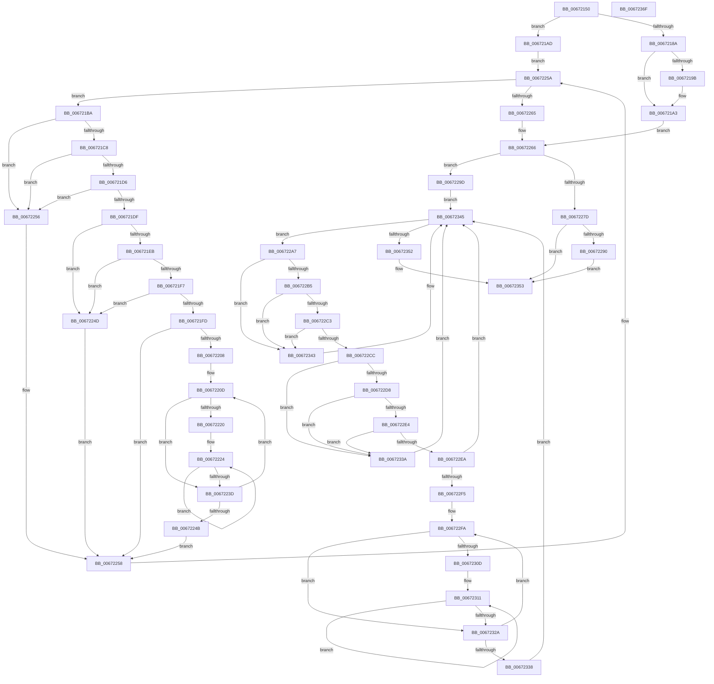

# MiFreeUnusedPfnPagesDpc

- RVA: `0x00672150`–`0x00672370` (길이 `544` bytes)
- VA: `0x0000000140672150`
- 실행 섹션: `.text`
- PDB 이름 있음: `예`; PDB Function 태그: `아니요`
- unwind 정보 RVA: `0x000C3E18`
- 디코드: `172`개 명령, `544/544` bytes 표시
- 미해석 바이트: `0` (있으면 어셈블리에 `.byte`로 보존)

> 이 문서는 커널 이미지의 기계어와 PDB 기호를 분석해 생성했습니다. 4번과 5번은 함수 원형과 자료형을 바이너리 사용 방식에서 추정한 C 해석이며 원본 소스 복구 결과는 아닙니다.

## 1. Dependencies

- 직접 호출 지점: **11**; 고유 호출 대상: **6**
- 직접 호출자로 확인된 함수: **0**
- RIP 상대 이미지 참조: **3**

### Outgoing calls
- `0x0067219E` → [KeWakeAddressAll](../21/KeWakeAddressAll_function_00217C20.md) (function, `0x00217C20`)
- `0x006721A3` → [MiFreedUnusedPfnPagesDpc](MiFreedUnusedPfnPagesDpc_function_00672378.md) (function, `0x00672378`)
- `0x006721D6` → [KiCheckVpBackingLongSpinWaitHypercall](../30/KiCheckVpBackingLongSpinWaitHypercall_function_0030F490.md) (function, `0x0030F490`)
- `0x006721E2` → [KeCanUseHaltOnAddress](../4F/KeCanUseHaltOnAddress_function_004FC22C.md) (function, `0x004FC22C`)
- `0x00672232` → [KiHaltOnAddress](../4F/KiHaltOnAddress_function_004FBA3C.md) (function, `0x004FBA3C`)
- `0x0067224F` → [HvlNotifyLongSpinWait](../30/HvlNotifyLongSpinWait_function_0030F460.md) (function, `0x0030F460`)
- `0x00672293` → [KeWakeAddressAll](../21/KeWakeAddressAll_function_00217C20.md) (function, `0x00217C20`)
- `0x006722C3` → [KiCheckVpBackingLongSpinWaitHypercall](../30/KiCheckVpBackingLongSpinWaitHypercall_function_0030F490.md) (function, `0x0030F490`)
- `0x006722CF` → [KeCanUseHaltOnAddress](../4F/KeCanUseHaltOnAddress_function_004FC22C.md) (function, `0x004FC22C`)
- `0x0067231F` → [KiHaltOnAddress](../4F/KiHaltOnAddress_function_004FBA3C.md) (function, `0x004FBA3C`)
- `0x0067233C` → [HvlNotifyLongSpinWait](../30/HvlNotifyLongSpinWait_function_0030F460.md) (function, `0x0030F460`)

### Direct callers
- 이 함수 시작 RVA로 연결되는 직접 call은 확인되지 않았습니다. 간접 호출은 완전히 역산할 수 없습니다.

### Static image references
- `0x006721BC` → RVA `0x00FC52AC` (`ALMOSTRO`; reference)
- `0x006721C8` → RVA `0x00FC6AB8` (`ALMOSTRO`; read)
- `0x006721EB` → RVA `0x00FC6B38` (`ALMOSTRO`; read)

## 2. Other-region calls and transfers

- 다른 실행 섹션으로 향하는 call: **0**
- 별도 외부 분기/꼬리 이동을 확인하지 못했습니다.

## 3. Assembly (complete function range)

```asm
00672150  48 89 5C 24 08                  mov qword ptr [rsp + 8], rbx
00672155  48 89 6C 24 10                  mov qword ptr [rsp + 0x10], rbp
0067215A  56                              push rsi
0067215B  57                              push rdi
0067215C  41 54                           push r12
0067215E  41 55                           push r13
00672160  41 56                           push r14
00672162  48 83 EC 30                     sub rsp, 0x30
00672166  49 8B D9                        mov rbx, r9
00672169  4D 8B E0                        mov r12, r8
0067216C  83 C8 FF                        or eax, 0xffffffff
0067216F  F0 41 0F C1 01                  lock xadd dword ptr [r9], eax
00672174  FF C8                           dec eax
00672176  41 BD 00 00 00 80               mov r13d, 0x80000000
0067217C  8B F8                           mov edi, eax
0067217E  F7 D7                           not edi
00672180  41 23 FD                        and edi, r13d
00672183  A9 FF FF FF 3F                  test eax, 0x3fffffff
00672188  75 23                           jne 0x1406721ad
0067218A  41 0B 79 04                     or edi, dword ptr [r9 + 4]
0067218E  41 87 39                        xchg dword ptr [r9], edi
00672191  89 7C 24 78                     mov dword ptr [rsp + 0x78], edi
00672195  0F BA E7 1E                     bt edi, 0x1e
00672199  73 08                           jae 0x1406721a3
0067219B  48 8B CB                        mov rcx, rbx
0067219E  E8 7D 5A BA FF                  call 0x140217c20
006721A3  E8 D0 01 00 00                  call 0x140672378
006721A8  E9 B9 00 00 00                  jmp 0x140672266
006721AD  41 8B 01                        mov eax, dword ptr [r9]
006721B0  33 ED                           xor ebp, ebp
006721B2  45 33 F6                        xor r14d, r14d
006721B5  E9 A0 00 00 00                  jmp 0x14067225a
006721BA  FF C5                           inc ebp
006721BC  85 2D EA 30 95 00               test dword ptr [rip + 0x9530ea], ebp
006721C2  0F 85 8E 00 00 00               jne 0x140672256
006721C8  8B 05 EA 48 95 00               mov eax, dword ptr [rip + 0x9548ea]
006721CE  A8 40                           test al, 0x40
006721D0  0F 84 80 00 00 00               je 0x140672256
006721D6  E8 B5 D2 C9 FF                  call 0x14030f490
006721DB  84 C0                           test al, al
006721DD  74 77                           je 0x140672256
006721DF  41 FF C6                        inc r14d
006721E2  E8 45 A0 E8 FF                  call 0x1404fc22c
006721E7  84 C0                           test al, al
006721E9  74 62                           je 0x14067224d
006721EB  F7 05 43 49 95 00 00 00 02 00   test dword ptr [rip + 0x954943], 0x20000
006721F5  74 56                           je 0x14067224d
006721F7  41 F6 C6 07                     test r14b, 7
006721FB  75 50                           jne 0x14067224d
006721FD  8B 0B                           mov ecx, dword ptr [rbx]
006721FF  8B C1                           mov eax, ecx
00672201  41 23 C5                        and eax, r13d
00672204  3B C7                           cmp eax, edi
00672206  74 50                           je 0x140672258
00672208  8B D1                           mov edx, ecx
0067220A  44 8B C1                        mov r8d, ecx
0067220D  0F BA E9 1E                     bts ecx, 0x1e
00672211  8B C2                           mov eax, edx
00672213  8B F1                           mov esi, ecx
00672215  F0 0F B1 33                     lock cmpxchg dword ptr [rbx], esi
00672219  8B C8                           mov ecx, eax
0067221B  41 3B C0                        cmp eax, r8d
0067221E  75 1D                           jne 0x14067223d
00672220  89 74 24 78                     mov dword ptr [rsp + 0x78], esi
00672224  41 B8 04 00 00 00               mov r8d, 4
0067222A  48 8D 54 24 78                  lea rdx, [rsp + 0x78]
0067222F  48 8B CB                        mov rcx, rbx
00672232  E8 05 98 E8 FF                  call 0x1404fba3c
00672237  8B 0B                           mov ecx, dword ptr [rbx]
00672239  3B CE                           cmp ecx, esi
0067223B  74 E7                           je 0x140672224
0067223D  8B C1                           mov eax, ecx
0067223F  8B D1                           mov edx, ecx
00672241  41 23 C5                        and eax, r13d
00672244  44 8B C1                        mov r8d, ecx
00672247  3B C7                           cmp eax, edi
00672249  75 C2                           jne 0x14067220d
0067224B  EB 0B                           jmp 0x140672258
0067224D  8B CD                           mov ecx, ebp
0067224F  E8 0C D2 C9 FF                  call 0x14030f460
00672254  EB 02                           jmp 0x140672258
00672256  F3 90                           pause
00672258  8B 03                           mov eax, dword ptr [rbx]
0067225A  41 23 C5                        and eax, r13d
0067225D  3B C7                           cmp eax, edi
0067225F  0F 85 55 FF FF FF               jne 0x1406721ba
00672265  90                              nop
00672266  83 C8 FF                        or eax, 0xffffffff
00672269  F0 0F C1 03                     lock xadd dword ptr [rbx], eax
0067226D  FF C8                           dec eax
0067226F  8B F8                           mov edi, eax
00672271  F7 D7                           not edi
00672273  41 23 FD                        and edi, r13d
00672276  A9 FF FF FF 3F                  test eax, 0x3fffffff
0067227B  75 20                           jne 0x14067229d
0067227D  0B 7B 04                        or edi, dword ptr [rbx + 4]
00672280  87 3B                           xchg dword ptr [rbx], edi
00672282  89 7C 24 20                     mov dword ptr [rsp + 0x20], edi
00672286  0F BA E7 1E                     bt edi, 0x1e
0067228A  0F 83 C3 00 00 00               jae 0x140672353
00672290  48 8B CB                        mov rcx, rbx
00672293  E8 88 59 BA FF                  call 0x140217c20
00672298  E9 B6 00 00 00                  jmp 0x140672353
0067229D  33 ED                           xor ebp, ebp
0067229F  45 33 F6                        xor r14d, r14d
006722A2  E9 9E 00 00 00                  jmp 0x140672345
006722A7  FF C5                           inc ebp
006722A9  85 2D FD 2F 95 00               test dword ptr [rip + 0x952ffd], ebp
006722AF  0F 85 8E 00 00 00               jne 0x140672343
006722B5  8B 05 FD 47 95 00               mov eax, dword ptr [rip + 0x9547fd]
006722BB  A8 40                           test al, 0x40
006722BD  0F 84 80 00 00 00               je 0x140672343
006722C3  E8 C8 D1 C9 FF                  call 0x14030f490
006722C8  84 C0                           test al, al
006722CA  74 77                           je 0x140672343
006722CC  41 FF C6                        inc r14d
006722CF  E8 58 9F E8 FF                  call 0x1404fc22c
006722D4  84 C0                           test al, al
006722D6  74 62                           je 0x14067233a
006722D8  F7 05 56 48 95 00 00 00 02 00   test dword ptr [rip + 0x954856], 0x20000
006722E2  74 56                           je 0x14067233a
006722E4  41 F6 C6 07                     test r14b, 7
006722E8  75 50                           jne 0x14067233a
006722EA  8B 0B                           mov ecx, dword ptr [rbx]
006722EC  8B C1                           mov eax, ecx
006722EE  41 23 C5                        and eax, r13d
006722F1  3B C7                           cmp eax, edi
006722F3  74 50                           je 0x140672345
006722F5  8B D1                           mov edx, ecx
006722F7  44 8B C1                        mov r8d, ecx
006722FA  0F BA E9 1E                     bts ecx, 0x1e
006722FE  8B C2                           mov eax, edx
00672300  8B F1                           mov esi, ecx
00672302  F0 0F B1 33                     lock cmpxchg dword ptr [rbx], esi
00672306  8B C8                           mov ecx, eax
00672308  41 3B C0                        cmp eax, r8d
0067230B  75 1D                           jne 0x14067232a
0067230D  89 74 24 20                     mov dword ptr [rsp + 0x20], esi
00672311  41 B8 04 00 00 00               mov r8d, 4
00672317  48 8D 54 24 20                  lea rdx, [rsp + 0x20]
0067231C  48 8B CB                        mov rcx, rbx
0067231F  E8 18 97 E8 FF                  call 0x1404fba3c
00672324  8B 0B                           mov ecx, dword ptr [rbx]
00672326  3B CE                           cmp ecx, esi
00672328  74 E7                           je 0x140672311
0067232A  8B C1                           mov eax, ecx
0067232C  8B D1                           mov edx, ecx
0067232E  41 23 C5                        and eax, r13d
00672331  44 8B C1                        mov r8d, ecx
00672334  3B C7                           cmp eax, edi
00672336  75 C2                           jne 0x1406722fa
00672338  EB 0B                           jmp 0x140672345
0067233A  8B CD                           mov ecx, ebp
0067233C  E8 1F D1 C9 FF                  call 0x14030f460
00672341  EB 02                           jmp 0x140672345
00672343  F3 90                           pause
00672345  8B 03                           mov eax, dword ptr [rbx]
00672347  41 23 C5                        and eax, r13d
0067234A  3B C7                           cmp eax, edi
0067234C  0F 85 55 FF FF FF               jne 0x1406722a7
00672352  90                              nop
00672353  F0 41 FF 0C 24                  lock dec dword ptr [r12]
00672358  48 8B 5C 24 60                  mov rbx, qword ptr [rsp + 0x60]
0067235D  48 8B 6C 24 68                  mov rbp, qword ptr [rsp + 0x68]
00672362  48 83 C4 30                     add rsp, 0x30
00672366  41 5E                           pop r14
00672368  41 5D                           pop r13
0067236A  41 5C                           pop r12
0067236C  5F                              pop rdi
0067236D  5E                              pop rsi
0067236E  C3                              ret
0067236F  CC                              int3
```

## 4. C-style interpretation (structured pseudocode)

```c
__int64 __fastcall MiFreeUnusedPfnPagesDpc(__int64 a1, __int64 a2, __int64 a3, __int64 a4)
{
    __int64 result;
    __int64 v_r14;
    __int64 v_rbp;
    __int64 v_rdi;
    __int64 v_rsp;
    unsigned int v_stack_m38;
    unsigned __int64 v_stack_p10;
    unsigned int v_stack_p20;
    unsigned __int64 v_stack_p8;

    v_stack_p8 = v_rbx;
    v_stack_p10 = v_rbp;
    v_rsp = (v_rsp) - (48);
    result = (unsigned int)((result) | (0xFFFFFFFFULL));
    result = (unsigned int)((result) - 1);
    v_rdi = (unsigned int)(~((unsigned int)((unsigned int)(result))));
    v_rdi = (unsigned int)((v_rdi) & ((unsigned int)((unsigned int)(0x80000000ULL))));
    if ((((unsigned int)(result)) & (0x3FFFFFFFULL)) != 0) goto loc_006721AD;
    v_rdi = (unsigned int)((v_rdi) | (*(unsigned int *)(a4 + 4)));
    v_stack_p20 = (unsigned int)(v_rdi);
    if (!(condition_is_above_or_equal)) {
        a1 = a4;
        result = KeWakeAddressAll(a1, a2, a3, a4);
    }
    result = MiFreedUnusedPfnPagesDpc(a1, a2, a3, a4);
    goto loc_00672266;
loc_006721AD:
    v_rbp = 0;
    v_r14 = 0;
    goto loc_0067225A;
loc_006721BA:
    v_rbp = (unsigned int)((v_rbp) + 1);
    if (((*(unsigned int *)(v_rip + 9777386)) & ((unsigned int)(v_rbp))) != 0) goto loc_00672256;
    if ((((unsigned __int8)((unsigned int)(*(unsigned int *)(v_rip + 9783530)))) & (64)) == 0) goto loc_00672256;
    result = KiCheckVpBackingLongSpinWaitHypercall(a1, a2, a3, a4);
    if ((unsigned __int8)(result) == 0) goto loc_00672256;
    v_r14 = (unsigned int)((v_r14) + 1);
    result = KeCanUseHaltOnAddress(a1, a2, a3, a4);
    if ((unsigned __int8)(result) == 0) goto loc_0067224D;
    if (((*(unsigned int *)(v_rip + 9783619)) & (0x20000ULL)) == 0) goto loc_0067224D;
    if ((((unsigned __int8)(v_r14)) & (7)) != 0) goto loc_0067224D;
    result = (unsigned int)(((unsigned int)((unsigned int)((unsigned int)(*(unsigned int *)(a4))))) & ((unsigned int)((unsigned int)(0x80000000ULL))));
    if (((unsigned int)(result)) == ((unsigned int)(v_rdi))) goto loc_00672258;
loc_0067220D:
    if (((unsigned int)((unsigned int)((unsigned int)((unsigned int)((unsigned int)((unsigned int)(*(unsigned int *)(a4)))))))) != ((unsigned int)((unsigned int)((unsigned int)((unsigned int)(*(unsigned int *)(a4))))))) goto loc_0067223D;
    v_stack_p20 = (unsigned int)((unsigned int)((unsigned int)((unsigned int)(*(unsigned int *)(a4)))));
loc_00672224:
    result = KiHaltOnAddress(a4, v_stack_p20, 4, a4);
    if (((unsigned int)((unsigned int)(*(unsigned int *)(a4)))) == ((unsigned int)((unsigned int)((unsigned int)((unsigned int)(*(unsigned int *)(a4))))))) goto loc_00672224;
loc_0067223D:
    result = (unsigned int)(((unsigned int)((unsigned int)((unsigned int)(*(unsigned int *)(a4))))) & ((unsigned int)((unsigned int)(0x80000000ULL))));
    if (((unsigned int)(result)) != ((unsigned int)(v_rdi))) goto loc_0067220D;
    goto loc_00672258;
loc_0067224D:
    result = HvlNotifyLongSpinWait((unsigned int)((unsigned int)(v_rbp)), (unsigned int)((unsigned int)((unsigned int)(*(unsigned int *)(a4)))), (unsigned int)((unsigned int)((unsigned int)(*(unsigned int *)(a4)))), a4);
    goto loc_00672258;
loc_00672256:
loc_00672258:
loc_0067225A:
    result = (unsigned int)(((unsigned int)(*(unsigned int *)(a4))) & ((unsigned int)((unsigned int)(0x80000000ULL))));
    if (((unsigned int)(result)) != ((unsigned int)(v_rdi))) goto loc_006721BA;
loc_00672266:
    result = (unsigned int)((result) | (0xFFFFFFFFULL));
    result = (unsigned int)((result) - 1);
    v_rdi = (unsigned int)(~((unsigned int)((unsigned int)(result))));
    v_rdi = (unsigned int)((v_rdi) & ((unsigned int)((unsigned int)(0x80000000ULL))));
    if ((((unsigned int)(result)) & (0x3FFFFFFFULL)) != 0) goto loc_0067229D;
    v_rdi = (unsigned int)((v_rdi) | (*(unsigned int *)(a4 + 4)));
    v_stack_m38 = (unsigned int)(v_rdi);
    if (condition_is_above_or_equal) goto loc_00672353;
    result = KeWakeAddressAll(a4, (unsigned int)((unsigned int)((unsigned int)(*(unsigned int *)(a4)))), (unsigned int)((unsigned int)((unsigned int)(*(unsigned int *)(a4)))), a4);
    goto loc_00672353;
loc_0067229D:
    v_rbp = 0;
    v_r14 = 0;
    goto loc_00672345;
loc_006722A7:
    v_rbp = (unsigned int)((v_rbp) + 1);
    if (((*(unsigned int *)(v_rip + 9777149)) & ((unsigned int)(v_rbp))) != 0) goto loc_00672343;
    if ((((unsigned __int8)((unsigned int)(*(unsigned int *)(v_rip + 9783293)))) & (64)) == 0) goto loc_00672343;
    result = KiCheckVpBackingLongSpinWaitHypercall(a4, (unsigned int)((unsigned int)((unsigned int)(*(unsigned int *)(a4)))), (unsigned int)((unsigned int)((unsigned int)(*(unsigned int *)(a4)))), a4);
    if ((unsigned __int8)(result) == 0) goto loc_00672343;
    v_r14 = (unsigned int)((v_r14) + 1);
    result = KeCanUseHaltOnAddress(a4, (unsigned int)((unsigned int)((unsigned int)(*(unsigned int *)(a4)))), (unsigned int)((unsigned int)((unsigned int)(*(unsigned int *)(a4)))), a4);
    if ((unsigned __int8)(result) == 0) goto loc_0067233A;
    if (((*(unsigned int *)(v_rip + 9783382)) & (0x20000ULL)) == 0) goto loc_0067233A;
    if ((((unsigned __int8)(v_r14)) & (7)) != 0) goto loc_0067233A;
    result = (unsigned int)(((unsigned int)((unsigned int)((unsigned int)(*(unsigned int *)(a4))))) & ((unsigned int)((unsigned int)(0x80000000ULL))));
    if (((unsigned int)(result)) == ((unsigned int)(v_rdi))) goto loc_00672345;
loc_006722FA:
    if (((unsigned int)((unsigned int)((unsigned int)((unsigned int)((unsigned int)((unsigned int)(*(unsigned int *)(a4)))))))) != ((unsigned int)((unsigned int)((unsigned int)((unsigned int)(*(unsigned int *)(a4))))))) goto loc_0067232A;
    v_stack_m38 = (unsigned int)((unsigned int)((unsigned int)((unsigned int)(*(unsigned int *)(a4)))));
loc_00672311:
    result = KiHaltOnAddress(a4, v_stack_m38, 4, a4);
    if (((unsigned int)((unsigned int)(*(unsigned int *)(a4)))) == ((unsigned int)((unsigned int)((unsigned int)((unsigned int)(*(unsigned int *)(a4))))))) goto loc_00672311;
loc_0067232A:
    result = (unsigned int)(((unsigned int)((unsigned int)((unsigned int)(*(unsigned int *)(a4))))) & ((unsigned int)((unsigned int)(0x80000000ULL))));
    if (((unsigned int)(result)) != ((unsigned int)(v_rdi))) goto loc_006722FA;
    goto loc_00672345;
loc_0067233A:
    result = HvlNotifyLongSpinWait((unsigned int)((unsigned int)(v_rbp)), (unsigned int)((unsigned int)((unsigned int)(*(unsigned int *)(a4)))), (unsigned int)((unsigned int)((unsigned int)(*(unsigned int *)(a4)))), a4);
    goto loc_00672345;
loc_00672343:
loc_00672345:
    result = (unsigned int)(((unsigned int)(*(unsigned int *)(a4))) & ((unsigned int)((unsigned int)(0x80000000ULL))));
    if (((unsigned int)(result)) != ((unsigned int)(v_rdi))) goto loc_006722A7;
loc_00672353:
    v_rsp = (v_rsp) + (48);
    return result;
}
```

## 5. (Beta) C Style

```c
int64_t MiFreeUnusedPfnPagesDpc(int64_t Arg1, int64_t Arg2, void *Arg3, void *Arg4)
{
    uint8_t *arg3 = (uint8_t *)Arg3;
    uint8_t *arg4 = (uint8_t *)Arg4;

    int64_t result;
    int64_t local_r14;
    int64_t local_rbp;
    int64_t local_rdi;
    int64_t local_rsp;
    uint32_t v_stack_m38;
    uint64_t v_stack_p10;
    uint32_t v_stack_p20;
    uint64_t v_stack_p8;

    v_stack_p8 = local_rbx;
    v_stack_p10 = local_rbp;
    local_rsp = (local_rsp) - (48);
    result = (uint32_t)((result) | (0xFFFFFFFFULL));
    result = (uint32_t)((result) - 1);
    local_rdi = (uint32_t)(~((uint32_t)((uint32_t)(result))));
    local_rdi = (uint32_t)((local_rdi) & ((uint32_t)((uint32_t)(0x80000000ULL))));
    if ((((uint32_t)(result)) & (0x3FFFFFFFULL)) != 0) goto loc_006721AD;
    local_rdi = (uint32_t)((local_rdi) | (*(uint32_t *)(arg4 + 0x4)));
    v_stack_p20 = (uint32_t)(local_rdi);
    if (!(condition_is_above_or_equal)) {
        Arg1 = Arg4;
        result = KeWakeAddressAll(Arg1, Arg2, Arg3, Arg4);
    }
    result = MiFreedUnusedPfnPagesDpc(Arg1, Arg2, Arg3, Arg4);
    goto loc_00672266;
loc_006721AD:
    local_rbp = 0;
    local_r14 = 0;
    goto loc_0067225A;
loc_006721BA:
    local_rbp = (uint32_t)((local_rbp) + 1);
    if (((*(uint32_t *)(v_rip + 0x9530EA)) & ((uint32_t)(local_rbp))) != 0) goto loc_00672256;
    if ((((uint8_t)((uint32_t)(*(uint32_t *)(v_rip + 0x9548EA)))) & (64)) == 0) goto loc_00672256;
    result = KiCheckVpBackingLongSpinWaitHypercall(Arg1, Arg2, Arg3, Arg4);
    if ((uint8_t)(result) == 0) goto loc_00672256;
    local_r14 = (uint32_t)((local_r14) + 1);
    result = KeCanUseHaltOnAddress(Arg1, Arg2, Arg3, Arg4);
    if ((uint8_t)(result) == 0) goto loc_0067224D;
    if (((*(uint32_t *)(v_rip + 0x954943)) & (0x20000ULL)) == 0) goto loc_0067224D;
    if ((((uint8_t)(local_r14)) & (7)) != 0) goto loc_0067224D;
    result = (uint32_t)(((uint32_t)((uint32_t)((uint32_t)(*(uint32_t *)(arg4))))) & ((uint32_t)((uint32_t)(0x80000000ULL))));
    if (((uint32_t)(result)) == ((uint32_t)(local_rdi))) goto loc_00672258;
loc_0067220D:
    if (((uint32_t)((uint32_t)((uint32_t)((uint32_t)((uint32_t)((uint32_t)(*(uint32_t *)(arg4)))))))) != ((uint32_t)((uint32_t)((uint32_t)((uint32_t)(*(uint32_t *)(arg4))))))) goto loc_0067223D;
    v_stack_p20 = (uint32_t)((uint32_t)((uint32_t)((uint32_t)(*(uint32_t *)(arg4)))));
loc_00672224:
    result = KiHaltOnAddress(Arg4, v_stack_p20, 4, Arg4);
    if (((uint32_t)((uint32_t)(*(uint32_t *)(arg4)))) == ((uint32_t)((uint32_t)((uint32_t)((uint32_t)(*(uint32_t *)(arg4))))))) goto loc_00672224;
loc_0067223D:
    result = (uint32_t)(((uint32_t)((uint32_t)((uint32_t)(*(uint32_t *)(arg4))))) & ((uint32_t)((uint32_t)(0x80000000ULL))));
    if (((uint32_t)(result)) != ((uint32_t)(local_rdi))) goto loc_0067220D;
    goto loc_00672258;
loc_0067224D:
    result = HvlNotifyLongSpinWait((uint32_t)((uint32_t)(local_rbp)), (uint32_t)((uint32_t)((uint32_t)(*(uint32_t *)(arg4)))), (uint32_t)((uint32_t)((uint32_t)(*(uint32_t *)(arg4)))), Arg4);
    goto loc_00672258;
loc_00672256:
loc_00672258:
loc_0067225A:
    result = (uint32_t)(((uint32_t)(*(uint32_t *)(arg4))) & ((uint32_t)((uint32_t)(0x80000000ULL))));
    if (((uint32_t)(result)) != ((uint32_t)(local_rdi))) goto loc_006721BA;
loc_00672266:
    result = (uint32_t)((result) | (0xFFFFFFFFULL));
    result = (uint32_t)((result) - 1);
    local_rdi = (uint32_t)(~((uint32_t)((uint32_t)(result))));
    local_rdi = (uint32_t)((local_rdi) & ((uint32_t)((uint32_t)(0x80000000ULL))));
    if ((((uint32_t)(result)) & (0x3FFFFFFFULL)) != 0) goto loc_0067229D;
    local_rdi = (uint32_t)((local_rdi) | (*(uint32_t *)(arg4 + 0x4)));
    v_stack_m38 = (uint32_t)(local_rdi);
    if (condition_is_above_or_equal) goto loc_00672353;
    result = KeWakeAddressAll(Arg4, (uint32_t)((uint32_t)((uint32_t)(*(uint32_t *)(arg4)))), (uint32_t)((uint32_t)((uint32_t)(*(uint32_t *)(arg4)))), Arg4);
    goto loc_00672353;
loc_0067229D:
    local_rbp = 0;
    local_r14 = 0;
    goto loc_00672345;
loc_006722A7:
    local_rbp = (uint32_t)((local_rbp) + 1);
    if (((*(uint32_t *)(v_rip + 0x952FFD)) & ((uint32_t)(local_rbp))) != 0) goto loc_00672343;
    if ((((uint8_t)((uint32_t)(*(uint32_t *)(v_rip + 0x9547FD)))) & (64)) == 0) goto loc_00672343;
    result = KiCheckVpBackingLongSpinWaitHypercall(Arg4, (uint32_t)((uint32_t)((uint32_t)(*(uint32_t *)(arg4)))), (uint32_t)((uint32_t)((uint32_t)(*(uint32_t *)(arg4)))), Arg4);
    if ((uint8_t)(result) == 0) goto loc_00672343;
    local_r14 = (uint32_t)((local_r14) + 1);
    result = KeCanUseHaltOnAddress(Arg4, (uint32_t)((uint32_t)((uint32_t)(*(uint32_t *)(arg4)))), (uint32_t)((uint32_t)((uint32_t)(*(uint32_t *)(arg4)))), Arg4);
    if ((uint8_t)(result) == 0) goto loc_0067233A;
    if (((*(uint32_t *)(v_rip + 0x954856)) & (0x20000ULL)) == 0) goto loc_0067233A;
    if ((((uint8_t)(local_r14)) & (7)) != 0) goto loc_0067233A;
    result = (uint32_t)(((uint32_t)((uint32_t)((uint32_t)(*(uint32_t *)(arg4))))) & ((uint32_t)((uint32_t)(0x80000000ULL))));
    if (((uint32_t)(result)) == ((uint32_t)(local_rdi))) goto loc_00672345;
loc_006722FA:
    if (((uint32_t)((uint32_t)((uint32_t)((uint32_t)((uint32_t)((uint32_t)(*(uint32_t *)(arg4)))))))) != ((uint32_t)((uint32_t)((uint32_t)((uint32_t)(*(uint32_t *)(arg4))))))) goto loc_0067232A;
    v_stack_m38 = (uint32_t)((uint32_t)((uint32_t)((uint32_t)(*(uint32_t *)(arg4)))));
loc_00672311:
    result = KiHaltOnAddress(Arg4, v_stack_m38, 4, Arg4);
    if (((uint32_t)((uint32_t)(*(uint32_t *)(arg4)))) == ((uint32_t)((uint32_t)((uint32_t)((uint32_t)(*(uint32_t *)(arg4))))))) goto loc_00672311;
loc_0067232A:
    result = (uint32_t)(((uint32_t)((uint32_t)((uint32_t)(*(uint32_t *)(arg4))))) & ((uint32_t)((uint32_t)(0x80000000ULL))));
    if (((uint32_t)(result)) != ((uint32_t)(local_rdi))) goto loc_006722FA;
    goto loc_00672345;
loc_0067233A:
    result = HvlNotifyLongSpinWait((uint32_t)((uint32_t)(local_rbp)), (uint32_t)((uint32_t)((uint32_t)(*(uint32_t *)(arg4)))), (uint32_t)((uint32_t)((uint32_t)(*(uint32_t *)(arg4)))), Arg4);
    goto loc_00672345;
loc_00672343:
loc_00672345:
    result = (uint32_t)(((uint32_t)(*(uint32_t *)(arg4))) & ((uint32_t)((uint32_t)(0x80000000ULL))));
    if (((uint32_t)(result)) != ((uint32_t)(local_rdi))) goto loc_006722A7;
loc_00672353:
    local_rsp = (local_rsp) + (48);
    return result;
}
```

### 관측된 메모리 오프셋

구조체 형식이 확인되지 않은 접근은 인자 기준의 오프셋으로만 기록했습니다.

| 기준 인자 | 오프셋 표현 | 폭 (bit) | 접근 |
|---|---:|---:|---|
| `Arg3` | `+ 0x0` | `32` | `R/W` |
| `Arg4` | `+ 0x0` | `32` | `R` |
| `Arg4` | `+ 0x0` | `32` | `R/W` |
| `Arg4` | `+ 0x4` | `32` | `R` |

## 6. Execution-region graph

[열기: 2D/3D 그래프와 함수 탐색 컨트롤 패널](../../../control-panel.html?section=text&rva=0x00672150&view=graph)

- 2D 그래프는 위에서 아래로 흐르고, 3D 그래프는 빈 공간을 드래그해 회전합니다. Shift+드래그는 이동, 휠은 확대·축소, 함수 노드 선택은 대상 보고서 이동입니다.

### Static fallback


