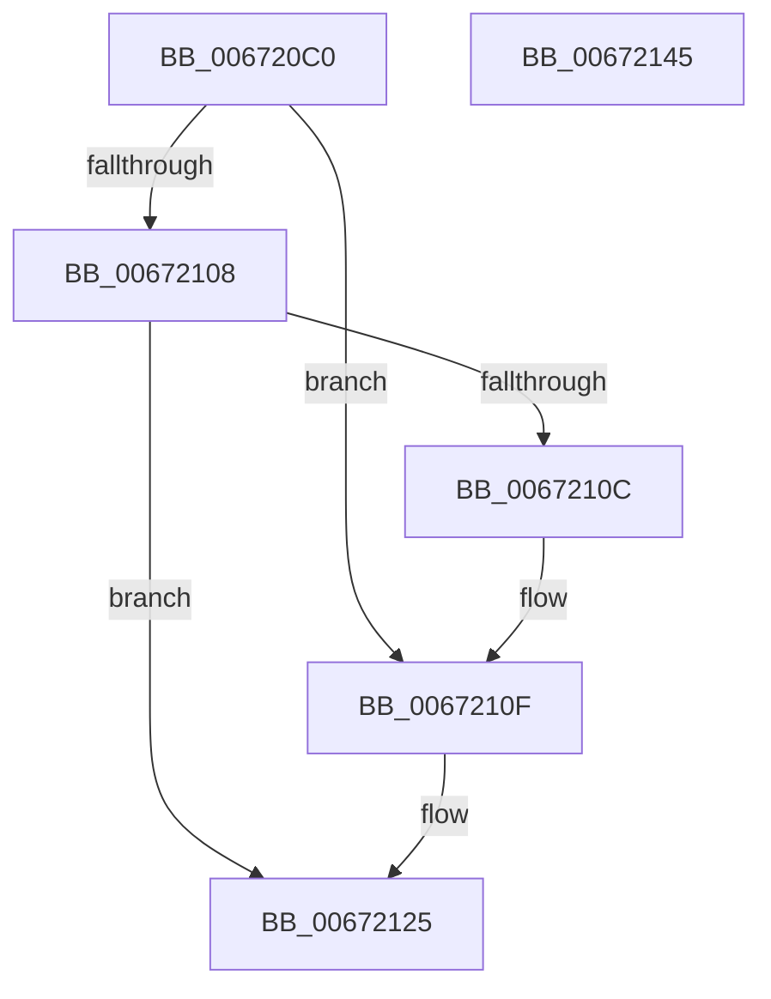

# MiFreeUnusedPfnPages

- RVA: `0x006720C0`–`0x00672146` (길이 `134` bytes)
- VA: `0x00000001406720C0`
- 실행 섹션: `.text`
- PDB 이름 있음: `예`; PDB Function 태그: `아니요`
- unwind 정보 RVA: `0x0005C954`
- 디코드: `35`개 명령, `134/134` bytes 표시
- 미해석 바이트: `0` (있으면 어셈블리에 `.byte`로 보존)

> 이 문서는 커널 이미지의 기계어와 PDB 기호를 분석해 생성했습니다. 4번과 5번은 함수 원형과 자료형을 바이너리 사용 방식에서 추정한 C 해석이며 원본 소스 복구 결과는 아닙니다.

## 1. Dependencies

- 직접 호출 지점: **3**; 고유 호출 대상: **3**
- 직접 호출자로 확인된 함수: **1**
- RIP 상대 이미지 참조: **2**

### Outgoing calls
- `0x006720F7` → [MiLockDynamicMemoryExclusive](MiLockDynamicMemoryExclusive_function_006730F8.md) (function, `0x006730F8`)
- `0x00672118` → [KeGenericCallDpcEx](../2C/KeGenericCallDpcEx_function_002C99F4.md) (function, `0x002C99F4`)
- `0x0067212B` → [MiUnlockDynamicMemoryExclusive](MiUnlockDynamicMemoryExclusive_function_00673C5C.md) (function, `0x00673C5C`)

### Direct callers
- [MiInitNucleus](../../init/C5/MiInitNucleus_function_00C5FD38.md) at `0x00C60403`

### Static image references
- `0x006720DD` → RVA `0x00E38D00` (`.data`; read)
- `0x00672111` → RVA `0x00672150` (`MiFreeUnusedPfnPagesDpc`; read)

## 2. Other-region calls and transfers

- 다른 실행 섹션으로 향하는 call: **0**
- 별도 외부 분기/꼬리 이동을 확인하지 못했습니다.

## 3. Assembly (complete function range)

```asm
006720C0  48 89 5C 24 08                  mov qword ptr [rsp + 8], rbx
006720C5  48 89 6C 24 10                  mov qword ptr [rsp + 0x10], rbp
006720CA  48 89 74 24 18                  mov qword ptr [rsp + 0x18], rsi
006720CF  57                              push rdi
006720D0  48 83 EC 20                     sub rsp, 0x20
006720D4  65 48 8B 2C 25 88 01 00 00      mov rbp, qword ptr gs:[0x188]
006720DD  48 8D 05 1C 6C 7C 00            lea rax, [rip + 0x7c6c1c]
006720E4  48 85 C9                        test rcx, rcx
006720E7  48 8B F1                        mov rsi, rcx
006720EA  48 8B D9                        mov rbx, rcx
006720ED  48 8B D5                        mov rdx, rbp
006720F0  48 0F 44 F0                     cmove rsi, rax
006720F4  48 8B CE                        mov rcx, rsi
006720F7  E8 FC 0F 00 00                  call 0x1406730f8
006720FC  48 8D BE CC 00 00 00            lea rdi, [rsi + 0xcc]
00672103  48 85 DB                        test rbx, rbx
00672106  75 07                           jne 0x14067210f
00672108  38 1F                           cmp byte ptr [rdi], bl
0067210A  75 19                           jne 0x140672125
0067210C  C6 07 01                        mov byte ptr [rdi], 1
0067210F  33 D2                           xor edx, edx
00672111  48 8D 0D 38 00 00 00            lea rcx, [rip + 0x38]
00672118  E8 D7 78 C5 FF                  call 0x1402c99f4
0067211D  48 83 66 48 00                  and qword ptr [rsi + 0x48], 0
00672122  C6 07 00                        mov byte ptr [rdi], 0
00672125  48 8B D5                        mov rdx, rbp
00672128  48 8B CE                        mov rcx, rsi
0067212B  E8 2C 1B 00 00                  call 0x140673c5c
00672130  48 8B 5C 24 30                  mov rbx, qword ptr [rsp + 0x30]
00672135  48 8B 6C 24 38                  mov rbp, qword ptr [rsp + 0x38]
0067213A  48 8B 74 24 40                  mov rsi, qword ptr [rsp + 0x40]
0067213F  48 83 C4 20                     add rsp, 0x20
00672143  5F                              pop rdi
00672144  C3                              ret
00672145  CC                              int3
```

## 4. C-style interpretation (structured pseudocode)

```c
__int64 __fastcall MiFreeUnusedPfnPages(__int64 a1)
{
    __int64 result;
    __int64 v_rsp;
    unsigned __int64 v_stack_p10;
    unsigned __int64 v_stack_p18;
    unsigned __int64 v_stack_p8;

    v_stack_p8 = v_rbx;
    v_stack_p10 = v_rbp;
    v_stack_p18 = v_rsi;
    v_rsp = (v_rsp) - (32);
    if (a1 == 0) { a1 = v_rip + 8154140; }
    result = MiLockDynamicMemoryExclusive(a1, *(unsigned __int64 *)(gs_base + (0 + 392)), a3, a4);
    if (a1 != 0) goto loc_0067210F;
    if ((*(unsigned __int8 *)(a1 + 204)) != ((unsigned __int8)(a1))) goto loc_00672125;
    *(unsigned __int8 *)(a1 + 204) = 1;
loc_0067210F:
    a2 = 0;
    result = KeGenericCallDpcEx(v_rip + 56, a2, a3, a4);
    *(unsigned __int8 *)(a1 + 204) = 0;
loc_00672125:
    result = MiUnlockDynamicMemoryExclusive(a1, *(unsigned __int64 *)(gs_base + (0 + 392)), a3, a4);
    v_rsp = (v_rsp) + (32);
    return result;
}
```

## 5. (Beta) C Style

```c
int64_t MiFreeUnusedPfnPages(int64_t Arg1)
{
    int64_t result;
    int64_t local_rsp;
    uint64_t v_stack_p10;
    uint64_t v_stack_p18;
    uint64_t v_stack_p8;

    v_stack_p8 = local_rbx;
    v_stack_p10 = local_rbp;
    v_stack_p18 = local_rsi;
    local_rsp = (local_rsp) - (32);
    if (Arg1 == 0) { Arg1 = v_rip + 8154140; }
    result = MiLockDynamicMemoryExclusive(Arg1, *(uint64_t *)(gs_base + (0 + 0x188)), a3, a4);
    if (Arg1 != 0) goto loc_0067210F;
    if ((*(uint8_t *)(Arg1 + 0xCC)) != ((uint8_t)(Arg1))) goto loc_00672125;
    *(uint8_t *)(Arg1 + 0xCC) = 1;
loc_0067210F:
    a2 = 0;
    result = KeGenericCallDpcEx(v_rip + 56, a2, a3, a4);
    *(uint8_t *)(Arg1 + 0xCC) = 0;
loc_00672125:
    result = MiUnlockDynamicMemoryExclusive(Arg1, *(uint64_t *)(gs_base + (0 + 0x188)), a3, a4);
    local_rsp = (local_rsp) + (32);
    return result;
}
```

## 6. Execution-region graph

[열기: 2D/3D 그래프와 함수 탐색 컨트롤 패널](../../../control-panel.html?section=text&rva=0x006720C0&view=graph)

- 2D 그래프는 위에서 아래로 흐르고, 3D 그래프는 빈 공간을 드래그해 회전합니다. Shift+드래그는 이동, 휠은 확대·축소, 함수 노드 선택은 대상 보고서 이동입니다.

### Static fallback


