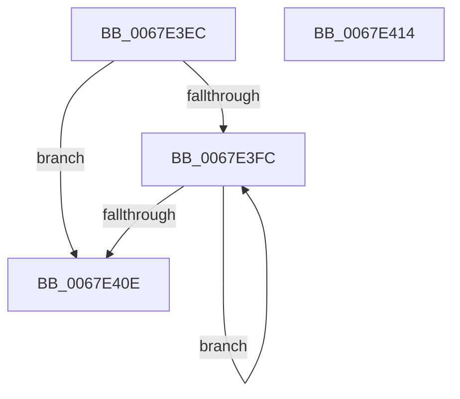

# MiFreeVadEvents

- RVA: `0x0067E3EC`–`0x0067E415` (길이 `41` bytes)
- VA: `0x000000014067E3EC`
- 실행 섹션: `.text`
- PDB 이름 있음: `예`; PDB Function 태그: `아니요`
- unwind 정보 RVA: `0x0005CF00`
- 디코드: `15`개 명령, `41/41` bytes 표시
- 미해석 바이트: `0` (있으면 어셈블리에 `.byte`로 보존)

> 이 문서는 커널 이미지의 기계어와 PDB 기호를 분석해 생성했습니다. 4번과 5번은 함수 원형과 자료형을 바이너리 사용 방식에서 추정한 C 해석이며 원본 소스 복구 결과는 아닙니다.

## 1. Dependencies

- 직접 호출 지점: **1**; 고유 호출 대상: **1**
- 직접 호출자로 확인된 함수: **2**
- RIP 상대 이미지 참조: **0**

### Outgoing calls
- `0x0067E401` → [ExFreePoolWithTag](../../poolcode/B8/ExFreePoolWithTag_function_00B82870.md) (function, `0x00B82870`)

### Direct callers
- [MiDeletePartialCloneVads](../../page/81/MiDeletePartialCloneVads_function_008116E4.md) at `0x0081186B`
- [sub_00B2A0A2](../../page/B2/Unknown_function_00B2A0A2.md) at `0x00B2A129`

### Static image references
- 디코드된 RIP-relative 메모리 참조가 없습니다.

## 2. Other-region calls and transfers

- 다른 실행 섹션으로 향하는 call: **1**
  - `0x0067E401` → [ExFreePoolWithTag](../../poolcode/B8/ExFreePoolWithTag_function_00B82870.md) (`.text` → `POOLCODE`)
- 별도 외부 분기/꼬리 이동을 확인하지 못했습니다.

## 3. Assembly (complete function range)

```asm
0067E3EC  40 53                           push rbx
0067E3EE  48 83 EC 20                     sub rsp, 0x20
0067E3F2  48 8B 49 38                     mov rcx, qword ptr [rcx + 0x38]
0067E3F6  48 83 E1 F0                     and rcx, 0xfffffffffffffff0
0067E3FA  74 12                           je 0x14067e40e
0067E3FC  48 8B 19                        mov rbx, qword ptr [rcx]
0067E3FF  33 D2                           xor edx, edx
0067E401  E8 6A 44 50 00                  call 0x140b82870
0067E406  48 8B CB                        mov rcx, rbx
0067E409  48 85 DB                        test rbx, rbx
0067E40C  75 EE                           jne 0x14067e3fc
0067E40E  48 83 C4 20                     add rsp, 0x20
0067E412  5B                              pop rbx
0067E413  C3                              ret
0067E414  CC                              int3
```

## 4. C-style interpretation (structured pseudocode)

```c
__int64 __fastcall MiFreeVadEvents(__int64 a1, int a2)
{
    __int64 result;
    __int64 v_rsp;

    v_rsp = (v_rsp) - (32);
    a1 = (*(unsigned __int64 *)(a1 + 56)) & (-16);
    if (condition_is_equal) goto loc_0067E40E;
loc_0067E3FC:
    a2 = 0;
    result = ExFreePoolWithTag(a1, a2, a3, a4);
    if (*(unsigned __int64 *)(a1) != 0) goto loc_0067E3FC;
loc_0067E40E:
    v_rsp = (v_rsp) + (32);
    return result;
}
```

## 5. (Beta) C Style

```c
int64_t MiFreeVadEvents(void *Arg1, int32_t Arg2)
{
    uint8_t *arg1 = (uint8_t *)Arg1;

    int64_t result;
    int64_t local_rsp;

    local_rsp = (local_rsp) - (32);
    Arg1 = (*(uint64_t *)(arg1 + 0x38)) & (-16);
    if (condition_is_equal) goto loc_0067E40E;
loc_0067E3FC:
    Arg2 = 0;
    result = ExFreePoolWithTag(Arg1, Arg2, a3, a4);
    if (*(uint64_t *)(arg1) != 0) goto loc_0067E3FC;
loc_0067E40E:
    local_rsp = (local_rsp) + (32);
    return result;
}
```

### 관측된 메모리 오프셋

구조체 형식이 확인되지 않은 접근은 인자 기준의 오프셋으로만 기록했습니다.

| 기준 인자 | 오프셋 표현 | 폭 (bit) | 접근 |
|---|---:|---:|---|
| `Arg1` | `+ 0x38` | `64` | `R` |

## 6. Execution-region graph

[열기: 2D/3D 그래프와 함수 탐색 컨트롤 패널](../../../control-panel.html?section=text&rva=0x0067E3EC&view=graph)

- 2D 그래프는 위에서 아래로 흐르고, 3D 그래프는 빈 공간을 드래그해 회전합니다. Shift+드래그는 이동, 휠은 확대·축소, 함수 노드 선택은 대상 보고서 이동입니다.

### Static fallback


