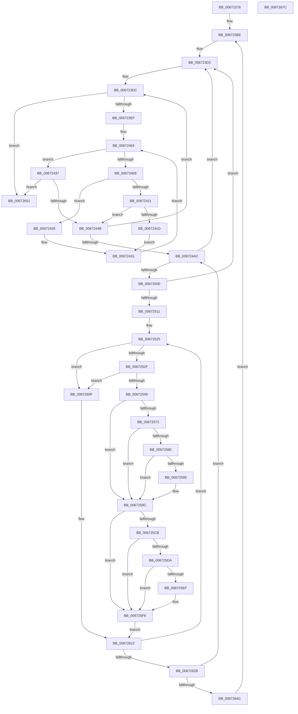

# MiFreedUnusedPfnPagesDpc

- RVA: `0x00672378`–`0x0067267D` (길이 `773` bytes)
- VA: `0x0000000140672378`
- 실행 섹션: `.text`
- PDB 이름 있음: `예`; PDB Function 태그: `아니요`
- unwind 정보 RVA: `0x000A3178`
- 디코드: `192`개 명령, `773/773` bytes 표시
- 미해석 바이트: `0` (있으면 어셈블리에 `.byte`로 보존)

> 이 문서는 커널 이미지의 기계어와 PDB 기호를 분석해 생성했습니다. 4번과 5번은 함수 원형과 자료형을 바이너리 사용 방식에서 추정한 C 해석이며 원본 소스 복구 결과는 아닙니다.

## 1. Dependencies

- 직접 호출 지점: **12**; 고유 호출 대상: **9**
- 직접 호출자로 확인된 함수: **1**
- RIP 상대 이미지 참조: **3**

### Outgoing calls
- `0x00672392` → [MiSystemVaTypeToVm](../28/MiSystemVaTypeToVm_function_0028EB50.md) (function, `0x0028EB50`)
- `0x0067239F` → [MiLockWorkingSetExclusiveAtDpc](../23/MiLockWorkingSetExclusiveAtDpc_function_002395EC.md) (function, `0x002395EC`)
- `0x006723AB` → [ExAcquireSpinLockExclusiveAtDpcLevel](../24/ExAcquireSpinLockExclusiveAtDpcLevel_function_00248E80.md) (function, `0x00248E80`)
- `0x006724DB` → [MiGetNextNonGapPfnPage](MiGetNextNonGapPfnPage_function_006728D8.md) (function, `0x006728D8`)
- `0x00672538` → [RtlCompareMemoryUlong](../6B/RtlCompareMemoryUlong_function_006BA6F0.md) (function, `0x006BA6F0`)
- `0x00672577` → [MmIsAddressValidEx](../27/MmIsAddressValidEx_function_0027FDD0.md) (function, `0x0027FDD0`)
- `0x0067258A` → [RtlCompareMemoryUlong](../6B/RtlCompareMemoryUlong_function_006BA6F0.md) (function, `0x006BA6F0`)
- `0x006725D1` → [MmIsAddressValidEx](../27/MmIsAddressValidEx_function_0027FDD0.md) (function, `0x0027FDD0`)
- `0x006725E4` → [RtlCompareMemoryUlong](../6B/RtlCompareMemoryUlong_function_006BA6F0.md) (function, `0x006BA6F0`)
- `0x006725FC` → [MiPfnRangeIsZero](MiPfnRangeIsZero_function_006735C0.md) (function, `0x006735C0`)
- `0x0067265A` → [MiReleaseSpinLockExclusive](../24/MiReleaseSpinLockExclusive_function_002482C0.md) (function, `0x002482C0`)
- `0x00672666` → [MiUnlockWorkingSetExclusive](../27/MiUnlockWorkingSetExclusive_function_0027EC70.md) (function, `0x0027EC70`)

### Direct callers
- [MiFreeUnusedPfnPagesDpc](MiFreeUnusedPfnPagesDpc_function_00672150.md) at `0x006721A3`

### Static image references
- `0x006723A4` → RVA `0x00E38DC8` (`.data`; read)
- `0x006723DC` → RVA `0x00E2DCE0` (`.data`; read)
- `0x006723EF` → RVA `0x00FC6B88` (`ALMOSTRO`; read)

## 2. Other-region calls and transfers

- 다른 실행 섹션으로 향하는 call: **0**
- 별도 외부 분기/꼬리 이동을 확인하지 못했습니다.

## 3. Assembly (complete function range)

```asm
00672378  48 89 4C 24 08                  mov qword ptr [rsp + 8], rcx
0067237D  53                              push rbx
0067237E  55                              push rbp
0067237F  56                              push rsi
00672380  57                              push rdi
00672381  41 54                           push r12
00672383  41 55                           push r13
00672385  41 56                           push r14
00672387  41 57                           push r15
00672389  48 83 EC 38                     sub rsp, 0x38
0067238D  B9 03 00 00 00                  mov ecx, 3
00672392  E8 B9 C7 C1 FF                  call 0x14028eb50
00672397  48 8B C8                        mov rcx, rax
0067239A  48 89 44 24 20                  mov qword ptr [rsp + 0x20], rax
0067239F  E8 48 72 BC FF                  call 0x1402395ec
006723A4  48 8D 0D 1D 6A 7C 00            lea rcx, [rip + 0x7c6a1d]
006723AB  E8 D0 6A BD FF                  call 0x140248e80
006723B0  33 DB                           xor ebx, ebx
006723B2  BD 00 10 00 00                  mov ebp, 0x1000
006723B7  49 C7 C6 00 F0 FF FF            mov r14, 0xfffffffffffff000
006723BE  49 BA 00 00 00 00 80 F6 FF FF   movabs r10, 0xfffff68000000000
006723C8  49 BB F8 FF FF FF 7F 00 00 00   movabs r11, 0x7ffffffff8
006723D2  49 B9 00 00 00 00 00 DE FF FF   movabs r9, 0xffffde0000000000
006723DC  48 8B 05 FD B8 7B 00            mov rax, qword ptr [rip + 0x7bb8fd]
006723E3  48 FF C0                        inc rax
006723E6  48 3B D8                        cmp rbx, rax
006723E9  0F 84 62 02 00 00               je 0x140672651
006723EF  48 8B 05 92 47 95 00            mov rax, qword ptr [rip + 0x954792]
006723F6  44 8B 00                        mov r8d, dword ptr [rax]
006723F9  48 8D 50 10                     lea rdx, [rax + 0x10]
006723FD  49 C1 E0 04                     shl r8, 4
00672401  4C 03 C2                        add r8, rdx
00672404  49 3B D0                        cmp rdx, r8
00672407  73 2E                           jae 0x140672437
00672409  48 8B 0A                        mov rcx, qword ptr [rdx]
0067240C  48 3B D9                        cmp rbx, rcx
0067240F  73 15                           jae 0x140672426
00672411  48 8B C1                        mov rax, rcx
00672414  48 2B C3                        sub rax, rbx
00672417  48 83 F8 55                     cmp rax, 0x55
0067241B  73 2E                           jae 0x14067244b
0067241D  48 8B 5A 08                     mov rbx, qword ptr [rdx + 8]
00672421  48 03 D9                        add rbx, rcx
00672424  EB 0B                           jmp 0x140672431
00672426  48 03 4A 08                     add rcx, qword ptr [rdx + 8]
0067242A  48 3B D9                        cmp rbx, rcx
0067242D  48 0F 42 D9                     cmovb rbx, rcx
00672431  48 83 C2 10                     add rdx, 0x10
00672435  EB CD                           jmp 0x140672404
00672437  48 8B 05 A2 B8 7B 00            mov rax, qword ptr [rip + 0x7bb8a2]
0067243E  48 2B C3                        sub rax, rbx
00672441  48 83 C0 01                     add rax, 1
00672445  0F 84 06 02 00 00               je 0x140672651
0067244B  48 8D 0C 5B                     lea rcx, [rbx + rbx*2]
0067244F  48 C1 E1 04                     shl rcx, 4
00672453  48 BA FF 0F 00 00 00 DE FF FF   movabs rdx, 0xffffde0000000fff
0067245D  48 03 D1                        add rdx, rcx
00672460  48 03 D8                        add rbx, rax
00672463  48 C1 EA 09                     shr rdx, 9
00672467  49 23 D3                        and rdx, r11
0067246A  48 89 9C 24 98 00 00 00         mov qword ptr [rsp + 0x98], rbx
00672472  49 8B C2                        mov rax, r10
00672475  48 03 D0                        add rdx, rax
00672478  4C 8D 24 5B                     lea r12, [rbx + rbx*2]
0067247C  48 89 94 24 88 00 00 00         mov qword ptr [rsp + 0x88], rdx
00672484  49 C1 E4 04                     shl r12, 4
00672488  49 8B C1                        mov rax, r9
0067248B  4C 03 E0                        add r12, rax
0067248E  49 C1 EC 09                     shr r12, 9
00672492  4D 23 E3                        and r12, r11
00672495  49 8B C2                        mov rax, r10
00672498  4C 03 E0                        add r12, rax
0067249B  4C 89 A4 24 90 00 00 00         mov qword ptr [rsp + 0x90], r12
006724A3  49 3B D4                        cmp rdx, r12
006724A6  0F 83 30 FF FF FF               jae 0x1406723dc
006724AC  49 8B C4                        mov rax, r12
006724AF  48 8D 8C 24 88 00 00 00         lea rcx, [rsp + 0x88]
006724B7  48 2B C2                        sub rax, rdx
006724BA  41 B9 01 00 00 00               mov r9d, 1
006724C0  48 C1 F8 03                     sar rax, 3
006724C4  48 8D 94 24 80 00 00 00         lea rdx, [rsp + 0x80]
006724CC  48 C1 E0 0C                     shl rax, 0xc
006724D0  41 B0 02                        mov r8b, 2
006724D3  48 89 84 24 80 00 00 00         mov qword ptr [rsp + 0x80], rax
006724DB  E8 F8 03 00 00                  call 0x1406728d8
006724E0  49 BA 00 00 00 00 80 F6 FF FF   movabs r10, 0xfffff68000000000
006724EA  48 8B F8                        mov rdi, rax
006724ED  49 BB F8 FF FF FF 7F 00 00 00   movabs r11, 0x7ffffffff8
006724F7  48 85 C0                        test rax, rax
006724FA  0F 84 D2 FE FF FF               je 0x1406723d2
00672500  48 8B B4 24 80 00 00 00         mov rsi, qword ptr [rsp + 0x80]
00672508  49 23 F6                        and rsi, r14
0067250B  0F 84 C1 FE FF FF               je 0x1406723d2
00672511  49 BC 00 00 00 00 00 DE FF FF   movabs r12, 0xffffde0000000000
0067251B  48 BB AB AA AA AA AA AA AA AA   movabs rbx, 0xaaaaaaaaaaaaaaab
00672525  48 83 3F 00                     cmp qword ptr [rdi], 0
00672529  0F 85 E0 00 00 00               jne 0x14067260f
0067252F  45 33 C0                        xor r8d, r8d
00672532  48 8B D6                        mov rdx, rsi
00672535  48 8B CF                        mov rcx, rdi
00672538  E8 B3 81 04 00                  call 0x1406ba6f0
0067253D  4C 8B F8                        mov r15, rax
00672540  48 3B C5                        cmp rax, rbp
00672543  0F 82 C6 00 00 00               jb 0x14067260f
00672549  4C 8B EF                        mov r13, rdi
0067254C  49 8B CC                        mov rcx, r12
0067254F  48 8B D7                        mov rdx, rdi
00672552  48 8B C3                        mov rax, rbx
00672555  48 2B D1                        sub rdx, rcx
00672558  48 F7 E2                        mul rdx
0067255B  48 C1 EA 05                     shr rdx, 5
0067255F  48 8D 2C 52                     lea rbp, [rdx + rdx*2]
00672563  48 C1 E5 04                     shl rbp, 4
00672567  49 8B C4                        mov rax, r12
0067256A  48 03 E8                        add rbp, rax
0067256D  48 3B EF                        cmp rbp, rdi
00672570  74 2A                           je 0x14067259c
00672572  33 D2                           xor edx, edx
00672574  48 8B CD                        mov rcx, rbp
00672577  E8 54 D8 C0 FF                  call 0x14027fdd0
0067257C  84 C0                           test al, al
0067257E  74 1C                           je 0x14067259c
00672580  45 33 C0                        xor r8d, r8d
00672583  48 8B CD                        mov rcx, rbp
00672586  41 8D 50 30                     lea edx, [r8 + 0x30]
0067258A  E8 61 81 04 00                  call 0x1406ba6f0
0067258F  48 83 F8 30                     cmp rax, 0x30
00672593  74 07                           je 0x14067259c
00672595  4C 8D AF 00 10 00 00            lea r13, [rdi + 0x1000]
0067259C  49 8B EF                        mov rbp, r15
0067259F  49 23 EE                        and rbp, r14
006725A2  48 03 EF                        add rbp, rdi
006725A5  49 8B C4                        mov rax, r12
006725A8  48 8B CD                        mov rcx, rbp
006725AB  48 2B C8                        sub rcx, rax
006725AE  48 8B C3                        mov rax, rbx
006725B1  48 F7 E1                        mul rcx
006725B4  48 C1 EA 05                     shr rdx, 5
006725B8  4C 8D 34 52                     lea r14, [rdx + rdx*2]
006725BC  49 C1 E6 04                     shl r14, 4
006725C0  49 8B C4                        mov rax, r12
006725C3  4C 03 F0                        add r14, rax
006725C6  4C 3B F5                        cmp r14, rbp
006725C9  74 2B                           je 0x1406725f6
006725CB  49 8D 4E 30                     lea rcx, [r14 + 0x30]
006725CF  33 D2                           xor edx, edx
006725D1  E8 FA D7 C0 FF                  call 0x14027fdd0
006725D6  84 C0                           test al, al
006725D8  74 1C                           je 0x1406725f6
006725DA  45 33 C0                        xor r8d, r8d
006725DD  49 8B CE                        mov rcx, r14
006725E0  41 8D 50 30                     lea edx, [r8 + 0x30]
006725E4  E8 07 81 04 00                  call 0x1406ba6f0
006725E9  48 83 F8 30                     cmp rax, 0x30
006725ED  74 07                           je 0x1406725f6
006725EF  48 81 ED 00 10 00 00            sub rbp, 0x1000
006725F6  48 8B D5                        mov rdx, rbp
006725F9  49 8B CD                        mov rcx, r13
006725FC  E8 BF 0F 00 00                  call 0x1406735c0
00672601  BD 00 10 00 00                  mov ebp, 0x1000
00672606  49 C7 C6 00 F0 FF FF            mov r14, 0xfffffffffffff000
0067260D  EB 03                           jmp 0x140672612
0067260F  4C 8B FD                        mov r15, rbp
00672612  49 8D 87 FF 0F 00 00            lea rax, [r15 + 0xfff]
00672619  49 23 C6                        and rax, r14
0067261C  48 03 F8                        add rdi, rax
0067261F  48 2B F0                        sub rsi, rax
00672622  48 3B F5                        cmp rsi, rbp
00672625  0F 83 FA FE FF FF               jae 0x140672525
0067262B  48 8B 94 24 88 00 00 00         mov rdx, qword ptr [rsp + 0x88]
00672633  4C 8B A4 24 90 00 00 00         mov r12, qword ptr [rsp + 0x90]
0067263B  48 8B 9C 24 98 00 00 00         mov rbx, qword ptr [rsp + 0x98]
00672643  49 3B D4                        cmp rdx, r12
00672646  0F 82 60 FE FF FF               jb 0x1406724ac
0067264C  E9 6D FD FF FF                  jmp 0x1406723be
00672651  B2 11                           mov dl, 0x11
00672653  48 8D 0D 6E 67 7C 00            lea rcx, [rip + 0x7c676e]
0067265A  E8 61 5C BD FF                  call 0x1402482c0
0067265F  48 8B 4C 24 20                  mov rcx, qword ptr [rsp + 0x20]
00672664  B2 11                           mov dl, 0x11
00672666  E8 05 C6 C0 FF                  call 0x14027ec70
0067266B  48 83 C4 38                     add rsp, 0x38
0067266F  41 5F                           pop r15
00672671  41 5E                           pop r14
00672673  41 5D                           pop r13
00672675  41 5C                           pop r12
00672677  5F                              pop rdi
00672678  5E                              pop rsi
00672679  5D                              pop rbp
0067267A  5B                              pop rbx
0067267B  C3                              ret
0067267C  CC                              int3
```

## 4. C-style interpretation (structured pseudocode)

```c
__int64 __fastcall MiFreedUnusedPfnPagesDpc(__int64 a1)
{
    __int64 result;
    __int64 v_r12;
    __int64 v_r13;
    __int64 v_r14;
    __int64 v_rbp;
    __int64 v_rbx;
    __int64 v_rdi;
    __int64 v_rsi;
    __int64 v_rsp;
    unsigned __int64 v_stack_m58;
    unsigned __int64 v_stack_p10;
    unsigned __int64 v_stack_p18;
    unsigned __int64 v_stack_p20;
    unsigned __int64 v_stack_p8;

    v_stack_p8 = a1;
    v_rsp = (v_rsp) - (56);
    result = MiSystemVaTypeToVm(3, a2, a3, a4);
    v_stack_m58 = result;
    result = MiLockWorkingSetExclusiveAtDpc(result, a2, a3, a4);
    result = ExAcquireSpinLockExclusiveAtDpcLevel(v_rip + 8153629, a2, a3, a4);
    v_rbx = 0;
loc_006723BE:
loc_006723D2:
loc_006723DC:
    result = (*(unsigned __int64 *)(v_rip + 8108285)) + 1;
    if (0 == result) goto loc_00672651;
    a3 = ((unsigned int)(*(unsigned int *)(*(unsigned __int64 *)(v_rip + 9783186)))) << (4);
    a3 = (a3) + (*(unsigned __int64 *)(v_rip + 9783186) + 16);
loc_00672404:
    if ((*(unsigned __int64 *)(v_rip + 9783186) + 16) >= a3) goto loc_00672437;
    if (0 >= (*(unsigned __int64 *)(*(unsigned __int64 *)(v_rip + 9783186) + 16))) goto loc_00672426;
    result = (*(unsigned __int64 *)(*(unsigned __int64 *)(v_rip + 9783186) + 16)) - (0);
    if (result >= 85) goto loc_0067244B;
    v_rbx = (*(unsigned __int64 *)(*(unsigned __int64 *)(v_rip + 9783186) + 16 + 8)) + (*(unsigned __int64 *)(*(unsigned __int64 *)(v_rip + 9783186) + 16));
    goto loc_00672431;
loc_00672426:
    a1 = (*(unsigned __int64 *)(*(unsigned __int64 *)(v_rip + 9783186) + 16)) + (*(unsigned __int64 *)(*(unsigned __int64 *)(v_rip + 9783186) + 16 + 8));
    if (v_rbx < a1) { v_rbx = a1; }
loc_00672431:
    a2 = (*(unsigned __int64 *)(v_rip + 9783186) + 16) + (16);
    goto loc_00672404;
loc_00672437:
    result = (*(unsigned __int64 *)(v_rip + 8108194)) - (v_rbx);
    result = (result) + (1);
    if (condition_is_equal) goto loc_00672651;
loc_0067244B:
    a1 = (v_rbx + v_rbx * 2) << (4);
    a2 = (a2) + (a1);
    v_rbx = (v_rbx) + (result);
    a2 = (a2) >> (9);
    a2 = (a2) & (v_r11);
    v_stack_p20 = v_rbx;
    a2 = (a2) + (v_r10);
    v_stack_p10 = a2;
    v_r12 = (v_rbx + v_rbx * 2) << (4);
    v_r12 = (v_r12) + (a4);
    v_r12 = (v_r12) >> (9);
    v_r12 = (v_r12) & (v_r11);
    v_r12 = (v_r12) + (v_r10);
    v_stack_p18 = v_r12;
    if (a2 >= v_r12) goto loc_006723DC;
loc_006724AC:
    result = (v_r12) - (a2);
    result = (result) >> (3);
    result = (result) << (12);
    v_stack_p8 = result;
    result = MiGetNextNonGapPfnPage(v_stack_p10, v_stack_p8, 2, 1);
    if (result == 0) goto loc_006723D2;
    v_rsi = (v_stack_p8) & (0xFFFFFFFFFFFFF000ULL);
    if (condition_is_equal) goto loc_006723D2;
loc_00672525:
    if ((*(unsigned __int64 *)(result)) != 0) goto loc_0067260F;
    a3 = 0;
    result = RtlCompareMemoryUlong(result, v_rsi, a3, 1);
    if (result < ((unsigned int)(0x1000ULL))) goto loc_0067260F;
    a2 = (result) - (v_r12);
    a2 = (a2) >> (5);
    v_rbp = (a2 + a2 * 2) << (4);
    v_rbp = (v_rbp) + (v_r12);
    if (v_rbp == result) goto loc_0067259C;
    a2 = 0;
    result = MmIsAddressValidEx(v_rbp, a2, a3, 1);
    if ((unsigned __int8)(result) == 0) goto loc_0067259C;
    a3 = 0;
    result = RtlCompareMemoryUlong(v_rbp, a3 + 48, a3, 1);
    v_r13 = result;
    if (result != 48) {
        v_r13 = result + 4096;
    }
    v_rbp = (result) & (0xFFFFFFFFFFFFF000ULL);
    v_rbp = (v_rbp) + (result);
    a1 = (v_rbp) - (v_r12);
    a2 = (a3 + 48) >> (5);
    v_r14 = (a2 + a2 * 2) << (4);
    v_r14 = (v_r14) + (v_r12);
    if (v_r14 == v_rbp) goto loc_006725F6;
    a2 = 0;
    result = MmIsAddressValidEx(v_r14 + 48, a2, a3, 1);
    if ((unsigned __int8)(result) == 0) goto loc_006725F6;
    a3 = 0;
    result = RtlCompareMemoryUlong(v_r14, a3 + 48, a3, 1);
    if (result != 48) {
        v_rbp = (v_rbp) - (0x1000ULL);
    }
    result = MiPfnRangeIsZero(v_r13, v_rbp, a3, 1);
    goto loc_00672612;
loc_0067260F:
loc_00672612:
    result = ((unsigned int)(0x1000ULL) + 4095) & (0xFFFFFFFFFFFFF000ULL);
    v_rdi = (result) + (result);
    v_rsi = (v_rsi) - (result);
    if (v_rsi >= ((unsigned int)(0x1000ULL))) goto loc_00672525;
    if (v_stack_p10 < v_stack_p18) goto loc_006724AC;
    goto loc_006723BE;
loc_00672651:
    result = MiReleaseSpinLockExclusive(v_rip + 8152942, 17, a3, 1);
    result = MiUnlockWorkingSetExclusive(v_stack_m58, 17, a3, 1);
    v_rsp = (v_rsp) + (56);
    return result;
}
```

## 5. (Beta) C Style

```c
int64_t MiFreedUnusedPfnPagesDpc(int64_t Arg1)
{
    int64_t result;
    int64_t local_r12;
    int64_t local_r13;
    int64_t local_r14;
    int64_t local_rbp;
    int64_t local_rbx;
    int64_t local_rdi;
    int64_t local_rsi;
    int64_t local_rsp;
    uint64_t v_stack_m58;
    uint64_t v_stack_p10;
    uint64_t v_stack_p18;
    uint64_t v_stack_p20;
    uint64_t v_stack_p8;

    v_stack_p8 = Arg1;
    local_rsp = (local_rsp) - (56);
    result = MiSystemVaTypeToVm(3, a2, a3, a4);
    v_stack_m58 = result;
    result = MiLockWorkingSetExclusiveAtDpc(result, a2, a3, a4);
    result = ExAcquireSpinLockExclusiveAtDpcLevel(v_rip + 8153629, a2, a3, a4);
    local_rbx = 0;
loc_006723BE:
loc_006723D2:
loc_006723DC:
    result = (*(uint64_t *)(v_rip + 0x7BB8FD)) + 1;
    if (0 == result) goto loc_00672651;
    a3 = ((uint32_t)(*(uint32_t *)(*(uint64_t *)(v_rip + 0x954792)))) << (4);
    a3 = (a3) + (*(uint64_t *)(v_rip + 0x954792) + 16);
loc_00672404:
    if ((*(uint64_t *)(v_rip + 0x954792) + 16) >= a3) goto loc_00672437;
    if (0 >= (*(uint64_t *)(*(uint64_t *)(v_rip + 0x954792) + 0x10))) goto loc_00672426;
    result = (*(uint64_t *)(*(uint64_t *)(v_rip + 0x954792) + 0x10)) - (0);
    if (result >= 85) goto loc_0067244B;
    local_rbx = (*(uint64_t *)(*(uint64_t *)(v_rip + 0x954792) + 0x10 + 0x8)) + (*(uint64_t *)(*(uint64_t *)(v_rip + 0x954792) + 0x10));
    goto loc_00672431;
loc_00672426:
    Arg1 = (*(uint64_t *)(*(uint64_t *)(v_rip + 0x954792) + 0x10)) + (*(uint64_t *)(*(uint64_t *)(v_rip + 0x954792) + 0x10 + 0x8));
    if (local_rbx < Arg1) { local_rbx = Arg1; }
loc_00672431:
    a2 = (*(uint64_t *)(v_rip + 0x954792) + 16) + (16);
    goto loc_00672404;
loc_00672437:
    result = (*(uint64_t *)(v_rip + 0x7BB8A2)) - (local_rbx);
    result = (result) + (1);
    if (condition_is_equal) goto loc_00672651;
loc_0067244B:
    Arg1 = (local_rbx + local_rbx * 2) << (4);
    a2 = (a2) + (Arg1);
    local_rbx = (local_rbx) + (result);
    a2 = (a2) >> (9);
    a2 = (a2) & (local_r11);
    v_stack_p20 = local_rbx;
    a2 = (a2) + (local_r10);
    v_stack_p10 = a2;
    local_r12 = (local_rbx + local_rbx * 2) << (4);
    local_r12 = (local_r12) + (a4);
    local_r12 = (local_r12) >> (9);
    local_r12 = (local_r12) & (local_r11);
    local_r12 = (local_r12) + (local_r10);
    v_stack_p18 = local_r12;
    if (a2 >= local_r12) goto loc_006723DC;
loc_006724AC:
    result = (local_r12) - (a2);
    result = (result) >> (3);
    result = (result) << (12);
    v_stack_p8 = result;
    result = MiGetNextNonGapPfnPage(v_stack_p10, v_stack_p8, 2, 1);
    if (result == 0) goto loc_006723D2;
    local_rsi = (v_stack_p8) & (0xFFFFFFFFFFFFF000ULL);
    if (condition_is_equal) goto loc_006723D2;
loc_00672525:
    if ((*(uint64_t *)(result)) != 0) goto loc_0067260F;
    a3 = 0;
    result = RtlCompareMemoryUlong(result, local_rsi, a3, 1);
    if (result < ((uint32_t)(0x1000ULL))) goto loc_0067260F;
    a2 = (result) - (local_r12);
    a2 = (a2) >> (5);
    local_rbp = (a2 + a2 * 2) << (4);
    local_rbp = (local_rbp) + (local_r12);
    if (local_rbp == result) goto loc_0067259C;
    a2 = 0;
    result = MmIsAddressValidEx(local_rbp, a2, a3, 1);
    if ((uint8_t)(result) == 0) goto loc_0067259C;
    a3 = 0;
    result = RtlCompareMemoryUlong(local_rbp, a3 + 48, a3, 1);
    local_r13 = result;
    if (result != 48) {
        local_r13 = result + 4096;
    }
    local_rbp = (result) & (0xFFFFFFFFFFFFF000ULL);
    local_rbp = (local_rbp) + (result);
    Arg1 = (local_rbp) - (local_r12);
    a2 = (a3 + 48) >> (5);
    local_r14 = (a2 + a2 * 2) << (4);
    local_r14 = (local_r14) + (local_r12);
    if (local_r14 == local_rbp) goto loc_006725F6;
    a2 = 0;
    result = MmIsAddressValidEx(local_r14 + 48, a2, a3, 1);
    if ((uint8_t)(result) == 0) goto loc_006725F6;
    a3 = 0;
    result = RtlCompareMemoryUlong(local_r14, a3 + 48, a3, 1);
    if (result != 48) {
        local_rbp = (local_rbp) - (0x1000ULL);
    }
    result = MiPfnRangeIsZero(local_r13, local_rbp, a3, 1);
    goto loc_00672612;
loc_0067260F:
loc_00672612:
    result = ((uint32_t)(0x1000ULL) + 4095) & (0xFFFFFFFFFFFFF000ULL);
    local_rdi = (result) + (result);
    local_rsi = (local_rsi) - (result);
    if (local_rsi >= ((uint32_t)(0x1000ULL))) goto loc_00672525;
    if (v_stack_p10 < v_stack_p18) goto loc_006724AC;
    goto loc_006723BE;
loc_00672651:
    result = MiReleaseSpinLockExclusive(v_rip + 8152942, 17, a3, 1);
    result = MiUnlockWorkingSetExclusive(v_stack_m58, 17, a3, 1);
    local_rsp = (local_rsp) + (56);
    return result;
}
```

## 6. Execution-region graph

[열기: 2D/3D 그래프와 함수 탐색 컨트롤 패널](../../../control-panel.html?section=text&rva=0x00672378&view=graph)

- 2D 그래프는 위에서 아래로 흐르고, 3D 그래프는 빈 공간을 드래그해 회전합니다. Shift+드래그는 이동, 휠은 확대·축소, 함수 노드 선택은 대상 보고서 이동입니다.

### Static fallback


