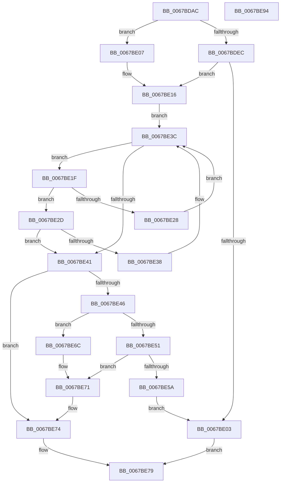

# MiFreezeIoPfnNode

- RVA: `0x0067BDAC`–`0x0067BE95` (길이 `233` bytes)
- VA: `0x000000014067BDAC`
- 실행 섹션: `.text`
- PDB 이름 있음: `예`; PDB Function 태그: `아니요`
- unwind 정보 RVA: `0x0005E6B4`
- 디코드: `63`개 명령, `233/233` bytes 표시
- 미해석 바이트: `0` (있으면 어셈블리에 `.byte`로 보존)

> 이 문서는 커널 이미지의 기계어와 PDB 기호를 분석해 생성했습니다. 4번과 5번은 함수 원형과 자료형을 바이너리 사용 방식에서 추정한 C 해석이며 원본 소스 복구 결과는 아닙니다.

## 1. Dependencies

- 직접 호출 지점: **5**; 고유 호출 대상: **5**
- 직접 호출자로 확인된 함수: **1**
- RIP 상대 이미지 참조: **1**

### Outgoing calls
- `0x0067BDF8` → [ExTryAcquireSpinLockSharedAtDpcLevel](../41/ExTryAcquireSpinLockSharedAtDpcLevel_function_00410A80.md) (function, `0x00410A80`)
- `0x0067BE11` → [MiLockIoPfnTree](../2A/MiLockIoPfnTree_function_002AC8A4.md) (function, `0x002AC8A4`)
- `0x0067BE51` → [ExTryAcquireSpinLockExclusiveAtDpcLevel](../2B/ExTryAcquireSpinLockExclusiveAtDpcLevel_function_002BB800.md) (function, `0x002BB800`)
- `0x0067BE61` → [ExReleaseSpinLockSharedFromDpcLevel](../24/ExReleaseSpinLockSharedFromDpcLevel_function_0024A590.md) (function, `0x0024A590`)
- `0x0067BE6C` → [ExAcquireSpinLockExclusiveAtDpcLevel](../24/ExAcquireSpinLockExclusiveAtDpcLevel_function_00248E80.md) (function, `0x00248E80`)

### Direct callers
- [MiDbgTranslatePhysicalAddress](../68/MiDbgTranslatePhysicalAddress_function_00685760.md) at `0x00685971`
- [MiDbgTranslatePhysicalAddress](../68/MiDbgTranslatePhysicalAddress_function_00685760.md) at `0x00685988`

### Static image references
- `0x0067BE16` → RVA `0x00E372C0` (`.data`; read)

## 2. Other-region calls and transfers

- 다른 실행 섹션으로 향하는 call: **0**
- 별도 외부 분기/꼬리 이동을 확인하지 못했습니다.

## 3. Assembly (complete function range)

```asm
0067BDAC  48 8B C4                        mov rax, rsp
0067BDAF  48 89 58 08                     mov qword ptr [rax + 8], rbx
0067BDB3  48 89 68 10                     mov qword ptr [rax + 0x10], rbp
0067BDB7  48 89 70 18                     mov qword ptr [rax + 0x18], rsi
0067BDBB  48 89 78 20                     mov qword ptr [rax + 0x20], rdi
0067BDBF  41 56                           push r14
0067BDC1  48 83 EC 20                     sub rsp, 0x20
0067BDC5  49 83 20 00                     and qword ptr [r8], 0
0067BDC9  49 8B F8                        mov rdi, r8
0067BDCC  65 48 8B 04 25 20 00 00 00      mov rax, qword ptr gs:[0x20]
0067BDD5  8B F2                           mov esi, edx
0067BDD7  4C 8B F1                        mov r14, rcx
0067BDDA  4C 8B 88 38 88 00 00            mov r9, qword ptr [rax + 0x8838]
0067BDE1  49 8B A9 48 01 00 00            mov rbp, qword ptr [r9 + 0x148]
0067BDE8  85 D2                           test edx, edx
0067BDEA  74 1B                           je 0x14067be07
0067BDEC  48 8D 8D 80 02 00 00            lea rcx, [rbp + 0x280]
0067BDF3  41 C6 40 08 01                  mov byte ptr [r8 + 8], 1
0067BDF8  E8 83 4C D9 FF                  call 0x140410a80
0067BDFD  8B F0                           mov esi, eax
0067BDFF  85 C0                           test eax, eax
0067BE01  75 13                           jne 0x14067be16
0067BE03  33 C0                           xor eax, eax
0067BE05  EB 72                           jmp 0x14067be79
0067BE07  B9 05 00 00 00                  mov ecx, 5
0067BE0C  41 C6 40 08 00                  mov byte ptr [r8 + 8], 0
0067BE11  E8 8E 0A C3 FF                  call 0x1402ac8a4
0067BE16  48 8B 1D A3 B4 7B 00            mov rbx, qword ptr [rip + 0x7bb4a3]
0067BE1D  EB 1D                           jmp 0x14067be3c
0067BE1F  48 8B 43 18                     mov rax, qword ptr [rbx + 0x18]
0067BE23  4C 3B F0                        cmp r14, rax
0067BE26  73 05                           jae 0x14067be2d
0067BE28  48 8B 1B                        mov rbx, qword ptr [rbx]
0067BE2B  EB 0F                           jmp 0x14067be3c
0067BE2D  48 05 00 02 00 00               add rax, 0x200
0067BE33  4C 3B F0                        cmp r14, rax
0067BE36  72 09                           jb 0x14067be41
0067BE38  48 8B 5B 08                     mov rbx, qword ptr [rbx + 8]
0067BE3C  48 85 DB                        test rbx, rbx
0067BE3F  75 DE                           jne 0x14067be1f
0067BE41  48 85 DB                        test rbx, rbx
0067BE44  74 2E                           je 0x14067be74
0067BE46  48 8D 8B AC 00 00 00            lea rcx, [rbx + 0xac]
0067BE4D  85 F6                           test esi, esi
0067BE4F  74 1B                           je 0x14067be6c
0067BE51  E8 AA F9 C3 FF                  call 0x1402bb800
0067BE56  85 C0                           test eax, eax
0067BE58  75 17                           jne 0x14067be71
0067BE5A  48 8D 8D 80 02 00 00            lea rcx, [rbp + 0x280]
0067BE61  E8 2A E7 BC FF                  call 0x14024a590
0067BE66  C6 47 08 00                     mov byte ptr [rdi + 8], 0
0067BE6A  EB 97                           jmp 0x14067be03
0067BE6C  E8 0F D0 BC FF                  call 0x140248e80
0067BE71  48 89 1F                        mov qword ptr [rdi], rbx
0067BE74  B8 01 00 00 00                  mov eax, 1
0067BE79  48 8B 5C 24 30                  mov rbx, qword ptr [rsp + 0x30]
0067BE7E  48 8B 6C 24 38                  mov rbp, qword ptr [rsp + 0x38]
0067BE83  48 8B 74 24 40                  mov rsi, qword ptr [rsp + 0x40]
0067BE88  48 8B 7C 24 48                  mov rdi, qword ptr [rsp + 0x48]
0067BE8D  48 83 C4 20                     add rsp, 0x20
0067BE91  41 5E                           pop r14
0067BE93  C3                              ret
0067BE94  CC                              int3
```

## 4. C-style interpretation (structured pseudocode)

```c
__int64 __fastcall MiFreezeIoPfnNode(__int64 a1, int a2, __int64 a3)
{
    __int64 result;
    __int64 v_rsp;
    unsigned __int64 v_stack_p10;
    unsigned __int64 v_stack_p18;
    unsigned __int64 v_stack_p20;
    unsigned __int64 v_stack_p8;

    *(unsigned __int64 *)(v_rsp + 8) = v_rbx;
    *(unsigned __int64 *)(v_rsp + 16) = v_rbp;
    *(unsigned __int64 *)(v_rsp + 24) = v_rsi;
    *(unsigned __int64 *)(v_rsp + 32) = v_rdi;
    v_rsp = (v_rsp) - (32);
    if (a2 == 0) goto loc_0067BE07;
    *(unsigned __int8 *)(a3 + 8) = 1;
    result = ExTryAcquireSpinLockSharedAtDpcLevel(*(unsigned __int64 *)(*(unsigned __int64 *)(*(unsigned __int64 *)(gs_base + (0 + 32)) + 34872) + 328) + 640, a2, a3, *(unsigned __int64 *)(*(unsigned __int64 *)(gs_base + (0 + 32)) + 34872));
    if ((unsigned int)(result) != 0) goto loc_0067BE16;
loc_0067BE03:
    result = 0;
    goto loc_0067BE79;
loc_0067BE07:
    *(unsigned __int8 *)(a3 + 8) = 0;
    result = MiLockIoPfnTree(5, a2, a3, *(unsigned __int64 *)(*(unsigned __int64 *)(gs_base + (0 + 32)) + 34872));
loc_0067BE16:
    goto loc_0067BE3C;
loc_0067BE1F:
    if (a1 >= (*(unsigned __int64 *)(*(unsigned __int64 *)(v_rip + 8107171) + 24))) goto loc_0067BE2D;
    goto loc_0067BE3C;
loc_0067BE2D:
    result = (*(unsigned __int64 *)(*(unsigned __int64 *)(v_rip + 8107171) + 24)) + (512);
    if (a1 < result) goto loc_0067BE41;
loc_0067BE3C:
    if (*(unsigned __int64 *)(*(unsigned __int64 *)(*(unsigned __int64 *)(v_rip + 8107171)) + 8) != 0) goto loc_0067BE1F;
loc_0067BE41:
    if (*(unsigned __int64 *)(*(unsigned __int64 *)(*(unsigned __int64 *)(v_rip + 8107171)) + 8) == 0) goto loc_0067BE74;
    if ((unsigned int)((unsigned int)((unsigned int)(result))) == 0) goto loc_0067BE6C;
    result = ExTryAcquireSpinLockExclusiveAtDpcLevel(*(unsigned __int64 *)(*(unsigned __int64 *)(*(unsigned __int64 *)(v_rip + 8107171)) + 8) + 172, a2, a3, *(unsigned __int64 *)(*(unsigned __int64 *)(gs_base + (0 + 32)) + 34872));
    if ((unsigned int)(result) != 0) goto loc_0067BE71;
    result = ExReleaseSpinLockSharedFromDpcLevel(*(unsigned __int64 *)(*(unsigned __int64 *)(*(unsigned __int64 *)(gs_base + (0 + 32)) + 34872) + 328) + 640, a2, a3, *(unsigned __int64 *)(*(unsigned __int64 *)(gs_base + (0 + 32)) + 34872));
    *(unsigned __int8 *)(a3 + 8) = 0;
    goto loc_0067BE03;
loc_0067BE6C:
    result = ExAcquireSpinLockExclusiveAtDpcLevel(*(unsigned __int64 *)(*(unsigned __int64 *)(*(unsigned __int64 *)(gs_base + (0 + 32)) + 34872) + 328) + 640, a2, a3, *(unsigned __int64 *)(*(unsigned __int64 *)(gs_base + (0 + 32)) + 34872));
loc_0067BE71:
    *(unsigned __int64 *)(a3) = *(unsigned __int64 *)(*(unsigned __int64 *)(*(unsigned __int64 *)(v_rip + 8107171)) + 8);
loc_0067BE74:
loc_0067BE79:
    v_rsp = (v_rsp) + (32);
    return 1;
}
```

## 5. (Beta) C Style

```c
int64_t MiFreezeIoPfnNode(int64_t Arg1, int32_t Arg2, void *Arg3)
{
    uint8_t *arg3 = (uint8_t *)Arg3;

    int64_t result;
    int64_t local_rsp;
    uint64_t v_stack_p10;
    uint64_t v_stack_p18;
    uint64_t v_stack_p20;
    uint64_t v_stack_p8;

    *(uint64_t *)(local_rsp + 0x8) = local_rbx;
    *(uint64_t *)(local_rsp + 0x10) = local_rbp;
    *(uint64_t *)(local_rsp + 0x18) = local_rsi;
    *(uint64_t *)(local_rsp + 0x20) = local_rdi;
    local_rsp = (local_rsp) - (32);
    if (Arg2 == 0) goto loc_0067BE07;
    *(uint8_t *)(arg3 + 0x8) = 1;
    result = ExTryAcquireSpinLockSharedAtDpcLevel(*(uint64_t *)(*(uint64_t *)(*(uint64_t *)(gs_base + (0 + 0x20)) + 0x8838) + 0x148) + 640, Arg2, Arg3, *(uint64_t *)(*(uint64_t *)(gs_base + (0 + 0x20)) + 0x8838));
    if ((uint32_t)(result) != 0) goto loc_0067BE16;
loc_0067BE03:
    result = 0;
    goto loc_0067BE79;
loc_0067BE07:
    *(uint8_t *)(arg3 + 0x8) = 0;
    result = MiLockIoPfnTree(5, Arg2, Arg3, *(uint64_t *)(*(uint64_t *)(gs_base + (0 + 0x20)) + 0x8838));
loc_0067BE16:
    goto loc_0067BE3C;
loc_0067BE1F:
    if (Arg1 >= (*(uint64_t *)(*(uint64_t *)(v_rip + 0x7BB4A3) + 0x18))) goto loc_0067BE2D;
    goto loc_0067BE3C;
loc_0067BE2D:
    result = (*(uint64_t *)(*(uint64_t *)(v_rip + 0x7BB4A3) + 0x18)) + (512);
    if (Arg1 < result) goto loc_0067BE41;
loc_0067BE3C:
    if (*(uint64_t *)(*(uint64_t *)(*(uint64_t *)(v_rip + 0x7BB4A3)) + 0x8) != 0) goto loc_0067BE1F;
loc_0067BE41:
    if (*(uint64_t *)(*(uint64_t *)(*(uint64_t *)(v_rip + 0x7BB4A3)) + 0x8) == 0) goto loc_0067BE74;
    if ((uint32_t)((uint32_t)((uint32_t)(result))) == 0) goto loc_0067BE6C;
    result = ExTryAcquireSpinLockExclusiveAtDpcLevel(*(uint64_t *)(*(uint64_t *)(*(uint64_t *)(v_rip + 0x7BB4A3)) + 0x8) + 172, Arg2, Arg3, *(uint64_t *)(*(uint64_t *)(gs_base + (0 + 0x20)) + 0x8838));
    if ((uint32_t)(result) != 0) goto loc_0067BE71;
    result = ExReleaseSpinLockSharedFromDpcLevel(*(uint64_t *)(*(uint64_t *)(*(uint64_t *)(gs_base + (0 + 0x20)) + 0x8838) + 0x148) + 640, Arg2, Arg3, *(uint64_t *)(*(uint64_t *)(gs_base + (0 + 0x20)) + 0x8838));
    *(uint8_t *)(arg3 + 0x8) = 0;
    goto loc_0067BE03;
loc_0067BE6C:
    result = ExAcquireSpinLockExclusiveAtDpcLevel(*(uint64_t *)(*(uint64_t *)(*(uint64_t *)(gs_base + (0 + 0x20)) + 0x8838) + 0x148) + 640, Arg2, Arg3, *(uint64_t *)(*(uint64_t *)(gs_base + (0 + 0x20)) + 0x8838));
loc_0067BE71:
    *(uint64_t *)(arg3) = *(uint64_t *)(*(uint64_t *)(*(uint64_t *)(v_rip + 0x7BB4A3)) + 0x8);
loc_0067BE74:
loc_0067BE79:
    local_rsp = (local_rsp) + (32);
    return 1;
}
```

### 관측된 메모리 오프셋

구조체 형식이 확인되지 않은 접근은 인자 기준의 오프셋으로만 기록했습니다.

| 기준 인자 | 오프셋 표현 | 폭 (bit) | 접근 |
|---|---:|---:|---|
| `Arg3` | `+ 0x0` | `64` | `R/W` |
| `Arg3` | `+ 0x0` | `64` | `W` |
| `Arg3` | `+ 0x8` | `8` | `W` |

## 6. Execution-region graph

[열기: 2D/3D 그래프와 함수 탐색 컨트롤 패널](../../../control-panel.html?section=text&rva=0x0067BDAC&view=graph)

- 2D 그래프는 위에서 아래로 흐르고, 3D 그래프는 빈 공간을 드래그해 회전합니다. Shift+드래그는 이동, 휠은 확대·축소, 함수 노드 선택은 대상 보고서 이동입니다.

### Static fallback


