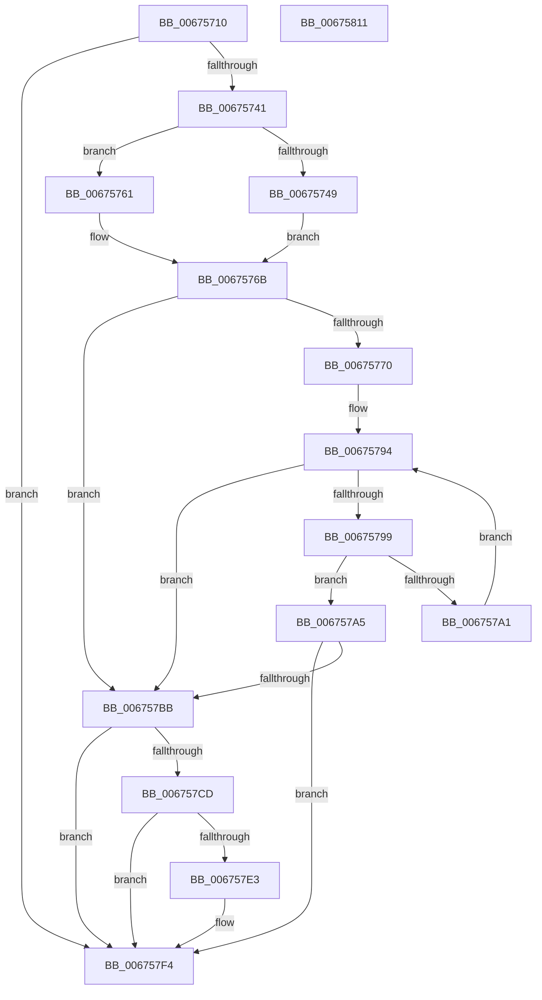

# MiGetBestHugeRangeFromNode

- RVA: `0x00675710`–`0x00675812` (길이 `258` bytes)
- VA: `0x0000000140675710`
- 실행 섹션: `.text`
- PDB 이름 있음: `예`; PDB Function 태그: `아니요`
- unwind 정보 RVA: `0x000C4CC8`
- 디코드: `76`개 명령, `258/258` bytes 표시
- 미해석 바이트: `0` (있으면 어셈블리에 `.byte`로 보존)

> 이 문서는 커널 이미지의 기계어와 PDB 기호를 분석해 생성했습니다. 4번과 5번은 함수 원형과 자료형을 바이너리 사용 방식에서 추정한 C 해석이며 원본 소스 복구 결과는 아닙니다.

## 1. Dependencies

- 직접 호출 지점: **7**; 고유 호출 대상: **4**
- 직접 호출자로 확인된 함수: **1**
- RIP 상대 이미지 참조: **1**

### Outgoing calls
- `0x00675733` → [MiGetPerfectFreeOrZeroHugeRange](MiGetPerfectFreeOrZeroHugeRange_function_00675D7C.md) (function, `0x00675D7C`)
- `0x0067578D` → [memcpy](../6C/memcpy_function_006C6840.md) (function, `0x006C6840`)
- `0x006757B1` → [MiRemoveHugeRangeAnyColor](MiRemoveHugeRangeAnyColor_function_006771B4.md) (function, `0x006771B4`)
- `0x006757C3` → [MiGetPerfectFreeOrZeroHugeRange](MiGetPerfectFreeOrZeroHugeRange_function_00675D7C.md) (function, `0x00675D7C`)
- `0x006757D9` → [MiRemoveHugeRangeAnyColor](MiRemoveHugeRangeAnyColor_function_006771B4.md) (function, `0x006771B4`)
- `0x006757EF` → [MiRemoveHugeRangeAnyColor](MiRemoveHugeRangeAnyColor_function_006771B4.md) (function, `0x006771B4`)
- `0x006757FC` → [_security_check_cookie](../6A/_security_check_cookie_function_006AC640.md) (function, `0x006AC640`)

### Direct callers
- [MiGetHugeRange](MiGetHugeRange_function_00675954.md) at `0x006759E4`

### Static image references
- `0x0067571C` → RVA `0x00E0A740` (`.data`; read)

## 2. Other-region calls and transfers

- 다른 실행 섹션으로 향하는 call: **0**
- 별도 외부 분기/꼬리 이동을 확인하지 못했습니다.

## 3. Assembly (complete function range)

```asm
00675710  48 89 5C 24 20                  mov qword ptr [rsp + 0x20], rbx
00675715  55                              push rbp
00675716  56                              push rsi
00675717  57                              push rdi
00675718  48 83 EC 50                     sub rsp, 0x50
0067571C  48 8B 05 1D 50 79 00            mov rax, qword ptr [rip + 0x79501d]
00675723  48 33 C4                        xor rax, rsp
00675726  48 89 44 24 40                  mov qword ptr [rsp + 0x40], rax
0067572B  41 8B F8                        mov edi, r8d
0067572E  8B F2                           mov esi, edx
00675730  48 8B E9                        mov rbp, rcx
00675733  E8 44 06 00 00                  call 0x140675d7c
00675738  48 85 C0                        test rax, rax
0067573B  0F 85 B3 00 00 00               jne 0x1406757f4
00675741  8B DF                           mov ebx, edi
00675743  40 F6 C7 10                     test dil, 0x10
00675747  74 18                           je 0x140675761
00675749  83 E3 EF                        and ebx, 0xffffffef
0067574C  48 8D 8D C0 3A 00 00            lea rcx, [rbp + 0x3ac0]
00675753  8B C7                           mov eax, edi
00675755  24 20                           and al, 0x20
00675757  F6 D8                           neg al
00675759  48 1B D2                        sbb rdx, rdx
0067575C  48 23 D1                        and rdx, rcx
0067575F  EB 0A                           jmp 0x14067576b
00675761  48 8D 95 D0 3A 00 00            lea rdx, [rbp + 0x3ad0]
00675768  83 CB 10                        or ebx, 0x10
0067576B  48 85 D2                        test rdx, rdx
0067576E  74 4B                           je 0x1406757bb
00675770  4C 8B 02                        mov r8, qword ptr [rdx]
00675773  48 8D 4C 24 20                  lea rcx, [rsp + 0x20]
00675778  48 8B 52 08                     mov rdx, qword ptr [rdx + 8]
0067577C  0F 57 C0                        xorps xmm0, xmm0
0067577F  49 C1 E8 03                     shr r8, 3
00675783  0F 11 44 24 20                  movups xmmword ptr [rsp + 0x20], xmm0
00675788  0F 11 44 24 30                  movups xmmword ptr [rsp + 0x30], xmm0
0067578D  E8 AE 10 05 00                  call 0x1406c6840
00675792  33 C9                           xor ecx, ecx
00675794  83 F9 04                        cmp ecx, 4
00675797  73 22                           jae 0x1406757bb
00675799  48 83 7C CC 20 00               cmp qword ptr [rsp + rcx*8 + 0x20], 0
0067579F  75 04                           jne 0x1406757a5
006757A1  FF C1                           inc ecx
006757A3  EB EF                           jmp 0x140675794
006757A5  48 8B 8D 88 3A 00 00            mov rcx, qword ptr [rbp + 0x3a88]
006757AC  44 8B C7                        mov r8d, edi
006757AF  8B D6                           mov edx, esi
006757B1  E8 FE 19 00 00                  call 0x1406771b4
006757B6  48 85 C0                        test rax, rax
006757B9  75 39                           jne 0x1406757f4
006757BB  44 8B C3                        mov r8d, ebx
006757BE  8B D6                           mov edx, esi
006757C0  48 8B CD                        mov rcx, rbp
006757C3  E8 B4 05 00 00                  call 0x140675d7c
006757C8  48 85 C0                        test rax, rax
006757CB  75 27                           jne 0x1406757f4
006757CD  48 8B 8D 88 3A 00 00            mov rcx, qword ptr [rbp + 0x3a88]
006757D4  44 8B C7                        mov r8d, edi
006757D7  8B D6                           mov edx, esi
006757D9  E8 D6 19 00 00                  call 0x1406771b4
006757DE  48 85 C0                        test rax, rax
006757E1  75 11                           jne 0x1406757f4
006757E3  48 8B 8D 88 3A 00 00            mov rcx, qword ptr [rbp + 0x3a88]
006757EA  44 8B C3                        mov r8d, ebx
006757ED  8B D6                           mov edx, esi
006757EF  E8 C0 19 00 00                  call 0x1406771b4
006757F4  48 8B 4C 24 40                  mov rcx, qword ptr [rsp + 0x40]
006757F9  48 33 CC                        xor rcx, rsp
006757FC  E8 3F 6E 03 00                  call 0x1406ac640
00675801  48 8B 9C 24 88 00 00 00         mov rbx, qword ptr [rsp + 0x88]
00675809  48 83 C4 50                     add rsp, 0x50
0067580D  5F                              pop rdi
0067580E  5E                              pop rsi
0067580F  5D                              pop rbp
00675810  C3                              ret
00675811  CC                              int3
```

## 4. C-style interpretation (structured pseudocode)

```c
__int64 __fastcall MiGetBestHugeRangeFromNode(__int64 a1, __int64 a2, int a3)
{
    __int64 result;
    __int64 v_rbx;
    __int64 v_rsp;
    unsigned __int64 v_stack_m28;
    unsigned __int64 v_stack_m38;
    unsigned __int64 v_stack_m48;
    unsigned __int64 v_stack_p20;

    v_stack_p20 = v_rbx;
    v_rsp = (v_rsp) - (80);
    result = (*(unsigned __int64 *)(v_rip + 7950365)) ^ (v_rsp);
    v_stack_m28 = result;
    result = MiGetPerfectFreeOrZeroHugeRange(a1, a2, a3, a4);
    if (result != 0) goto loc_006757F4;
    if ((((unsigned __int8)((unsigned int)(a3))) & (16)) == 0) goto loc_00675761;
    v_rbx = (unsigned int)(((unsigned int)((unsigned int)((unsigned int)(a3)))) & (0xFFFFFFEFULL));
    result = (unsigned __int8)(((unsigned int)((unsigned int)((unsigned int)(a3)))) & (32));
    result = (unsigned __int8)(-(result));
    a2 = (a2) & (a1 + 15040);
    goto loc_0067576B;
loc_00675761:
    v_rbx = (unsigned int)((v_rbx) | (16));
loc_0067576B:
    if (a1 + 15056 == 0) goto loc_006757BB;
    a3 = (*(unsigned __int64 *)(a1 + 15056)) >> (3);
    v_stack_m48 = v_xmm0;
    v_stack_m38 = v_xmm0;
    result = memcpy(v_stack_m48, *(unsigned __int64 *)(a1 + 15056 + 8), a3, a4);
    a1 = 0;
loc_00675794:
    if (0 >= 4) goto loc_006757BB;
    if ((*(unsigned __int64 *)(v_rsp + a1 * 8 + 32)) != 0) goto loc_006757A5;
    a1 = (unsigned int)((a1) + 1);
    goto loc_00675794;
loc_006757A5:
    result = MiRemoveHugeRangeAnyColor(*(unsigned __int64 *)(a1 + 14984), (unsigned int)((unsigned int)((unsigned int)((unsigned int)(a2)))), (unsigned int)((unsigned int)((unsigned int)(a3))), a4);
    if (result != 0) goto loc_006757F4;
loc_006757BB:
    result = MiGetPerfectFreeOrZeroHugeRange(a1, (unsigned int)((unsigned int)((unsigned int)((unsigned int)(a2)))), (unsigned int)((unsigned int)(v_rbx)), a4);
    if (result != 0) goto loc_006757F4;
    result = MiRemoveHugeRangeAnyColor(*(unsigned __int64 *)(a1 + 14984), (unsigned int)((unsigned int)((unsigned int)((unsigned int)(a2)))), (unsigned int)((unsigned int)((unsigned int)(a3))), a4);
    if (result == 0) {
        a1 = *(unsigned __int64 *)(a1 + 14984);
        a3 = (unsigned int)(v_rbx);
        a2 = (unsigned int)((unsigned int)((unsigned int)(a2)));
        result = MiRemoveHugeRangeAnyColor(a1, a2, a3, a4);
    }
    a1 = (v_stack_m28) ^ (v_rsp);
    result = _security_check_cookie(a1, a2, a3, a4);
    v_rsp = (v_rsp) + (80);
    return result;
}
```

## 5. (Beta) C Style

```c
int64_t MiGetBestHugeRangeFromNode(void *Arg1, int64_t Arg2, int32_t Arg3)
{
    uint8_t *arg1 = (uint8_t *)Arg1;

    int64_t result;
    int64_t local_rbx;
    int64_t local_rsp;
    uint64_t v_stack_m28;
    uint64_t v_stack_m38;
    uint64_t v_stack_m48;
    uint64_t v_stack_p20;

    v_stack_p20 = local_rbx;
    local_rsp = (local_rsp) - (80);
    result = (*(uint64_t *)(v_rip + 0x79501D)) ^ (local_rsp);
    v_stack_m28 = result;
    result = MiGetPerfectFreeOrZeroHugeRange(Arg1, Arg2, Arg3, a4);
    if (result != 0) goto loc_006757F4;
    if ((((uint8_t)((uint32_t)(Arg3))) & (16)) == 0) goto loc_00675761;
    local_rbx = (uint32_t)(((uint32_t)((uint32_t)((uint32_t)(Arg3)))) & (0xFFFFFFEFULL));
    result = (uint8_t)(((uint32_t)((uint32_t)((uint32_t)(Arg3)))) & (32));
    result = (uint8_t)(-(result));
    Arg2 = (Arg2) & (Arg1 + 15040);
    goto loc_0067576B;
loc_00675761:
    local_rbx = (uint32_t)((local_rbx) | (16));
loc_0067576B:
    if (Arg1 + 15056 == 0) goto loc_006757BB;
    Arg3 = (*(uint64_t *)(arg1 + 0x3AD0)) >> (3);
    v_stack_m48 = v_xmm0;
    v_stack_m38 = v_xmm0;
    result = memcpy(v_stack_m48, *(uint64_t *)(arg1 + 0x3AD0 + 0x8), Arg3, a4);
    Arg1 = 0;
loc_00675794:
    if (0 >= 4) goto loc_006757BB;
    if ((*(uint64_t *)(local_rsp + arg1 * 8 + 0x20)) != 0) goto loc_006757A5;
    Arg1 = (uint32_t)((Arg1) + 1);
    goto loc_00675794;
loc_006757A5:
    result = MiRemoveHugeRangeAnyColor(*(uint64_t *)(arg1 + 0x3A88), (uint32_t)((uint32_t)((uint32_t)((uint32_t)(Arg2)))), (uint32_t)((uint32_t)((uint32_t)(Arg3))), a4);
    if (result != 0) goto loc_006757F4;
loc_006757BB:
    result = MiGetPerfectFreeOrZeroHugeRange(Arg1, (uint32_t)((uint32_t)((uint32_t)((uint32_t)(Arg2)))), (uint32_t)((uint32_t)(local_rbx)), a4);
    if (result != 0) goto loc_006757F4;
    result = MiRemoveHugeRangeAnyColor(*(uint64_t *)(arg1 + 0x3A88), (uint32_t)((uint32_t)((uint32_t)((uint32_t)(Arg2)))), (uint32_t)((uint32_t)((uint32_t)(Arg3))), a4);
    if (result == 0) {
        Arg1 = *(uint64_t *)(arg1 + 0x3A88);
        Arg3 = (uint32_t)(local_rbx);
        Arg2 = (uint32_t)((uint32_t)((uint32_t)(Arg2)));
        result = MiRemoveHugeRangeAnyColor(Arg1, Arg2, Arg3, a4);
    }
    Arg1 = (v_stack_m28) ^ (local_rsp);
    result = _security_check_cookie(Arg1, Arg2, Arg3, a4);
    local_rsp = (local_rsp) + (80);
    return result;
}
```

### 관측된 메모리 오프셋

구조체 형식이 확인되지 않은 접근은 인자 기준의 오프셋으로만 기록했습니다.

| 기준 인자 | 오프셋 표현 | 폭 (bit) | 접근 |
|---|---:|---:|---|
| `Arg1` | `+ 0x3A88` | `64` | `R` |
| `Arg1` | `+ 0x3AC0` | `64` | `R` |
| `Arg1` | `+ 0x3AD0` | `64` | `R` |

## 6. Execution-region graph

[열기: 2D/3D 그래프와 함수 탐색 컨트롤 패널](../../../control-panel.html?section=text&rva=0x00675710&view=graph)

- 2D 그래프는 위에서 아래로 흐르고, 3D 그래프는 빈 공간을 드래그해 회전합니다. Shift+드래그는 이동, 휠은 확대·축소, 함수 노드 선택은 대상 보고서 이동입니다.

### Static fallback


