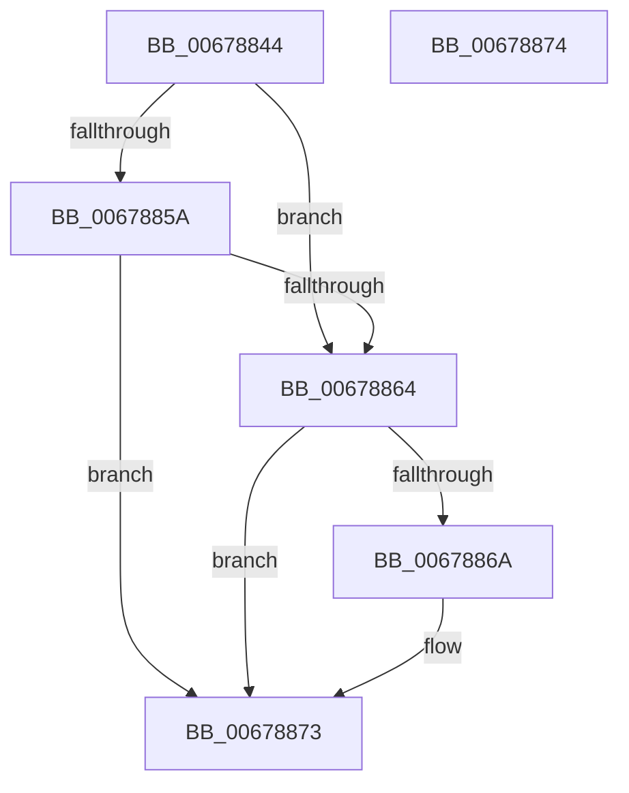

# MiGetExceptionInfo

- RVA: `0x00678844`–`0x00678875` (길이 `49` bytes)
- VA: `0x0000000140678844`
- 실행 섹션: `.text`
- PDB 이름 있음: `예`; PDB Function 태그: `아니요`
- unwind 정보 RVA: `0x000DB714`
- 디코드: `16`개 명령, `49/49` bytes 표시
- 미해석 바이트: `0` (있으면 어셈블리에 `.byte`로 보존)

> 이 문서는 커널 이미지의 기계어와 PDB 기호를 분석해 생성했습니다. 4번과 5번은 함수 원형과 자료형을 바이너리 사용 방식에서 추정한 C 해석이며 원본 소스 복구 결과는 아닙니다.

## 1. Dependencies

- 직접 호출 지점: **0**; 고유 호출 대상: **0**
- 직접 호출자로 확인된 함수: **2**
- RIP 상대 이미지 참조: **0**

### Outgoing calls
- 직접 디코드된 call 명령이 없습니다.

### Direct callers
- [MiDecommitHardwareEnclavePages$filt$0](../6D/MiDecommitHardwareEnclavePages_filt_0_function_006D22C1.md) at `0x006D22DC`
- [MiCopyVirtualMemory$filt$0](../../page/B1/MiCopyVirtualMemory_filt_0_function_00B10960.md) at `0x00B10974`

### Static image references
- 디코드된 RIP-relative 메모리 참조가 없습니다.

## 2. Other-region calls and transfers

- 다른 실행 섹션으로 향하는 call: **0**
- 별도 외부 분기/꼬리 이동을 확인하지 못했습니다.

## 3. Assembly (complete function range)

```asm
00678844  83 22 00                        and dword ptr [rdx], 0
00678847  B8 01 00 00 00                  mov eax, 1
0067884C  4C 8B 09                        mov r9, qword ptr [rcx]
0067884F  41 8B 09                        mov ecx, dword ptr [r9]
00678852  81 F9 01 00 00 80               cmp ecx, 0x80000001
00678858  74 0A                           je 0x140678864
0067885A  81 C1 FB FF FF 3F               add ecx, 0x3ffffffb
00678860  3B C8                           cmp ecx, eax
00678862  77 0F                           ja 0x140678873
00678864  41 39 41 18                     cmp dword ptr [r9 + 0x18], eax
00678868  76 09                           jbe 0x140678873
0067886A  89 02                           mov dword ptr [rdx], eax
0067886C  49 8B 49 28                     mov rcx, qword ptr [r9 + 0x28]
00678870  49 89 08                        mov qword ptr [r8], rcx
00678873  C3                              ret
00678874  CC                              int3
```

## 4. C-style interpretation (structured pseudocode)

```c
__int64 __fastcall MiGetExceptionInfo(__int64 a1, __int64 a2, __int64 a3)
{
    if (((unsigned int)((unsigned int)(*(unsigned int *)(*(unsigned __int64 *)(a1))))) == 0x80000001ULL) goto loc_00678864;
    a1 = (unsigned int)(((unsigned int)(*(unsigned int *)(*(unsigned __int64 *)(a1)))) + (0x3FFFFFFBULL));
    if (((unsigned int)(a1)) > 1) goto loc_00678873;
loc_00678864:
    if ((*(unsigned int *)(*(unsigned __int64 *)(a1) + 24)) >= = 1) {
        *(unsigned int *)(a2) = 1;
        a1 = *(unsigned __int64 *)(*(unsigned __int64 *)(a1) + 40);
        *(unsigned __int64 *)(a3) = a1;
    }
    return 1;
}
```

## 5. (Beta) C Style

```c
int64_t MiGetExceptionInfo(void *Arg1, void *Arg2, void *Arg3)
{
    uint8_t *arg1 = (uint8_t *)Arg1;
    uint8_t *arg2 = (uint8_t *)Arg2;
    uint8_t *arg3 = (uint8_t *)Arg3;

    if (((uint32_t)((uint32_t)(*(uint32_t *)(*(uint64_t *)(arg1))))) == 0x80000001ULL) goto loc_00678864;
    Arg1 = (uint32_t)(((uint32_t)(*(uint32_t *)(*(uint64_t *)(arg1)))) + (0x3FFFFFFBULL));
    if (((uint32_t)(Arg1)) > 1) goto loc_00678873;
loc_00678864:
    if ((*(uint32_t *)(*(uint64_t *)(arg1) + 0x18)) >= = 1) {
        *(uint32_t *)(arg2) = 1;
        Arg1 = *(uint64_t *)(*(uint64_t *)(arg1) + 0x28);
        *(void **)(arg3) = Arg1;
    }
    return 1;
}
```

### 관측된 메모리 오프셋

구조체 형식이 확인되지 않은 접근은 인자 기준의 오프셋으로만 기록했습니다.

| 기준 인자 | 오프셋 표현 | 폭 (bit) | 접근 |
|---|---:|---:|---|
| `Arg1` | `+ 0x0` | `64` | `R` |
| `Arg2` | `+ 0x0` | `32` | `R/W` |
| `Arg2` | `+ 0x0` | `32` | `W` |
| `Arg3` | `+ 0x0` | `64` | `W` |

## 6. Execution-region graph

[열기: 2D/3D 그래프와 함수 탐색 컨트롤 패널](../../../control-panel.html?section=text&rva=0x00678844&view=graph)

- 2D 그래프는 위에서 아래로 흐르고, 3D 그래프는 빈 공간을 드래그해 회전합니다. Shift+드래그는 이동, 휠은 확대·축소, 함수 노드 선택은 대상 보고서 이동입니다.

### Static fallback


