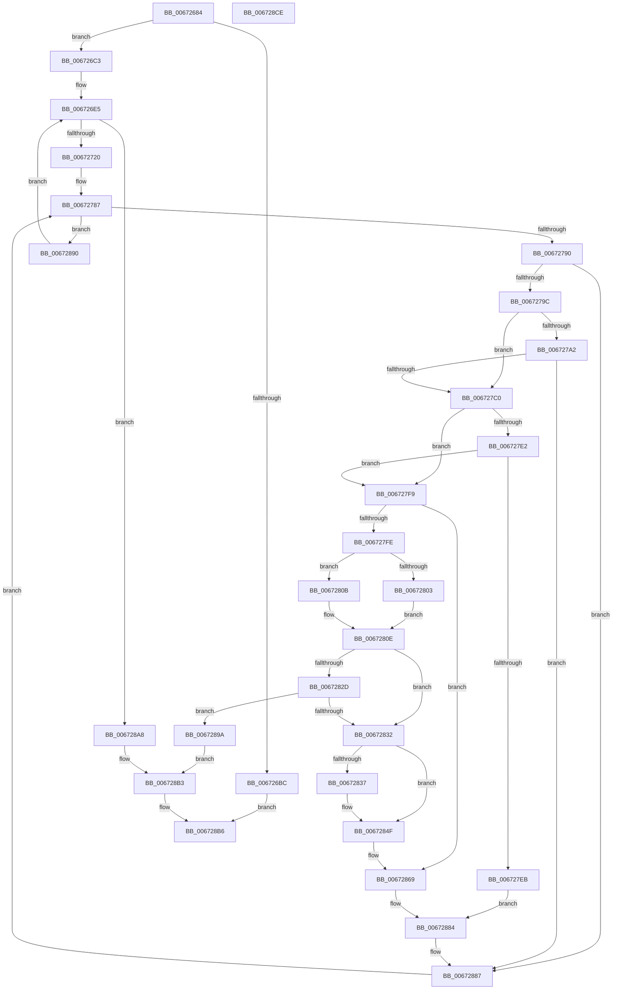

# MiGetFileOnlyRanges

- RVA: `0x00672684`–`0x006728CF` (길이 `587` bytes)
- VA: `0x0000000140672684`
- 실행 섹션: `.text`
- PDB 이름 있음: `예`; PDB Function 태그: `아니요`
- unwind 정보 RVA: `0x00093A28`
- 디코드: `154`개 명령, `587/587` bytes 표시
- 미해석 바이트: `0` (있으면 어셈블리에 `.byte`로 보존)

> 이 문서는 커널 이미지의 기계어와 PDB 기호를 분석해 생성했습니다. 4번과 5번은 함수 원형과 자료형을 바이너리 사용 방식에서 추정한 C 해석이며 원본 소스 복구 결과는 아닙니다.

## 1. Dependencies

- 직접 호출 지점: **8**; 고유 호출 대상: **7**
- 직접 호출자로 확인된 함수: **1**
- RIP 상대 이미지 참조: **1**

### Outgoing calls
- `0x006726D3` → [MiSystemVaTypeToVm](../28/MiSystemVaTypeToVm_function_0028EB50.md) (function, `0x0028EB50`)
- `0x006726E8` → [MiLockWorkingSetShared](../27/MiLockWorkingSetShared_function_0027CBF0.md) (function, `0x0027CBF0`)
- `0x00672705` → [MiGetNextNonGapPfnPage](MiGetNextNonGapPfnPage_function_006728D8.md) (function, `0x006728D8`)
- `0x00672712` → [MiUnlockWorkingSetShared](../27/MiUnlockWorkingSetShared_function_0027D690.md) (function, `0x0027D690`)
- `0x00672820` → [MiAllocatePool](../35/MiAllocatePool_function_0035B540.md) (function, `0x0035B540`)
- `0x00672840` → [memcpy](../6C/memcpy_function_006C6840.md) (function, `0x006C6840`)
- `0x0067284A` → [ExFreePoolWithTag](../../poolcode/B8/ExFreePoolWithTag_function_00B82870.md) (function, `0x00B82870`)
- `0x0067289F` → [ExFreePoolWithTag](../../poolcode/B8/ExFreePoolWithTag_function_00B82870.md) (function, `0x00B82870`)

### Direct callers
- [MiGetPhysicalMemoryRanges](../../page/AC/MiGetPhysicalMemoryRanges_function_00ACAE08.md) at `0x00ACAEC9`

### Static image references
- `0x006726B3` → RVA `0x00FC6A88` (`ALMOSTRO`; read)

## 2. Other-region calls and transfers

- 다른 실행 섹션으로 향하는 call: **2**
  - `0x0067284A` → [ExFreePoolWithTag](../../poolcode/B8/ExFreePoolWithTag_function_00B82870.md) (`.text` → `POOLCODE`)
  - `0x0067289F` → [ExFreePoolWithTag](../../poolcode/B8/ExFreePoolWithTag_function_00B82870.md) (`.text` → `POOLCODE`)
- 별도 외부 분기/꼬리 이동을 확인하지 못했습니다.

## 3. Assembly (complete function range)

```asm
00672684  48 89 5C 24 08                  mov qword ptr [rsp + 8], rbx
00672689  4C 89 44 24 18                  mov qword ptr [rsp + 0x18], r8
0067268E  89 54 24 10                     mov dword ptr [rsp + 0x10], edx
00672692  55                              push rbp
00672693  56                              push rsi
00672694  57                              push rdi
00672695  41 54                           push r12
00672697  41 55                           push r13
00672699  41 56                           push r14
0067269B  41 57                           push r15
0067269D  48 83 EC 40                     sub rsp, 0x40
006726A1  33 FF                           xor edi, edi
006726A3  45 33 F6                        xor r14d, r14d
006726A6  49 21 38                        and qword ptr [r8], rdi
006726A9  45 33 FF                        xor r15d, r15d
006726AC  49 83 CD FF                     or r13, 0xffffffffffffffff
006726B0  44 8B E2                        mov r12d, edx
006726B3  F6 05 CE 43 95 00 30            test byte ptr [rip + 0x9543ce], 0x30
006726BA  75 07                           jne 0x1406726c3
006726BC  33 C0                           xor eax, eax
006726BE  E9 F3 01 00 00                  jmp 0x1406728b6
006726C3  0F B7 01                        movzx eax, word ptr [rcx]
006726C6  B9 03 00 00 00                  mov ecx, 3
006726CB  66 89 84 24 98 00 00 00         mov word ptr [rsp + 0x98], ax
006726D3  E8 78 C4 C1 FF                  call 0x14028eb50
006726D8  48 21 7C 24 28                  and qword ptr [rsp + 0x28], rdi
006726DD  48 8B E8                        mov rbp, rax
006726E0  48 89 44 24 30                  mov qword ptr [rsp + 0x30], rax
006726E5  48 8B CD                        mov rcx, rbp
006726E8  E8 03 A5 C0 FF                  call 0x14027cbf0
006726ED  48 83 64 24 20 00               and qword ptr [rsp + 0x20], 0
006726F3  48 8D 54 24 20                  lea rdx, [rsp + 0x20]
006726F8  45 33 C9                        xor r9d, r9d
006726FB  48 8D 4C 24 28                  lea rcx, [rsp + 0x28]
00672700  44 8A C0                        mov r8b, al
00672703  8A D8                           mov bl, al
00672705  E8 CE 01 00 00                  call 0x1406728d8
0067270A  8A D3                           mov dl, bl
0067270C  48 8B CD                        mov rcx, rbp
0067270F  48 8B F0                        mov rsi, rax
00672712  E8 79 AF C0 FF                  call 0x14027d690
00672717  48 85 F6                        test rsi, rsi
0067271A  0F 84 88 01 00 00               je 0x1406728a8
00672720  49 B9 00 00 00 00 00 DE FF FF   movabs r9, 0xffffde0000000000
0067272A  49 8B C9                        mov rcx, r9
0067272D  48 8B D6                        mov rdx, rsi
00672730  49 B8 AB AA AA AA AA AA AA AA   movabs r8, 0xaaaaaaaaaaaaaaab
0067273A  48 2B D1                        sub rdx, rcx
0067273D  49 8B C0                        mov rax, r8
00672740  48 F7 E2                        mul rdx
00672743  48 C1 EA 05                     shr rdx, 5
00672747  48 8D 2C 52                     lea rbp, [rdx + rdx*2]
0067274B  48 C1 E5 04                     shl rbp, 4
0067274F  49 8B C1                        mov rax, r9
00672752  48 03 E8                        add rbp, rax
00672755  49 8B C1                        mov rax, r9
00672758  48 8B 4C 24 20                  mov rcx, qword ptr [rsp + 0x20]
0067275D  48 2B C8                        sub rcx, rax
00672760  49 8B C0                        mov rax, r8
00672763  48 03 CE                        add rcx, rsi
00672766  48 F7 E1                        mul rcx
00672769  48 C1 EA 05                     shr rdx, 5
0067276D  48 8D 0C 52                     lea rcx, [rdx + rdx*2]
00672771  48 C1 E1 04                     shl rcx, 4
00672775  49 8B C1                        mov rax, r9
00672778  48 03 C8                        add rcx, rax
0067277B  49 8B F7                        mov rsi, r15
0067277E  48 89 4C 24 20                  mov qword ptr [rsp + 0x20], rcx
00672783  48 C1 E6 04                     shl rsi, 4
00672787  48 3B E9                        cmp rbp, rcx
0067278A  0F 83 00 01 00 00               jae 0x140672890
00672790  48 0F BA 65 28 35               bt qword ptr [rbp + 0x28], 0x35
00672796  0F 83 EB 00 00 00               jae 0x140672887
0067279C  41 F6 C4 02                     test r12b, 2
006727A0  75 1E                           jne 0x1406727c0
006727A2  48 8B 45 28                     mov rax, qword ptr [rbp + 0x28]
006727A6  BA FF 03 00 00                  mov edx, 0x3ff
006727AB  48 C1 E8 2B                     shr rax, 0x2b
006727AF  66 23 C2                        and ax, dx
006727B2  66 3B 84 24 98 00 00 00         cmp ax, word ptr [rsp + 0x98]
006727BA  0F 85 C7 00 00 00               jne 0x140672887
006727C0  48 B8 28 00 00 00 00 DE FF FF   movabs rax, 0xffffde0000000028
006727CA  48 8B DD                        mov rbx, rbp
006727CD  48 2B D8                        sub rbx, rax
006727D0  48 83 C3 28                     add rbx, 0x28
006727D4  48 C1 FB 04                     sar rbx, 4
006727D8  49 0F AF D8                     imul rbx, r8
006727DC  49 83 FD FF                     cmp r13, -1
006727E0  74 17                           je 0x1406727f9
006727E2  49 8D 45 01                     lea rax, [r13 + 1]
006727E6  48 3B C3                        cmp rax, rbx
006727E9  75 0E                           jne 0x1406727f9
006727EB  48 81 44 3E F8 00 10 00 00      add qword ptr [rsi + rdi - 8], 0x1000
006727F4  E9 8B 00 00 00                  jmp 0x140672884
006727F9  4D 3B FE                        cmp r15, r14
006727FC  75 6B                           jne 0x140672869
006727FE  4D 85 F6                        test r14, r14
00672801  75 08                           jne 0x14067280b
00672803  41 BE 10 00 00 00               mov r14d, 0x10
00672809  EB 03                           jmp 0x14067280e
0067280B  4D 03 F6                        add r14, r14
0067280E  49 8B D6                        mov rdx, r14
00672811  B9 40 00 00 00                  mov ecx, 0x40
00672816  48 C1 E2 04                     shl rdx, 4
0067281A  41 B8 4D 6D 50 66               mov r8d, 0x66506d4d
00672820  E8 1B 8D CE FF                  call 0x14035b540
00672825  4C 8B E0                        mov r12, rax
00672828  48 85 C0                        test rax, rax
0067282B  75 05                           jne 0x140672832
0067282D  48 85 FF                        test rdi, rdi
00672830  75 68                           jne 0x14067289a
00672832  4D 85 FF                        test r15, r15
00672835  74 18                           je 0x14067284f
00672837  4C 8B C6                        mov r8, rsi
0067283A  48 8B D7                        mov rdx, rdi
0067283D  49 8B CC                        mov rcx, r12
00672840  E8 FB 3F 05 00                  call 0x1406c6840
00672845  33 D2                           xor edx, edx
00672847  48 8B CF                        mov rcx, rdi
0067284A  E8 21 00 51 00                  call 0x140b82870
0067284F  48 8B 4C 24 20                  mov rcx, qword ptr [rsp + 0x20]
00672854  49 8B FC                        mov rdi, r12
00672857  44 8B A4 24 88 00 00 00         mov r12d, dword ptr [rsp + 0x88]
0067285F  49 B8 AB AA AA AA AA AA AA AA   movabs r8, 0xaaaaaaaaaaaaaaab
00672869  48 8B C3                        mov rax, rbx
0067286C  48 C7 44 3E 08 00 10 00 00      mov qword ptr [rsi + rdi + 8], 0x1000
00672875  48 C1 E0 0C                     shl rax, 0xc
00672879  49 FF C7                        inc r15
0067287C  48 89 04 3E                     mov qword ptr [rsi + rdi], rax
00672880  48 83 C6 10                     add rsi, 0x10
00672884  4C 8B EB                        mov r13, rbx
00672887  48 83 C5 30                     add rbp, 0x30
0067288B  E9 F7 FE FF FF                  jmp 0x140672787
00672890  48 8B 6C 24 30                  mov rbp, qword ptr [rsp + 0x30]
00672895  E9 4B FE FF FF                  jmp 0x1406726e5
0067289A  33 D2                           xor edx, edx
0067289C  48 8B CF                        mov rcx, rdi
0067289F  E8 CC FF 50 00                  call 0x140b82870
006728A4  33 FF                           xor edi, edi
006728A6  EB 0B                           jmp 0x1406728b3
006728A8  48 8B 84 24 90 00 00 00         mov rax, qword ptr [rsp + 0x90]
006728B0  4C 89 38                        mov qword ptr [rax], r15
006728B3  48 8B C7                        mov rax, rdi
006728B6  48 8B 9C 24 80 00 00 00         mov rbx, qword ptr [rsp + 0x80]
006728BE  48 83 C4 40                     add rsp, 0x40
006728C2  41 5F                           pop r15
006728C4  41 5E                           pop r14
006728C6  41 5D                           pop r13
006728C8  41 5C                           pop r12
006728CA  5F                              pop rdi
006728CB  5E                              pop rsi
006728CC  5D                              pop rbp
006728CD  C3                              ret
006728CE  CC                              int3
```

## 4. C-style interpretation (structured pseudocode)

```c
__int64 __fastcall MiGetFileOnlyRanges(__int64 a1, int a2, __int64 a3, int a4)
{
    __int64 result;
    __int64 v_r13;
    __int64 v_r14;
    __int64 v_r15;
    __int64 v_rbp;
    __int64 v_rbx;
    __int64 v_rdi;
    __int64 v_rsi;
    __int64 v_rsp;
    unsigned __int64 v_stack_m48;
    unsigned __int64 v_stack_m50;
    unsigned __int64 v_stack_m58;
    unsigned int v_stack_p10;
    unsigned __int64 v_stack_p18;
    unsigned __int16 v_stack_p20;
    unsigned __int64 v_stack_p8;

    v_stack_p8 = v_rbx;
    v_stack_p18 = a3;
    v_stack_p10 = a2;
    v_rsp = (v_rsp) - (64);
    v_rdi = 0;
    v_r14 = 0;
    v_r15 = 0;
    v_r13 = (v_r13) | (-1);
    if (((*(unsigned __int8 *)(v_rip + 9782222)) & (48)) != 0) goto loc_006726C3;
    result = 0;
    goto loc_006728B6;
loc_006726C3:
    v_stack_p20 = (unsigned __int16)(*(unsigned __int16 *)(a1));
    result = MiSystemVaTypeToVm(3, a2, a3, a4);
    v_stack_m48 = result;
loc_006726E5:
    result = MiLockWorkingSetShared(result, a2, a3, a4);
    a4 = 0;
    result = MiGetNextNonGapPfnPage(v_stack_m50, v_stack_m58, (unsigned __int8)(result), a4);
    result = MiUnlockWorkingSetShared(result, (unsigned __int8)((unsigned __int8)(result)), (unsigned __int8)(result), a4);
    if (result == 0) goto loc_006728A8;
    a2 = (result) - (0);
    a2 = (a2) >> (5);
    v_rbp = (a2 + a2 * 2) << (4);
    v_rbp = (v_rbp) + (0);
    a1 = (v_stack_m58) - (0);
    a1 = (a1) + (result);
    a2 = (a2) >> (5);
    a1 = (a2 + a2 * 2) << (4);
    a1 = (a1) + (0);
    v_stack_m58 = a1;
    v_rsi = (0) << (4);
loc_00672787:
    if (v_rbp >= a1) goto loc_00672890;
    if (v_rbp >= a1) goto loc_00672887;
    if ((((unsigned __int8)((unsigned int)(a2))) & (2)) != 0) goto loc_006727C0;
    result = (*(unsigned __int64 *)(v_rbp + 40)) >> (43);
    result = (unsigned __int16)((result) & ((unsigned __int16)((unsigned int)(0x3FFULL))));
    if (((unsigned __int16)(result)) != v_stack_p20) goto loc_00672887;
loc_006727C0:
    v_rbx = (v_rbp) - (result);
    v_rbx = (v_rbx) + (40);
    v_rbx = (v_rbx) >> (4);
    v_rbx = (v_rbx) * ((unsigned __int8)(result));
    if (v_r13 == -1) goto loc_006727F9;
    if ((v_r13 + 1) != v_rbx) goto loc_006727F9;
    goto loc_00672884;
loc_006727F9:
    if (0 != 0) goto loc_00672869;
    if (0 != 0) goto loc_0067280B;
    goto loc_0067280E;
loc_0067280B:
    v_r14 = (16) + (16);
loc_0067280E:
    a2 = (v_r14) << (4);
    result = MiAllocatePool(64, a2, (unsigned int)(0x66506D4DULL), a4);
    if (result != 0) goto loc_00672832;
    if (0 != 0) goto loc_0067289A;
loc_00672832:
    if (0 != 0) {
        a3 = v_rsi;
        a2 = 0;
        a1 = result;
        result = memcpy(a1, a2, a3, a4);
        a2 = 0;
        a1 = 0;
        result = ExFreePoolWithTag(a1, a2, a3, a4);
    }
loc_00672869:
    *(unsigned __int64 *)(v_rsi + result * 1 + 8) = 0x1000ULL;
    result = (v_rbx) << (12);
    v_r15 = (v_r15) + 1;
    *(unsigned __int64 *)(v_rsi + result * 1) = result;
    v_rsi = (v_rsi) + (16);
loc_00672884:
loc_00672887:
    v_rbp = (v_rbp) + (48);
    goto loc_00672787;
loc_00672890:
    goto loc_006726E5;
loc_0067289A:
    a2 = 0;
    result = ExFreePoolWithTag(result, a2, a3, a4);
    v_rdi = 0;
    goto loc_006728B3;
loc_006728A8:
    *(unsigned __int64 *)(v_stack_p18) = v_r15;
loc_006728B3:
loc_006728B6:
    v_rsp = (v_rsp) + (64);
    return 0;
}
```

## 5. (Beta) C Style

```c
int64_t MiGetFileOnlyRanges(void *Arg1, int32_t Arg2, void *Arg3, int32_t Arg4)
{
    uint8_t *arg1 = (uint8_t *)Arg1;
    uint8_t *arg3 = (uint8_t *)Arg3;

    int64_t result;
    int64_t local_r13;
    int64_t local_r14;
    int64_t local_r15;
    int64_t local_rbp;
    int64_t local_rbx;
    int64_t local_rdi;
    int64_t local_rsi;
    int64_t local_rsp;
    uint64_t v_stack_m48;
    uint64_t v_stack_m50;
    uint64_t v_stack_m58;
    uint32_t v_stack_p10;
    uint64_t v_stack_p18;
    uint16_t v_stack_p20;
    uint64_t v_stack_p8;

    v_stack_p8 = local_rbx;
    v_stack_p18 = Arg3;
    v_stack_p10 = Arg2;
    local_rsp = (local_rsp) - (64);
    local_rdi = 0;
    local_r14 = 0;
    local_r15 = 0;
    local_r13 = (local_r13) | (-1);
    if (((*(uint8_t *)(v_rip + 0x9543CE)) & (48)) != 0) goto loc_006726C3;
    result = 0;
    goto loc_006728B6;
loc_006726C3:
    v_stack_p20 = (uint16_t)(*(uint16_t *)(arg1));
    result = MiSystemVaTypeToVm(3, Arg2, Arg3, Arg4);
    v_stack_m48 = result;
loc_006726E5:
    result = MiLockWorkingSetShared(result, Arg2, Arg3, Arg4);
    Arg4 = 0;
    result = MiGetNextNonGapPfnPage(v_stack_m50, v_stack_m58, (uint8_t)(result), Arg4);
    result = MiUnlockWorkingSetShared(result, (uint8_t)((uint8_t)(result)), (uint8_t)(result), Arg4);
    if (result == 0) goto loc_006728A8;
    Arg2 = (result) - (0);
    Arg2 = (Arg2) >> (5);
    local_rbp = (Arg2 + Arg2 * 2) << (4);
    local_rbp = (local_rbp) + (0);
    Arg1 = (v_stack_m58) - (0);
    Arg1 = (Arg1) + (result);
    Arg2 = (Arg2) >> (5);
    Arg1 = (Arg2 + Arg2 * 2) << (4);
    Arg1 = (Arg1) + (0);
    v_stack_m58 = Arg1;
    local_rsi = (0) << (4);
loc_00672787:
    if (local_rbp >= Arg1) goto loc_00672890;
    if (local_rbp >= Arg1) goto loc_00672887;
    if ((((uint8_t)((uint32_t)(Arg2))) & (2)) != 0) goto loc_006727C0;
    result = (*(uint64_t *)(local_rbp + 0x28)) >> (43);
    result = (uint16_t)((result) & ((uint16_t)((uint32_t)(0x3FFULL))));
    if (((uint16_t)(result)) != v_stack_p20) goto loc_00672887;
loc_006727C0:
    local_rbx = (local_rbp) - (result);
    local_rbx = (local_rbx) + (40);
    local_rbx = (local_rbx) >> (4);
    local_rbx = (local_rbx) * ((uint8_t)(result));
    if (local_r13 == -1) goto loc_006727F9;
    if ((local_r13 + 1) != local_rbx) goto loc_006727F9;
    goto loc_00672884;
loc_006727F9:
    if (0 != 0) goto loc_00672869;
    if (0 != 0) goto loc_0067280B;
    goto loc_0067280E;
loc_0067280B:
    local_r14 = (16) + (16);
loc_0067280E:
    Arg2 = (local_r14) << (4);
    result = MiAllocatePool(64, Arg2, (uint32_t)(0x66506D4DULL), Arg4);
    if (result != 0) goto loc_00672832;
    if (0 != 0) goto loc_0067289A;
loc_00672832:
    if (0 != 0) {
        Arg3 = local_rsi;
        Arg2 = 0;
        Arg1 = result;
        result = memcpy(Arg1, Arg2, Arg3, Arg4);
        Arg2 = 0;
        Arg1 = 0;
        result = ExFreePoolWithTag(Arg1, Arg2, Arg3, Arg4);
    }
loc_00672869:
    *(uint64_t *)(local_rsi + result * 1 + 0x8) = 0x1000ULL;
    result = (local_rbx) << (12);
    local_r15 = (local_r15) + 1;
    *(uint64_t *)(local_rsi + result * 1) = result;
    local_rsi = (local_rsi) + (16);
loc_00672884:
loc_00672887:
    local_rbp = (local_rbp) + (48);
    goto loc_00672787;
loc_00672890:
    goto loc_006726E5;
loc_0067289A:
    Arg2 = 0;
    result = ExFreePoolWithTag(result, Arg2, Arg3, Arg4);
    local_rdi = 0;
    goto loc_006728B3;
loc_006728A8:
    *(uint64_t *)(v_stack_p18) = local_r15;
loc_006728B3:
loc_006728B6:
    local_rsp = (local_rsp) + (64);
    return 0;
}
```

### 관측된 메모리 오프셋

구조체 형식이 확인되지 않은 접근은 인자 기준의 오프셋으로만 기록했습니다.

| 기준 인자 | 오프셋 표현 | 폭 (bit) | 접근 |
|---|---:|---:|---|
| `Arg1` | `+ 0x0` | `16` | `R` |
| `Arg3` | `+ 0x0` | `64` | `R/W` |

## 6. Execution-region graph

[열기: 2D/3D 그래프와 함수 탐색 컨트롤 패널](../../../control-panel.html?section=text&rva=0x00672684&view=graph)

- 2D 그래프는 위에서 아래로 흐르고, 3D 그래프는 빈 공간을 드래그해 회전합니다. Shift+드래그는 이동, 휠은 확대·축소, 함수 노드 선택은 대상 보고서 이동입니다.

### Static fallback


