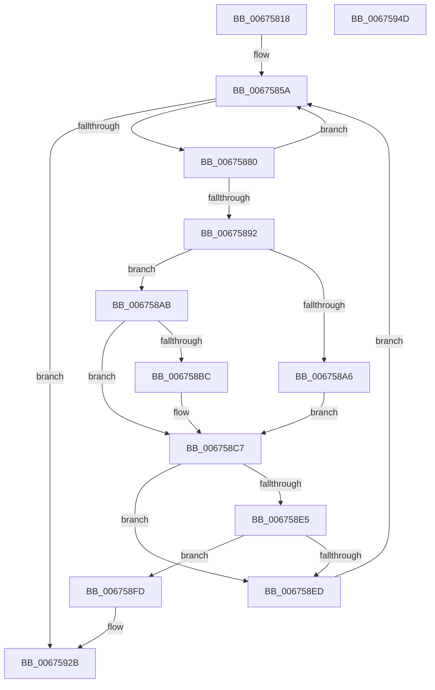

# MiGetHugeBadRangeFromNode

- RVA: `0x00675818`–`0x0067594E` (길이 `310` bytes)
- VA: `0x0000000140675818`
- 실행 섹션: `.text`
- PDB 이름 있음: `예`; PDB Function 태그: `아니요`
- unwind 정보 RVA: `0x0005FEF8`
- 디코드: `83`개 명령, `310/310` bytes 표시
- 미해석 바이트: `0` (있으면 어셈블리에 `.byte`로 보존)

> 이 문서는 커널 이미지의 기계어와 PDB 기호를 분석해 생성했습니다. 4번과 5번은 함수 원형과 자료형을 바이너리 사용 방식에서 추정한 C 해석이며 원본 소스 복구 결과는 아닙니다.

## 1. Dependencies

- 직접 호출 지점: **8**; 고유 호출 대상: **7**
- 직접 호출자로 확인된 함수: **1**
- RIP 상대 이미지 참조: **4**

### Outgoing calls
- `0x0067584E` → [MiGetColorHeadHugeRangeBase](../43/MiGetColorHeadHugeRangeBase_function_00437160.md) (function, `0x00437160`)
- `0x006758C2` → [KiRaiseIrqlProcessIrqlFlags](../4F/KiRaiseIrqlProcessIrqlFlags_function_004F56FC.md) (function, `0x004F56FC`)
- `0x006758CA` → [MiLockHugePfnInternal](../3F/MiLockHugePfnInternal_function_003FBC80.md) (function, `0x003FBC80`)
- `0x006758F3` → [MiUnlockHugePfn](../4D/MiUnlockHugePfn_function_004D90E4.md) (function, `0x004D90E4`)
- `0x00675904` → [ExAcquireSpinLockExclusiveAtDpcLevel](../24/ExAcquireSpinLockExclusiveAtDpcLevel_function_00248E80.md) (function, `0x00248E80`)
- `0x0067590F` → [MiUnlinkHugeRange](../43/MiUnlinkHugeRange_function_00436EF0.md) (function, `0x00436EF0`)
- `0x0067591B` → [ExReleaseSpinLockExclusiveFromDpcLevel](../24/ExReleaseSpinLockExclusiveFromDpcLevel_function_002497E0.md) (function, `0x002497E0`)
- `0x00675926` → [MiUnlockHugePfn](../4D/MiUnlockHugePfn_function_004D90E4.md) (function, `0x004D90E4`)

### Direct callers
- [MiAllocatePartitionPhysicalPages](../../page/80/MiAllocatePartitionPhysicalPages_function_0080C9D4.md) at `0x0080CBC8`

### Static image references
- `0x00675880` → RVA `0x00E300B8` (`.data`; read)
- `0x00675892` → RVA `0x00E300C0` (`.data`; read)
- `0x006758B3` → RVA `0x00FC6D20` (`ALMOSTRO`; read)
- `0x006758FD` → RVA `0x00E2FFD0` (`.data`; read)

## 2. Other-region calls and transfers

- 다른 실행 섹션으로 향하는 call: **0**
- 별도 외부 분기/꼬리 이동을 확인하지 못했습니다.

## 3. Assembly (complete function range)

```asm
00675818  48 8B C4                        mov rax, rsp
0067581B  48 89 58 08                     mov qword ptr [rax + 8], rbx
0067581F  48 89 68 10                     mov qword ptr [rax + 0x10], rbp
00675823  48 89 70 18                     mov qword ptr [rax + 0x18], rsi
00675827  48 89 78 20                     mov qword ptr [rax + 0x20], rdi
0067582B  41 54                           push r12
0067582D  41 56                           push r14
0067582F  41 57                           push r15
00675831  48 83 EC 20                     sub rsp, 0x20
00675835  0F B7 29                        movzx ebp, word ptr [rcx]
00675838  4C 8B F1                        mov r14, rcx
0067583B  8B C2                           mov eax, edx
0067583D  33 DB                           xor ebx, ebx
0067583F  48 69 C8 80 DF 00 00            imul rcx, rax, 0xdf80
00675846  44 8D 43 05                     lea r8d, [rbx + 5]
0067584A  49 03 4E 10                     add rcx, qword ptr [r14 + 0x10]
0067584E  E8 0D 19 DC FF                  call 0x140437160
00675853  4C 8B F8                        mov r15, rax
00675856  44 8D 63 02                     lea r12d, [rbx + 2]
0067585A  49 8B 07                        mov rax, qword ptr [r15]
0067585D  48 C1 E8 0F                     shr rax, 0xf
00675861  48 33 D8                        xor rbx, rax
00675864  48 8B D0                        mov rdx, rax
00675867  48 81 E3 00 00 C0 FF            and rbx, 0xffffffffffc00000
0067586E  81 E2 FF FF 3F 00               and edx, 0x3fffff
00675874  48 33 D8                        xor rbx, rax
00675877  48 85 D2                        test rdx, rdx
0067587A  0F 84 AB 00 00 00               je 0x14067592b
00675880  48 8B 05 31 A8 7B 00            mov rax, qword ptr [rip + 0x7ba831]
00675887  48 0F A3 10                     bt qword ptr [rax], rdx
0067588B  0F 92 C0                        setb al
0067588E  84 C0                           test al, al
00675890  74 C8                           je 0x14067585a
00675892  48 8B 05 27 A8 7B 00            mov rax, qword ptr [rip + 0x7ba827]
00675899  48 8D 34 D0                     lea rsi, [rax + rdx*8]
0067589D  44 0F 20 C0                     mov rax, cr8
006758A1  41 3A C4                        cmp al, r12b
006758A4  75 05                           jne 0x1406758ab
006758A6  40 B7 11                        mov dil, 0x11
006758A9  EB 1C                           jmp 0x1406758c7
006758AB  44 0F 20 C7                     mov rdi, cr8
006758AF  45 0F 22 C4                     mov cr8, r12
006758B3  83 3D 66 14 95 00 00            cmp dword ptr [rip + 0x951466], 0
006758BA  74 0B                           je 0x1406758c7
006758BC  41 8A D4                        mov dl, r12b
006758BF  40 8A CF                        mov cl, dil
006758C2  E8 35 FE E7 FF                  call 0x1404f56fc
006758C7  48 8B CE                        mov rcx, rsi
006758CA  E8 B1 63 D8 FF                  call 0x1403fbc80
006758CF  48 8B 16                        mov rdx, qword ptr [rsi]
006758D2  4C 8B C2                        mov r8, rdx
006758D5  49 C1 E8 04                     shr r8, 4
006758D9  41 81 E0 FF 07 00 00            and r8d, 0x7ff
006758E0  4C 3B C5                        cmp r8, rbp
006758E3  75 08                           jne 0x1406758ed
006758E5  80 E2 07                        and dl, 7
006758E8  80 FA 04                        cmp dl, 4
006758EB  74 10                           je 0x1406758fd
006758ED  40 8A D7                        mov dl, dil
006758F0  48 8B CE                        mov rcx, rsi
006758F3  E8 EC 37 E6 FF                  call 0x1404d90e4
006758F8  E9 5D FF FF FF                  jmp 0x14067585a
006758FD  48 8D 0D CC A6 7B 00            lea rcx, [rip + 0x7ba6cc]
00675904  E8 77 35 BD FF                  call 0x140248e80
00675909  48 8B D3                        mov rdx, rbx
0067590C  49 8B CE                        mov rcx, r14
0067590F  E8 DC 15 DC FF                  call 0x140436ef0
00675914  48 8D 0D B5 A6 7B 00            lea rcx, [rip + 0x7ba6b5]
0067591B  E8 C0 3E BD FF                  call 0x1402497e0
00675920  40 8A D7                        mov dl, dil
00675923  48 8B CE                        mov rcx, rsi
00675926  E8 B9 37 E6 FF                  call 0x1404d90e4
0067592B  48 8B 6C 24 48                  mov rbp, qword ptr [rsp + 0x48]
00675930  48 8B C3                        mov rax, rbx
00675933  48 8B 5C 24 40                  mov rbx, qword ptr [rsp + 0x40]
00675938  48 8B 74 24 50                  mov rsi, qword ptr [rsp + 0x50]
0067593D  48 8B 7C 24 58                  mov rdi, qword ptr [rsp + 0x58]
00675942  48 83 C4 20                     add rsp, 0x20
00675946  41 5F                           pop r15
00675948  41 5E                           pop r14
0067594A  41 5C                           pop r12
0067594C  C3                              ret
0067594D  CC                              int3
```

## 4. C-style interpretation (structured pseudocode)

```c
__int64 __fastcall MiGetHugeBadRangeFromNode(__int64 a1, int a2)
{
    __int64 result;
    __int64 v_rbx;
    __int64 v_rsp;
    unsigned __int64 v_stack_p10;
    unsigned __int64 v_stack_p18;
    unsigned __int64 v_stack_p20;
    unsigned __int64 v_stack_p8;

    *(unsigned __int64 *)(v_rsp + 8) = v_rbx;
    *(unsigned __int64 *)(v_rsp + 16) = v_rbp;
    *(unsigned __int64 *)(v_rsp + 24) = v_rsi;
    *(unsigned __int64 *)(v_rsp + 32) = v_rdi;
    v_rsp = (v_rsp) - (32);
    v_rbx = 0;
    a1 = (a1) * ((unsigned int)(a2));
    a1 = (a1) + (*(unsigned __int64 *)(a1 + 16));
    result = MiGetColorHeadHugeRangeBase(a1, a2, v_rbx + 5, a4);
loc_0067585A:
    result = (*(unsigned __int64 *)(result)) >> (15);
    v_rbx = (v_rbx) ^ (result);
    v_rbx = (v_rbx) & (0xFFFFFFFFFFC00000ULL);
    a2 = (unsigned int)((result) & (0x3FFFFFULL));
    v_rbx = (v_rbx) ^ (result);
    if (a2 == 0) goto loc_0067592B;
    result = (condition_is_below) ? 1 : 0;
    if ((unsigned __int8)(result) == 0) goto loc_0067585A;
    if (((unsigned __int8)(v_cr8)) != ((unsigned __int8)(v_rbx + 2))) goto loc_006758AB;
    goto loc_006758C7;
loc_006758AB:
    result = v_cr8;
    if ((*(unsigned int *)(v_rip + 9770086)) != 0) {
        a2 = (unsigned __int8)(v_rbx + 2);
        a1 = (unsigned __int8)(v_cr8);
        result = KiRaiseIrqlProcessIrqlFlags(a1, a2, v_rbx + 5, a4);
    }
    result = MiLockHugePfnInternal(*(unsigned __int64 *)(v_rip + 8103975) + a2 * 8, a2, v_rbx + 5, a4);
    a3 = (*(unsigned __int64 *)(*(unsigned __int64 *)(v_rip + 8103975) + a2 * 8)) >> (4);
    a3 = (unsigned int)((a3) & (0x7FFULL));
    if (a3 != (*(unsigned __int16 *)(a1))) goto loc_006758ED;
    a2 = (unsigned __int8)((*(unsigned __int64 *)(*(unsigned __int64 *)(v_rip + 8103975) + a2 * 8)) & (7));
    if (((unsigned __int8)(a2)) == 4) goto loc_006758FD;
loc_006758ED:
    result = MiUnlockHugePfn(*(unsigned __int64 *)(v_rip + 8103975) + a2 * 8, (unsigned __int8)(v_cr8), a3, a4);
    goto loc_0067585A;
loc_006758FD:
    result = ExAcquireSpinLockExclusiveAtDpcLevel(v_rip + 8103628, (unsigned __int8)(v_cr8), a3, a4);
    result = MiUnlinkHugeRange(a1, v_rbx, a3, a4);
    result = ExReleaseSpinLockExclusiveFromDpcLevel(v_rip + 8103605, v_rbx, a3, a4);
    result = MiUnlockHugePfn(*(unsigned __int64 *)(v_rip + 8103975) + a2 * 8, (unsigned __int8)(v_cr8), a3, a4);
loc_0067592B:
    v_rsp = (v_rsp) + (32);
    return v_rbx;
}
```

## 5. (Beta) C Style

```c
int64_t MiGetHugeBadRangeFromNode(void *Arg1, int32_t Arg2)
{
    uint8_t *arg1 = (uint8_t *)Arg1;

    int64_t result;
    int64_t local_rbx;
    int64_t local_rsp;
    uint64_t v_stack_p10;
    uint64_t v_stack_p18;
    uint64_t v_stack_p20;
    uint64_t v_stack_p8;

    *(uint64_t *)(local_rsp + 0x8) = local_rbx;
    *(uint64_t *)(local_rsp + 0x10) = local_rbp;
    *(uint64_t *)(local_rsp + 0x18) = local_rsi;
    *(uint64_t *)(local_rsp + 0x20) = local_rdi;
    local_rsp = (local_rsp) - (32);
    local_rbx = 0;
    Arg1 = (Arg1) * ((uint32_t)(Arg2));
    Arg1 = (Arg1) + (*(uint64_t *)(arg1 + 0x10));
    result = MiGetColorHeadHugeRangeBase(Arg1, Arg2, local_rbx + 5, a4);
loc_0067585A:
    result = (*(uint64_t *)(result)) >> (15);
    local_rbx = (local_rbx) ^ (result);
    local_rbx = (local_rbx) & (0xFFFFFFFFFFC00000ULL);
    Arg2 = (uint32_t)((result) & (0x3FFFFFULL));
    local_rbx = (local_rbx) ^ (result);
    if (Arg2 == 0) goto loc_0067592B;
    result = (condition_is_below) ? 1 : 0;
    if ((uint8_t)(result) == 0) goto loc_0067585A;
    if (((uint8_t)(v_cr8)) != ((uint8_t)(local_rbx + 2))) goto loc_006758AB;
    goto loc_006758C7;
loc_006758AB:
    result = v_cr8;
    if ((*(uint32_t *)(v_rip + 0x951466)) != 0) {
        Arg2 = (uint8_t)(local_rbx + 2);
        Arg1 = (uint8_t)(v_cr8);
        result = KiRaiseIrqlProcessIrqlFlags(Arg1, Arg2, local_rbx + 5, a4);
    }
    result = MiLockHugePfnInternal(*(uint64_t *)(v_rip + 0x7BA827) + Arg2 * 8, Arg2, local_rbx + 5, a4);
    a3 = (*(uint64_t *)(*(uint64_t *)(v_rip + 0x7BA827) + Arg2 * 8)) >> (4);
    a3 = (uint32_t)((a3) & (0x7FFULL));
    if (a3 != (*(uint16_t *)(arg1))) goto loc_006758ED;
    Arg2 = (uint8_t)((*(uint64_t *)(*(uint64_t *)(v_rip + 0x7BA827) + Arg2 * 8)) & (7));
    if (((uint8_t)(Arg2)) == 4) goto loc_006758FD;
loc_006758ED:
    result = MiUnlockHugePfn(*(uint64_t *)(v_rip + 0x7BA827) + Arg2 * 8, (uint8_t)(v_cr8), a3, a4);
    goto loc_0067585A;
loc_006758FD:
    result = ExAcquireSpinLockExclusiveAtDpcLevel(v_rip + 8103628, (uint8_t)(v_cr8), a3, a4);
    result = MiUnlinkHugeRange(Arg1, local_rbx, a3, a4);
    result = ExReleaseSpinLockExclusiveFromDpcLevel(v_rip + 8103605, local_rbx, a3, a4);
    result = MiUnlockHugePfn(*(uint64_t *)(v_rip + 0x7BA827) + Arg2 * 8, (uint8_t)(v_cr8), a3, a4);
loc_0067592B:
    local_rsp = (local_rsp) + (32);
    return local_rbx;
}
```

### 관측된 메모리 오프셋

구조체 형식이 확인되지 않은 접근은 인자 기준의 오프셋으로만 기록했습니다.

| 기준 인자 | 오프셋 표현 | 폭 (bit) | 접근 |
|---|---:|---:|---|
| `Arg1` | `+ 0x0` | `16` | `R` |
| `Arg1` | `+ 0x10` | `64` | `R` |

## 6. Execution-region graph

[열기: 2D/3D 그래프와 함수 탐색 컨트롤 패널](../../../control-panel.html?section=text&rva=0x00675818&view=graph)

- 2D 그래프는 위에서 아래로 흐르고, 3D 그래프는 빈 공간을 드래그해 회전합니다. Shift+드래그는 이동, 휠은 확대·축소, 함수 노드 선택은 대상 보고서 이동입니다.

### Static fallback


