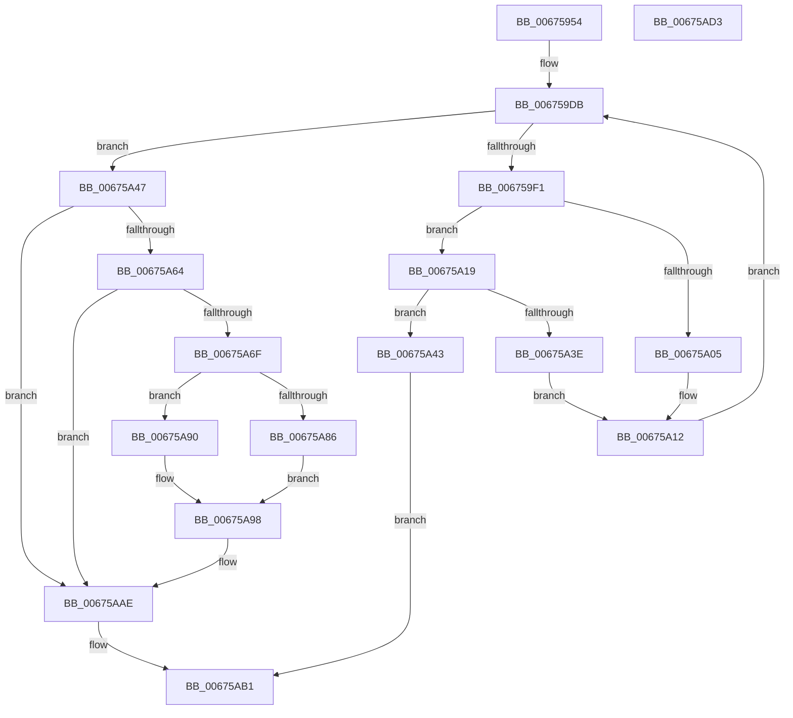

# MiGetHugeRange

- RVA: `0x00675954`–`0x00675AD4` (길이 `384` bytes)
- VA: `0x0000000140675954`
- 실행 섹션: `.text`
- PDB 이름 있음: `예`; PDB Function 태그: `아니요`
- unwind 정보 RVA: `0x000D7C0C`
- 디코드: `108`개 명령, `384/384` bytes 표시
- 미해석 바이트: `0` (있으면 어셈블리에 `.byte`로 보존)

> 이 문서는 커널 이미지의 기계어와 PDB 기호를 분석해 생성했습니다. 4번과 5번은 함수 원형과 자료형을 바이너리 사용 방식에서 추정한 C 해석이며 원본 소스 복구 결과는 아닙니다.

## 1. Dependencies

- 직접 호출 지점: **12**; 고유 호출 대상: **10**
- 직접 호출자로 확인된 함수: **2**
- RIP 상대 이미지 참조: **2**

### Outgoing calls
- `0x0067599B` → [MiInitializeGetPageChannels](../44/MiInitializeGetPageChannels_function_00442DE0.md) (function, `0x00442DE0`)
- `0x006759C1` → [MiInitializeGetPageChannels](../44/MiInitializeGetPageChannels_function_00442DE0.md) (function, `0x00442DE0`)
- `0x006759CE` → [MiSnapPageMoveInProgress](../3B/MiSnapPageMoveInProgress_function_003B8C04.md) (function, `0x003B8C04`)
- `0x006759E4` → [MiGetBestHugeRangeFromNode](MiGetBestHugeRangeFromNode_function_00675710.md) (function, `0x00675710`)
- `0x00675A0D` → [MiColorSetChannel](../44/MiColorSetChannel_function_0044F454.md) (function, `0x0044F454`)
- `0x00675A1D` → [MiColorSetChannel](../44/MiColorSetChannel_function_0044F454.md) (function, `0x0044F454`)
- `0x00675A2A` → [MiWaitForPageMoveComplete](../3B/MiWaitForPageMoveComplete_function_003B8C30.md) (function, `0x003B8C30`)
- `0x00675A78` → [MiHugePageOperation](../68/MiHugePageOperation_function_0068C490.md) (function, `0x0068C490`)
- `0x00675A89` → [MiLockHugePfnInternal](../3F/MiLockHugePfnInternal_function_003FBC80.md) (function, `0x003FBC80`)
- `0x00675A90` → [MiLockHugePfn](MiLockHugePfn_function_006765FC.md) (function, `0x006765FC`)
- `0x00675AA9` → [MiUnlockHugePfn](../4D/MiUnlockHugePfn_function_004D90E4.md) (function, `0x004D90E4`)
- `0x00675AB9` → [_security_check_cookie](../6A/_security_check_cookie_function_006AC640.md) (function, `0x006AC640`)

### Direct callers
- [MmAllocateMemoryRanges](../../page/7F/MmAllocateMemoryRanges_function_007FC0C0.md) at `0x007FC1DD`
- [MiAllocatePartitionPhysicalPages](../../page/80/MiAllocatePartitionPhysicalPages_function_0080C9D4.md) at `0x0080CC21`

### Static image references
- `0x00675965` → RVA `0x00E0A740` (`.data`; read)
- `0x00675A47` → RVA `0x00E300C0` (`.data`; read)

## 2. Other-region calls and transfers

- 다른 실행 섹션으로 향하는 call: **0**
- 별도 외부 분기/꼬리 이동을 확인하지 못했습니다.

## 3. Assembly (complete function range)

```asm
00675954  48 89 5C 24 20                  mov qword ptr [rsp + 0x20], rbx
00675959  56                              push rsi
0067595A  57                              push rdi
0067595B  41 54                           push r12
0067595D  41 56                           push r14
0067595F  41 57                           push r15
00675961  48 83 EC 40                     sub rsp, 0x40
00675965  48 8B 05 D4 4D 79 00            mov rax, qword ptr [rip + 0x794dd4]
0067596C  48 33 C4                        xor rax, rsp
0067596F  48 89 44 24 30                  mov qword ptr [rsp + 0x30], rax
00675974  33 C0                           xor eax, eax
00675976  89 54 24 20                     mov dword ptr [rsp + 0x20], edx
0067597A  41 8B F8                        mov edi, r8d
0067597D  89 44 24 28                     mov dword ptr [rsp + 0x28], eax
00675981  45 8B C8                        mov r9d, r8d
00675984  66 89 44 24 2C                  mov word ptr [rsp + 0x2c], ax
00675989  44 8B C2                        mov r8d, edx
0067598C  44 8B DA                        mov r11d, edx
0067598F  4C 8B E1                        mov r12, rcx
00675992  8B DA                           mov ebx, edx
00675994  33 D2                           xor edx, edx
00675996  48 8D 4C 24 28                  lea rcx, [rsp + 0x28]
0067599B  E8 40 D4 DC FF                  call 0x140442de0
006759A0  48 C1 EB 09                     shr rbx, 9
006759A4  48 8D 4C 24 28                  lea rcx, [rsp + 0x28]
006759A9  83 E3 3F                        and ebx, 0x3f
006759AC  44 8B CF                        mov r9d, edi
006759AF  4C 69 FB 80 DF 00 00            imul r15, rbx, 0xdf80
006759B6  45 8B C3                        mov r8d, r11d
006759B9  4D 03 7C 24 10                  add r15, qword ptr [r12 + 0x10]
006759BE  49 8B D7                        mov rdx, r15
006759C1  E8 1A D4 DC FF                  call 0x140442de0
006759C6  BA 04 00 00 00                  mov edx, 4
006759CB  49 8B CF                        mov rcx, r15
006759CE  E8 31 32 D4 FF                  call 0x1403b8c04
006759D3  44 8A 74 24 2A                  mov r14b, byte ptr [rsp + 0x2a]
006759D8  48 8B D8                        mov rbx, rax
006759DB  44 8B C7                        mov r8d, edi
006759DE  41 8B D3                        mov edx, r11d
006759E1  49 8B CF                        mov rcx, r15
006759E4  E8 27 FD FF FF                  call 0x140675710
006759E9  48 8B F0                        mov rsi, rax
006759EC  48 85 C0                        test rax, rax
006759EF  75 56                           jne 0x140675a47
006759F1  41 FE C6                        inc r14b
006759F4  48 8D 4C 24 20                  lea rcx, [rsp + 0x20]
006759F9  44 88 74 24 2A                  mov byte ptr [rsp + 0x2a], r14b
006759FE  44 3A 74 24 2B                  cmp r14b, byte ptr [rsp + 0x2b]
00675A03  73 14                           jae 0x140675a19
00675A05  41 0F B6 D6                     movzx edx, r14b
00675A09  8A 54 14 28                     mov dl, byte ptr [rsp + rdx + 0x28]
00675A0D  E8 42 9A DD FF                  call 0x14044f454
00675A12  44 8B 5C 24 20                  mov r11d, dword ptr [rsp + 0x20]
00675A17  EB C2                           jmp 0x1406759db
00675A19  8A 54 24 2C                     mov dl, byte ptr [rsp + 0x2c]
00675A1D  E8 32 9A DD FF                  call 0x14044f454
00675A22  BA 04 00 00 00                  mov edx, 4
00675A27  49 8B CF                        mov rcx, r15
00675A2A  E8 01 32 D4 FF                  call 0x1403b8c30
00675A2F  48 8B C8                        mov rcx, rax
00675A32  48 33 CB                        xor rcx, rbx
00675A35  48 F7 C1 00 00 FF FF            test rcx, -0x10000
00675A3C  74 05                           je 0x140675a43
00675A3E  48 8B D8                        mov rbx, rax
00675A41  EB CF                           jmp 0x140675a12
00675A43  33 C0                           xor eax, eax
00675A45  EB 6A                           jmp 0x140675ab1
00675A47  48 8B 05 72 A6 7B 00            mov rax, qword ptr [rip + 0x7ba672]
00675A4E  48 8B DE                        mov rbx, rsi
00675A51  48 2B D8                        sub rbx, rax
00675A54  48 C1 FB 03                     sar rbx, 3
00675A58  81 E3 FF FF 3F 00               and ebx, 0x3fffff
00675A5E  40 F6 C7 20                     test dil, 0x20
00675A62  74 4A                           je 0x140675aae
00675A64  48 8B 04 D8                     mov rax, qword ptr [rax + rbx*8]
00675A68  48 0F BA E0 10                  bt rax, 0x10
00675A6D  73 3F                           jae 0x140675aae
00675A6F  8B D3                           mov edx, ebx
00675A71  49 8B CC                        mov rcx, r12
00675A74  48 C1 E2 12                     shl rdx, 0x12
00675A78  E8 13 6A 01 00                  call 0x14068c490
00675A7D  48 8B CE                        mov rcx, rsi
00675A80  40 F6 C7 01                     test dil, 1
00675A84  74 0A                           je 0x140675a90
00675A86  40 B7 11                        mov dil, 0x11
00675A89  E8 F2 61 D8 FF                  call 0x1403fbc80
00675A8E  EB 08                           jmp 0x140675a98
00675A90  E8 67 0B 00 00                  call 0x1406765fc
00675A95  40 8A F8                        mov dil, al
00675A98  48 8B 0E                        mov rcx, qword ptr [rsi]
00675A9B  40 8A D7                        mov dl, dil
00675A9E  48 0F BA F1 10                  btr rcx, 0x10
00675AA3  48 89 0E                        mov qword ptr [rsi], rcx
00675AA6  48 8B CE                        mov rcx, rsi
00675AA9  E8 36 36 E6 FF                  call 0x1404d90e4
00675AAE  48 8B C3                        mov rax, rbx
00675AB1  48 8B 4C 24 30                  mov rcx, qword ptr [rsp + 0x30]
00675AB6  48 33 CC                        xor rcx, rsp
00675AB9  E8 82 6B 03 00                  call 0x1406ac640
00675ABE  48 8B 9C 24 88 00 00 00         mov rbx, qword ptr [rsp + 0x88]
00675AC6  48 83 C4 40                     add rsp, 0x40
00675ACA  41 5F                           pop r15
00675ACC  41 5E                           pop r14
00675ACE  41 5C                           pop r12
00675AD0  5F                              pop rdi
00675AD1  5E                              pop rsi
00675AD2  C3                              ret
00675AD3  CC                              int3
```

## 4. C-style interpretation (structured pseudocode)

```c
__int64 __fastcall MiGetHugeRange(__int64 a1, int a2, int a3)
{
    __int64 result;
    __int64 v_r14;
    __int64 v_r15;
    __int64 v_rbx;
    __int64 v_rsp;
    unsigned __int64 v_stack_m38;
    unsigned __int16 v_stack_m3C;
    unsigned __int8 v_stack_m3D;
    unsigned __int8 v_stack_m3E;
    unsigned int v_stack_m40;
    unsigned int v_stack_m48;
    unsigned __int64 v_stack_p20;

    v_stack_p20 = v_rbx;
    v_rsp = (v_rsp) - (64);
    result = (*(unsigned __int64 *)(v_rip + 7949780)) ^ (v_rsp);
    v_stack_m38 = result;
    result = 0;
    v_stack_m48 = a2;
    v_stack_m40 = 0;
    v_stack_m3C = 0;
    a2 = 0;
    result = MiInitializeGetPageChannels(v_stack_m40, a2, (unsigned int)(a2), (unsigned int)(a3));
    v_rbx = ((unsigned int)(a2)) >> (9);
    v_rbx = (unsigned int)((v_rbx) & (63));
    v_r15 = (v_r15) * (v_rbx);
    v_r15 = (v_r15) + (*(unsigned __int64 *)(a1 + 16));
    result = MiInitializeGetPageChannels(v_stack_m40, v_r15, (unsigned int)((unsigned int)((unsigned int)(a2))), (unsigned int)((unsigned int)((unsigned int)(a3))));
    result = MiSnapPageMoveInProgress(v_r15, 4, (unsigned int)((unsigned int)((unsigned int)(a2))), (unsigned int)((unsigned int)((unsigned int)(a3))));
loc_006759DB:
    result = MiGetBestHugeRangeFromNode(v_r15, (unsigned int)((unsigned int)((unsigned int)(a2))), (unsigned int)((unsigned int)((unsigned int)(a3))), (unsigned int)((unsigned int)((unsigned int)(a3))));
    if (result != 0) goto loc_00675A47;
    v_r14 = (unsigned __int8)((v_stack_m3E) + 1);
    v_stack_m3E = (unsigned __int8)(v_r14);
    if (((unsigned __int8)(v_r14)) >= v_stack_m3D) goto loc_00675A19;
    result = MiColorSetChannel(v_stack_m48, *(unsigned __int8 *)(v_rsp + (unsigned __int8)(v_r14) * 1 + 40), (unsigned int)((unsigned int)((unsigned int)(a3))), (unsigned int)((unsigned int)((unsigned int)(a3))));
loc_00675A12:
    goto loc_006759DB;
loc_00675A19:
    result = MiColorSetChannel(v_stack_m48, v_stack_m3C, (unsigned int)((unsigned int)((unsigned int)(a3))), (unsigned int)((unsigned int)((unsigned int)(a3))));
    result = MiWaitForPageMoveComplete(v_r15, 4, (unsigned int)((unsigned int)((unsigned int)(a3))), (unsigned int)((unsigned int)((unsigned int)(a3))));
    a1 = (result) ^ (result);
    if (((a1) & (0xFFFFFFFFFFFF0000ULL)) == 0) goto loc_00675A43;
    goto loc_00675A12;
loc_00675A43:
    result = 0;
    goto loc_00675AB1;
loc_00675A47:
    v_rbx = (0) - (*(unsigned __int64 *)(v_rip + 8103538));
    v_rbx = (v_rbx) >> (3);
    v_rbx = (unsigned int)((v_rbx) & (0x3FFFFFULL));
    if ((((unsigned __int8)((unsigned int)(a3))) & (32)) == 0) goto loc_00675AAE;
    if (condition_is_above_or_equal) goto loc_00675AAE;
    a2 = ((unsigned int)((unsigned int)(v_rbx))) << (18);
    result = MiHugePageOperation(a1, a2, (unsigned int)((unsigned int)((unsigned int)(a3))), (unsigned int)((unsigned int)((unsigned int)(a3))));
    if ((((unsigned __int8)((unsigned int)(a3))) & (1)) == 0) goto loc_00675A90;
    result = MiLockHugePfnInternal(result, a2, (unsigned int)((unsigned int)((unsigned int)(a3))), (unsigned int)((unsigned int)((unsigned int)(a3))));
    goto loc_00675A98;
loc_00675A90:
    result = MiLockHugePfn(result, a2, (unsigned int)((unsigned int)((unsigned int)(a3))), (unsigned int)((unsigned int)((unsigned int)(a3))));
loc_00675A98:
    *(unsigned __int64 *)(result) = *(unsigned __int64 *)(result);
    result = MiUnlockHugePfn(result, (unsigned __int8)((unsigned __int8)(result)), (unsigned int)((unsigned int)((unsigned int)(a3))), (unsigned int)((unsigned int)((unsigned int)(a3))));
loc_00675AAE:
loc_00675AB1:
    a1 = (v_stack_m38) ^ (v_rsp);
    result = _security_check_cookie(a1, (unsigned __int8)((unsigned __int8)(result)), (unsigned int)((unsigned int)((unsigned int)(a3))), (unsigned int)((unsigned int)((unsigned int)(a3))));
    v_rsp = (v_rsp) + (64);
    return result;
}
```

## 5. (Beta) C Style

```c
int64_t MiGetHugeRange(void *Arg1, int32_t Arg2, int32_t Arg3)
{
    uint8_t *arg1 = (uint8_t *)Arg1;

    int64_t result;
    int64_t local_r14;
    int64_t local_r15;
    int64_t local_rbx;
    int64_t local_rsp;
    uint64_t v_stack_m38;
    uint16_t v_stack_m3C;
    uint8_t v_stack_m3D;
    uint8_t v_stack_m3E;
    uint32_t v_stack_m40;
    uint32_t v_stack_m48;
    uint64_t v_stack_p20;

    v_stack_p20 = local_rbx;
    local_rsp = (local_rsp) - (64);
    result = (*(uint64_t *)(v_rip + 0x794DD4)) ^ (local_rsp);
    v_stack_m38 = result;
    result = 0;
    v_stack_m48 = Arg2;
    v_stack_m40 = 0;
    v_stack_m3C = 0;
    Arg2 = 0;
    result = MiInitializeGetPageChannels(v_stack_m40, Arg2, (uint32_t)(Arg2), (uint32_t)(Arg3));
    local_rbx = ((uint32_t)(Arg2)) >> (9);
    local_rbx = (uint32_t)((local_rbx) & (63));
    local_r15 = (local_r15) * (local_rbx);
    local_r15 = (local_r15) + (*(uint64_t *)(arg1 + 0x10));
    result = MiInitializeGetPageChannels(v_stack_m40, local_r15, (uint32_t)((uint32_t)((uint32_t)(Arg2))), (uint32_t)((uint32_t)((uint32_t)(Arg3))));
    result = MiSnapPageMoveInProgress(local_r15, 4, (uint32_t)((uint32_t)((uint32_t)(Arg2))), (uint32_t)((uint32_t)((uint32_t)(Arg3))));
loc_006759DB:
    result = MiGetBestHugeRangeFromNode(local_r15, (uint32_t)((uint32_t)((uint32_t)(Arg2))), (uint32_t)((uint32_t)((uint32_t)(Arg3))), (uint32_t)((uint32_t)((uint32_t)(Arg3))));
    if (result != 0) goto loc_00675A47;
    local_r14 = (uint8_t)((v_stack_m3E) + 1);
    v_stack_m3E = (uint8_t)(local_r14);
    if (((uint8_t)(local_r14)) >= v_stack_m3D) goto loc_00675A19;
    result = MiColorSetChannel(v_stack_m48, *(uint8_t *)(local_rsp + (uint8_t)(local_r14) * 1 + 0x28), (uint32_t)((uint32_t)((uint32_t)(Arg3))), (uint32_t)((uint32_t)((uint32_t)(Arg3))));
loc_00675A12:
    goto loc_006759DB;
loc_00675A19:
    result = MiColorSetChannel(v_stack_m48, v_stack_m3C, (uint32_t)((uint32_t)((uint32_t)(Arg3))), (uint32_t)((uint32_t)((uint32_t)(Arg3))));
    result = MiWaitForPageMoveComplete(local_r15, 4, (uint32_t)((uint32_t)((uint32_t)(Arg3))), (uint32_t)((uint32_t)((uint32_t)(Arg3))));
    Arg1 = (result) ^ (result);
    if (((Arg1) & (0xFFFFFFFFFFFF0000ULL)) == 0) goto loc_00675A43;
    goto loc_00675A12;
loc_00675A43:
    result = 0;
    goto loc_00675AB1;
loc_00675A47:
    local_rbx = (0) - (*(uint64_t *)(v_rip + 0x7BA672));
    local_rbx = (local_rbx) >> (3);
    local_rbx = (uint32_t)((local_rbx) & (0x3FFFFFULL));
    if ((((uint8_t)((uint32_t)(Arg3))) & (32)) == 0) goto loc_00675AAE;
    if (condition_is_above_or_equal) goto loc_00675AAE;
    Arg2 = ((uint32_t)((uint32_t)(local_rbx))) << (18);
    result = MiHugePageOperation(Arg1, Arg2, (uint32_t)((uint32_t)((uint32_t)(Arg3))), (uint32_t)((uint32_t)((uint32_t)(Arg3))));
    if ((((uint8_t)((uint32_t)(Arg3))) & (1)) == 0) goto loc_00675A90;
    result = MiLockHugePfnInternal(result, Arg2, (uint32_t)((uint32_t)((uint32_t)(Arg3))), (uint32_t)((uint32_t)((uint32_t)(Arg3))));
    goto loc_00675A98;
loc_00675A90:
    result = MiLockHugePfn(result, Arg2, (uint32_t)((uint32_t)((uint32_t)(Arg3))), (uint32_t)((uint32_t)((uint32_t)(Arg3))));
loc_00675A98:
    *(uint64_t *)(result) = *(uint64_t *)(result);
    result = MiUnlockHugePfn(result, (uint8_t)((uint8_t)(result)), (uint32_t)((uint32_t)((uint32_t)(Arg3))), (uint32_t)((uint32_t)((uint32_t)(Arg3))));
loc_00675AAE:
loc_00675AB1:
    Arg1 = (v_stack_m38) ^ (local_rsp);
    result = _security_check_cookie(Arg1, (uint8_t)((uint8_t)(result)), (uint32_t)((uint32_t)((uint32_t)(Arg3))), (uint32_t)((uint32_t)((uint32_t)(Arg3))));
    local_rsp = (local_rsp) + (64);
    return result;
}
```

### 관측된 메모리 오프셋

구조체 형식이 확인되지 않은 접근은 인자 기준의 오프셋으로만 기록했습니다.

| 기준 인자 | 오프셋 표현 | 폭 (bit) | 접근 |
|---|---:|---:|---|
| `Arg1` | `+ 0x10` | `64` | `R` |

## 6. Execution-region graph

[열기: 2D/3D 그래프와 함수 탐색 컨트롤 패널](../../../control-panel.html?section=text&rva=0x00675954&view=graph)

- 2D 그래프는 위에서 아래로 흐르고, 3D 그래프는 빈 공간을 드래그해 회전합니다. Shift+드래그는 이동, 휠은 확대·축소, 함수 노드 선택은 대상 보고서 이동입니다.

### Static fallback


