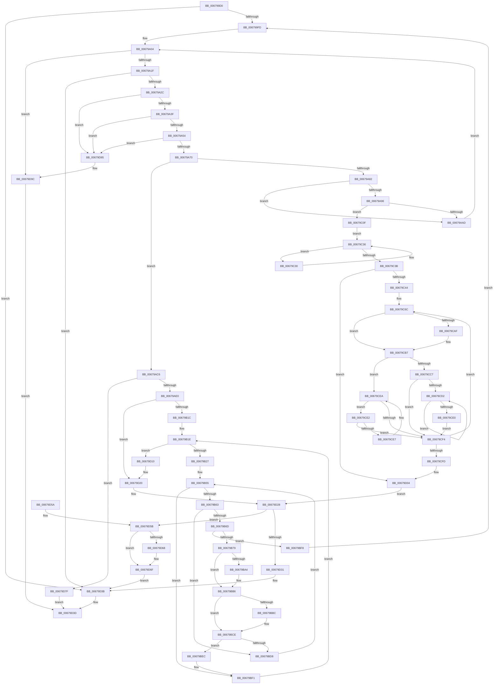

# MiGetListOfPendingBadPages

- RVA: `0x006799D0`–`0x00679DA3` (길이 `979` bytes)
- VA: `0x00000001406799D0`
- 실행 섹션: `.text`
- PDB 이름 있음: `예`; PDB Function 태그: `아니요`
- unwind 정보 RVA: `0x000D7DF4`
- 디코드: `246`개 명령, `979/979` bytes 표시
- 미해석 바이트: `0` (있으면 어셈블리에 `.byte`로 보존)

> 이 문서는 커널 이미지의 기계어와 PDB 기호를 분석해 생성했습니다. 4번과 5번은 함수 원형과 자료형을 바이너리 사용 방식에서 추정한 C 해석이며 원본 소스 복구 결과는 아닙니다.

## 1. Dependencies

- 직접 호출 지점: **18**; 고유 호출 대상: **10**
- 직접 호출자로 확인된 함수: **2**
- RIP 상대 이미지 참조: **6**

### Outgoing calls
- `0x00679A5F` → [MiAllocatePool](../35/MiAllocatePool_function_0035B540.md) (function, `0x0035B540`)
- `0x00679A85` → [ExAcquireSpinLockShared](../24/ExAcquireSpinLockShared_function_0024DCE0.md) (function, `0x0024DCE0`)
- `0x00679AB2` → [MiReleaseSpinLockShared](../34/MiReleaseSpinLockShared_function_00348BF0.md) (function, `0x00348BF0`)
- `0x00679ABC` → [ExFreePoolWithTag](../../poolcode/B8/ExFreePoolWithTag_function_00B82870.md) (function, `0x00B82870`)
- `0x00679ACF` → [MiReferencePageRuns](../37/MiReferencePageRuns_function_00379540.md) (function, `0x00379540`)
- `0x00679AE3` → [ExAcquireSpinLockShared](../24/ExAcquireSpinLockShared_function_0024DCE0.md) (function, `0x0024DCE0`)
- `0x00679AF6` → [MiEnumerateBadHugeRangePages](MiEnumerateBadHugeRangePages_function_006754E0.md) (function, `0x006754E0`)
- `0x00679B03` → [MiReleaseSpinLockShared](../34/MiReleaseSpinLockShared_function_00348BF0.md) (function, `0x00348BF0`)
- `0x00679B70` → [MiCheckLostBadPageNode](MiCheckLostBadPageNode_function_00679550.md) (function, `0x00679550`)
- `0x00679B9B` → [MiIsPageOnBadList](../2B/MiIsPageOnBadList_function_002B1018.md) (function, `0x002B1018`)
- `0x00679BFD` → [ExFreePoolWithTag](../../poolcode/B8/ExFreePoolWithTag_function_00B82870.md) (function, `0x00B82870`)
- `0x00679C05` → [MiDereferencePageRuns](../3B/MiDereferencePageRuns_function_003BD388.md) (function, `0x003BD388`)
- `0x00679C1B` → [MiEnumerateBadHugeRangePages](MiEnumerateBadHugeRangePages_function_006754E0.md) (function, `0x006754E0`)
- `0x00679D09` → [MiReleaseSpinLockShared](../34/MiReleaseSpinLockShared_function_00348BF0.md) (function, `0x00348BF0`)
- `0x00679D17` → [MiSortPageFramesRemoveDuplicates](MiSortPageFramesRemoveDuplicates_function_0067A67C.md) (function, `0x0067A67C`)
- `0x00679D23` → [MiDereferencePageRuns](../3B/MiDereferencePageRuns_function_003BD388.md) (function, `0x003BD388`)
- `0x00679D36` → [ExFreePoolWithTag](../../poolcode/B8/ExFreePoolWithTag_function_00B82870.md) (function, `0x00B82870`)
- `0x00679D8B` → [ExFreePoolWithTag](../../poolcode/B8/ExFreePoolWithTag_function_00B82870.md) (function, `0x00B82870`)

### Direct callers
- [MmEnumerateBadPages](../../page/7F/MmEnumerateBadPages_function_007FDE28.md) at `0x007FDF22`
- [MmQueryBadAddresses](../../page/AD/MmQueryBadAddresses_function_00AD5430.md) at `0x00AD54B5`

### Static image references
- `0x006799EC` → RVA `0x00E2FFC8` (`.data`; read)
- `0x006799FD` → RVA `0x00E2FFD0` (`.data`; read)
- `0x00679A0B` → RVA `0x00E30028` (`.data`; read)
- `0x00679A78` → RVA `0x00E2FFD8` (`.data`; read)
- `0x00679AC8` → RVA `0x00E38D00` (`.data`; read)
- `0x00679C24` → RVA `0x00E2FFC0` (`.data`; read)

## 2. Other-region calls and transfers

- 다른 실행 섹션으로 향하는 call: **4**
  - `0x00679ABC` → [ExFreePoolWithTag](../../poolcode/B8/ExFreePoolWithTag_function_00B82870.md) (`.text` → `POOLCODE`)
  - `0x00679BFD` → [ExFreePoolWithTag](../../poolcode/B8/ExFreePoolWithTag_function_00B82870.md) (`.text` → `POOLCODE`)
  - `0x00679D36` → [ExFreePoolWithTag](../../poolcode/B8/ExFreePoolWithTag_function_00B82870.md) (`.text` → `POOLCODE`)
  - `0x00679D8B` → [ExFreePoolWithTag](../../poolcode/B8/ExFreePoolWithTag_function_00B82870.md) (`.text` → `POOLCODE`)
- 별도 외부 분기/꼬리 이동을 확인하지 못했습니다.

## 3. Assembly (complete function range)

```asm
006799D0  48 89 5C 24 08                  mov qword ptr [rsp + 8], rbx
006799D5  48 89 6C 24 18                  mov qword ptr [rsp + 0x18], rbp
006799DA  48 89 74 24 20                  mov qword ptr [rsp + 0x20], rsi
006799DF  57                              push rdi
006799E0  41 54                           push r12
006799E2  41 55                           push r13
006799E4  41 56                           push r14
006799E6  41 57                           push r15
006799E8  48 83 EC 20                     sub rsp, 0x20
006799EC  48 83 3D D4 65 7B 00 00         cmp qword ptr [rip + 0x7b65d4], 0
006799F4  48 8B E9                        mov rbp, rcx
006799F7  0F 84 3E 03 00 00               je 0x140679d3b
006799FD  4C 8D 2D CC 65 7B 00            lea r13, [rip + 0x7b65cc]
00679A04  48 8B 0D BD 65 7B 00            mov rcx, qword ptr [rip + 0x7b65bd]
00679A0B  48 8B 15 16 66 7B 00            mov rdx, qword ptr [rip + 0x7b6616]
00679A12  48 8D 04 11                     lea rax, [rcx + rdx]
00679A16  48 3B C1                        cmp rax, rcx
00679A19  0F 82 7D 03 00 00               jb 0x140679d9c
00679A1F  4C 8D 24 0A                     lea r12, [rdx + rcx]
00679A23  4D 85 E4                        test r12, r12
00679A26  0F 84 0F 03 00 00               je 0x140679d3b
00679A2C  48 B8 FF FF FF FF FF FF FF 1F   movabs rax, 0x1fffffffffffffff
00679A36  4C 3B E0                        cmp r12, rax
00679A39  0F 87 56 03 00 00               ja 0x140679d95
00679A3F  4A 8D 04 E5 00 00 00 00         lea rax, [r12*8]
00679A47  48 8D 50 20                     lea rdx, [rax + 0x20]
00679A4B  48 3B D0                        cmp rdx, rax
00679A4E  0F 86 41 03 00 00               jbe 0x140679d95
00679A54  B9 40 00 00 00                  mov ecx, 0x40
00679A59  41 B8 4D 6D 42 61               mov r8d, 0x61426d4d
00679A5F  E8 DC 1A CE FF                  call 0x14035b540
00679A64  48 8B F0                        mov rsi, rax
00679A67  48 85 C0                        test rax, rax
00679A6A  0F 84 25 03 00 00               je 0x140679d95
00679A70  4C 8D 70 20                     lea r14, [rax + 0x20]
00679A74  4C 89 70 18                     mov qword ptr [rax + 0x18], r14
00679A78  48 83 3D 58 65 7B 00 00         cmp qword ptr [rip + 0x7b6558], 0
00679A80  75 44                           jne 0x140679ac6
00679A82  49 8B CD                        mov rcx, r13
00679A85  E8 56 42 BD FF                  call 0x14024dce0
00679A8A  48 83 3D 46 65 7B 00 00         cmp qword ptr [rip + 0x7b6546], 0
00679A92  8A D8                           mov bl, al
00679A94  75 17                           jne 0x140679aad
00679A96  48 8B 15 2B 65 7B 00            mov rdx, qword ptr [rip + 0x7b652b]
00679A9D  48 03 15 84 65 7B 00            add rdx, qword ptr [rip + 0x7b6584]
00679AA4  4C 3B E2                        cmp r12, rdx
00679AA7  0F 83 62 01 00 00               jae 0x140679c0f
00679AAD  8A D3                           mov dl, bl
00679AAF  49 8B CD                        mov rcx, r13
00679AB2  E8 39 F1 CC FF                  call 0x140348bf0
00679AB7  33 D2                           xor edx, edx
00679AB9  48 8B CE                        mov rcx, rsi
00679ABC  E8 AF 8D 50 00                  call 0x140b82870
00679AC1  E9 3E FF FF FF                  jmp 0x140679a04
00679AC6  33 D2                           xor edx, edx
00679AC8  48 8D 0D 31 F2 7B 00            lea rcx, [rip + 0x7bf231]
00679ACF  E8 6C FA CF FF                  call 0x140379540
00679AD4  4C 8B F8                        mov r15, rax
00679AD7  48 85 C0                        test rax, rax
00679ADA  0F 84 9F 02 00 00               je 0x140679d7f
00679AE0  49 8B CD                        mov rcx, r13
00679AE3  E8 F8 41 BD FF                  call 0x14024dce0
00679AE8  41 B8 02 00 00 00               mov r8d, 2
00679AEE  49 8B D4                        mov rdx, r12
00679AF1  49 8B CE                        mov rcx, r14
00679AF4  8A D8                           mov bl, al
00679AF6  E8 E5 B9 FF FF                  call 0x1406754e0
00679AFB  8A D3                           mov dl, bl
00679AFD  49 8B CD                        mov rcx, r13
00679B00  48 8B F8                        mov rdi, rax
00679B03  E8 E8 F0 CC FF                  call 0x140348bf0
00679B08  48 8B 46 10                     mov rax, qword ptr [rsi + 0x10]
00679B0C  48 03 C7                        add rax, rdi
00679B0F  48 89 46 10                     mov qword ptr [rsi + 0x10], rax
00679B13  49 3B C4                        cmp rax, r12
00679B16  0F 84 04 02 00 00               je 0x140679d20
00679B1C  33 FF                           xor edi, edi
00679B1E  41 3B 3F                        cmp edi, dword ptr [r15]
00679B21  0F 83 E9 01 00 00               jae 0x140679d10
00679B27  8B CF                           mov ecx, edi
00679B29  48 03 C9                        add rcx, rcx
00679B2C  48 B8 00 00 00 00 00 DE FF FF   movabs rax, 0xffffde0000000000
00679B36  4D 8B 6C CF 10                  mov r13, qword ptr [r15 + rcx*8 + 0x10]
00679B3B  4A 8D 1C 6D 00 00 00 00         lea rbx, [r13*2]
00679B43  49 03 DD                        add rbx, r13
00679B46  48 C1 E3 04                     shl rbx, 4
00679B4A  48 8B C0                        mov rax, rax
00679B4D  48 03 D8                        add rbx, rax
00679B50  49 8B 44 CF 18                  mov rax, qword ptr [r15 + rcx*8 + 0x18]
00679B55  48 89 44 24 58                  mov qword ptr [rsp + 0x58], rax
00679B5A  48 85 C0                        test rax, rax
00679B5D  0F 84 8E 00 00 00               je 0x140679bf1
00679B63  8B 43 20                        mov eax, dword ptr [rbx + 0x20]
00679B66  C1 E8 18                        shr eax, 0x18
00679B69  A8 40                           test al, 0x40
00679B6B  74 6B                           je 0x140679bd8
00679B6D  48 8B CB                        mov rcx, rbx
00679B70  E8 DB F9 FF FF                  call 0x140679550
00679B75  84 C0                           test al, al
00679B77  75 7F                           jne 0x140679bf8
00679B79  48 8B 4E 10                     mov rcx, qword ptr [rsi + 0x10]
00679B7D  49 8B C5                        mov rax, r13
00679B80  48 BA 00 00 00 00 00 00 F0 FF   movabs rdx, 0xfff0000000000000
00679B8A  49 33 04 CE                     xor rax, qword ptr [r14 + rcx*8]
00679B8E  48 23 C2                        and rax, rdx
00679B91  49 33 C5                        xor rax, r13
00679B94  49 89 04 CE                     mov qword ptr [r14 + rcx*8], rax
00679B98  48 8B CB                        mov rcx, rbx
00679B9B  E8 78 74 C3 FF                  call 0x1402b1018
00679BA0  85 C0                           test eax, eax
00679BA2  75 12                           jne 0x140679bb6
00679BA4  48 8B 46 10                     mov rax, qword ptr [rsi + 0x10]
00679BA8  48 B9 00 00 00 00 00 00 00 40   movabs rcx, 0x4000000000000000
00679BB2  49 09 0C C6                     or qword ptr [r14 + rax*8], rcx
00679BB6  80 7B 23 00                     cmp byte ptr [rbx + 0x23], 0
00679BBA  7D 12                           jge 0x140679bce
00679BBC  48 8B 46 10                     mov rax, qword ptr [rsi + 0x10]
00679BC0  48 B9 00 00 00 00 00 00 00 80   movabs rcx, 0x8000000000000000
00679BCA  49 09 0C C6                     or qword ptr [r14 + rax*8], rcx
00679BCE  48 FF 46 10                     inc qword ptr [rsi + 0x10]
00679BD2  4C 39 66 10                     cmp qword ptr [rsi + 0x10], r12
00679BD6  74 14                           je 0x140679bec
00679BD8  48 8B 44 24 58                  mov rax, qword ptr [rsp + 0x58]
00679BDD  49 FF C5                        inc r13
00679BE0  48 FF C8                        dec rax
00679BE3  48 83 C3 30                     add rbx, 0x30
00679BE7  E9 69 FF FF FF                  jmp 0x140679b55
00679BEC  41 8B 3F                        mov edi, dword ptr [r15]
00679BEF  FF CF                           dec edi
00679BF1  FF C7                           inc edi
00679BF3  E9 26 FF FF FF                  jmp 0x140679b1e
00679BF8  33 D2                           xor edx, edx
00679BFA  48 8B CE                        mov rcx, rsi
00679BFD  E8 6E 8C 50 00                  call 0x140b82870
00679C02  49 8B CF                        mov rcx, r15
00679C05  E8 7E 37 D4 FF                  call 0x1403bd388
00679C0A  E9 EE FD FF FF                  jmp 0x1406799fd
00679C0F  41 B8 02 00 00 00               mov r8d, 2
00679C15  49 8B D4                        mov rdx, r12
00679C18  49 8B CE                        mov rcx, r14
00679C1B  E8 C0 B8 FF FF                  call 0x1406754e0
00679C20  48 01 46 10                     add qword ptr [rsi + 0x10], rax
00679C24  48 8B 05 95 63 7B 00            mov rax, qword ptr [rip + 0x7b6395]
00679C2B  45 33 C9                        xor r9d, r9d
00679C2E  EB 06                           jmp 0x140679c36
00679C30  4C 8B C8                        mov r9, rax
00679C33  48 8B 00                        mov rax, qword ptr [rax]
00679C36  48 85 C0                        test rax, rax
00679C39  75 F5                           jne 0x140679c30
00679C3B  4D 85 C9                        test r9, r9
00679C3E  0F 84 C0 00 00 00               je 0x140679d04
00679C44  48 BF 00 00 00 00 00 00 00 80   movabs rdi, 0x8000000000000000
00679C4E  49 BD 00 00 00 00 00 DE FF FF   movabs r13, 0xffffde0000000000
00679C58  49 BF 00 00 00 00 00 00 00 40   movabs r15, 0x4000000000000000
00679C62  49 BA 00 00 00 00 00 00 F0 FF   movabs r10, 0xfff0000000000000
00679C6C  4D 8B 41 18                     mov r8, qword ptr [r9 + 0x18]
00679C70  48 8B 56 10                     mov rdx, qword ptr [rsi + 0x10]
00679C74  49 8B C5                        mov rax, r13
00679C77  49 8B C8                        mov rcx, r8
00679C7A  48 2B C8                        sub rcx, rax
00679C7D  48 B8 AB AA AA AA AA AA AA AA   movabs rax, 0xaaaaaaaaaaaaaaab
00679C87  48 C1 F9 04                     sar rcx, 4
00679C8B  48 0F AF C8                     imul rcx, rax
00679C8F  48 8B C1                        mov rax, rcx
00679C92  49 33 04 D6                     xor rax, qword ptr [r14 + rdx*8]
00679C96  49 23 C2                        and rax, r10
00679C99  48 33 C1                        xor rax, rcx
00679C9C  49 89 04 D6                     mov qword ptr [r14 + rdx*8], rax
00679CA0  48 8B 46 10                     mov rax, qword ptr [rsi + 0x10]
00679CA4  4D 09 3C C6                     or qword ptr [r14 + rax*8], r15
00679CA8  41 80 78 23 00                  cmp byte ptr [r8 + 0x23], 0
00679CAD  7D 08                           jge 0x140679cb7
00679CAF  48 8B 46 10                     mov rax, qword ptr [rsi + 0x10]
00679CB3  49 09 3C C6                     or qword ptr [r14 + rax*8], rdi
00679CB7  48 FF 46 10                     inc qword ptr [rsi + 0x10]
00679CBB  49 8B C9                        mov rcx, r9
00679CBE  49 8B 41 08                     mov rax, qword ptr [r9 + 8]
00679CC2  48 85 C0                        test rax, rax
00679CC5  74 23                           je 0x140679cea
00679CC7  48 8B 08                        mov rcx, qword ptr [rax]
00679CCA  4C 8B C8                        mov r9, rax
00679CCD  48 85 C9                        test rcx, rcx
00679CD0  74 22                           je 0x140679cf4
00679CD2  48 8B 01                        mov rax, qword ptr [rcx]
00679CD5  4C 8B C9                        mov r9, rcx
00679CD8  48 8B C8                        mov rcx, rax
00679CDB  48 85 C0                        test rax, rax
00679CDE  75 F2                           jne 0x140679cd2
00679CE0  EB 12                           jmp 0x140679cf4
00679CE2  49 39 09                        cmp qword ptr [r9], rcx
00679CE5  74 0D                           je 0x140679cf4
00679CE7  49 8B C9                        mov rcx, r9
00679CEA  4D 8B 49 10                     mov r9, qword ptr [r9 + 0x10]
00679CEE  49 83 E1 FC                     and r9, 0xfffffffffffffffc
00679CF2  75 EE                           jne 0x140679ce2
00679CF4  4D 85 C9                        test r9, r9
00679CF7  0F 85 6F FF FF FF               jne 0x140679c6c
00679CFD  4C 8D 2D CC 62 7B 00            lea r13, [rip + 0x7b62cc]
00679D04  8A D3                           mov dl, bl
00679D06  49 8B CD                        mov rcx, r13
00679D09  E8 E2 EE CC FF                  call 0x140348bf0
00679D0E  EB 18                           jmp 0x140679d28
00679D10  48 8B 56 10                     mov rdx, qword ptr [rsi + 0x10]
00679D14  49 8B CE                        mov rcx, r14
00679D17  E8 60 09 00 00                  call 0x14067a67c
00679D1C  48 89 46 10                     mov qword ptr [rsi + 0x10], rax
00679D20  49 8B CF                        mov rcx, r15
00679D23  E8 60 36 D4 FF                  call 0x1403bd388
00679D28  48 8B 46 10                     mov rax, qword ptr [rsi + 0x10]
00679D2C  48 85 C0                        test rax, rax
00679D2F  75 2A                           jne 0x140679d5b
00679D31  33 D2                           xor edx, edx
00679D33  48 8B CE                        mov rcx, rsi
00679D36  E8 35 8B 50 00                  call 0x140b82870
00679D3B  33 C0                           xor eax, eax
00679D3D  48 8B 5C 24 50                  mov rbx, qword ptr [rsp + 0x50]
00679D42  48 8B 6C 24 60                  mov rbp, qword ptr [rsp + 0x60]
00679D47  48 8B 74 24 68                  mov rsi, qword ptr [rsp + 0x68]
00679D4C  48 83 C4 20                     add rsp, 0x20
00679D50  41 5F                           pop r15
00679D52  41 5E                           pop r14
00679D54  41 5D                           pop r13
00679D56  41 5C                           pop r12
00679D58  5F                              pop rdi
00679D59  C3                              ret
00679D5A  CC                              int3
00679D5B  48 01 45 18                     add qword ptr [rbp + 0x18], rax
00679D5F  48 8B 45 08                     mov rax, qword ptr [rbp + 8]
00679D63  48 39 28                        cmp qword ptr [rax], rbp
00679D66  74 07                           je 0x140679d6f
00679D68  B9 03 00 00 00                  mov ecx, 3
00679D6D  CD 29                           int 0x29
00679D6F  48 89 2E                        mov qword ptr [rsi], rbp
00679D72  48 89 46 08                     mov qword ptr [rsi + 8], rax
00679D76  48 89 30                        mov qword ptr [rax], rsi
00679D79  48 89 75 08                     mov qword ptr [rbp + 8], rsi
00679D7D  EB BC                           jmp 0x140679d3b
00679D7F  33 D2                           xor edx, edx
00679D81  C7 45 10 9A 00 00 C0            mov dword ptr [rbp + 0x10], 0xc000009a
00679D88  48 8B CE                        mov rcx, rsi
00679D8B  E8 E0 8A 50 00                  call 0x140b82870
00679D90  8B 45 10                        mov eax, dword ptr [rbp + 0x10]
00679D93  EB A8                           jmp 0x140679d3d
00679D95  C7 45 10 9A 00 00 C0            mov dword ptr [rbp + 0x10], 0xc000009a
00679D9C  B8 9A 00 00 C0                  mov eax, 0xc000009a
00679DA1  EB 9A                           jmp 0x140679d3d
```

## 4. C-style interpretation (structured pseudocode)

```c
__int64 __fastcall MiGetListOfPendingBadPages(__int64 a1, __int64 a2, __int64 a3, int a4)
{
    __int64 result;
    __int64 v_r13;
    __int64 v_rbx;
    __int64 v_rdi;
    __int64 v_rsp;
    unsigned __int64 v_stack_p10;
    unsigned __int64 v_stack_p18;
    unsigned __int64 v_stack_p20;
    unsigned __int64 v_stack_p8;

    v_stack_p8 = v_rbx;
    v_stack_p18 = v_rbp;
    v_stack_p20 = v_rsi;
    v_rsp = (v_rsp) - (32);
    if ((*(unsigned __int64 *)(v_rip + 8086996)) == 0) goto loc_00679D3B;
loc_006799FD:
loc_00679A04:
    if ((*(unsigned __int64 *)(v_rip + 8086973) + *(unsigned __int64 *)(v_rip + 8087062) * 1) < (*(unsigned __int64 *)(v_rip + 8086973))) goto loc_00679D9C;
    if (*(unsigned __int64 *)(v_rip + 8087062) + *(unsigned __int64 *)(v_rip + 8086973) * 1 == 0) goto loc_00679D3B;
    if ((*(unsigned __int64 *)(v_rip + 8087062) + *(unsigned __int64 *)(v_rip + 8086973) * 1) > (*(unsigned __int64 *)(v_rip + 8086973) + *(unsigned __int64 *)(v_rip + 8087062) * 1)) goto loc_00679D95;
    if ((*(unsigned __int64 *)(v_rip + 8087062) + *(unsigned __int64 *)(v_rip + 8086973) * 1 * 8 + 32) <= (*(unsigned __int64 *)(v_rip + 8087062) + *(unsigned __int64 *)(v_rip + 8086973) * 1 * 8)) goto loc_00679D95;
    result = MiAllocatePool(64, *(unsigned __int64 *)(v_rip + 8087062) + *(unsigned __int64 *)(v_rip + 8086973) * 1 * 8 + 32, (unsigned int)(0x61426D4DULL), a4);
    if (result == 0) goto loc_00679D95;
    *(unsigned __int64 *)(result + 24) = result + 32;
    if ((*(unsigned __int64 *)(v_rip + 8086872)) != 0) goto loc_00679AC6;
    result = ExAcquireSpinLockShared(v_rip + 8086988, *(unsigned __int64 *)(v_rip + 8087062) + *(unsigned __int64 *)(v_rip + 8086973) * 1 * 8 + 32, (unsigned int)(0x61426D4DULL), a4);
    if ((*(unsigned __int64 *)(v_rip + 8086854)) != 0) goto loc_00679AAD;
    a2 = (*(unsigned __int64 *)(v_rip + 8086827)) + (*(unsigned __int64 *)(v_rip + 8086916));
    if ((*(unsigned __int64 *)(v_rip + 8087062) + *(unsigned __int64 *)(v_rip + 8086973) * 1) >= a2) goto loc_00679C0F;
loc_00679AAD:
    result = MiReleaseSpinLockShared(v_rip + 8086988, (unsigned __int8)((unsigned __int8)(result)), (unsigned int)(0x61426D4DULL), a4);
    a2 = 0;
    result = ExFreePoolWithTag(result, a2, (unsigned int)(0x61426D4DULL), a4);
    goto loc_00679A04;
loc_00679AC6:
    a2 = 0;
    result = MiReferencePageRuns(v_rip + 8122929, a2, (unsigned int)(0x61426D4DULL), a4);
    if (result == 0) goto loc_00679D7F;
    result = ExAcquireSpinLockShared(v_rip + 8086988, a2, (unsigned int)(0x61426D4DULL), a4);
    result = MiEnumerateBadHugeRangePages(result + 32, *(unsigned __int64 *)(v_rip + 8087062) + *(unsigned __int64 *)(v_rip + 8086973) * 1, 2, a4);
    result = MiReleaseSpinLockShared(v_rip + 8086988, (unsigned __int8)((unsigned __int8)(result)), 2, a4);
    result = (*(unsigned __int64 *)(result + 16)) + (result);
    *(unsigned __int64 *)(result + 16) = result;
    if (result == (*(unsigned __int64 *)(v_rip + 8087062) + *(unsigned __int64 *)(v_rip + 8086973) * 1)) goto loc_00679D20;
    v_rdi = 0;
loc_00679B1E:
    if (0 >= (*(unsigned int *)(result))) goto loc_00679D10;
    a1 = (0) + (0);
    v_rbx = (*(unsigned __int64 *)(result + a1 * 8 + 16) * 2) + (*(unsigned __int64 *)(result + a1 * 8 + 16));
    v_rbx = (v_rbx) << (4);
    v_rbx = (v_rbx) + (result);
loc_00679B55:
    v_stack_p10 = *(unsigned __int64 *)(result + a1 * 8 + 24);
    if (*(unsigned __int64 *)(result + a1 * 8 + 24) == 0) goto loc_00679BF1;
    result = (unsigned int)(((unsigned int)(*(unsigned int *)(v_rbx + 32))) >> (24));
    if ((((unsigned __int8)(result)) & (64)) == 0) goto loc_00679BD8;
    result = MiCheckLostBadPageNode(v_rbx, (unsigned __int8)((unsigned __int8)(result)), 2, a4);
    if ((unsigned __int8)(result) != 0) goto loc_00679BF8;
    result = (*(unsigned __int64 *)(result + a1 * 8 + 16)) ^ (*(unsigned __int64 *)(result + 32 + *(unsigned __int64 *)(result + 16) * 8));
    result = (result) & ((unsigned __int8)((unsigned __int8)(result)));
    result = (result) ^ (*(unsigned __int64 *)(result + a1 * 8 + 16));
    *(unsigned __int64 *)(result + 32 + *(unsigned __int64 *)(result + 16) * 8) = result;
    result = MiIsPageOnBadList(v_rbx, (unsigned __int8)((unsigned __int8)(result)), 2, a4);
    if ((unsigned int)(result) == 0) {
        result = *(unsigned __int64 *)(result + 16);
    }
    if ((*(unsigned __int8 *)(v_rbx + 35)) < 0) {
        result = *(unsigned __int64 *)(result + 16);
    }
    if ((*(unsigned __int64 *)(result + 16)) == (*(unsigned __int64 *)(v_rip + 8087062) + *(unsigned __int64 *)(v_rip + 8086973) * 1)) goto loc_00679BEC;
loc_00679BD8:
    v_r13 = (*(unsigned __int64 *)(result + a1 * 8 + 16)) + 1;
    result = (v_stack_p10) - 1;
    v_rbx = (v_rbx) + (48);
    goto loc_00679B55;
loc_00679BEC:
    v_rdi = (unsigned int)(((unsigned int)(*(unsigned int *)(result))) - 1);
loc_00679BF1:
    v_rdi = (unsigned int)((v_rdi) + 1);
    goto loc_00679B1E;
loc_00679BF8:
    a2 = 0;
    result = ExFreePoolWithTag(result, a2, 2, a4);
    result = MiDereferencePageRuns(result, a2, 2, a4);
    goto loc_006799FD;
loc_00679C0F:
    result = MiEnumerateBadHugeRangePages(result + 32, *(unsigned __int64 *)(v_rip + 8087062) + *(unsigned __int64 *)(v_rip + 8086973) * 1, 2, a4);
    a4 = 0;
    goto loc_00679C36;
loc_00679C30:
loc_00679C36:
    if (*(unsigned __int64 *)(*(unsigned __int64 *)(v_rip + 8086421)) != 0) goto loc_00679C30;
    if (*(unsigned __int64 *)(v_rip + 8086421) == 0) goto loc_00679D04;
loc_00679C6C:
    a1 = (*(unsigned __int64 *)(*(unsigned __int64 *)(v_rip + 8086421) + 24)) - (v_r13);
    a1 = (a1) >> (4);
    a1 = (a1) * (v_r13);
    result = (a1) ^ (*(unsigned __int64 *)(result + 32 + *(unsigned __int64 *)(result + 16) * 8));
    result = (result) & (v_r10);
    result = (result) ^ (a1);
    *(unsigned __int64 *)(result + 32 + *(unsigned __int64 *)(result + 16) * 8) = result;
    result = *(unsigned __int64 *)(result + 16);
    if ((*(unsigned __int8 *)(*(unsigned __int64 *)(*(unsigned __int64 *)(v_rip + 8086421) + 24) + 35)) < 0) {
        result = *(unsigned __int64 *)(result + 16);
    }
    if (*(unsigned __int64 *)(*(unsigned __int64 *)(v_rip + 8086421) + 8) == 0) goto loc_00679CEA;
    if (*(unsigned __int64 *)(*(unsigned __int64 *)(*(unsigned __int64 *)(v_rip + 8086421) + 8)) == 0) goto loc_00679CF4;
loc_00679CD2:
    if (*(unsigned __int64 *)(*(unsigned __int64 *)(*(unsigned __int64 *)(*(unsigned __int64 *)(v_rip + 8086421) + 8))) != 0) goto loc_00679CD2;
    goto loc_00679CF4;
loc_00679CE2:
    if ((*(unsigned __int64 *)(*(unsigned __int64 *)(*(unsigned __int64 *)(*(unsigned __int64 *)(v_rip + 8086421) + 8)))) == (*(unsigned __int64 *)(*(unsigned __int64 *)(*(unsigned __int64 *)(*(unsigned __int64 *)(v_rip + 8086421) + 8))))) goto loc_00679CF4;
loc_00679CEA:
    a4 = (*(unsigned __int64 *)(*(unsigned __int64 *)(*(unsigned __int64 *)(*(unsigned __int64 *)(v_rip + 8086421) + 8)) + 16)) & (-4);
    if (condition_is_not_equal) goto loc_00679CE2;
loc_00679CF4:
    if (a4 != 0) goto loc_00679C6C;
loc_00679D04:
    result = MiReleaseSpinLockShared(v_rip + 8086220, (unsigned __int8)(v_rbx), *(unsigned __int64 *)(*(unsigned __int64 *)(v_rip + 8086421) + 24), a4);
    goto loc_00679D28;
loc_00679D10:
    result = MiSortPageFramesRemoveDuplicates(result + 32, *(unsigned __int64 *)(result + 16), *(unsigned __int64 *)(*(unsigned __int64 *)(v_rip + 8086421) + 24), a4);
    *(unsigned __int64 *)(result + 16) = result;
loc_00679D20:
    result = MiDereferencePageRuns(result, *(unsigned __int64 *)(result + 16), *(unsigned __int64 *)(*(unsigned __int64 *)(v_rip + 8086421) + 24), a4);
loc_00679D28:
    if (*(unsigned __int64 *)(result + 16) != 0) goto loc_00679D5B;
    a2 = 0;
    result = ExFreePoolWithTag(result, a2, *(unsigned __int64 *)(*(unsigned __int64 *)(v_rip + 8086421) + 24), a4);
loc_00679D3B:
    result = 0;
loc_00679D3D:
    v_rsp = (v_rsp) + (32);
    return result;
loc_00679D5B:
    if ((*(unsigned __int64 *)(*(unsigned __int64 *)(v_stack_p18 + 8))) != v_stack_p18) {
        a1 = 3;
    }
    *(unsigned __int64 *)(v_stack_p20) = v_stack_p18;
    *(unsigned __int64 *)(v_stack_p20 + 8) = *(unsigned __int64 *)(v_stack_p18 + 8);
    *(unsigned __int64 *)(*(unsigned __int64 *)(v_stack_p18 + 8)) = v_stack_p20;
    *(unsigned __int64 *)(v_stack_p18 + 8) = v_stack_p20;
    goto loc_00679D3B;
loc_00679D7F:
    a2 = 0;
    *(unsigned int *)(v_stack_p18 + 16) = 0xC000009AULL;
    result = ExFreePoolWithTag(v_stack_p20, a2, *(unsigned __int64 *)(*(unsigned __int64 *)(v_rip + 8086421) + 24), a4);
    goto loc_00679D3D;
loc_00679D95:
    *(unsigned int *)(v_stack_p18 + 16) = 0xC000009AULL;
loc_00679D9C:
    goto loc_00679D3D;
}
```

## 5. (Beta) C Style

```c
int64_t MiGetListOfPendingBadPages(void *Arg1, int64_t Arg2, int64_t Arg3, int32_t Arg4)
{
    uint8_t *arg1 = (uint8_t *)Arg1;

    int64_t result;
    int64_t local_r13;
    int64_t local_rbx;
    int64_t local_rdi;
    int64_t local_rsp;
    uint64_t v_stack_p10;
    uint64_t v_stack_p18;
    uint64_t v_stack_p20;
    uint64_t v_stack_p8;

    v_stack_p8 = local_rbx;
    v_stack_p18 = local_rbp;
    v_stack_p20 = local_rsi;
    local_rsp = (local_rsp) - (32);
    if ((*(uint64_t *)(v_rip + 0x7B65D4)) == 0) goto loc_00679D3B;
loc_006799FD:
loc_00679A04:
    if ((*(uint64_t *)(v_rip + 0x7B65BD) + *(uint64_t *)(v_rip + 0x7B6616) * 1) < (*(uint64_t *)(v_rip + 0x7B65BD))) goto loc_00679D9C;
    if (*(uint64_t *)(v_rip + 0x7B6616) + *(uint64_t *)(v_rip + 0x7B65BD) * 1 == 0) goto loc_00679D3B;
    if ((*(uint64_t *)(v_rip + 0x7B6616) + *(uint64_t *)(v_rip + 0x7B65BD) * 1) > (*(uint64_t *)(v_rip + 0x7B65BD) + *(uint64_t *)(v_rip + 0x7B6616) * 1)) goto loc_00679D95;
    if ((*(uint64_t *)(v_rip + 0x7B6616) + *(uint64_t *)(v_rip + 0x7B65BD) * 1 * 8 + 32) <= (*(uint64_t *)(v_rip + 0x7B6616) + *(uint64_t *)(v_rip + 0x7B65BD) * 1 * 8)) goto loc_00679D95;
    result = MiAllocatePool(64, *(uint64_t *)(v_rip + 0x7B6616) + *(uint64_t *)(v_rip + 0x7B65BD) * 1 * 8 + 32, (uint32_t)(0x61426D4DULL), Arg4);
    if (result == 0) goto loc_00679D95;
    *(uint64_t *)(result + 0x18) = result + 32;
    if ((*(uint64_t *)(v_rip + 0x7B6558)) != 0) goto loc_00679AC6;
    result = ExAcquireSpinLockShared(v_rip + 8086988, *(uint64_t *)(v_rip + 0x7B6616) + *(uint64_t *)(v_rip + 0x7B65BD) * 1 * 8 + 32, (uint32_t)(0x61426D4DULL), Arg4);
    if ((*(uint64_t *)(v_rip + 0x7B6546)) != 0) goto loc_00679AAD;
    Arg2 = (*(uint64_t *)(v_rip + 0x7B652B)) + (*(uint64_t *)(v_rip + 0x7B6584));
    if ((*(uint64_t *)(v_rip + 0x7B6616) + *(uint64_t *)(v_rip + 0x7B65BD) * 1) >= Arg2) goto loc_00679C0F;
loc_00679AAD:
    result = MiReleaseSpinLockShared(v_rip + 8086988, (uint8_t)((uint8_t)(result)), (uint32_t)(0x61426D4DULL), Arg4);
    Arg2 = 0;
    result = ExFreePoolWithTag(result, Arg2, (uint32_t)(0x61426D4DULL), Arg4);
    goto loc_00679A04;
loc_00679AC6:
    Arg2 = 0;
    result = MiReferencePageRuns(v_rip + 8122929, Arg2, (uint32_t)(0x61426D4DULL), Arg4);
    if (result == 0) goto loc_00679D7F;
    result = ExAcquireSpinLockShared(v_rip + 8086988, Arg2, (uint32_t)(0x61426D4DULL), Arg4);
    result = MiEnumerateBadHugeRangePages(result + 32, *(uint64_t *)(v_rip + 0x7B6616) + *(uint64_t *)(v_rip + 0x7B65BD) * 1, 2, Arg4);
    result = MiReleaseSpinLockShared(v_rip + 8086988, (uint8_t)((uint8_t)(result)), 2, Arg4);
    result = (*(uint64_t *)(result + 0x10)) + (result);
    *(uint64_t *)(result + 0x10) = result;
    if (result == (*(uint64_t *)(v_rip + 0x7B6616) + *(uint64_t *)(v_rip + 0x7B65BD) * 1)) goto loc_00679D20;
    local_rdi = 0;
loc_00679B1E:
    if (0 >= (*(uint32_t *)(result))) goto loc_00679D10;
    Arg1 = (0) + (0);
    local_rbx = (*(uint64_t *)(result + arg1 * 8 + 0x10) * 2) + (*(uint64_t *)(result + arg1 * 8 + 0x10));
    local_rbx = (local_rbx) << (4);
    local_rbx = (local_rbx) + (result);
loc_00679B55:
    v_stack_p10 = *(uint64_t *)(result + arg1 * 8 + 0x18);
    if (*(uint64_t *)(result + arg1 * 8 + 0x18) == 0) goto loc_00679BF1;
    result = (uint32_t)(((uint32_t)(*(uint32_t *)(local_rbx + 0x20))) >> (24));
    if ((((uint8_t)(result)) & (64)) == 0) goto loc_00679BD8;
    result = MiCheckLostBadPageNode(local_rbx, (uint8_t)((uint8_t)(result)), 2, Arg4);
    if ((uint8_t)(result) != 0) goto loc_00679BF8;
    result = (*(uint64_t *)(result + arg1 * 8 + 0x10)) ^ (*(uint64_t *)(result + 0x20 + *(uint64_t *)(result + 0x10) * 8));
    result = (result) & ((uint8_t)((uint8_t)(result)));
    result = (result) ^ (*(uint64_t *)(result + arg1 * 8 + 0x10));
    *(uint64_t *)(result + 0x20 + *(uint64_t *)(result + 0x10) * 8) = result;
    result = MiIsPageOnBadList(local_rbx, (uint8_t)((uint8_t)(result)), 2, Arg4);
    if ((uint32_t)(result) == 0) {
        result = *(uint64_t *)(result + 0x10);
    }
    if ((*(uint8_t *)(local_rbx + 0x23)) < 0) {
        result = *(uint64_t *)(result + 0x10);
    }
    if ((*(uint64_t *)(result + 0x10)) == (*(uint64_t *)(v_rip + 0x7B6616) + *(uint64_t *)(v_rip + 0x7B65BD) * 1)) goto loc_00679BEC;
loc_00679BD8:
    local_r13 = (*(uint64_t *)(result + arg1 * 8 + 0x10)) + 1;
    result = (v_stack_p10) - 1;
    local_rbx = (local_rbx) + (48);
    goto loc_00679B55;
loc_00679BEC:
    local_rdi = (uint32_t)(((uint32_t)(*(uint32_t *)(result))) - 1);
loc_00679BF1:
    local_rdi = (uint32_t)((local_rdi) + 1);
    goto loc_00679B1E;
loc_00679BF8:
    Arg2 = 0;
    result = ExFreePoolWithTag(result, Arg2, 2, Arg4);
    result = MiDereferencePageRuns(result, Arg2, 2, Arg4);
    goto loc_006799FD;
loc_00679C0F:
    result = MiEnumerateBadHugeRangePages(result + 32, *(uint64_t *)(v_rip + 0x7B6616) + *(uint64_t *)(v_rip + 0x7B65BD) * 1, 2, Arg4);
    Arg4 = 0;
    goto loc_00679C36;
loc_00679C30:
loc_00679C36:
    if (*(uint64_t *)(*(uint64_t *)(v_rip + 0x7B6395)) != 0) goto loc_00679C30;
    if (*(uint64_t *)(v_rip + 0x7B6395) == 0) goto loc_00679D04;
loc_00679C6C:
    Arg1 = (*(uint64_t *)(*(uint64_t *)(v_rip + 0x7B6395) + 0x18)) - (local_r13);
    Arg1 = (Arg1) >> (4);
    Arg1 = (Arg1) * (local_r13);
    result = (Arg1) ^ (*(uint64_t *)(result + 0x20 + *(uint64_t *)(result + 0x10) * 8));
    result = (result) & (local_r10);
    result = (result) ^ (Arg1);
    *(uint64_t *)(result + 0x20 + *(uint64_t *)(result + 0x10) * 8) = result;
    result = *(uint64_t *)(result + 0x10);
    if ((*(uint8_t *)(*(uint64_t *)(*(uint64_t *)(v_rip + 0x7B6395) + 0x18) + 0x23)) < 0) {
        result = *(uint64_t *)(result + 0x10);
    }
    if (*(uint64_t *)(*(uint64_t *)(v_rip + 0x7B6395) + 0x8) == 0) goto loc_00679CEA;
    if (*(uint64_t *)(*(uint64_t *)(*(uint64_t *)(v_rip + 0x7B6395) + 0x8)) == 0) goto loc_00679CF4;
loc_00679CD2:
    if (*(uint64_t *)(*(uint64_t *)(*(uint64_t *)(*(uint64_t *)(v_rip + 0x7B6395) + 0x8))) != 0) goto loc_00679CD2;
    goto loc_00679CF4;
loc_00679CE2:
    if ((*(uint64_t *)(*(uint64_t *)(*(uint64_t *)(*(uint64_t *)(v_rip + 0x7B6395) + 0x8)))) == (*(uint64_t *)(*(uint64_t *)(*(uint64_t *)(*(uint64_t *)(v_rip + 0x7B6395) + 0x8))))) goto loc_00679CF4;
loc_00679CEA:
    Arg4 = (*(uint64_t *)(*(uint64_t *)(*(uint64_t *)(*(uint64_t *)(v_rip + 0x7B6395) + 0x8)) + 0x10)) & (-4);
    if (condition_is_not_equal) goto loc_00679CE2;
loc_00679CF4:
    if (Arg4 != 0) goto loc_00679C6C;
loc_00679D04:
    result = MiReleaseSpinLockShared(v_rip + 8086220, (uint8_t)(local_rbx), *(uint64_t *)(*(uint64_t *)(v_rip + 0x7B6395) + 0x18), Arg4);
    goto loc_00679D28;
loc_00679D10:
    result = MiSortPageFramesRemoveDuplicates(result + 32, *(uint64_t *)(result + 0x10), *(uint64_t *)(*(uint64_t *)(v_rip + 0x7B6395) + 0x18), Arg4);
    *(uint64_t *)(result + 0x10) = result;
loc_00679D20:
    result = MiDereferencePageRuns(result, *(uint64_t *)(result + 0x10), *(uint64_t *)(*(uint64_t *)(v_rip + 0x7B6395) + 0x18), Arg4);
loc_00679D28:
    if (*(uint64_t *)(result + 0x10) != 0) goto loc_00679D5B;
    Arg2 = 0;
    result = ExFreePoolWithTag(result, Arg2, *(uint64_t *)(*(uint64_t *)(v_rip + 0x7B6395) + 0x18), Arg4);
loc_00679D3B:
    result = 0;
loc_00679D3D:
    local_rsp = (local_rsp) + (32);
    return result;
loc_00679D5B:
    if ((*(uint64_t *)(*(uint64_t *)(v_stack_p18 + 0x8))) != v_stack_p18) {
        Arg1 = 3;
    }
    *(uint64_t *)(v_stack_p20) = v_stack_p18;
    *(uint64_t *)(v_stack_p20 + 0x8) = *(uint64_t *)(v_stack_p18 + 0x8);
    *(uint64_t *)(*(uint64_t *)(v_stack_p18 + 0x8)) = v_stack_p20;
    *(uint64_t *)(v_stack_p18 + 0x8) = v_stack_p20;
    goto loc_00679D3B;
loc_00679D7F:
    Arg2 = 0;
    *(uint32_t *)(v_stack_p18 + 0x10) = 0xC000009AULL;
    result = ExFreePoolWithTag(v_stack_p20, Arg2, *(uint64_t *)(*(uint64_t *)(v_rip + 0x7B6395) + 0x18), Arg4);
    goto loc_00679D3D;
loc_00679D95:
    *(uint32_t *)(v_stack_p18 + 0x10) = 0xC000009AULL;
loc_00679D9C:
    goto loc_00679D3D;
}
```

### 관측된 메모리 오프셋

구조체 형식이 확인되지 않은 접근은 인자 기준의 오프셋으로만 기록했습니다.

| 기준 인자 | 오프셋 표현 | 폭 (bit) | 접근 |
|---|---:|---:|---|
| `Arg1` | `+ 0x8` | `64` | `R` |
| `Arg1` | `+ 0x8` | `64` | `W` |
| `Arg1` | `+ 0x10` | `32` | `R` |
| `Arg1` | `+ 0x10` | `32` | `W` |
| `Arg1` | `+ 0x18` | `64` | `R/W` |

## 6. Execution-region graph

[열기: 2D/3D 그래프와 함수 탐색 컨트롤 패널](../../../control-panel.html?section=text&rva=0x006799D0&view=graph)

- 2D 그래프는 위에서 아래로 흐르고, 3D 그래프는 빈 공간을 드래그해 회전합니다. Shift+드래그는 이동, 휠은 확대·축소, 함수 노드 선택은 대상 보고서 이동입니다.

### Static fallback


