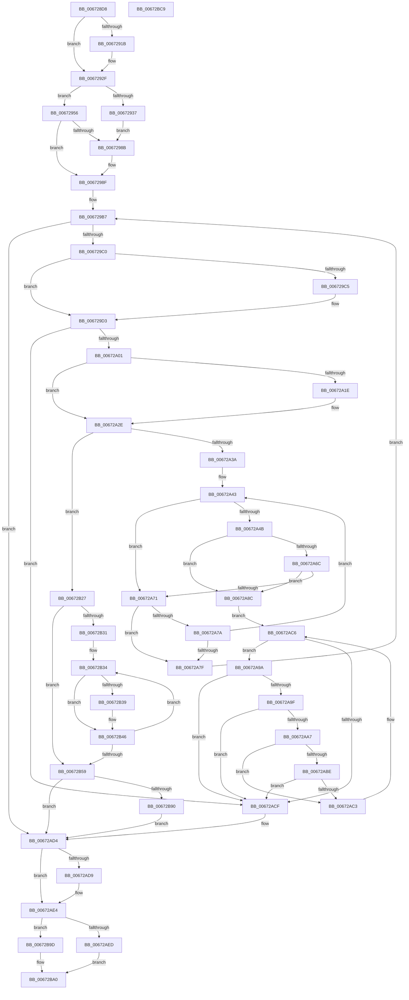

# MiGetNextNonGapPfnPage

- RVA: `0x006728D8`–`0x00672BCA` (길이 `754` bytes)
- VA: `0x00000001406728D8`
- 실행 섹션: `.text`
- PDB 이름 있음: `예`; PDB Function 태그: `아니요`
- unwind 정보 RVA: `0x000D7A30`
- 디코드: `206`개 명령, `754/754` bytes 표시
- 미해석 바이트: `0` (있으면 어셈블리에 `.byte`로 보존)

> 이 문서는 커널 이미지의 기계어와 PDB 기호를 분석해 생성했습니다. 4번과 5번은 함수 원형과 자료형을 바이너리 사용 방식에서 추정한 C 해석이며 원본 소스 복구 결과는 아닙니다.

## 1. Dependencies

- 직접 호출 지점: **6**; 고유 호출 대상: **4**
- 직접 호출자로 확인된 함수: **2**
- RIP 상대 이미지 참조: **4**

### Outgoing calls
- `0x006729A4` → [MiSystemVaTypeToVm](../28/MiSystemVaTypeToVm_function_0028EB50.md) (function, `0x0028EB50`)
- `0x006729CB` → [MiUnlockPageTable](../21/MiUnlockPageTable_function_00216EC0.md) (function, `0x00216EC0`)
- `0x006729F0` → [MiGetNextPageTable](../2C/MiGetNextPageTable_function_002C2EE0.md) (function, `0x002C2EE0`)
- `0x00672ADF` → [MiUnlockPageTable](../21/MiUnlockPageTable_function_00216EC0.md) (function, `0x00216EC0`)
- `0x00672B5D` → [MiGetLeafVa](../27/MiGetLeafVa_function_0027C0A0.md) (function, `0x0027C0A0`)
- `0x00672B68` → [MiGetLeafVa](../27/MiGetLeafVa_function_0027C0A0.md) (function, `0x0027C0A0`)

### Direct callers
- [MiFreedUnusedPfnPagesDpc](MiFreedUnusedPfnPagesDpc_function_00672378.md) at `0x006724DB`
- [MiGetFileOnlyRanges](MiGetFileOnlyRanges_function_00672684.md) at `0x00672705`

### Static image references
- `0x0067291B` → RVA `0x00FC6C38` (`ALMOSTRO`; read)
- `0x00672956` → RVA `0x00E2DCE0` (`.data`; read)
- `0x00672A4B` → RVA `0x00E37440` (`.data`; read)
- `0x00672A63` → RVA `0x00E37458` (`.data`; read)

## 2. Other-region calls and transfers

- 다른 실행 섹션으로 향하는 call: **0**
- 별도 외부 분기/꼬리 이동을 확인하지 못했습니다.

## 3. Assembly (complete function range)

```asm
006728D8  48 8B C4                        mov rax, rsp
006728DB  44 89 48 20                     mov dword ptr [rax + 0x20], r9d
006728DF  44 88 40 18                     mov byte ptr [rax + 0x18], r8b
006728E3  48 89 50 10                     mov qword ptr [rax + 0x10], rdx
006728E7  48 89 48 08                     mov qword ptr [rax + 8], rcx
006728EB  53                              push rbx
006728EC  56                              push rsi
006728ED  57                              push rdi
006728EE  41 54                           push r12
006728F0  41 55                           push r13
006728F2  41 56                           push r14
006728F4  41 57                           push r15
006728F6  48 83 EC 40                     sub rsp, 0x40
006728FA  48 8B 39                        mov rdi, qword ptr [rcx]
006728FD  33 DB                           xor ebx, ebx
006728FF  89 58 B8                        mov dword ptr [rax - 0x48], ebx
00672902  49 BA F8 FF FF FF 7F 00 00 00   movabs r10, 0x7ffffffff8
0067290C  49 BB 00 00 00 00 80 F6 FF FF   movabs r11, 0xfffff68000000000
00672916  48 85 FF                        test rdi, rdi
00672919  75 14                           jne 0x14067292f
0067291B  48 8B 3D 16 43 95 00            mov rdi, qword ptr [rip + 0x954316]
00672922  48 C1 EF 09                     shr rdi, 9
00672926  49 23 FA                        and rdi, r10
00672929  49 8B C3                        mov rax, r11
0067292C  48 03 F8                        add rdi, rax
0067292F  48 8B 02                        mov rax, qword ptr [rdx]
00672932  48 85 C0                        test rax, rax
00672935  74 1F                           je 0x140672956
00672937  48 C1 E8 0C                     shr rax, 0xc
0067293B  48 8D 34 C7                     lea rsi, [rdi + rax*8]
0067293F  4C 8B EE                        mov r13, rsi
00672942  49 C1 E5 19                     shl r13, 0x19
00672946  49 8B C3                        mov rax, r11
00672949  48 C1 E0 19                     shl rax, 0x19
0067294D  4C 2B E8                        sub r13, rax
00672950  49 C1 FD 10                     sar r13, 0x10
00672954  EB 35                           jmp 0x14067298b
00672956  48 8B 05 83 B3 7B 00            mov rax, qword ptr [rip + 0x7bb383]
0067295D  4C 8D 2C 40                     lea r13, [rax + rax*2]
00672961  49 C1 E5 04                     shl r13, 4
00672965  48 B8 30 00 00 00 00 DE FF FF   movabs rax, 0xffffde0000000030
0067296F  4C 03 E8                        add r13, rax
00672972  49 8B F5                        mov rsi, r13
00672975  48 C1 EE 09                     shr rsi, 9
00672979  49 23 F2                        and rsi, r10
0067297C  49 8B C3                        mov rax, r11
0067297F  48 03 F0                        add rsi, rax
00672982  48 F7 C6 FF 0F 00 00            test rsi, 0xfff
00672989  75 04                           jne 0x14067298f
0067298B  48 83 EE 08                     sub rsi, 8
0067298F  41 8B C1                        mov eax, r9d
00672992  B9 03 00 00 00                  mov ecx, 3
00672997  F7 D8                           neg eax
00672999  1B C0                           sbb eax, eax
0067299B  83 E0 04                        and eax, 4
0067299E  03 C1                           add eax, ecx
006729A0  89 44 24 34                     mov dword ptr [rsp + 0x34], eax
006729A4  E8 A7 C1 C1 FF                  call 0x14028eb50
006729A9  48 89 44 24 38                  mov qword ptr [rsp + 0x38], rax
006729AE  4C 8B F3                        mov r14, rbx
006729B1  4C 8B FB                        mov r15, rbx
006729B4  4C 8B E3                        mov r12, rbx
006729B7  48 3B FE                        cmp rdi, rsi
006729BA  0F 87 14 01 00 00               ja 0x140672ad4
006729C0  4D 85 F6                        test r14, r14
006729C3  74 0E                           je 0x1406729d3
006729C5  49 8B D6                        mov rdx, r14
006729C8  48 8B C8                        mov rcx, rax
006729CB  E8 F0 44 BA FF                  call 0x140216ec0
006729D0  4C 8B F3                        mov r14, rbx
006729D3  44 8B 4C 24 34                  mov r9d, dword ptr [rsp + 0x34]
006729D8  48 8D 44 24 30                  lea rax, [rsp + 0x30]
006729DD  44 8A 84 24 90 00 00 00         mov r8b, byte ptr [rsp + 0x90]
006729E5  48 8B D6                        mov rdx, rsi
006729E8  48 8B CF                        mov rcx, rdi
006729EB  48 89 44 24 20                  mov qword ptr [rsp + 0x20], rax
006729F0  E8 EB 04 C5 FF                  call 0x1402c2ee0
006729F5  48 8B F8                        mov rdi, rax
006729F8  48 85 C0                        test rax, rax
006729FB  0F 84 CE 00 00 00               je 0x140672acf
00672A01  49 BA F8 FF FF FF 7F 00 00 00   movabs r10, 0x7ffffffff8
00672A0B  49 BB 00 00 00 00 80 F6 FF FF   movabs r11, 0xfffff68000000000
00672A15  39 9C 24 98 00 00 00            cmp dword ptr [rsp + 0x98], ebx
00672A1C  75 10                           jne 0x140672a2e
00672A1E  4C 8B F0                        mov r14, rax
00672A21  49 C1 EE 09                     shr r14, 9
00672A25  4D 23 F2                        and r14, r10
00672A28  49 8B C3                        mov rax, r11
00672A2B  4C 03 F0                        add r14, rax
00672A2E  8B 44 24 30                     mov eax, dword ptr [rsp + 0x30]
00672A32  85 C0                           test eax, eax
00672A34  0F 85 ED 00 00 00               jne 0x140672b27
00672A3A  48 8B C7                        mov rax, rdi
00672A3D  41 B9 FF 0F 00 00               mov r9d, 0xfff
00672A43  48 8B 08                        mov rcx, qword ptr [rax]
00672A46  F6 C1 01                        test cl, 1
00672A49  74 26                           je 0x140672a71
00672A4B  48 8B 15 EE 49 7C 00            mov rdx, qword ptr [rip + 0x7c49ee]
00672A52  49 BA FF FF FF FF FF 00 00 00   movabs r10, 0xffffffffff
00672A5C  48 C1 E9 0C                     shr rcx, 0xc
00672A60  49 23 CA                        and rcx, r10
00672A63  48 3B 15 EE 49 7C 00            cmp rdx, qword ptr [rip + 0x7c49ee]
00672A6A  74 20                           je 0x140672a8c
00672A6C  48 3B CA                        cmp rcx, rdx
00672A6F  75 1B                           jne 0x140672a8c
00672A71  48 83 C0 08                     add rax, 8
00672A75  48 3B C6                        cmp rax, rsi
00672A78  77 05                           ja 0x140672a7f
00672A7A  49 85 C1                        test r9, rax
00672A7D  75 C4                           jne 0x140672a43
00672A7F  48 8B F8                        mov rdi, rax
00672A82  48 8B 44 24 38                  mov rax, qword ptr [rsp + 0x38]
00672A87  E9 2B FF FF FF                  jmp 0x1406729b7
00672A8C  41 B8 00 10 00 00               mov r8d, 0x1000
00672A92  4C 8B F8                        mov r15, rax
00672A95  45 8B E0                        mov r12d, r8d
00672A98  EB 2C                           jmp 0x140672ac6
00672A9A  49 85 C1                        test r9, rax
00672A9D  74 30                           je 0x140672acf
00672A9F  48 8B 08                        mov rcx, qword ptr [rax]
00672AA2  F6 C1 01                        test cl, 1
00672AA5  74 28                           je 0x140672acf
00672AA7  48 8B 15 92 49 7C 00            mov rdx, qword ptr [rip + 0x7c4992]
00672AAE  48 C1 E9 0C                     shr rcx, 0xc
00672AB2  49 23 CA                        and rcx, r10
00672AB5  48 3B 15 9C 49 7C 00            cmp rdx, qword ptr [rip + 0x7c499c]
00672ABC  74 05                           je 0x140672ac3
00672ABE  48 3B CA                        cmp rcx, rdx
00672AC1  74 0C                           je 0x140672acf
00672AC3  4D 03 E0                        add r12, r8
00672AC6  48 83 C0 08                     add rax, 8
00672ACA  48 3B C6                        cmp rax, rsi
00672ACD  76 CB                           jbe 0x140672a9a
00672ACF  48 8B 44 24 38                  mov rax, qword ptr [rsp + 0x38]
00672AD4  4D 85 F6                        test r14, r14
00672AD7  74 0B                           je 0x140672ae4
00672AD9  49 8B D6                        mov rdx, r14
00672ADC  48 8B C8                        mov rcx, rax
00672ADF  E8 DC 43 BA FF                  call 0x140216ec0
00672AE4  4D 85 FF                        test r15, r15
00672AE7  0F 84 B0 00 00 00               je 0x140672b9d
00672AED  49 8B C4                        mov rax, r12
00672AF0  48 C1 E8 0C                     shr rax, 0xc
00672AF4  49 8D 3C C7                     lea rdi, [r15 + rax*8]
00672AF8  49 C1 E7 19                     shl r15, 0x19
00672AFC  48 B8 00 00 00 00 80 F6 FF FF   movabs rax, 0xfffff68000000000
00672B06  48 8B C0                        mov rax, rax
00672B09  48 C1 E0 19                     shl rax, 0x19
00672B0D  49 8B DD                        mov rbx, r13
00672B10  4C 2B F8                        sub r15, rax
00672B13  49 C1 FF 10                     sar r15, 0x10
00672B17  49 2B DF                        sub rbx, r15
00672B1A  4B 8D 04 3C                     lea rax, [r12 + r15]
00672B1E  49 3B C5                        cmp rax, r13
00672B21  49 0F 46 DC                     cmovbe rbx, r12
00672B25  EB 79                           jmp 0x140672ba0
00672B27  4C 8B FF                        mov r15, rdi
00672B2A  48 8B CF                        mov rcx, rdi
00672B2D  85 C0                           test eax, eax
00672B2F  74 28                           je 0x140672b59
00672B31  48 8B D0                        mov rdx, rax
00672B34  4D 85 F6                        test r14, r14
00672B37  74 0D                           je 0x140672b46
00672B39  49 C1 EE 09                     shr r14, 9
00672B3D  4D 23 F2                        and r14, r10
00672B40  49 8B C3                        mov rax, r11
00672B43  4C 03 F0                        add r14, rax
00672B46  48 C1 E9 09                     shr rcx, 9
00672B4A  49 23 CA                        and rcx, r10
00672B4D  49 8B C3                        mov rax, r11
00672B50  48 03 C8                        add rcx, rax
00672B53  48 83 EA 01                     sub rdx, 1
00672B57  75 DB                           jne 0x140672b34
00672B59  48 83 C1 08                     add rcx, 8
00672B5D  E8 3E 95 C0 FF                  call 0x14027c0a0
00672B62  48 8B CF                        mov rcx, rdi
00672B65  4C 8B E0                        mov r12, rax
00672B68  E8 33 95 C0 FF                  call 0x14027c0a0
00672B6D  4C 2B E0                        sub r12, rax
00672B70  48 2B F7                        sub rsi, rdi
00672B73  48 8B 44 24 38                  mov rax, qword ptr [rsp + 0x38]
00672B78  49 8B CC                        mov rcx, r12
00672B7B  48 C1 FE 03                     sar rsi, 3
00672B7F  48 C1 E9 0C                     shr rcx, 0xc
00672B83  48 8D 56 01                     lea rdx, [rsi + 1]
00672B87  48 3B CA                        cmp rcx, rdx
00672B8A  0F 86 44 FF FF FF               jbe 0x140672ad4
00672B90  4C 8D 66 01                     lea r12, [rsi + 1]
00672B94  49 C1 E4 0C                     shl r12, 0xc
00672B98  E9 37 FF FF FF                  jmp 0x140672ad4
00672B9D  4C 8B FB                        mov r15, rbx
00672BA0  48 8B 84 24 88 00 00 00         mov rax, qword ptr [rsp + 0x88]
00672BA8  48 89 18                        mov qword ptr [rax], rbx
00672BAB  48 8B 84 24 80 00 00 00         mov rax, qword ptr [rsp + 0x80]
00672BB3  48 89 38                        mov qword ptr [rax], rdi
00672BB6  49 8B C7                        mov rax, r15
00672BB9  48 83 C4 40                     add rsp, 0x40
00672BBD  41 5F                           pop r15
00672BBF  41 5E                           pop r14
00672BC1  41 5D                           pop r13
00672BC3  41 5C                           pop r12
00672BC5  5F                              pop rdi
00672BC6  5E                              pop rsi
00672BC7  5B                              pop rbx
00672BC8  C3                              ret
00672BC9  CC                              int3
```

## 4. C-style interpretation (structured pseudocode)

```c
__int64 __fastcall MiGetNextNonGapPfnPage(__int64 a1, __int64 a2, unsigned __int8 a3, int a4)
{
    __int64 result;
    __int64 v_r12;
    __int64 v_r13;
    __int64 v_r14;
    __int64 v_r15;
    __int64 v_rbx;
    __int64 v_rdi;
    __int64 v_rsi;
    __int64 v_rsp;
    unsigned __int64 v_stack_m40;
    unsigned int v_stack_m44;
    unsigned __int64 v_stack_m48;
    unsigned __int64 v_stack_m58;
    unsigned __int64 v_stack_p10;
    unsigned __int8 v_stack_p18;
    unsigned int v_stack_p20;
    unsigned __int64 v_stack_p8;

    *(unsigned int *)(v_rsp + 32) = a4;
    *(unsigned __int8 *)(v_rsp + 24) = a3;
    *(unsigned __int64 *)(v_rsp + 16) = a2;
    *(unsigned __int64 *)(v_rsp + 8) = a1;
    v_rsp = (v_rsp) - (64);
    v_rbx = 0;
    *(unsigned int *)(v_rsp - 72) = 0;
    result = v_rsp;
    v_rdi = *(unsigned __int64 *)(a1);
    if (*(unsigned __int64 *)(a1) == 0) {
        v_rdi = *(unsigned __int64 *)(v_rip + 9782038);
        v_rdi = (v_rdi) >> (9);
        v_rdi = (v_rdi) & (v_r10);
        result = v_r11;
        v_rdi = (v_rdi) + (result);
    }
    if (*(unsigned __int64 *)(a2) == 0) goto loc_00672956;
    result = (*(unsigned __int64 *)(a2)) >> (12);
    v_r13 = (v_rdi + result * 8) << (25);
    result = (v_r11) << (25);
    v_r13 = (v_r13) - (result);
    v_r13 = (v_r13) >> (16);
    goto loc_0067298B;
loc_00672956:
    v_r13 = (*(unsigned __int64 *)(v_rip + 8106883) + *(unsigned __int64 *)(v_rip + 8106883) * 2) << (4);
    v_r13 = (v_r13) + (*(unsigned __int64 *)(v_rip + 8106883));
    v_rsi = (v_r13) >> (9);
    v_rsi = (v_rsi) & (v_r10);
    v_rsi = (v_rsi) + (v_r11);
    if (((v_rsi) & (0xFFFULL)) == 0) {
        v_rsi = (v_rsi) - (8);
    }
    result = (unsigned int)(-((unsigned int)(a4)));
    result = (unsigned int)((result) & (4));
    result = (unsigned int)((result) + (3));
    v_stack_m44 = (unsigned int)(result);
    result = MiSystemVaTypeToVm(3, a2, a3, a4);
    v_stack_m40 = result;
loc_006729B7:
    if (v_rdi > v_rsi) goto loc_00672AD4;
    v_r14 = 0;
    if (0 != 0) {
        a2 = 0;
        a1 = result;
        result = MiUnlockPageTable(a1, a2, a3, a4);
        v_r14 = 0;
    }
    v_stack_m58 = v_stack_m48;
    result = MiGetNextPageTable(v_rdi, v_rsi, v_stack_p18, (unsigned int)(v_stack_m44));
    if (result == 0) goto loc_00672ACF;
    if (v_stack_p20 == 0) {
        v_r14 = result;
        v_r14 = (v_r14) >> (9);
        v_r14 = (v_r14) & (v_r10);
        result = v_r11;
        v_r14 = (v_r14) + (result);
    }
    if ((unsigned int)((unsigned int)(v_stack_m48)) != 0) goto loc_00672B27;
loc_00672A43:
    if ((((unsigned __int8)(*(unsigned __int64 *)(result))) & (1)) == 0) goto loc_00672A71;
    a1 = (*(unsigned __int64 *)(result)) >> (12);
    a1 = (a1) & (v_r10);
    if ((*(unsigned __int64 *)(v_rip + 8145390)) == (*(unsigned __int64 *)(v_rip + 8145390))) goto loc_00672A8C;
    if (a1 != (*(unsigned __int64 *)(v_rip + 8145390))) goto loc_00672A8C;
loc_00672A71:
    result = (result) + (8);
    if (result > v_rsi) goto loc_00672A7F;
    if ((((unsigned int)(0xFFFULL)) & (result)) != 0) goto loc_00672A43;
loc_00672A7F:
    goto loc_006729B7;
loc_00672A8C:
    goto loc_00672AC6;
loc_00672A9A:
    if ((((unsigned int)(0xFFFULL)) & (v_stack_m40)) == 0) goto loc_00672ACF;
    if ((((unsigned __int8)(*(unsigned __int64 *)(v_stack_m40))) & (1)) == 0) goto loc_00672ACF;
    a1 = (*(unsigned __int64 *)(v_stack_m40)) >> (12);
    a1 = (a1) & (v_r10);
    if ((*(unsigned __int64 *)(v_rip + 8145298)) == (*(unsigned __int64 *)(v_rip + 8145308))) goto loc_00672AC3;
    if (a1 == (*(unsigned __int64 *)(v_rip + 8145298))) goto loc_00672ACF;
loc_00672AC3:
    v_r12 = ((unsigned int)((unsigned int)((unsigned int)(0x1000ULL)))) + ((unsigned int)(0x1000ULL));
loc_00672AC6:
    result = (v_stack_m40) + (8);
    if (result <= v_rsi) goto loc_00672A9A;
loc_00672ACF:
loc_00672AD4:
    result = v_stack_m40;
    if (v_r14 != 0) {
        a2 = v_r14;
        a1 = v_stack_m40;
        result = MiUnlockPageTable(a1, a2, (unsigned int)(0x1000ULL), (unsigned int)(0xFFFULL));
    }
    if (v_stack_m40 == 0) goto loc_00672B9D;
    result = (v_r12) >> (12);
    v_r15 = (v_stack_m40) << (25);
    result = (result) << (25);
    v_r15 = (v_r15) - (result);
    v_r15 = (v_r15) >> (16);
    v_rbx = (v_r13) - (v_r15);
    if ((v_r12 + v_r15 * 1) <= v_r13) { v_rbx = v_r12; }
    goto loc_00672BA0;
loc_00672B27:
    if ((unsigned int)(v_r12 + v_r15 * 1) == 0) goto loc_00672B59;
loc_00672B34:
    result = v_r12 + v_r15 * 1;
    if (v_r14 != 0) {
        v_r14 = (v_r14) >> (9);
        v_r14 = (v_r14) & (v_r10);
        result = v_r11;
        v_r14 = (v_r14) + (result);
    }
    a1 = (v_stack_m40 + result * 8) >> (9);
    a1 = (a1) & (v_r10);
    a1 = (a1) + (v_r11);
    a2 = (v_r12 + v_r15 * 1) - (1);
    if (condition_is_not_equal) goto loc_00672B34;
loc_00672B59:
    a1 = (a1) + (8);
    result = MiGetLeafVa(a1, a2, (unsigned int)(0x1000ULL), (unsigned int)(0xFFFULL));
    result = MiGetLeafVa(v_stack_m40 + result * 8, a2, (unsigned int)(0x1000ULL), (unsigned int)(0xFFFULL));
    v_r12 = (result) - (result);
    v_rsi = (v_rsi) - (v_stack_m40 + result * 8);
    v_rsi = (v_rsi) >> (3);
    a1 = (v_r12) >> (12);
    if (a1 <= (v_rsi + 1)) goto loc_00672AD4;
    v_r12 = (v_rsi + 1) << (12);
    goto loc_00672AD4;
loc_00672B9D:
loc_00672BA0:
    *(unsigned __int64 *)(v_stack_p10) = v_rbx;
    *(unsigned __int64 *)(v_stack_p8) = v_stack_m40 + result * 8;
    v_rsp = (v_rsp) + (64);
    return v_rbx;
}
```

## 5. (Beta) C Style

```c
int64_t MiGetNextNonGapPfnPage(void *Arg1, void *Arg2, uint8_t Arg3, int32_t Arg4)
{
    uint8_t *arg1 = (uint8_t *)Arg1;
    uint8_t *arg2 = (uint8_t *)Arg2;

    int64_t result;
    int64_t local_r12;
    int64_t local_r13;
    int64_t local_r14;
    int64_t local_r15;
    int64_t local_rbx;
    int64_t local_rdi;
    int64_t local_rsi;
    int64_t local_rsp;
    uint64_t v_stack_m40;
    uint32_t v_stack_m44;
    uint64_t v_stack_m48;
    uint64_t v_stack_m58;
    uint64_t v_stack_p10;
    uint8_t v_stack_p18;
    uint32_t v_stack_p20;
    uint64_t v_stack_p8;

    *(uint32_t *)(local_rsp + 0x20) = Arg4;
    *(uint8_t *)(local_rsp + 0x18) = Arg3;
    *(void **)(local_rsp + 0x10) = Arg2;
    *(void **)(local_rsp + 0x8) = Arg1;
    local_rsp = (local_rsp) - (64);
    local_rbx = 0;
    *(uint32_t *)(local_rsp - 0x48) = 0;
    result = local_rsp;
    local_rdi = *(uint64_t *)(arg1);
    if (*(uint64_t *)(arg1) == 0) {
        local_rdi = *(uint64_t *)(v_rip + 0x954316);
        local_rdi = (local_rdi) >> (9);
        local_rdi = (local_rdi) & (local_r10);
        result = local_r11;
        local_rdi = (local_rdi) + (result);
    }
    if (*(uint64_t *)(arg2) == 0) goto loc_00672956;
    result = (*(uint64_t *)(arg2)) >> (12);
    local_r13 = (local_rdi + result * 8) << (25);
    result = (local_r11) << (25);
    local_r13 = (local_r13) - (result);
    local_r13 = (local_r13) >> (16);
    goto loc_0067298B;
loc_00672956:
    local_r13 = (*(uint64_t *)(v_rip + 0x7BB383) + *(uint64_t *)(v_rip + 0x7BB383) * 2) << (4);
    local_r13 = (local_r13) + (*(uint64_t *)(v_rip + 0x7BB383));
    local_rsi = (local_r13) >> (9);
    local_rsi = (local_rsi) & (local_r10);
    local_rsi = (local_rsi) + (local_r11);
    if (((local_rsi) & (0xFFFULL)) == 0) {
        local_rsi = (local_rsi) - (8);
    }
    result = (uint32_t)(-((uint32_t)(Arg4)));
    result = (uint32_t)((result) & (4));
    result = (uint32_t)((result) + (3));
    v_stack_m44 = (uint32_t)(result);
    result = MiSystemVaTypeToVm(3, Arg2, Arg3, Arg4);
    v_stack_m40 = result;
loc_006729B7:
    if (local_rdi > local_rsi) goto loc_00672AD4;
    local_r14 = 0;
    if (0 != 0) {
        Arg2 = 0;
        Arg1 = result;
        result = MiUnlockPageTable(Arg1, Arg2, Arg3, Arg4);
        local_r14 = 0;
    }
    v_stack_m58 = v_stack_m48;
    result = MiGetNextPageTable(local_rdi, local_rsi, v_stack_p18, (uint32_t)(v_stack_m44));
    if (result == 0) goto loc_00672ACF;
    if (v_stack_p20 == 0) {
        local_r14 = result;
        local_r14 = (local_r14) >> (9);
        local_r14 = (local_r14) & (local_r10);
        result = local_r11;
        local_r14 = (local_r14) + (result);
    }
    if ((uint32_t)((uint32_t)(v_stack_m48)) != 0) goto loc_00672B27;
loc_00672A43:
    if ((((uint8_t)(*(uint64_t *)(result))) & (1)) == 0) goto loc_00672A71;
    Arg1 = (*(uint64_t *)(result)) >> (12);
    Arg1 = (Arg1) & (local_r10);
    if ((*(uint64_t *)(v_rip + 0x7C49EE)) == (*(uint64_t *)(v_rip + 0x7C49EE))) goto loc_00672A8C;
    if (Arg1 != (*(uint64_t *)(v_rip + 0x7C49EE))) goto loc_00672A8C;
loc_00672A71:
    result = (result) + (8);
    if (result > local_rsi) goto loc_00672A7F;
    if ((((uint32_t)(0xFFFULL)) & (result)) != 0) goto loc_00672A43;
loc_00672A7F:
    goto loc_006729B7;
loc_00672A8C:
    goto loc_00672AC6;
loc_00672A9A:
    if ((((uint32_t)(0xFFFULL)) & (v_stack_m40)) == 0) goto loc_00672ACF;
    if ((((uint8_t)(*(uint64_t *)(v_stack_m40))) & (1)) == 0) goto loc_00672ACF;
    Arg1 = (*(uint64_t *)(v_stack_m40)) >> (12);
    Arg1 = (Arg1) & (local_r10);
    if ((*(uint64_t *)(v_rip + 0x7C4992)) == (*(uint64_t *)(v_rip + 0x7C499C))) goto loc_00672AC3;
    if (Arg1 == (*(uint64_t *)(v_rip + 0x7C4992))) goto loc_00672ACF;
loc_00672AC3:
    local_r12 = ((uint32_t)((uint32_t)((uint32_t)(0x1000ULL)))) + ((uint32_t)(0x1000ULL));
loc_00672AC6:
    result = (v_stack_m40) + (8);
    if (result <= local_rsi) goto loc_00672A9A;
loc_00672ACF:
loc_00672AD4:
    result = v_stack_m40;
    if (local_r14 != 0) {
        Arg2 = local_r14;
        Arg1 = v_stack_m40;
        result = MiUnlockPageTable(Arg1, Arg2, (uint32_t)(0x1000ULL), (uint32_t)(0xFFFULL));
    }
    if (v_stack_m40 == 0) goto loc_00672B9D;
    result = (local_r12) >> (12);
    local_r15 = (v_stack_m40) << (25);
    result = (result) << (25);
    local_r15 = (local_r15) - (result);
    local_r15 = (local_r15) >> (16);
    local_rbx = (local_r13) - (local_r15);
    if ((local_r12 + local_r15 * 1) <= local_r13) { local_rbx = local_r12; }
    goto loc_00672BA0;
loc_00672B27:
    if ((uint32_t)(local_r12 + local_r15 * 1) == 0) goto loc_00672B59;
loc_00672B34:
    result = local_r12 + local_r15 * 1;
    if (local_r14 != 0) {
        local_r14 = (local_r14) >> (9);
        local_r14 = (local_r14) & (local_r10);
        result = local_r11;
        local_r14 = (local_r14) + (result);
    }
    Arg1 = (v_stack_m40 + result * 8) >> (9);
    Arg1 = (Arg1) & (local_r10);
    Arg1 = (Arg1) + (local_r11);
    Arg2 = (local_r12 + local_r15 * 1) - (1);
    if (condition_is_not_equal) goto loc_00672B34;
loc_00672B59:
    Arg1 = (Arg1) + (8);
    result = MiGetLeafVa(Arg1, Arg2, (uint32_t)(0x1000ULL), (uint32_t)(0xFFFULL));
    result = MiGetLeafVa(v_stack_m40 + result * 8, Arg2, (uint32_t)(0x1000ULL), (uint32_t)(0xFFFULL));
    local_r12 = (result) - (result);
    local_rsi = (local_rsi) - (v_stack_m40 + result * 8);
    local_rsi = (local_rsi) >> (3);
    Arg1 = (local_r12) >> (12);
    if (Arg1 <= (local_rsi + 1)) goto loc_00672AD4;
    local_r12 = (local_rsi + 1) << (12);
    goto loc_00672AD4;
loc_00672B9D:
loc_00672BA0:
    *(uint64_t *)(v_stack_p10) = local_rbx;
    *(uint64_t *)(v_stack_p8) = v_stack_m40 + result * 8;
    local_rsp = (local_rsp) + (64);
    return local_rbx;
}
```

### 관측된 메모리 오프셋

구조체 형식이 확인되지 않은 접근은 인자 기준의 오프셋으로만 기록했습니다.

| 기준 인자 | 오프셋 표현 | 폭 (bit) | 접근 |
|---|---:|---:|---|
| `Arg1` | `+ 0x0` | `64` | `R` |
| `Arg2` | `+ 0x0` | `64` | `R` |

## 6. Execution-region graph

[열기: 2D/3D 그래프와 함수 탐색 컨트롤 패널](../../../control-panel.html?section=text&rva=0x006728D8&view=graph)

- 2D 그래프는 위에서 아래로 흐르고, 3D 그래프는 빈 공간을 드래그해 회전합니다. Shift+드래그는 이동, 휠은 확대·축소, 함수 노드 선택은 대상 보고서 이동입니다.

### Static fallback


