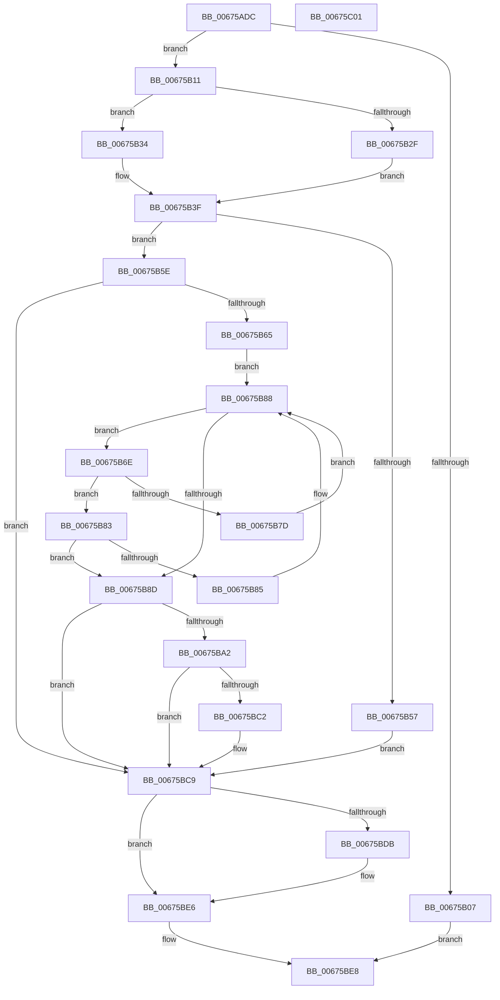

# MiGetPageInHugePageBadStatus

- RVA: `0x00675ADC`–`0x00675C02` (길이 `294` bytes)
- VA: `0x0000000140675ADC`
- 실행 섹션: `.text`
- PDB 이름 있음: `예`; PDB Function 태그: `아니요`
- unwind 정보 RVA: `0x00060300`
- 디코드: `84`개 명령, `294/294` bytes 표시
- 미해석 바이트: `0` (있으면 어셈블리에 `.byte`로 보존)

> 이 문서는 커널 이미지의 기계어와 PDB 기호를 분석해 생성했습니다. 4번과 5번은 함수 원형과 자료형을 바이너리 사용 방식에서 추정한 C 해석이며 원본 소스 복구 결과는 아닙니다.

## 1. Dependencies

- 직접 호출 지점: **6**; 고유 호출 대상: **5**
- 직접 호출자로 확인된 함수: **2**
- RIP 상대 이미지 참조: **3**

### Outgoing calls
- `0x00675AFE` → [MiIsPageInHugePfn](../2A/MiIsPageInHugePfn_function_002AB770.md) (function, `0x002AB770`)
- `0x00675B37` → [MiLockHugePfn](MiLockHugePfn_function_006765FC.md) (function, `0x006765FC`)
- `0x00675B46` → [ExAcquireSpinLockSharedAtDpcLevel](../24/ExAcquireSpinLockSharedAtDpcLevel_function_00248E30.md) (function, `0x00248E30`)
- `0x00675B4E` → [MiIsPageInHugePfn](../2A/MiIsPageInHugePfn_function_002AB770.md) (function, `0x002AB770`)
- `0x00675BD0` → [ExReleaseSpinLockSharedFromDpcLevel](../24/ExReleaseSpinLockSharedFromDpcLevel_function_0024A590.md) (function, `0x0024A590`)
- `0x00675BE1` → [MiUnlockHugePfn](../4D/MiUnlockHugePfn_function_004D90E4.md) (function, `0x004D90E4`)

### Direct callers
- [MiUpdateBadPfnIdentity](MiUpdateBadPfnIdentity_function_0067A890.md) at `0x0067A8F9`
- [MmGetPageBadStatus](MmGetPageBadStatus_function_0067A9B0.md) at `0x0067A9FA`

### Static image references
- `0x00675B11` → RVA `0x00E300C0` (`.data`; read)
- `0x00675B3F` → RVA `0x00E2FFD0` (`.data`; read)
- `0x00675B65` → RVA `0x00E30020` (`.data`; read)

## 2. Other-region calls and transfers

- 다른 실행 섹션으로 향하는 call: **0**
- 별도 외부 분기/꼬리 이동을 확인하지 못했습니다.

## 3. Assembly (complete function range)

```asm
00675ADC  48 89 5C 24 08                  mov qword ptr [rsp + 8], rbx
00675AE1  48 89 6C 24 10                  mov qword ptr [rsp + 0x10], rbp
00675AE6  48 89 74 24 18                  mov qword ptr [rsp + 0x18], rsi
00675AEB  57                              push rdi
00675AEC  41 56                           push r14
00675AEE  41 57                           push r15
00675AF0  48 83 EC 20                     sub rsp, 0x20
00675AF4  41 83 20 00                     and dword ptr [r8], 0
00675AF8  4D 8B F8                        mov r15, r8
00675AFB  48 8B F1                        mov rsi, rcx
00675AFE  E8 6D 5C C3 FF                  call 0x1402ab770
00675B03  85 C0                           test eax, eax
00675B05  75 0A                           jne 0x140675b11
00675B07  B8 EF 00 00 C0                  mov eax, 0xc00000ef
00675B0C  E9 D7 00 00 00                  jmp 0x140675be8
00675B11  48 8B 05 A8 A5 7B 00            mov rax, qword ptr [rip + 0x7ba5a8]
00675B18  48 8B DE                        mov rbx, rsi
00675B1B  48 C1 EB 12                     shr rbx, 0x12
00675B1F  33 FF                           xor edi, edi
00675B21  81 E3 FF FF 3F 00               and ebx, 0x3fffff
00675B27  4C 8D 34 D8                     lea r14, [rax + rbx*8]
00675B2B  85 D2                           test edx, edx
00675B2D  74 05                           je 0x140675b34
00675B2F  40 B5 11                        mov bpl, 0x11
00675B32  EB 0B                           jmp 0x140675b3f
00675B34  49 8B CE                        mov rcx, r14
00675B37  E8 C0 0A 00 00                  call 0x1406765fc
00675B3C  40 8A E8                        mov bpl, al
00675B3F  48 8D 0D 8A A4 7B 00            lea rcx, [rip + 0x7ba48a]
00675B46  E8 E5 32 BD FF                  call 0x140248e30
00675B4B  48 8B CE                        mov rcx, rsi
00675B4E  E8 1D 5C C3 FF                  call 0x1402ab770
00675B53  85 C0                           test eax, eax
00675B55  75 07                           jne 0x140675b5e
00675B57  BF EF 00 00 C0                  mov edi, 0xc00000ef
00675B5C  EB 6B                           jmp 0x140675bc9
00675B5E  49 8B 06                        mov rax, qword ptr [r14]
00675B61  A8 08                           test al, 8
00675B63  74 64                           je 0x140675bc9
00675B65  48 8B 0D B4 A4 7B 00            mov rcx, qword ptr [rip + 0x7ba4b4]
00675B6C  EB 1A                           jmp 0x140675b88
00675B6E  48 8B 51 18                     mov rdx, qword ptr [rcx + 0x18]
00675B72  81 E2 FF FF 3F 00               and edx, 0x3fffff
00675B78  48 3B DA                        cmp rbx, rdx
00675B7B  76 06                           jbe 0x140675b83
00675B7D  48 8B 49 08                     mov rcx, qword ptr [rcx + 8]
00675B81  EB 05                           jmp 0x140675b88
00675B83  73 08                           jae 0x140675b8d
00675B85  48 8B 09                        mov rcx, qword ptr [rcx]
00675B88  48 85 C9                        test rcx, rcx
00675B8B  75 E1                           jne 0x140675b6e
00675B8D  48 8B 51 20                     mov rdx, qword ptr [rcx + 0x20]
00675B91  81 E6 FF FF 03 00               and esi, 0x3ffff
00675B97  48 0F A3 32                     bt qword ptr [rdx], rsi
00675B9B  0F 92 C1                        setb cl
00675B9E  84 C9                           test cl, cl
00675BA0  74 27                           je 0x140675bc9
00675BA2  24 07                           and al, 7
00675BA4  BF 09 07 00 C0                  mov edi, 0xc0000709
00675BA9  3C 04                           cmp al, 4
00675BAB  B9 03 01 00 00                  mov ecx, 0x103
00675BB0  0F 45 F9                        cmovne edi, ecx
00675BB3  48 0F A3 B2 00 80 00 00         bt qword ptr [rdx + 0x8000], rsi
00675BBB  0F 92 C0                        setb al
00675BBE  84 C0                           test al, al
00675BC0  74 07                           je 0x140675bc9
00675BC2  41 C7 07 01 00 00 00            mov dword ptr [r15], 1
00675BC9  48 8D 0D 00 A4 7B 00            lea rcx, [rip + 0x7ba400]
00675BD0  E8 BB 49 BD FF                  call 0x14024a590
00675BD5  40 80 FD 11                     cmp bpl, 0x11
00675BD9  74 0B                           je 0x140675be6
00675BDB  40 8A D5                        mov dl, bpl
00675BDE  49 8B CE                        mov rcx, r14
00675BE1  E8 FE 34 E6 FF                  call 0x1404d90e4
00675BE6  8B C7                           mov eax, edi
00675BE8  48 8B 5C 24 40                  mov rbx, qword ptr [rsp + 0x40]
00675BED  48 8B 6C 24 48                  mov rbp, qword ptr [rsp + 0x48]
00675BF2  48 8B 74 24 50                  mov rsi, qword ptr [rsp + 0x50]
00675BF7  48 83 C4 20                     add rsp, 0x20
00675BFB  41 5F                           pop r15
00675BFD  41 5E                           pop r14
00675BFF  5F                              pop rdi
00675C00  C3                              ret
00675C01  CC                              int3
```

## 4. C-style interpretation (structured pseudocode)

```c
__int64 __fastcall MiGetPageInHugePageBadStatus(__int64 a1, int a2, __int64 a3)
{
    __int64 result;
    __int64 v_rbx;
    __int64 v_rdi;
    __int64 v_rsi;
    __int64 v_rsp;
    unsigned __int64 v_stack_p10;
    unsigned __int64 v_stack_p18;
    unsigned __int64 v_stack_p8;

    v_stack_p8 = v_rbx;
    v_stack_p10 = v_rbp;
    v_stack_p18 = v_rsi;
    v_rsp = (v_rsp) - (32);
    result = MiIsPageInHugePfn(a1, a2, a3, a4);
    if ((unsigned int)(result) != 0) goto loc_00675B11;
    goto loc_00675BE8;
loc_00675B11:
    v_rbx = (a1) >> (18);
    v_rdi = 0;
    v_rbx = (unsigned int)((v_rbx) & (0x3FFFFFULL));
    if (a2 == 0) goto loc_00675B34;
    goto loc_00675B3F;
loc_00675B34:
    result = MiLockHugePfn(*(unsigned __int64 *)(v_rip + 8103336) + v_rbx * 8, a2, a3, a4);
loc_00675B3F:
    result = ExAcquireSpinLockSharedAtDpcLevel(v_rip + 8103050, a2, a3, a4);
    result = MiIsPageInHugePfn(a1, a2, a3, a4);
    if ((unsigned int)(result) != 0) goto loc_00675B5E;
    goto loc_00675BC9;
loc_00675B5E:
    if ((((unsigned __int8)(*(unsigned __int64 *)(*(unsigned __int64 *)(v_rip + 8103336) + v_rbx * 8))) & (8)) == 0) goto loc_00675BC9;
    goto loc_00675B88;
loc_00675B6E:
    a2 = (unsigned int)((*(unsigned __int64 *)(*(unsigned __int64 *)(v_rip + 8103092) + 24)) & (0x3FFFFFULL));
    if (v_rbx <= a2) goto loc_00675B83;
    goto loc_00675B88;
loc_00675B83:
    if (v_rbx >= a2) goto loc_00675B8D;
loc_00675B88:
    if (*(unsigned __int64 *)(*(unsigned __int64 *)(*(unsigned __int64 *)(v_rip + 8103092) + 8)) != 0) goto loc_00675B6E;
loc_00675B8D:
    v_rsi = (unsigned int)((a1) & (0x3FFFFULL));
    a1 = (condition_is_below) ? 1 : 0;
    if ((unsigned __int8)(a1) == 0) goto loc_00675BC9;
    result = (unsigned __int8)((*(unsigned __int64 *)(*(unsigned __int64 *)(v_rip + 8103336) + v_rbx * 8)) & (7));
    v_rdi = (unsigned int)(0xC0000709ULL);
    if (((unsigned __int8)(result)) != 4) { v_rdi = 259; }
    result = (((unsigned __int8)(result)) < 4) ? 1 : 0;
    if ((unsigned __int8)(result) != 0) {
        *(unsigned int *)(a3) = 1;
    }
    result = ExReleaseSpinLockSharedFromDpcLevel(v_rip + 8102912, *(unsigned __int64 *)(*(unsigned __int64 *)(*(unsigned __int64 *)(*(unsigned __int64 *)(v_rip + 8103092) + 8)) + 32), a3, a4);
    if (((unsigned __int8)((unsigned __int8)(result))) != 17) {
        a2 = (unsigned __int8)((unsigned __int8)(result));
        a1 = *(unsigned __int64 *)(v_rip + 8103336) + v_rbx * 8;
        result = MiUnlockHugePfn(a1, a2, a3, a4);
    }
loc_00675BE8:
    v_rsp = (v_rsp) + (32);
    return (unsigned int)((unsigned int)(v_rdi));
}
```

## 5. (Beta) C Style

```c
int64_t MiGetPageInHugePageBadStatus(int64_t Arg1, int32_t Arg2, void *Arg3)
{
    uint8_t *arg3 = (uint8_t *)Arg3;

    int64_t result;
    int64_t local_rbx;
    int64_t local_rdi;
    int64_t local_rsi;
    int64_t local_rsp;
    uint64_t v_stack_p10;
    uint64_t v_stack_p18;
    uint64_t v_stack_p8;

    v_stack_p8 = local_rbx;
    v_stack_p10 = local_rbp;
    v_stack_p18 = local_rsi;
    local_rsp = (local_rsp) - (32);
    result = MiIsPageInHugePfn(Arg1, Arg2, Arg3, a4);
    if ((uint32_t)(result) != 0) goto loc_00675B11;
    goto loc_00675BE8;
loc_00675B11:
    local_rbx = (Arg1) >> (18);
    local_rdi = 0;
    local_rbx = (uint32_t)((local_rbx) & (0x3FFFFFULL));
    if (Arg2 == 0) goto loc_00675B34;
    goto loc_00675B3F;
loc_00675B34:
    result = MiLockHugePfn(*(uint64_t *)(v_rip + 0x7BA5A8) + local_rbx * 8, Arg2, Arg3, a4);
loc_00675B3F:
    result = ExAcquireSpinLockSharedAtDpcLevel(v_rip + 8103050, Arg2, Arg3, a4);
    result = MiIsPageInHugePfn(Arg1, Arg2, Arg3, a4);
    if ((uint32_t)(result) != 0) goto loc_00675B5E;
    goto loc_00675BC9;
loc_00675B5E:
    if ((((uint8_t)(*(uint64_t *)(*(uint64_t *)(v_rip + 0x7BA5A8) + local_rbx * 8))) & (8)) == 0) goto loc_00675BC9;
    goto loc_00675B88;
loc_00675B6E:
    Arg2 = (uint32_t)((*(uint64_t *)(*(uint64_t *)(v_rip + 0x7BA4B4) + 0x18)) & (0x3FFFFFULL));
    if (local_rbx <= Arg2) goto loc_00675B83;
    goto loc_00675B88;
loc_00675B83:
    if (local_rbx >= Arg2) goto loc_00675B8D;
loc_00675B88:
    if (*(uint64_t *)(*(uint64_t *)(*(uint64_t *)(v_rip + 0x7BA4B4) + 0x8)) != 0) goto loc_00675B6E;
loc_00675B8D:
    local_rsi = (uint32_t)((Arg1) & (0x3FFFFULL));
    Arg1 = (condition_is_below) ? 1 : 0;
    if ((uint8_t)(Arg1) == 0) goto loc_00675BC9;
    result = (uint8_t)((*(uint64_t *)(*(uint64_t *)(v_rip + 0x7BA5A8) + local_rbx * 8)) & (7));
    local_rdi = (uint32_t)(0xC0000709ULL);
    if (((uint8_t)(result)) != 4) { local_rdi = 259; }
    result = (((uint8_t)(result)) < 4) ? 1 : 0;
    if ((uint8_t)(result) != 0) {
        *(uint32_t *)(arg3) = 1;
    }
    result = ExReleaseSpinLockSharedFromDpcLevel(v_rip + 8102912, *(uint64_t *)(*(uint64_t *)(*(uint64_t *)(*(uint64_t *)(v_rip + 0x7BA4B4) + 0x8)) + 0x20), Arg3, a4);
    if (((uint8_t)((uint8_t)(result))) != 17) {
        Arg2 = (uint8_t)((uint8_t)(result));
        Arg1 = *(uint64_t *)(v_rip + 0x7BA5A8) + local_rbx * 8;
        result = MiUnlockHugePfn(Arg1, Arg2, Arg3, a4);
    }
loc_00675BE8:
    local_rsp = (local_rsp) + (32);
    return (uint32_t)((uint32_t)(local_rdi));
}
```

### 관측된 메모리 오프셋

구조체 형식이 확인되지 않은 접근은 인자 기준의 오프셋으로만 기록했습니다.

| 기준 인자 | 오프셋 표현 | 폭 (bit) | 접근 |
|---|---:|---:|---|
| `Arg3` | `+ 0x0` | `32` | `R/W` |
| `Arg3` | `+ 0x0` | `32` | `W` |

## 6. Execution-region graph

[열기: 2D/3D 그래프와 함수 탐색 컨트롤 패널](../../../control-panel.html?section=text&rva=0x00675ADC&view=graph)

- 2D 그래프는 위에서 아래로 흐르고, 3D 그래프는 빈 공간을 드래그해 회전합니다. Shift+드래그는 이동, 휠은 확대·축소, 함수 노드 선택은 대상 보고서 이동입니다.

### Static fallback


