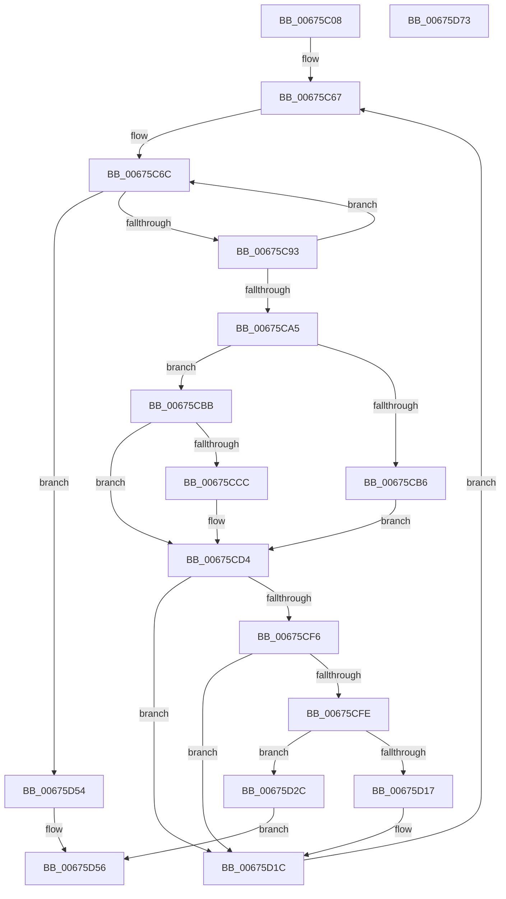

# MiGetPerfectColorHeadHugeRange

- RVA: `0x00675C08`–`0x00675D74` (길이 `364` bytes)
- VA: `0x0000000140675C08`
- 실행 섹션: `.text`
- PDB 이름 있음: `예`; PDB Function 태그: `아니요`
- unwind 정보 RVA: `0x0005D79C`
- 디코드: `100`개 명령, `364/364` bytes 표시
- 미해석 바이트: `0` (있으면 어셈블리에 `.byte`로 보존)

> 이 문서는 커널 이미지의 기계어와 PDB 기호를 분석해 생성했습니다. 4번과 5번은 함수 원형과 자료형을 바이너리 사용 방식에서 추정한 C 해석이며 원본 소스 복구 결과는 아닙니다.

## 1. Dependencies

- 직접 호출 지점: **7**; 고유 호출 대상: **6**
- 직접 호출자로 확인된 함수: **2**
- RIP 상대 이미지 참조: **3**

### Outgoing calls
- `0x00675C56` → [MiGetColorHeadHugeRangeBase](../43/MiGetColorHeadHugeRangeBase_function_00437160.md) (function, `0x00437160`)
- `0x00675CCF` → [KiRaiseIrqlProcessIrqlFlags](../4F/KiRaiseIrqlProcessIrqlFlags_function_004F56FC.md) (function, `0x004F56FC`)
- `0x00675CD7` → [MiLockHugePfnInternal](../3F/MiLockHugePfnInternal_function_003FBC80.md) (function, `0x003FBC80`)
- `0x00675D01` → [MiLockColorHeadHugeAtDpc](../4F/MiLockColorHeadHugeAtDpc_function_004FAD3C.md) (function, `0x004FAD3C`)
- `0x00675D22` → [MiUnlockHugePfn](../4D/MiUnlockHugePfn_function_004D90E4.md) (function, `0x004D90E4`)
- `0x00675D3A` → [MiUnlinkHugeRange](../43/MiUnlinkHugeRange_function_00436EF0.md) (function, `0x00436EF0`)
- `0x00675D4A` → [MiUnlockHugePfn](../4D/MiUnlockHugePfn_function_004D90E4.md) (function, `0x004D90E4`)

### Direct callers
- [MiGetPerfectFreeOrZeroHugeRange](MiGetPerfectFreeOrZeroHugeRange_function_00675D7C.md) at `0x00675DBF`
- [MiRemoveHugeRangeAnyColor](MiRemoveHugeRangeAnyColor_function_006771B4.md) at `0x006773A6`

### Static image references
- `0x00675C93` → RVA `0x00E300B8` (`.data`; read)
- `0x00675CA5` → RVA `0x00E300C0` (`.data`; read)
- `0x00675CC3` → RVA `0x00FC6D20` (`ALMOSTRO`; read)

## 2. Other-region calls and transfers

- 다른 실행 섹션으로 향하는 call: **0**
- 별도 외부 분기/꼬리 이동을 확인하지 못했습니다.

## 3. Assembly (complete function range)

```asm
00675C08  48 89 5C 24 10                  mov qword ptr [rsp + 0x10], rbx
00675C0D  48 89 6C 24 18                  mov qword ptr [rsp + 0x18], rbp
00675C12  48 89 74 24 20                  mov qword ptr [rsp + 0x20], rsi
00675C17  57                              push rdi
00675C18  41 54                           push r12
00675C1A  41 55                           push r13
00675C1C  41 56                           push r14
00675C1E  41 57                           push r15
00675C20  48 83 EC 20                     sub rsp, 0x20
00675C24  4C 8B E1                        mov r12, rcx
00675C27  33 DB                           xor ebx, ebx
00675C29  48 8B 09                        mov rcx, qword ptr [rcx]
00675C2C  41 8B 7C 24 20                  mov edi, dword ptr [r12 + 0x20]
00675C31  48 8B 81 88 3A 00 00            mov rax, qword ptr [rcx + 0x3a88]
00675C38  0F B7 00                        movzx eax, word ptr [rax]
00675C3B  66 89 44 24 50                  mov word ptr [rsp + 0x50], ax
00675C40  49 8B 44 24 10                  mov rax, qword ptr [r12 + 0x10]
00675C45  44 8B 00                        mov r8d, dword ptr [rax]
00675C48  41 8B C0                        mov eax, r8d
00675C4B  F7 D8                           neg eax
00675C4D  45 1B ED                        sbb r13d, r13d
00675C50  41 F7 DD                        neg r13d
00675C53  41 FF C5                        inc r13d
00675C56  E8 05 15 DC FF                  call 0x140437160
00675C5B  41 8B 4C 24 1C                  mov ecx, dword ptr [r12 + 0x1c]
00675C60  0F B6 D1                        movzx edx, cl
00675C63  4C 8D 34 D0                     lea r14, [rax + rdx*8]
00675C67  BA 02 00 00 00                  mov edx, 2
00675C6C  49 8B 06                        mov rax, qword ptr [r14]
00675C6F  48 C1 E8 0F                     shr rax, 0xf
00675C73  48 33 D8                        xor rbx, rax
00675C76  4C 8B F8                        mov r15, rax
00675C79  48 81 E3 00 00 C0 FF            and rbx, 0xffffffffffc00000
00675C80  41 81 E7 FF FF 3F 00            and r15d, 0x3fffff
00675C87  48 33 D8                        xor rbx, rax
00675C8A  4D 85 FF                        test r15, r15
00675C8D  0F 84 C1 00 00 00               je 0x140675d54
00675C93  48 8B 05 1E A4 7B 00            mov rax, qword ptr [rip + 0x7ba41e]
00675C9A  4C 0F A3 38                     bt qword ptr [rax], r15
00675C9E  0F 92 C0                        setb al
00675CA1  84 C0                           test al, al
00675CA3  74 C7                           je 0x140675c6c
00675CA5  48 8B 05 14 A4 7B 00            mov rax, qword ptr [rip + 0x7ba414]
00675CAC  4A 8D 34 F8                     lea rsi, [rax + r15*8]
00675CB0  40 F6 C7 01                     test dil, 1
00675CB4  74 05                           je 0x140675cbb
00675CB6  40 B5 11                        mov bpl, 0x11
00675CB9  EB 19                           jmp 0x140675cd4
00675CBB  44 0F 20 C5                     mov rbp, cr8
00675CBF  44 0F 22 C2                     mov cr8, rdx
00675CC3  83 3D 56 10 95 00 00            cmp dword ptr [rip + 0x951056], 0
00675CCA  74 08                           je 0x140675cd4
00675CCC  40 8A CD                        mov cl, bpl
00675CCF  E8 28 FA E7 FF                  call 0x1404f56fc
00675CD4  48 8B CE                        mov rcx, rsi
00675CD7  E8 A4 5F D8 FF                  call 0x1403fbc80
00675CDC  48 8B 16                        mov rdx, qword ptr [rsi]
00675CDF  0F B7 44 24 50                  movzx eax, word ptr [rsp + 0x50]
00675CE4  48 8B CA                        mov rcx, rdx
00675CE7  48 C1 E9 04                     shr rcx, 4
00675CEB  81 E1 FF 07 00 00               and ecx, 0x7ff
00675CF1  48 3B C8                        cmp rcx, rax
00675CF4  75 26                           jne 0x140675d1c
00675CF6  83 E2 07                        and edx, 7
00675CF9  41 3B D5                        cmp edx, r13d
00675CFC  75 1E                           jne 0x140675d1c
00675CFE  49 8B CE                        mov rcx, r14
00675D01  E8 36 50 E8 FF                  call 0x1404fad3c
00675D06  49 8B 06                        mov rax, qword ptr [r14]
00675D09  48 C1 E8 0F                     shr rax, 0xf
00675D0D  25 FF FF 3F 00                  and eax, 0x3fffff
00675D12  4C 3B F8                        cmp r15, rax
00675D15  74 15                           je 0x140675d2c
00675D17  F0 49 83 26 F7                  lock and qword ptr [r14], 0xfffffffffffffff7
00675D1C  40 8A D5                        mov dl, bpl
00675D1F  48 8B CE                        mov rcx, rsi
00675D22  E8 BD 33 E6 FF                  call 0x1404d90e4
00675D27  E9 3B FF FF FF                  jmp 0x140675c67
00675D2C  49 8B 0C 24                     mov rcx, qword ptr [r12]
00675D30  48 8B D3                        mov rdx, rbx
00675D33  48 8B 89 88 3A 00 00            mov rcx, qword ptr [rcx + 0x3a88]
00675D3A  E8 B1 11 DC FF                  call 0x140436ef0
00675D3F  F0 49 83 26 F7                  lock and qword ptr [r14], 0xfffffffffffffff7
00675D44  40 8A D5                        mov dl, bpl
00675D47  48 8B CE                        mov rcx, rsi
00675D4A  E8 95 33 E6 FF                  call 0x1404d90e4
00675D4F  48 8B C6                        mov rax, rsi
00675D52  EB 02                           jmp 0x140675d56
00675D54  33 C0                           xor eax, eax
00675D56  48 8B 5C 24 58                  mov rbx, qword ptr [rsp + 0x58]
00675D5B  48 8B 6C 24 60                  mov rbp, qword ptr [rsp + 0x60]
00675D60  48 8B 74 24 68                  mov rsi, qword ptr [rsp + 0x68]
00675D65  48 83 C4 20                     add rsp, 0x20
00675D69  41 5F                           pop r15
00675D6B  41 5E                           pop r14
00675D6D  41 5D                           pop r13
00675D6F  41 5C                           pop r12
00675D71  5F                              pop rdi
00675D72  C3                              ret
00675D73  CC                              int3
```

## 4. C-style interpretation (structured pseudocode)

```c
__int64 __fastcall MiGetPerfectColorHeadHugeRange(__int64 a1)
{
    __int64 result;
    __int64 v_r13;
    __int64 v_r15;
    __int64 v_rbx;
    __int64 v_rsp;
    unsigned __int64 v_stack_p10;
    unsigned __int64 v_stack_p18;
    unsigned __int64 v_stack_p20;
    unsigned __int16 v_stack_p8;

    v_stack_p10 = v_rbx;
    v_stack_p18 = v_rbp;
    v_stack_p20 = v_rsi;
    v_rsp = (v_rsp) - (32);
    v_rbx = 0;
    v_stack_p8 = (unsigned __int16)(*(unsigned __int16 *)(*(unsigned __int64 *)(*(unsigned __int64 *)(a1) + 14984)));
    result = (unsigned int)(-((unsigned int)((unsigned int)((unsigned int)(*(unsigned int *)(*(unsigned __int64 *)(a1 + 16)))))));
    v_r13 = (unsigned int)(-(v_r13));
    v_r13 = (unsigned int)((v_r13) + 1);
    result = MiGetColorHeadHugeRangeBase(*(unsigned __int64 *)(a1), a2, (unsigned int)(*(unsigned int *)(*(unsigned __int64 *)(a1 + 16))), a4);
loc_00675C67:
loc_00675C6C:
    result = (*(unsigned __int64 *)(result + (unsigned __int8)((unsigned int)(*(unsigned int *)(a1 + 28))) * 8)) >> (15);
    v_rbx = (v_rbx) ^ (result);
    v_rbx = (v_rbx) & (0xFFFFFFFFFFC00000ULL);
    v_r15 = (unsigned int)((result) & (0x3FFFFFULL));
    v_rbx = (v_rbx) ^ (result);
    if (v_r15 == 0) goto loc_00675D54;
    result = (condition_is_below) ? 1 : 0;
    if ((unsigned __int8)(result) == 0) goto loc_00675C6C;
    if ((((unsigned __int8)((unsigned int)(*(unsigned int *)(a1 + 32)))) & (1)) == 0) goto loc_00675CBB;
    goto loc_00675CD4;
loc_00675CBB:
    result = *(unsigned __int64 *)(v_rip + 8102932);
    if ((*(unsigned int *)(v_rip + 9769046)) != 0) {
        a1 = (unsigned __int8)(v_cr8);
        result = KiRaiseIrqlProcessIrqlFlags(a1, 2, (unsigned int)(*(unsigned int *)(*(unsigned __int64 *)(a1 + 16))), a4);
    }
    result = MiLockHugePfnInternal(*(unsigned __int64 *)(v_rip + 8102932) + v_r15 * 8, 2, (unsigned int)(*(unsigned int *)(*(unsigned __int64 *)(a1 + 16))), a4);
    a1 = (*(unsigned __int64 *)(*(unsigned __int64 *)(v_rip + 8102932) + v_r15 * 8)) >> (4);
    a1 = (unsigned int)((a1) & (0x7FFULL));
    if (a1 != v_stack_p8) goto loc_00675D1C;
    a2 = (unsigned int)((*(unsigned __int64 *)(*(unsigned __int64 *)(v_rip + 8102932) + v_r15 * 8)) & (7));
    if (((unsigned int)(a2)) != ((unsigned int)(v_r13))) goto loc_00675D1C;
    result = MiLockColorHeadHugeAtDpc(result + (unsigned __int8)((unsigned int)(*(unsigned int *)(a1 + 28))) * 8, a2, (unsigned int)(*(unsigned int *)(*(unsigned __int64 *)(a1 + 16))), a4);
    result = (*(unsigned __int64 *)(result + (unsigned __int8)((unsigned int)(*(unsigned int *)(a1 + 28))) * 8)) >> (15);
    result = (unsigned int)((result) & (0x3FFFFFULL));
    if (v_r15 == result) goto loc_00675D2C;
loc_00675D1C:
    result = MiUnlockHugePfn(*(unsigned __int64 *)(v_rip + 8102932) + v_r15 * 8, (unsigned __int8)(v_cr8), (unsigned int)(*(unsigned int *)(*(unsigned __int64 *)(a1 + 16))), a4);
    goto loc_00675C67;
loc_00675D2C:
    result = MiUnlinkHugeRange(*(unsigned __int64 *)(*(unsigned __int64 *)(a1) + 14984), v_rbx, (unsigned int)(*(unsigned int *)(*(unsigned __int64 *)(a1 + 16))), a4);
    result = MiUnlockHugePfn(*(unsigned __int64 *)(v_rip + 8102932) + v_r15 * 8, (unsigned __int8)(v_cr8), (unsigned int)(*(unsigned int *)(*(unsigned __int64 *)(a1 + 16))), a4);
    goto loc_00675D56;
loc_00675D54:
    result = 0;
loc_00675D56:
    v_rsp = (v_rsp) + (32);
    return result;
}
```

## 5. (Beta) C Style

```c
int64_t MiGetPerfectColorHeadHugeRange(void *Arg1)
{
    uint8_t *arg1 = (uint8_t *)Arg1;

    int64_t result;
    int64_t local_r13;
    int64_t local_r15;
    int64_t local_rbx;
    int64_t local_rsp;
    uint64_t v_stack_p10;
    uint64_t v_stack_p18;
    uint64_t v_stack_p20;
    uint16_t v_stack_p8;

    v_stack_p10 = local_rbx;
    v_stack_p18 = local_rbp;
    v_stack_p20 = local_rsi;
    local_rsp = (local_rsp) - (32);
    local_rbx = 0;
    v_stack_p8 = (uint16_t)(*(uint16_t *)(*(uint64_t *)(*(uint64_t *)(arg1) + 0x3A88)));
    result = (uint32_t)(-((uint32_t)((uint32_t)((uint32_t)(*(uint32_t *)(*(uint64_t *)(arg1 + 0x10)))))));
    local_r13 = (uint32_t)(-(local_r13));
    local_r13 = (uint32_t)((local_r13) + 1);
    result = MiGetColorHeadHugeRangeBase(*(uint64_t *)(arg1), a2, (uint32_t)(*(uint32_t *)(*(uint64_t *)(arg1 + 0x10))), a4);
loc_00675C67:
loc_00675C6C:
    result = (*(uint64_t *)(result + (uint8_t)((uint32_t)(*(uint32_t *)(arg1 + 0x1C))) * 8)) >> (15);
    local_rbx = (local_rbx) ^ (result);
    local_rbx = (local_rbx) & (0xFFFFFFFFFFC00000ULL);
    local_r15 = (uint32_t)((result) & (0x3FFFFFULL));
    local_rbx = (local_rbx) ^ (result);
    if (local_r15 == 0) goto loc_00675D54;
    result = (condition_is_below) ? 1 : 0;
    if ((uint8_t)(result) == 0) goto loc_00675C6C;
    if ((((uint8_t)((uint32_t)(*(uint32_t *)(arg1 + 0x20)))) & (1)) == 0) goto loc_00675CBB;
    goto loc_00675CD4;
loc_00675CBB:
    result = *(uint64_t *)(v_rip + 0x7BA414);
    if ((*(uint32_t *)(v_rip + 0x951056)) != 0) {
        Arg1 = (uint8_t)(v_cr8);
        result = KiRaiseIrqlProcessIrqlFlags(Arg1, 2, (uint32_t)(*(uint32_t *)(*(uint64_t *)(arg1 + 0x10))), a4);
    }
    result = MiLockHugePfnInternal(*(uint64_t *)(v_rip + 0x7BA414) + local_r15 * 8, 2, (uint32_t)(*(uint32_t *)(*(uint64_t *)(arg1 + 0x10))), a4);
    Arg1 = (*(uint64_t *)(*(uint64_t *)(v_rip + 0x7BA414) + local_r15 * 8)) >> (4);
    Arg1 = (uint32_t)((Arg1) & (0x7FFULL));
    if (Arg1 != v_stack_p8) goto loc_00675D1C;
    a2 = (uint32_t)((*(uint64_t *)(*(uint64_t *)(v_rip + 0x7BA414) + local_r15 * 8)) & (7));
    if (((uint32_t)(a2)) != ((uint32_t)(local_r13))) goto loc_00675D1C;
    result = MiLockColorHeadHugeAtDpc(result + (uint8_t)((uint32_t)(*(uint32_t *)(arg1 + 0x1C))) * 8, a2, (uint32_t)(*(uint32_t *)(*(uint64_t *)(arg1 + 0x10))), a4);
    result = (*(uint64_t *)(result + (uint8_t)((uint32_t)(*(uint32_t *)(arg1 + 0x1C))) * 8)) >> (15);
    result = (uint32_t)((result) & (0x3FFFFFULL));
    if (local_r15 == result) goto loc_00675D2C;
loc_00675D1C:
    result = MiUnlockHugePfn(*(uint64_t *)(v_rip + 0x7BA414) + local_r15 * 8, (uint8_t)(v_cr8), (uint32_t)(*(uint32_t *)(*(uint64_t *)(arg1 + 0x10))), a4);
    goto loc_00675C67;
loc_00675D2C:
    result = MiUnlinkHugeRange(*(uint64_t *)(*(uint64_t *)(arg1) + 0x3A88), local_rbx, (uint32_t)(*(uint32_t *)(*(uint64_t *)(arg1 + 0x10))), a4);
    result = MiUnlockHugePfn(*(uint64_t *)(v_rip + 0x7BA414) + local_r15 * 8, (uint8_t)(v_cr8), (uint32_t)(*(uint32_t *)(*(uint64_t *)(arg1 + 0x10))), a4);
    goto loc_00675D56;
loc_00675D54:
    result = 0;
loc_00675D56:
    local_rsp = (local_rsp) + (32);
    return result;
}
```

### 관측된 메모리 오프셋

구조체 형식이 확인되지 않은 접근은 인자 기준의 오프셋으로만 기록했습니다.

| 기준 인자 | 오프셋 표현 | 폭 (bit) | 접근 |
|---|---:|---:|---|
| `Arg1` | `+ 0x0` | `64` | `R` |
| `Arg1` | `+ 0x10` | `64` | `R` |
| `Arg1` | `+ 0x1C` | `32` | `R` |
| `Arg1` | `+ 0x20` | `32` | `R` |

## 6. Execution-region graph

[열기: 2D/3D 그래프와 함수 탐색 컨트롤 패널](../../../control-panel.html?section=text&rva=0x00675C08&view=graph)

- 2D 그래프는 위에서 아래로 흐르고, 3D 그래프는 빈 공간을 드래그해 회전합니다. Shift+드래그는 이동, 휠은 확대·축소, 함수 노드 선택은 대상 보고서 이동입니다.

### Static fallback


