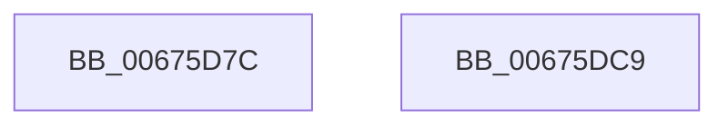

# MiGetPerfectFreeOrZeroHugeRange

- RVA: `0x00675D7C`–`0x00675DCA` (길이 `78` bytes)
- VA: `0x0000000140675D7C`
- 실행 섹션: `.text`
- PDB 이름 있음: `예`; PDB Function 태그: `아니요`
- unwind 정보 RVA: `0x0005CC98`
- 디코드: `20`개 명령, `78/78` bytes 표시
- 미해석 바이트: `0` (있으면 어셈블리에 `.byte`로 보존)

> 이 문서는 커널 이미지의 기계어와 PDB 기호를 분석해 생성했습니다. 4번과 5번은 함수 원형과 자료형을 바이너리 사용 방식에서 추정한 C 해석이며 원본 소스 복구 결과는 아닙니다.

## 1. Dependencies

- 직접 호출 지점: **1**; 고유 호출 대상: **1**
- 직접 호출자로 확인된 함수: **1**
- RIP 상대 이미지 참조: **2**

### Outgoing calls
- `0x00675DBF` → [MiGetPerfectColorHeadHugeRange](MiGetPerfectColorHeadHugeRange_function_00675C08.md) (function, `0x00675C08`)

### Direct callers
- [MiGetBestHugeRangeFromNode](MiGetBestHugeRangeFromNode_function_00675710.md) at `0x00675733`
- [MiGetBestHugeRangeFromNode](MiGetBestHugeRangeFromNode_function_00675710.md) at `0x006757C3`

### Static image references
- `0x00675D99` → RVA `0x00010860` (`.rdata`; read)
- `0x00675DA4` → RVA `0x00011038` (`.rdata`; read)

## 2. Other-region calls and transfers

- 다른 실행 섹션으로 향하는 call: **0**
- 별도 외부 분기/꼬리 이동을 확인하지 못했습니다.

## 3. Assembly (complete function range)

```asm
00675D7C  4C 8B DC                        mov r11, rsp
00675D7F  48 83 EC 58                     sub rsp, 0x58
00675D83  33 C0                           xor eax, eax
00675D85  49 89 43 D0                     mov qword ptr [r11 - 0x30], rax
00675D89  41 F6 C0 10                     test r8b, 0x10
00675D8D  89 44 24 38                     mov dword ptr [rsp + 0x38], eax
00675D91  89 44 24 44                     mov dword ptr [rsp + 0x44], eax
00675D95  49 89 43 F0                     mov qword ptr [r11 - 0x10], rax
00675D99  48 8D 05 C0 AA 99 FF            lea rax, [rip - 0x665540]
00675DA0  49 89 4B C8                     mov qword ptr [r11 - 0x38], rcx
00675DA4  48 8D 0D 8D B2 99 FF            lea rcx, [rip - 0x664d73]
00675DAB  48 0F 44 C1                     cmove rax, rcx
00675DAF  89 54 24 3C                     mov dword ptr [rsp + 0x3c], edx
00675DB3  49 8D 4B C8                     lea rcx, [r11 - 0x38]
00675DB7  49 89 43 D8                     mov qword ptr [r11 - 0x28], rax
00675DBB  45 89 43 E8                     mov dword ptr [r11 - 0x18], r8d
00675DBF  E8 44 FE FF FF                  call 0x140675c08
00675DC4  48 83 C4 58                     add rsp, 0x58
00675DC8  C3                              ret
00675DC9  CC                              int3
```

## 4. C-style interpretation (structured pseudocode)

```c
__int64 __fastcall MiGetPerfectFreeOrZeroHugeRange(__int64 a1, int a2, int a3)
{
    __int64 result;
    __int64 v_rsp;
    unsigned int v_stack_m14;
    unsigned int v_stack_m1C;
    unsigned int v_stack_m20;

    v_rsp = (v_rsp) - (88);
    result = 0;
    *(unsigned __int64 *)(v_rsp - 48) = 0;
    v_stack_m20 = 0;
    v_stack_m14 = 0;
    *(unsigned __int64 *)(v_rsp - 16) = 0;
    *(unsigned __int64 *)(v_rsp - 56) = a1;
    result = v_rip - 6706496;
    if ((((unsigned __int8)(a3)) & (16)) == 0) { result = v_rip - 6704499; }
    v_stack_m1C = a2;
    *(unsigned __int64 *)(v_rsp - 40) = result;
    *(unsigned int *)(v_rsp - 24) = a3;
    result = MiGetPerfectColorHeadHugeRange(v_rsp - 56, a2, a3, a4);
    v_rsp = (v_rsp) + (88);
    return result;
}
```

## 5. (Beta) C Style

```c
int64_t MiGetPerfectFreeOrZeroHugeRange(int64_t Arg1, int32_t Arg2, int32_t Arg3)
{
    int64_t result;
    int64_t local_rsp;
    uint32_t v_stack_m14;
    uint32_t v_stack_m1C;
    uint32_t v_stack_m20;

    local_rsp = (local_rsp) - (88);
    result = 0;
    *(uint64_t *)(local_rsp - 0x30) = 0;
    v_stack_m20 = 0;
    v_stack_m14 = 0;
    *(uint64_t *)(local_rsp - 0x10) = 0;
    *(uint64_t *)(local_rsp - 0x38) = Arg1;
    result = v_rip - 6706496;
    if ((((uint8_t)(Arg3)) & (16)) == 0) { result = v_rip - 6704499; }
    v_stack_m1C = Arg2;
    *(uint64_t *)(local_rsp - 0x28) = result;
    *(uint32_t *)(local_rsp - 0x18) = Arg3;
    result = MiGetPerfectColorHeadHugeRange(local_rsp - 56, Arg2, Arg3, a4);
    local_rsp = (local_rsp) + (88);
    return result;
}
```

## 6. Execution-region graph

[열기: 2D/3D 그래프와 함수 탐색 컨트롤 패널](../../../control-panel.html?section=text&rva=0x00675D7C&view=graph)

- 2D 그래프는 위에서 아래로 흐르고, 3D 그래프는 빈 공간을 드래그해 회전합니다. Shift+드래그는 이동, 휠은 확대·축소, 함수 노드 선택은 대상 보고서 이동입니다.

### Static fallback


