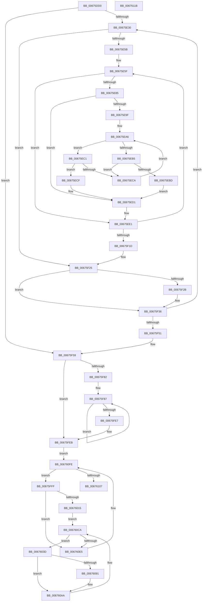

# MiHotRemoveHugeRange

- RVA: `0x00675DD0`–`0x0067611C` (길이 `844` bytes)
- VA: `0x0000000140675DD0`
- 실행 섹션: `.text`
- PDB 이름 있음: `예`; PDB Function 태그: `아니요`
- unwind 정보 RVA: `0x000CA438`
- 디코드: `228`개 명령, `844/844` bytes 표시
- 미해석 바이트: `0` (있으면 어셈블리에 `.byte`로 보존)

> 이 문서는 커널 이미지의 기계어와 PDB 기호를 분석해 생성했습니다. 4번과 5번은 함수 원형과 자료형을 바이너리 사용 방식에서 추정한 C 해석이며 원본 소스 복구 결과는 아닙니다.

## 1. Dependencies

- 직접 호출 지점: **22**; 고유 호출 대상: **21**
- 직접 호출자로 확인된 함수: **2**
- RIP 상대 이미지 참조: **4**

### Outgoing calls
- `0x00675E1E` → [MiHugePfnPartition](../43/MiHugePfnPartition_function_004371B4.md) (function, `0x004371B4`)
- `0x00675E36` → [MiRestrictRangeToNode](../40/MiRestrictRangeToNode_function_0040199C.md) (function, `0x0040199C`)
- `0x00675E49` → [MiPageToNode](../33/MiPageToNode_function_00338CD0.md) (function, `0x00338CD0`)
- `0x00675E62` → [MiLockHugePfn](MiLockHugePfn_function_006765FC.md) (function, `0x006765FC`)
- `0x00675E77` → [MiUpdateHugePageCounts](MiUpdateHugePageCounts_function_00677530.md) (function, `0x00677530`)
- `0x00675E88` → [MiMakeEntireHugePfnGood](MiMakeEntireHugePfnGood_function_00676644.md) (function, `0x00676644`)
- `0x00675ED8` → [RtlAvlInsertNodeEx](../26/RtlAvlInsertNodeEx_function_00265790.md) (function, `0x00265790`)
- `0x00675EF9` → [MiUnlockHugePfn](../4D/MiUnlockHugePfn_function_004D90E4.md) (function, `0x004D90E4`)
- `0x00675F31` → [MiFlushCacheRange](../69/MiFlushCacheRange_function_006954C8.md) (function, `0x006954C8`)
- `0x00675F3C` → [MiMarkHugeRangeIoPfnDeleted](MiMarkHugeRangeIoPfnDeleted_function_0067C770.md) (function, `0x0067C770`)
- `0x00675F72` → [ExAcquireSpinLockExclusive](../24/ExAcquireSpinLockExclusive_function_00248690.md) (function, `0x00248690`)
- `0x00675F8A` → [MiLockHugePfnInternal](../3F/MiLockHugePfnInternal_function_003FBC80.md) (function, `0x003FBC80`)
- `0x00675FA3` → [RtlClearBitsEx](../29/RtlClearBitsEx_function_00297740.md) (function, `0x00297740`)
- `0x00675FF5` → [MiReleaseSpinLockExclusive](../24/MiReleaseSpinLockExclusive_function_002482C0.md) (function, `0x002482C0`)
- `0x00676006` → [RtlAvlRemoveNode](../29/RtlAvlRemoveNode_function_00296650.md) (function, `0x00296650`)
- `0x0067607A` → [MiAllocatePool](../35/MiAllocatePool_function_0035B540.md) (function, `0x0035B540`)
- `0x00676085` → [MiLockPageInline](../31/MiLockPageInline_function_0031A340.md) (function, `0x0031A340`)
- `0x006760B7` → [MiSetPfnRemovalRequested](MiSetPfnRemovalRequested_function_0067A4D0.md) (function, `0x0067A4D0`)
- `0x006760C2` → [MiUnlockPage](../31/MiUnlockPage_function_0031A3E0.md) (function, `0x0031A3E0`)
- `0x006760D3` → [RtlFindSetBitsAndClearEx](../29/RtlFindSetBitsAndClearEx_function_002958B0.md) (function, `0x002958B0`)
- `0x006760EB` → [ExFreePoolWithTag](../../poolcode/B8/ExFreePoolWithTag_function_00B82870.md) (function, `0x00B82870`)
- `0x006760F5` → [ExFreePoolWithTag](../../poolcode/B8/ExFreePoolWithTag_function_00B82870.md) (function, `0x00B82870`)

### Direct callers
- [MiActOnPartitionNodePages](../68/MiActOnPartitionNodePages_function_0068F7F4.md) at `0x00690044`
- [MiCompleteMemoryAddition](../../page/7F/MiCompleteMemoryAddition_function_007F9FAC.md) at `0x007FA070`

### Static image references
- `0x00675DED` → RVA `0x00E300C0` (`.data`; read)
- `0x00675F60` → RVA `0x00E30100` (`.data`; read)
- `0x00675F96` → RVA `0x00E300B0` (`.data`; read)
- `0x00675FC2` → RVA `0x00E300C8` (`.data`; read)

## 2. Other-region calls and transfers

- 다른 실행 섹션으로 향하는 call: **2**
  - `0x006760EB` → [ExFreePoolWithTag](../../poolcode/B8/ExFreePoolWithTag_function_00B82870.md) (`.text` → `POOLCODE`)
  - `0x006760F5` → [ExFreePoolWithTag](../../poolcode/B8/ExFreePoolWithTag_function_00B82870.md) (`.text` → `POOLCODE`)
- 별도 외부 분기/꼬리 이동을 확인하지 못했습니다.

## 3. Assembly (complete function range)

```asm
00675DD0  44 89 44 24 18                  mov dword ptr [rsp + 0x18], r8d
00675DD5  48 89 54 24 10                  mov qword ptr [rsp + 0x10], rdx
00675DDA  55                              push rbp
00675DDB  53                              push rbx
00675DDC  56                              push rsi
00675DDD  57                              push rdi
00675DDE  41 54                           push r12
00675DE0  41 55                           push r13
00675DE2  41 56                           push r14
00675DE4  41 57                           push r15
00675DE6  48 8B EC                        mov rbp, rsp
00675DE9  48 83 EC 58                     sub rsp, 0x58
00675DED  48 8B 05 CC A2 7B 00            mov rax, qword ptr [rip + 0x7ba2cc]
00675DF4  48 8B D9                        mov rbx, rcx
00675DF7  48 C1 EB 12                     shr rbx, 0x12
00675DFB  4C 8B F1                        mov r14, rcx
00675DFE  81 E3 FF FF 3F 00               and ebx, 0x3fffff
00675E04  48 89 55 48                     mov qword ptr [rbp + 0x48], rdx
00675E08  33 F6                           xor esi, esi
00675E0A  48 89 5D E0                     mov qword ptr [rbp - 0x20], rbx
00675E0E  4C 8B EA                        mov r13, rdx
00675E11  48 89 75 60                     mov qword ptr [rbp + 0x60], rsi
00675E15  8B FB                           mov edi, ebx
00675E17  4C 8D 24 D8                     lea r12, [rax + rbx*8]
00675E1B  49 8B CC                        mov rcx, r12
00675E1E  E8 91 13 DC FF                  call 0x1404371b4
00675E23  48 89 45 D0                     mov qword ptr [rbp - 0x30], rax
00675E27  48 85 D2                        test rdx, rdx
00675E2A  0F 84 29 01 00 00               je 0x140675f59
00675E30  49 8B D5                        mov rdx, r13
00675E33  49 8B CE                        mov rcx, r14
00675E36  E8 61 BB D8 FF                  call 0x14040199c
00675E3B  4C 8B F8                        mov r15, rax
00675E3E  49 8B CE                        mov rcx, r14
00675E41  48 C1 E8 12                     shr rax, 0x12
00675E45  48 89 45 C8                     mov qword ptr [rbp - 0x38], rax
00675E49  E8 82 2E CC FF                  call 0x140338cd0
00675E4E  48 8B 5D C8                     mov rbx, qword ptr [rbp - 0x38]
00675E52  48 85 DB                        test rbx, rbx
00675E55  0F 84 CA 00 00 00               je 0x140675f25
00675E5B  4C 8B 6D D0                     mov r13, qword ptr [rbp - 0x30]
00675E5F  49 8B CC                        mov rcx, r12
00675E62  E8 95 07 00 00                  call 0x1406765fc
00675E67  45 33 C9                        xor r9d, r9d
00675E6A  48 8B D7                        mov rdx, rdi
00675E6D  49 8B CD                        mov rcx, r13
00675E70  40 8A F0                        mov sil, al
00675E73  45 8D 41 01                     lea r8d, [r9 + 1]
00675E77  E8 B4 16 00 00                  call 0x140677530
00675E7C  49 8B 0C 24                     mov rcx, qword ptr [r12]
00675E80  F6 C1 08                        test cl, 8
00675E83  74 5C                           je 0x140675ee1
00675E85  48 8B CF                        mov rcx, rdi
00675E88  E8 B7 07 00 00                  call 0x140676644
00675E8D  48 8B 55 60                     mov rdx, qword ptr [rbp + 0x60]
00675E91  32 C9                           xor cl, cl
00675E93  4C 8B C8                        mov r9, rax
00675E96  4C 8B 40 18                     mov r8, qword ptr [rax + 0x18]
00675E9A  48 85 D2                        test rdx, rdx
00675E9D  74 32                           je 0x140675ed1
00675E9F  41 81 E0 FF FF 3F 00            and r8d, 0x3fffff
00675EA6  48 8B 4A 18                     mov rcx, qword ptr [rdx + 0x18]
00675EAA  81 E1 FF FF 3F 00               and ecx, 0x3fffff
00675EB0  4C 3B C1                        cmp r8, rcx
00675EB3  73 0C                           jae 0x140675ec1
00675EB5  48 8B 02                        mov rax, qword ptr [rdx]
00675EB8  48 85 C0                        test rax, rax
00675EBB  75 0D                           jne 0x140675eca
00675EBD  32 C9                           xor cl, cl
00675EBF  EB 10                           jmp 0x140675ed1
00675EC1  48 8B 42 08                     mov rax, qword ptr [rdx + 8]
00675EC5  48 85 C0                        test rax, rax
00675EC8  74 05                           je 0x140675ecf
00675ECA  48 8B D0                        mov rdx, rax
00675ECD  EB D7                           jmp 0x140675ea6
00675ECF  B1 01                           mov cl, 1
00675ED1  44 8A C1                        mov r8b, cl
00675ED4  48 8D 4D 60                     lea rcx, [rbp + 0x60]
00675ED8  E8 B3 F8 BE FF                  call 0x140265790
00675EDD  49 8B 0C 24                     mov rcx, qword ptr [r12]
00675EE1  48 81 E1 1F C0 FF FF            and rcx, 0xffffffffffffc01f
00675EE8  40 8A D6                        mov dl, sil
00675EEB  48 81 C9 10 40 00 00            or rcx, 0x4010
00675EF2  49 89 0C 24                     mov qword ptr [r12], rcx
00675EF6  49 8B CC                        mov rcx, r12
00675EF9  E8 E6 31 E6 FF                  call 0x1404d90e4
00675EFE  48 8D 4F 01                     lea rcx, [rdi + 1]
00675F02  49 83 C4 08                     add r12, 8
00675F06  48 33 F9                        xor rdi, rcx
00675F09  48 81 E7 00 00 C0 FF            and rdi, 0xffffffffffc00000
00675F10  48 33 F9                        xor rdi, rcx
00675F13  48 83 EB 01                     sub rbx, 1
00675F17  0F 85 42 FF FF FF               jne 0x140675e5f
00675F1D  48 8B 75 60                     mov rsi, qword ptr [rbp + 0x60]
00675F21  4C 8B 6D 48                     mov r13, qword ptr [rbp + 0x48]
00675F25  83 7D 58 00                     cmp dword ptr [rbp + 0x58], 0
00675F29  74 0B                           je 0x140675f36
00675F2B  49 8B D7                        mov rdx, r15
00675F2E  49 8B CE                        mov rcx, r14
00675F31  E8 92 F5 01 00                  call 0x1406954c8
00675F36  49 8B D7                        mov rdx, r15
00675F39  49 8B CE                        mov rcx, r14
00675F3C  E8 2F 68 00 00                  call 0x14067c770
00675F41  4D 03 F7                        add r14, r15
00675F44  4D 2B EF                        sub r13, r15
00675F47  4C 89 6D 48                     mov qword ptr [rbp + 0x48], r13
00675F4B  0F 85 DF FE FF FF               jne 0x140675e30
00675F51  48 8B 5D E0                     mov rbx, qword ptr [rbp - 0x20]
00675F55  4C 8B 6D 50                     mov r13, qword ptr [rbp + 0x50]
00675F59  48 8B 05 60 A1 7B 00            mov rax, qword ptr [rip + 0x7ba160]
00675F60  48 8D 0D 99 A1 7B 00            lea rcx, [rip + 0x7ba199]
00675F67  45 33 E4                        xor r12d, r12d
00675F6A  49 C1 ED 12                     shr r13, 0x12
00675F6E  48 8D 3C D8                     lea rdi, [rax + rbx*8]
00675F72  E8 19 27 BD FF                  call 0x140248690
00675F77  45 33 F6                        xor r14d, r14d
00675F7A  44 8A F8                        mov r15b, al
00675F7D  4D 85 ED                        test r13, r13
00675F80  74 69                           je 0x140675feb
00675F82  41 8D 74 24 01                  lea esi, [r12 + 1]
00675F87  48 8B CF                        mov rcx, rdi
00675F8A  E8 F1 5C D8 FF                  call 0x1403fbc80
00675F8F  48 8B 0F                        mov rcx, qword ptr [rdi]
00675F92  4A 8D 14 33                     lea rdx, [rbx + r14]
00675F96  48 8D 0D 13 A1 7B 00            lea rcx, [rip + 0x7ba113]
00675F9D  4C 89 27                        mov qword ptr [rdi], r12
00675FA0  4C 8B C6                        mov r8, rsi
00675FA3  E8 98 17 C2 FF                  call 0x140297740
00675FA8  48 8B C7                        mov rax, rdi
00675FAB  44 8B C6                        mov r8d, esi
00675FAE  48 2B 05 0B A1 7B 00            sub rax, qword ptr [rip + 0x7ba10b]
00675FB5  48 C1 F8 03                     sar rax, 3
00675FB9  25 FF FF 3F 00                  and eax, 0x3fffff
00675FBE  8B C8                           mov ecx, eax
00675FC0  8B D0                           mov edx, eax
00675FC2  48 8B 05 FF A0 7B 00            mov rax, qword ptr [rip + 0x7ba0ff]
00675FC9  83 E1 1F                        and ecx, 0x1f
00675FCC  41 D3 E0                        shl r8d, cl
00675FCF  41 F7 D0                        not r8d
00675FD2  48 C1 EA 05                     shr rdx, 5
00675FD6  F0 44 21 04 90                  lock and dword ptr [rax + rdx*4], r8d
00675FDB  48 83 C7 08                     add rdi, 8
00675FDF  4C 03 F6                        add r14, rsi
00675FE2  4D 3B F5                        cmp r14, r13
00675FE5  72 A0                           jb 0x140675f87
00675FE7  48 8B 75 60                     mov rsi, qword ptr [rbp + 0x60]
00675FEB  41 8A D7                        mov dl, r15b
00675FEE  48 8D 0D 0B A1 7B 00            lea rcx, [rip + 0x7ba10b]
00675FF5  E8 C6 22 BD FF                  call 0x1402482c0
00675FFA  E9 FF 00 00 00                  jmp 0x1406760fe
00675FFF  48 8B D6                        mov rdx, rsi
00676002  48 8D 4D 60                     lea rcx, [rbp + 0x60]
00676006  E8 45 06 C2 FF                  call 0x140296650
0067600B  83 7D 58 00                     cmp dword ptr [rbp + 0x58], 0
0067600F  0F 85 D0 00 00 00               jne 0x1406760e5
00676015  48 8B 46 20                     mov rax, qword ptr [rsi + 0x20]
00676019  48 83 65 D0 00                  and qword ptr [rbp - 0x30], 0
0067601E  48 C7 45 E0 00 00 04 00         mov qword ptr [rbp - 0x20], 0x40000
00676026  45 33 C0                        xor r8d, r8d
00676029  48 89 45 E8                     mov qword ptr [rbp - 0x18], rax
0067602D  4C 8D B8 00 80 00 00            lea r15, [rax + 0x8000]
00676034  4C 89 7D D8                     mov qword ptr [rbp - 0x28], r15
00676038  E9 8D 00 00 00                  jmp 0x1406760ca
0067603D  8B 4E 18                        mov ecx, dword ptr [rsi + 0x18]
00676040  49 FF C4                        inc r12
00676043  81 E1 FF FF 3F 00               and ecx, 0x3fffff
00676049  48 C1 E1 12                     shl rcx, 0x12
0067604D  49 03 CE                        add rcx, r14
00676050  48 8D 3C 49                     lea rdi, [rcx + rcx*2]
00676054  48 C1 E7 04                     shl rdi, 4
00676058  48 B8 00 00 00 00 00 DE FF FF   movabs rax, 0xffffde0000000000
00676062  48 03 F8                        add rdi, rax
00676065  BA 20 00 00 00                  mov edx, 0x20
0067606A  4D 0F A3 37                     bt qword ptr [r15], r14
0067606E  8D 4A 20                        lea ecx, [rdx + 0x20]
00676071  41 B8 4D 69 42 6C               mov r8d, 0x6c42694d
00676077  0F 92 C3                        setb bl
0067607A  E8 C1 54 CE FF                  call 0x14035b540
0067607F  48 8B CF                        mov rcx, rdi
00676082  4C 8B E8                        mov r13, rax
00676085  E8 B6 42 CA FF                  call 0x14031a340
0067608A  88 45 50                        mov byte ptr [rbp + 0x50], al
0067608D  84 DB                           test bl, bl
0067608F  74 19                           je 0x1406760aa
00676091  8B 57 20                        mov edx, dword ptr [rdi + 0x20]
00676094  4C 8B 7D D8                     mov r15, qword ptr [rbp - 0x28]
00676098  89 55 48                        mov dword ptr [rbp + 0x48], edx
0067609B  C1 EA 18                        shr edx, 0x18
0067609E  80 CA 80                        or dl, 0x80
006760A1  88 55 4B                        mov byte ptr [rbp + 0x4b], dl
006760A4  8B 55 48                        mov edx, dword ptr [rbp + 0x48]
006760A7  89 57 20                        mov dword ptr [rdi + 0x20], edx
006760AA  45 33 C0                        xor r8d, r8d
006760AD  4D 8B CD                        mov r9, r13
006760B0  48 8B CF                        mov rcx, rdi
006760B3  41 8D 50 01                     lea edx, [r8 + 1]
006760B7  E8 14 44 00 00                  call 0x14067a4d0
006760BC  8A 55 50                        mov dl, byte ptr [rbp + 0x50]
006760BF  48 8B CF                        mov rcx, rdi
006760C2  E8 19 43 CA FF                  call 0x14031a3e0
006760C7  4D 8B C6                        mov r8, r14
006760CA  BA 01 00 00 00                  mov edx, 1
006760CF  48 8D 4D E0                     lea rcx, [rbp - 0x20]
006760D3  E8 D8 F7 C1 FF                  call 0x1402958b0
006760D8  4C 8B F0                        mov r14, rax
006760DB  48 83 F8 FF                     cmp rax, -1
006760DF  0F 85 58 FF FF FF               jne 0x14067603d
006760E5  48 8B 4E 20                     mov rcx, qword ptr [rsi + 0x20]
006760E9  33 D2                           xor edx, edx
006760EB  E8 80 C7 50 00                  call 0x140b82870
006760F0  33 D2                           xor edx, edx
006760F2  48 8B CE                        mov rcx, rsi
006760F5  E8 76 C7 50 00                  call 0x140b82870
006760FA  48 8B 75 60                     mov rsi, qword ptr [rbp + 0x60]
006760FE  48 85 F6                        test rsi, rsi
00676101  0F 85 F8 FE FF FF               jne 0x140675fff
00676107  49 8B C4                        mov rax, r12
0067610A  48 83 C4 58                     add rsp, 0x58
0067610E  41 5F                           pop r15
00676110  41 5E                           pop r14
00676112  41 5D                           pop r13
00676114  41 5C                           pop r12
00676116  5F                              pop rdi
00676117  5E                              pop rsi
00676118  5B                              pop rbx
00676119  5D                              pop rbp
0067611A  C3                              ret
0067611B  CC                              int3
```

## 4. C-style interpretation (structured pseudocode)

```c
__int64 __fastcall MiHotRemoveHugeRange(__int64 a1, __int64 a2, int a3, int a4)
{
    __int64 result;
    __int64 v_r12;
    __int64 v_r13;
    __int64 v_r14;
    __int64 v_r15;
    __int64 v_rbx;
    __int64 v_rdi;
    __int64 v_rsi;
    __int64 v_rsp;
    unsigned __int64 v_stack_m58;
    unsigned __int64 v_stack_m60;
    unsigned __int64 v_stack_m68;
    unsigned __int64 v_stack_m70;
    unsigned __int64 v_stack_m78;
    unsigned __int64 v_stack_p10;
    unsigned int v_stack_p18;
    unsigned __int64 v_stack_p20;
    unsigned __int64 v_stack_p8;
    unsigned __int8 v_stack_pB;

    v_stack_p18 = a3;
    v_stack_p10 = a2;
    v_rsp = (v_rsp) - (88);
    v_rbx = (a1) >> (18);
    v_rbx = (unsigned int)((v_rbx) & (0x3FFFFFULL));
    v_stack_p8 = a2;
    v_rsi = 0;
    v_stack_m60 = v_rbx;
    v_stack_p20 = 0;
    result = MiHugePfnPartition(*(unsigned __int64 *)(v_rip + 8102604) + v_rbx * 8, a2, a3, a4);
    v_stack_m70 = result;
    if (a2 == 0) goto loc_00675F59;
loc_00675E30:
    result = MiRestrictRangeToNode(a1, a2, a3, a4);
    result = (result) >> (18);
    v_stack_m78 = result;
    result = MiPageToNode(a1, a2, a3, a4);
    if (v_stack_m78 == 0) goto loc_00675F25;
loc_00675E5F:
    result = MiLockHugePfn(*(unsigned __int64 *)(v_rip + 8102604) + v_rbx * 8, a2, a3, a4);
    a4 = 0;
    result = MiUpdateHugePageCounts(v_stack_m70, (unsigned int)((unsigned int)(v_rbx)), a4 + 1, a4);
    if ((((unsigned __int8)(*(unsigned __int64 *)(*(unsigned __int64 *)(v_rip + 8102604) + v_rbx * 8))) & (8)) == 0) goto loc_00675EE1;
    result = MiMakeEntireHugePfnGood((unsigned int)((unsigned int)(v_rbx)), (unsigned int)((unsigned int)(v_rbx)), a4 + 1, a4);
    a1 = 0;
    if (v_stack_p20 == 0) goto loc_00675ED1;
    a3 = (unsigned int)((*(unsigned __int64 *)(result + 24)) & (0x3FFFFFULL));
loc_00675EA6:
    a1 = (unsigned int)((*(unsigned __int64 *)(v_stack_p20 + 24)) & (0x3FFFFFULL));
    if (a3 >= a1) goto loc_00675EC1;
    if (*(unsigned __int64 *)(v_stack_p20) != 0) goto loc_00675ECA;
    a1 = 0;
    goto loc_00675ED1;
loc_00675EC1:
    if (*(unsigned __int64 *)(v_stack_p20 + 8) == 0) goto loc_00675ECF;
loc_00675ECA:
    goto loc_00675EA6;
loc_00675ECF:
loc_00675ED1:
    result = RtlAvlInsertNodeEx(v_stack_p20, *(unsigned __int64 *)(v_stack_p20 + 8), 1, result);
loc_00675EE1:
    a1 = (*(unsigned __int64 *)(*(unsigned __int64 *)(v_rip + 8102604) + v_rbx * 8)) & (0xFFFFFFFFFFFFC01FULL);
    a1 = (a1) | (0x4010ULL);
    *(unsigned __int64 *)(*(unsigned __int64 *)(v_rip + 8102604) + v_rbx * 8) = a1;
    result = MiUnlockHugePfn(*(unsigned __int64 *)(v_rip + 8102604) + v_rbx * 8, (unsigned __int8)((unsigned __int8)(result)), 1, result);
    v_r12 = (*(unsigned __int64 *)(v_rip + 8102604) + v_rbx * 8) + (8);
    v_rdi = ((unsigned int)((unsigned int)(v_rbx))) ^ ((unsigned int)((unsigned int)(v_rbx)) + 1);
    v_rdi = (v_rdi) & (0xFFFFFFFFFFC00000ULL);
    v_rdi = (v_rdi) ^ ((unsigned int)((unsigned int)(v_rbx)) + 1);
    v_rbx = (v_stack_m78) - (1);
    if (condition_is_not_equal) goto loc_00675E5F;
loc_00675F25:
    if (v_stack_p18 != 0) {
        a2 = result;
        a1 = a1;
        result = MiFlushCacheRange(a1, a2, 1, result);
    }
    result = MiMarkHugeRangeIoPfnDeleted(a1, result, 1, result);
    v_r14 = (a1) + (result);
    v_r13 = (v_stack_p8) - (result);
    v_stack_p8 = v_r13;
    if (condition_is_not_equal) goto loc_00675E30;
loc_00675F59:
    v_r12 = 0;
    v_r13 = (v_stack_p10) >> (18);
    result = ExAcquireSpinLockExclusive(v_rip + 8102297, result, 1, result);
    v_r14 = 0;
    if (v_r13 == 0) goto loc_00675FEB;
loc_00675F87:
    result = MiLockHugePfnInternal(*(unsigned __int64 *)(v_rip + 8102240) + v_stack_m60 * 8, result, 1, result);
    *(unsigned __int64 *)(*(unsigned __int64 *)(v_rip + 8102240) + v_stack_m60 * 8) = 0;
    result = RtlClearBitsEx(v_rip + 8102163, v_stack_m60 + v_r14 * 1, v_r12 + 1, result);
    result = (*(unsigned __int64 *)(v_rip + 8102240) + v_stack_m60 * 8) - (*(unsigned __int64 *)(v_rip + 8102155));
    result = (result) >> (3);
    result = (unsigned int)((result) & (0x3FFFFFULL));
    a1 = (unsigned int)(((unsigned int)((unsigned int)(result))) & (31));
    a3 = (unsigned int)(((unsigned int)((unsigned int)(v_r12 + 1))) << ((unsigned __int8)(a1)));
    a3 = (unsigned int)(~(a3));
    a2 = ((unsigned int)((unsigned int)(result))) >> (5);
    v_rdi = (*(unsigned __int64 *)(v_rip + 8102240) + v_stack_m60 * 8) + (8);
    v_r14 = (v_r14) + (v_r12 + 1);
    if (v_r14 < v_r13) goto loc_00675F87;
loc_00675FEB:
    result = MiReleaseSpinLockExclusive(v_rip + 8102155, (unsigned __int8)((unsigned __int8)(result)), a3, result);
    goto loc_006760FE;
loc_00675FFF:
    result = RtlAvlRemoveNode(v_stack_p20, v_stack_p20, a3, result);
    if (v_stack_p18 != 0) goto loc_006760E5;
    v_stack_m60 = 0x40000ULL;
    a3 = 0;
    v_stack_m58 = *(unsigned __int64 *)(v_stack_p20 + 32);
    v_stack_m68 = *(unsigned __int64 *)(v_stack_p20 + 32) + 32768;
    goto loc_006760CA;
loc_0067603D:
    v_r12 = (v_r12) + 1;
    a1 = (unsigned int)(((unsigned int)(*(unsigned int *)(v_stack_p20 + 24))) & (0x3FFFFFULL));
    a1 = (a1) << (18);
    a1 = (a1) + (v_r14);
    v_rdi = (a1 + a1 * 2) << (4);
    v_rdi = (v_rdi) + (*(unsigned __int64 *)(v_stack_p20 + 32));
    v_rbx = (condition_is_below) ? 1 : 0;
    result = MiAllocatePool(32 + 32, 32, (unsigned int)(0x6C42694DULL), result);
    result = MiLockPageInline(v_rdi, 32, (unsigned int)(0x6C42694DULL), result);
    v_stack_p10 = (unsigned __int8)(result);
    v_r15 = *(unsigned __int64 *)(v_stack_p20 + 32) + 32768;
    if ((unsigned __int8)(v_rbx) != 0) {
        a2 = *(unsigned int *)(v_rdi + 32);
        v_r15 = v_stack_m68;
        v_stack_p8 = (unsigned int)(a2);
        a2 = (unsigned int)((a2) >> (24));
        a2 = (unsigned __int8)((a2) | (128));
        v_stack_pB = (unsigned __int8)(a2);
        a2 = v_stack_p8;
        *(unsigned int *)(v_rdi + 32) = (unsigned int)(a2);
    }
    a3 = 0;
    result = MiSetPfnRemovalRequested(v_rdi, a3 + 1, a3, result);
    result = MiUnlockPage(v_rdi, v_stack_p10, a3, result);
loc_006760CA:
    result = RtlFindSetBitsAndClearEx(v_stack_m60, 1, v_r14, result);
    if (result != -1) goto loc_0067603D;
loc_006760E5:
    a2 = 0;
    result = ExFreePoolWithTag(*(unsigned __int64 *)(v_stack_p20 + 32), a2, v_r14, result);
    a2 = 0;
    result = ExFreePoolWithTag(v_stack_p20, a2, v_r14, result);
loc_006760FE:
    if (v_stack_p20 != 0) goto loc_00675FFF;
    v_rsp = (v_rsp) + (88);
    return v_r12;
}
```

## 5. (Beta) C Style

```c
int64_t MiHotRemoveHugeRange(int64_t Arg1, int64_t Arg2, int32_t Arg3, int32_t Arg4)
{
    int64_t result;
    int64_t local_r12;
    int64_t local_r13;
    int64_t local_r14;
    int64_t local_r15;
    int64_t local_rbx;
    int64_t local_rdi;
    int64_t local_rsi;
    int64_t local_rsp;
    uint64_t v_stack_m58;
    uint64_t v_stack_m60;
    uint64_t v_stack_m68;
    uint64_t v_stack_m70;
    uint64_t v_stack_m78;
    uint64_t v_stack_p10;
    uint32_t v_stack_p18;
    uint64_t v_stack_p20;
    uint64_t v_stack_p8;
    uint8_t v_stack_pB;

    v_stack_p18 = Arg3;
    v_stack_p10 = Arg2;
    local_rsp = (local_rsp) - (88);
    local_rbx = (Arg1) >> (18);
    local_rbx = (uint32_t)((local_rbx) & (0x3FFFFFULL));
    v_stack_p8 = Arg2;
    local_rsi = 0;
    v_stack_m60 = local_rbx;
    v_stack_p20 = 0;
    result = MiHugePfnPartition(*(uint64_t *)(v_rip + 0x7BA2CC) + local_rbx * 8, Arg2, Arg3, Arg4);
    v_stack_m70 = result;
    if (Arg2 == 0) goto loc_00675F59;
loc_00675E30:
    result = MiRestrictRangeToNode(Arg1, Arg2, Arg3, Arg4);
    result = (result) >> (18);
    v_stack_m78 = result;
    result = MiPageToNode(Arg1, Arg2, Arg3, Arg4);
    if (v_stack_m78 == 0) goto loc_00675F25;
loc_00675E5F:
    result = MiLockHugePfn(*(uint64_t *)(v_rip + 0x7BA2CC) + local_rbx * 8, Arg2, Arg3, Arg4);
    Arg4 = 0;
    result = MiUpdateHugePageCounts(v_stack_m70, (uint32_t)((uint32_t)(local_rbx)), Arg4 + 1, Arg4);
    if ((((uint8_t)(*(uint64_t *)(*(uint64_t *)(v_rip + 0x7BA2CC) + local_rbx * 8))) & (8)) == 0) goto loc_00675EE1;
    result = MiMakeEntireHugePfnGood((uint32_t)((uint32_t)(local_rbx)), (uint32_t)((uint32_t)(local_rbx)), Arg4 + 1, Arg4);
    Arg1 = 0;
    if (v_stack_p20 == 0) goto loc_00675ED1;
    Arg3 = (uint32_t)((*(uint64_t *)(result + 0x18)) & (0x3FFFFFULL));
loc_00675EA6:
    Arg1 = (uint32_t)((*(uint64_t *)(v_stack_p20 + 0x18)) & (0x3FFFFFULL));
    if (Arg3 >= Arg1) goto loc_00675EC1;
    if (*(uint64_t *)(v_stack_p20) != 0) goto loc_00675ECA;
    Arg1 = 0;
    goto loc_00675ED1;
loc_00675EC1:
    if (*(uint64_t *)(v_stack_p20 + 0x8) == 0) goto loc_00675ECF;
loc_00675ECA:
    goto loc_00675EA6;
loc_00675ECF:
loc_00675ED1:
    result = RtlAvlInsertNodeEx(v_stack_p20, *(uint64_t *)(v_stack_p20 + 0x8), 1, result);
loc_00675EE1:
    Arg1 = (*(uint64_t *)(*(uint64_t *)(v_rip + 0x7BA2CC) + local_rbx * 8)) & (0xFFFFFFFFFFFFC01FULL);
    Arg1 = (Arg1) | (0x4010ULL);
    *(uint64_t *)(*(uint64_t *)(v_rip + 0x7BA2CC) + local_rbx * 8) = Arg1;
    result = MiUnlockHugePfn(*(uint64_t *)(v_rip + 0x7BA2CC) + local_rbx * 8, (uint8_t)((uint8_t)(result)), 1, result);
    local_r12 = (*(uint64_t *)(v_rip + 0x7BA2CC) + local_rbx * 8) + (8);
    local_rdi = ((uint32_t)((uint32_t)(local_rbx))) ^ ((uint32_t)((uint32_t)(local_rbx)) + 1);
    local_rdi = (local_rdi) & (0xFFFFFFFFFFC00000ULL);
    local_rdi = (local_rdi) ^ ((uint32_t)((uint32_t)(local_rbx)) + 1);
    local_rbx = (v_stack_m78) - (1);
    if (condition_is_not_equal) goto loc_00675E5F;
loc_00675F25:
    if (v_stack_p18 != 0) {
        Arg2 = result;
        Arg1 = Arg1;
        result = MiFlushCacheRange(Arg1, Arg2, 1, result);
    }
    result = MiMarkHugeRangeIoPfnDeleted(Arg1, result, 1, result);
    local_r14 = (Arg1) + (result);
    local_r13 = (v_stack_p8) - (result);
    v_stack_p8 = local_r13;
    if (condition_is_not_equal) goto loc_00675E30;
loc_00675F59:
    local_r12 = 0;
    local_r13 = (v_stack_p10) >> (18);
    result = ExAcquireSpinLockExclusive(v_rip + 8102297, result, 1, result);
    local_r14 = 0;
    if (local_r13 == 0) goto loc_00675FEB;
loc_00675F87:
    result = MiLockHugePfnInternal(*(uint64_t *)(v_rip + 0x7BA160) + v_stack_m60 * 8, result, 1, result);
    *(uint64_t *)(*(uint64_t *)(v_rip + 0x7BA160) + v_stack_m60 * 8) = 0;
    result = RtlClearBitsEx(v_rip + 8102163, v_stack_m60 + local_r14 * 1, local_r12 + 1, result);
    result = (*(uint64_t *)(v_rip + 0x7BA160) + v_stack_m60 * 8) - (*(uint64_t *)(v_rip + 0x7BA10B));
    result = (result) >> (3);
    result = (uint32_t)((result) & (0x3FFFFFULL));
    Arg1 = (uint32_t)(((uint32_t)((uint32_t)(result))) & (31));
    Arg3 = (uint32_t)(((uint32_t)((uint32_t)(local_r12 + 1))) << ((uint8_t)(Arg1)));
    Arg3 = (uint32_t)(~(Arg3));
    Arg2 = ((uint32_t)((uint32_t)(result))) >> (5);
    local_rdi = (*(uint64_t *)(v_rip + 0x7BA160) + v_stack_m60 * 8) + (8);
    local_r14 = (local_r14) + (local_r12 + 1);
    if (local_r14 < local_r13) goto loc_00675F87;
loc_00675FEB:
    result = MiReleaseSpinLockExclusive(v_rip + 8102155, (uint8_t)((uint8_t)(result)), Arg3, result);
    goto loc_006760FE;
loc_00675FFF:
    result = RtlAvlRemoveNode(v_stack_p20, v_stack_p20, Arg3, result);
    if (v_stack_p18 != 0) goto loc_006760E5;
    v_stack_m60 = 0x40000ULL;
    Arg3 = 0;
    v_stack_m58 = *(uint64_t *)(v_stack_p20 + 0x20);
    v_stack_m68 = *(uint64_t *)(v_stack_p20 + 0x20) + 32768;
    goto loc_006760CA;
loc_0067603D:
    local_r12 = (local_r12) + 1;
    Arg1 = (uint32_t)(((uint32_t)(*(uint32_t *)(v_stack_p20 + 0x18))) & (0x3FFFFFULL));
    Arg1 = (Arg1) << (18);
    Arg1 = (Arg1) + (local_r14);
    local_rdi = (Arg1 + Arg1 * 2) << (4);
    local_rdi = (local_rdi) + (*(uint64_t *)(v_stack_p20 + 0x20));
    local_rbx = (condition_is_below) ? 1 : 0;
    result = MiAllocatePool(32 + 32, 32, (uint32_t)(0x6C42694DULL), result);
    result = MiLockPageInline(local_rdi, 32, (uint32_t)(0x6C42694DULL), result);
    v_stack_p10 = (uint8_t)(result);
    local_r15 = *(uint64_t *)(v_stack_p20 + 0x20) + 32768;
    if ((uint8_t)(local_rbx) != 0) {
        Arg2 = *(uint32_t *)(local_rdi + 0x20);
        local_r15 = v_stack_m68;
        v_stack_p8 = (uint32_t)(Arg2);
        Arg2 = (uint32_t)((Arg2) >> (24));
        Arg2 = (uint8_t)((Arg2) | (128));
        v_stack_pB = (uint8_t)(Arg2);
        Arg2 = v_stack_p8;
        *(uint32_t *)(local_rdi + 0x20) = (uint32_t)(Arg2);
    }
    Arg3 = 0;
    result = MiSetPfnRemovalRequested(local_rdi, Arg3 + 1, Arg3, result);
    result = MiUnlockPage(local_rdi, v_stack_p10, Arg3, result);
loc_006760CA:
    result = RtlFindSetBitsAndClearEx(v_stack_m60, 1, local_r14, result);
    if (result != -1) goto loc_0067603D;
loc_006760E5:
    Arg2 = 0;
    result = ExFreePoolWithTag(*(uint64_t *)(v_stack_p20 + 0x20), Arg2, local_r14, result);
    Arg2 = 0;
    result = ExFreePoolWithTag(v_stack_p20, Arg2, local_r14, result);
loc_006760FE:
    if (v_stack_p20 != 0) goto loc_00675FFF;
    local_rsp = (local_rsp) + (88);
    return local_r12;
}
```

## 6. Execution-region graph

[열기: 2D/3D 그래프와 함수 탐색 컨트롤 패널](../../../control-panel.html?section=text&rva=0x00675DD0&view=graph)

- 2D 그래프는 위에서 아래로 흐르고, 3D 그래프는 빈 공간을 드래그해 회전합니다. Shift+드래그는 이동, 휠은 확대·축소, 함수 노드 선택은 대상 보고서 이동입니다.

### Static fallback


