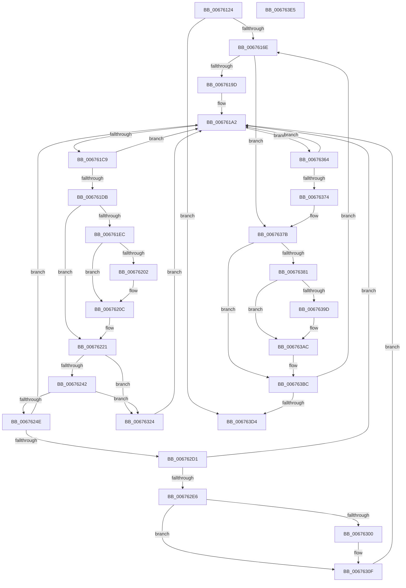

# MiHugePurgeZeroList

- RVA: `0x00676124`–`0x006763E6` (길이 `706` bytes)
- VA: `0x0000000140676124`
- 실행 섹션: `.text`
- PDB 이름 있음: `예`; PDB Function 태그: `아니요`
- unwind 정보 RVA: `0x000A315C`
- 디코드: `180`개 명령, `706/706` bytes 표시
- 미해석 바이트: `0` (있으면 어셈블리에 `.byte`로 보존)

> 이 문서는 커널 이미지의 기계어와 PDB 기호를 분석해 생성했습니다. 4번과 5번은 함수 원형과 자료형을 바이너리 사용 방식에서 추정한 C 해석이며 원본 소스 복구 결과는 아닙니다.

## 1. Dependencies

- 직접 호출 지점: **12**; 고유 호출 대상: **9**
- 직접 호출자로 확인된 함수: **1**
- RIP 상대 이미지 참조: **6**

### Outgoing calls
- `0x00676189` → [MiGetColorHeadHugeRangeBase](../43/MiGetColorHeadHugeRangeBase_function_00437160.md) (function, `0x00437160`)
- `0x00676207` → [KiRaiseIrqlProcessIrqlFlags](../4F/KiRaiseIrqlProcessIrqlFlags_function_004F56FC.md) (function, `0x004F56FC`)
- `0x0067621C` → [MiUpdatePageMoveInProgressInternal](../43/MiUpdatePageMoveInProgressInternal_function_0043F5A0.md) (function, `0x0043F5A0`)
- `0x00676224` → [MiLockHugePfnInternal](../3F/MiLockHugePfnInternal_function_003FBC80.md) (function, `0x003FBC80`)
- `0x00676251` → [MiLockColorHeadHugeAtDpc](../4F/MiLockColorHeadHugeAtDpc_function_004FAD3C.md) (function, `0x004FAD3C`)
- `0x0067625F` → [MiUnlinkHugeRange](../43/MiUnlinkHugeRange_function_00436EF0.md) (function, `0x00436EF0`)
- `0x00676271` → [MiInsertHugeRangeInList](../43/MiInsertHugeRangeInList_function_004371E8.md) (function, `0x004371E8`)
- `0x006762D1` → [KeShouldYieldProcessor](../27/KeShouldYieldProcessor_function_002773E0.md) (function, `0x002773E0`)
- `0x006762F2` → [MiUpdatePageMoveInProgressInternal](../43/MiUpdatePageMoveInProgressInternal_function_0043F5A0.md) (function, `0x0043F5A0`)
- `0x00676307` → [KiLowerIrqlProcessIrqlFlags](../4F/KiLowerIrqlProcessIrqlFlags_function_004F5698.md) (function, `0x004F5698`)
- `0x0067638F` → [MiUpdatePageMoveInProgressInternal](../43/MiUpdatePageMoveInProgressInternal_function_0043F5A0.md) (function, `0x0043F5A0`)
- `0x006763A4` → [KiLowerIrqlProcessIrqlFlags](../4F/KiLowerIrqlProcessIrqlFlags_function_004F5698.md) (function, `0x004F5698`)

### Direct callers
- [MiMirrorPurgePartitionPages](../4B/MiMirrorPurgePartitionPages_function_004BEFA0.md) at `0x004BEFE0`

### Static image references
- `0x0067613B` → RVA `0x00FC5000` (`ALMOSTRO`; read)
- `0x00676146` → RVA `0x00E2DCC0` (`.data`; read)
- `0x006761C9` → RVA `0x00E300B8` (`.data`; read)
- `0x006761DB` → RVA `0x00E300C0` (`.data`; read)
- `0x006761F9` → RVA `0x00FC6D20` (`ALMOSTRO`; read)
- `0x00676282` → RVA `0x00E300C8` (`.data`; read)

## 2. Other-region calls and transfers

- 다른 실행 섹션으로 향하는 call: **0**
- 별도 외부 분기/꼬리 이동을 확인하지 못했습니다.

## 3. Assembly (complete function range)

```asm
00676124  40 53                           push rbx
00676126  55                              push rbp
00676127  56                              push rsi
00676128  57                              push rdi
00676129  41 54                           push r12
0067612B  41 55                           push r13
0067612D  41 56                           push r14
0067612F  41 57                           push r15
00676131  48 83 EC 28                     sub rsp, 0x28
00676135  0F B7 01                        movzx eax, word ptr [rcx]
00676138  45 33 DB                        xor r11d, r11d
0067613B  66 44 3B 1D BD EE 94 00         cmp r11w, word ptr [rip + 0x94eebd]
00676143  4C 8B E9                        mov r13, rcx
00676146  44 8B 15 73 7B 7B 00            mov r10d, dword ptr [rip + 0x7b7b73]
0067614D  41 8B DB                        mov ebx, r11d
00676150  66 89 44 24 70                  mov word ptr [rsp + 0x70], ax
00676155  40 B6 11                        mov sil, 0x11
00676158  44 89 54 24 78                  mov dword ptr [rsp + 0x78], r10d
0067615D  41 8B FB                        mov edi, r11d
00676160  44 89 9C 24 88 00 00 00         mov dword ptr [rsp + 0x88], r11d
00676168  0F 83 66 02 00 00               jae 0x1406763d4
0067616E  8B C7                           mov eax, edi
00676170  45 33 C0                        xor r8d, r8d
00676173  48 69 E8 80 DF 00 00            imul rbp, rax, 0xdf80
0067617A  44 89 9C 24 80 00 00 00         mov dword ptr [rsp + 0x80], r11d
00676182  49 03 6D 10                     add rbp, qword ptr [r13 + 0x10]
00676186  48 8B CD                        mov rcx, rbp
00676189  E8 D2 0F DC FF                  call 0x140437160
0067618E  4C 8B F8                        mov r15, rax
00676191  45 8B E3                        mov r12d, r11d
00676194  45 85 D2                        test r10d, r10d
00676197  0F 84 DE 01 00 00               je 0x14067637b
0067619D  0F B7 7C 24 70                  movzx edi, word ptr [rsp + 0x70]
006761A2  49 8B 0F                        mov rcx, qword ptr [r15]
006761A5  48 C1 E9 0F                     shr rcx, 0xf
006761A9  48 33 D9                        xor rbx, rcx
006761AC  4C 8B C1                        mov r8, rcx
006761AF  48 81 E3 00 00 C0 FF            and rbx, 0xffffffffffc00000
006761B6  41 81 E0 FF FF 3F 00            and r8d, 0x3fffff
006761BD  48 33 D9                        xor rbx, rcx
006761C0  4D 85 C0                        test r8, r8
006761C3  0F 84 9B 01 00 00               je 0x140676364
006761C9  48 8B 05 E8 9E 7B 00            mov rax, qword ptr [rip + 0x7b9ee8]
006761D0  4C 0F A3 00                     bt qword ptr [rax], r8
006761D4  0F 92 C0                        setb al
006761D7  84 C0                           test al, al
006761D9  74 C7                           je 0x1406761a2
006761DB  48 8B 05 DE 9E 7B 00            mov rax, qword ptr [rip + 0x7b9ede]
006761E2  4E 8D 34 C0                     lea r14, [rax + r8*8]
006761E6  40 80 FE 11                     cmp sil, 0x11
006761EA  75 35                           jne 0x140676221
006761EC  44 0F 20 C6                     mov rsi, cr8
006761F0  B8 02 00 00 00                  mov eax, 2
006761F5  44 0F 22 C0                     mov cr8, rax
006761F9  44 39 1D 20 0B 95 00            cmp dword ptr [rip + 0x950b20], r11d
00676200  74 0A                           je 0x14067620c
00676202  8A D0                           mov dl, al
00676204  40 8A CE                        mov cl, sil
00676207  E8 F0 F4 E7 FF                  call 0x1404f56fc
0067620C  B8 01 00 00 00                  mov eax, 1
00676211  33 D2                           xor edx, edx
00676213  44 8B C8                        mov r9d, eax
00676216  44 8B C0                        mov r8d, eax
00676219  48 8B CD                        mov rcx, rbp
0067621C  E8 7F 93 DC FF                  call 0x14043f5a0
00676221  49 8B CE                        mov rcx, r14
00676224  E8 57 5A D8 FF                  call 0x1403fbc80
00676229  49 8B 16                        mov rdx, qword ptr [r14]
0067622C  48 8B CA                        mov rcx, rdx
0067622F  48 C1 E9 04                     shr rcx, 4
00676233  81 E1 FF 07 00 00               and ecx, 0x7ff
00676239  48 3B CF                        cmp rcx, rdi
0067623C  0F 85 E2 00 00 00               jne 0x140676324
00676242  80 E2 07                        and dl, 7
00676245  80 FA 01                        cmp dl, 1
00676248  0F 85 D6 00 00 00               jne 0x140676324
0067624E  49 8B CF                        mov rcx, r15
00676251  E8 E6 4A E8 FF                  call 0x1404fad3c
00676256  49 8B 07                        mov rax, qword ptr [r15]
00676259  48 8B D3                        mov rdx, rbx
0067625C  49 8B CD                        mov rcx, r13
0067625F  E8 8C 0C DC FF                  call 0x140436ef0
00676264  F0 49 83 27 F7                  lock and qword ptr [r15], 0xfffffffffffffff7
00676269  45 33 C0                        xor r8d, r8d
0067626C  48 8B D3                        mov rdx, rbx
0067626F  33 C9                           xor ecx, ecx
00676271  E8 72 0F DC FF                  call 0x1404371e8
00676276  4C 2B 35 43 9E 7B 00            sub r14, qword ptr [rip + 0x7b9e43]
0067627D  BA 01 00 00 00                  mov edx, 1
00676282  48 8B 05 3F 9E 7B 00            mov rax, qword ptr [rip + 0x7b9e3f]
00676289  49 C1 FE 03                     sar r14, 3
0067628D  41 81 E6 FF FF 3F 00            and r14d, 0x3fffff
00676294  41 8B CE                        mov ecx, r14d
00676297  83 E1 1F                        and ecx, 0x1f
0067629A  D3 E2                           shl edx, cl
0067629C  41 8B CE                        mov ecx, r14d
0067629F  F7 D2                           not edx
006762A1  48 C1 E9 05                     shr rcx, 5
006762A5  F0 21 14 88                     lock and dword ptr [rax + rcx*4], edx
006762A9  44 8B 9C 24 80 00 00 00         mov r11d, dword ptr [rsp + 0x80]
006762B1  44 8B 54 24 78                  mov r10d, dword ptr [rsp + 0x78]
006762B6  41 FF C3                        inc r11d
006762B9  44 89 9C 24 80 00 00 00         mov dword ptr [rsp + 0x80], r11d
006762C1  41 F6 C3 3F                     test r11b, 0x3f
006762C5  41 BB 00 00 00 00               mov r11d, 0
006762CB  0F 85 D1 FE FF FF               jne 0x1406761a2
006762D1  E8 0A 11 C0 FF                  call 0x1402773e0
006762D6  44 8B 54 24 78                  mov r10d, dword ptr [rsp + 0x78]
006762DB  45 33 DB                        xor r11d, r11d
006762DE  85 C0                           test eax, eax
006762E0  0F 84 BC FE FF FF               je 0x1406761a2
006762E6  45 8D 4B 01                     lea r9d, [r11 + 1]
006762EA  45 33 C0                        xor r8d, r8d
006762ED  33 D2                           xor edx, edx
006762EF  48 8B CD                        mov rcx, rbp
006762F2  E8 A9 92 DC FF                  call 0x14043f5a0
006762F7  44 39 1D 22 0A 95 00            cmp dword ptr [rip + 0x950a22], r11d
006762FE  74 0F                           je 0x14067630f
00676300  44 0F 20 C1                     mov rcx, cr8
00676304  40 8A D6                        mov dl, sil
00676307  E8 8C F3 E7 FF                  call 0x1404f5698
0067630C  45 33 DB                        xor r11d, r11d
0067630F  40 0F B6 C6                     movzx eax, sil
00676313  44 0F 22 C0                     mov cr8, rax
00676317  44 8B 54 24 78                  mov r10d, dword ptr [rsp + 0x78]
0067631C  40 B6 11                        mov sil, 0x11
0067631F  E9 7E FE FF FF                  jmp 0x1406761a2
00676324  4C 2B 35 95 9D 7B 00            sub r14, qword ptr [rip + 0x7b9d95]
0067632B  BA 01 00 00 00                  mov edx, 1
00676330  48 8B 05 91 9D 7B 00            mov rax, qword ptr [rip + 0x7b9d91]
00676337  49 C1 FE 03                     sar r14, 3
0067633B  41 81 E6 FF FF 3F 00            and r14d, 0x3fffff
00676342  41 8B CE                        mov ecx, r14d
00676345  83 E1 1F                        and ecx, 0x1f
00676348  D3 E2                           shl edx, cl
0067634A  41 8B CE                        mov ecx, r14d
0067634D  F7 D2                           not edx
0067634F  48 C1 E9 05                     shr rcx, 5
00676353  F0 21 14 88                     lock and dword ptr [rax + rcx*4], edx
00676357  44 8B 54 24 78                  mov r10d, dword ptr [rsp + 0x78]
0067635C  45 33 DB                        xor r11d, r11d
0067635F  E9 3E FE FF FF                  jmp 0x1406761a2
00676364  49 83 C7 08                     add r15, 8
00676368  41 FF C4                        inc r12d
0067636B  45 3B E2                        cmp r12d, r10d
0067636E  0F 82 2E FE FF FF               jb 0x1406761a2
00676374  8B BC 24 88 00 00 00            mov edi, dword ptr [rsp + 0x88]
0067637B  40 80 FE 11                     cmp sil, 0x11
0067637F  74 3B                           je 0x1406763bc
00676381  41 B9 01 00 00 00               mov r9d, 1
00676387  45 33 C0                        xor r8d, r8d
0067638A  33 D2                           xor edx, edx
0067638C  48 8B CD                        mov rcx, rbp
0067638F  E8 0C 92 DC FF                  call 0x14043f5a0
00676394  44 39 1D 85 09 95 00            cmp dword ptr [rip + 0x950985], r11d
0067639B  74 0F                           je 0x1406763ac
0067639D  44 0F 20 C1                     mov rcx, cr8
006763A1  40 8A D6                        mov dl, sil
006763A4  E8 EF F2 E7 FF                  call 0x1404f5698
006763A9  45 33 DB                        xor r11d, r11d
006763AC  40 0F B6 C6                     movzx eax, sil
006763B0  44 0F 22 C0                     mov cr8, rax
006763B4  44 8B 54 24 78                  mov r10d, dword ptr [rsp + 0x78]
006763B9  40 B6 11                        mov sil, 0x11
006763BC  0F B7 05 3D EC 94 00            movzx eax, word ptr [rip + 0x94ec3d]
006763C3  FF C7                           inc edi
006763C5  89 BC 24 88 00 00 00            mov dword ptr [rsp + 0x88], edi
006763CC  3B F8                           cmp edi, eax
006763CE  0F 82 9A FD FF FF               jb 0x14067616e
006763D4  48 83 C4 28                     add rsp, 0x28
006763D8  41 5F                           pop r15
006763DA  41 5E                           pop r14
006763DC  41 5D                           pop r13
006763DE  41 5C                           pop r12
006763E0  5F                              pop rdi
006763E1  5E                              pop rsi
006763E2  5D                              pop rbp
006763E3  5B                              pop rbx
006763E4  C3                              ret
006763E5  CC                              int3
```

## 4. C-style interpretation (structured pseudocode)

```c
__int64 __fastcall MiHugePurgeZeroList(__int64 a1, __int64 a2, int a3)
{
    __int64 result;
    __int64 v_r11;
    __int64 v_r12;
    __int64 v_r14;
    __int64 v_r15;
    __int64 v_rbp;
    __int64 v_rbx;
    __int64 v_rdi;
    __int64 v_rsp;
    unsigned int v_stack_p10;
    unsigned int v_stack_p18;
    unsigned int v_stack_p20;
    unsigned __int16 v_stack_p8;

    v_rsp = (v_rsp) - (40);
    v_r11 = 0;
    v_stack_p8 = (unsigned __int16)(*(unsigned __int16 *)(a1));
    v_stack_p10 = (unsigned int)((unsigned int)(*(unsigned int *)(v_rip + 8092531)));
    v_stack_p20 = 0;
    if (0 >= (*(unsigned __int16 *)(v_rip + 9760445))) goto loc_006763D4;
loc_0067616E:
    a3 = 0;
    v_rbp = (v_rbp) * (0);
    v_stack_p18 = 0;
    v_rbp = (v_rbp) + (*(unsigned __int64 *)(a1 + 16));
    result = MiGetColorHeadHugeRangeBase(v_rbp, a2, a3, a4);
    if ((unsigned int)((unsigned int)(*(unsigned int *)(v_rip + 8092531))) == 0) goto loc_0067637B;
loc_006761A2:
    a1 = (*(unsigned __int64 *)(result)) >> (15);
    v_rbx = (0) ^ (a1);
    v_rbx = (v_rbx) & (0xFFFFFFFFFFC00000ULL);
    a3 = (unsigned int)((a1) & (0x3FFFFFULL));
    v_rbx = (v_rbx) ^ (a1);
    if (a3 == 0) goto loc_00676364;
    result = (condition_is_below) ? 1 : 0;
    if ((unsigned __int8)(result) == 0) goto loc_006761A2;
    if (17 != 17) goto loc_00676221;
    result = 2;
    if ((*(unsigned int *)(v_rip + 9767712)) != 0) {
        a2 = 2;
        a1 = (unsigned __int8)(v_cr8);
        result = KiRaiseIrqlProcessIrqlFlags(a1, a2, a3, a4);
    }
    a2 = 0;
    result = MiUpdatePageMoveInProgressInternal(v_rbp, a2, 1, 1);
loc_00676221:
    result = MiLockHugePfnInternal(*(unsigned __int64 *)(v_rip + 8101598) + a3 * 8, a2, 1, 1);
    a1 = (*(unsigned __int64 *)(*(unsigned __int64 *)(v_rip + 8101598) + a3 * 8)) >> (4);
    a1 = (unsigned int)((a1) & (0x7FFULL));
    if (a1 != v_stack_p8) goto loc_00676324;
    a2 = (unsigned __int8)((*(unsigned __int64 *)(*(unsigned __int64 *)(v_rip + 8101598) + a3 * 8)) & (7));
    if (((unsigned __int8)(a2)) != 1) goto loc_00676324;
    result = MiLockColorHeadHugeAtDpc(result, a2, 1, 1);
    result = MiUnlinkHugeRange(a1, v_rbx, 1, 1);
    a3 = 0;
    a1 = 0;
    result = MiInsertHugeRangeInList(a1, v_rbx, a3, 1);
    v_r14 = (*(unsigned __int64 *)(v_rip + 8101598) + a3 * 8) - (*(unsigned __int64 *)(v_rip + 8101443));
    v_r14 = (v_r14) >> (3);
    v_r14 = (unsigned int)((v_r14) & (0x3FFFFFULL));
    a1 = (unsigned int)(((unsigned int)((unsigned int)(v_r14))) & (31));
    a2 = (unsigned int)((1) << ((unsigned __int8)(a1)));
    a2 = (unsigned int)(~(a2));
    a1 = ((unsigned int)((unsigned int)(v_r14))) >> (5);
    v_r11 = (unsigned int)(((unsigned int)(v_stack_p18)) + 1);
    v_stack_p18 = (unsigned int)(v_r11);
    if ((((unsigned __int8)(v_r11)) & (63)) != 0) goto loc_006761A2;
    result = KeShouldYieldProcessor(a1, a2, a3, 1);
    v_r11 = 0;
    if ((unsigned int)(result) == 0) goto loc_006761A2;
    a3 = 0;
    a2 = 0;
    result = MiUpdatePageMoveInProgressInternal(v_rbp, a2, a3, v_r11 + 1);
    if ((*(unsigned int *)(v_rip + 9767458)) != 0) {
        a1 = 2;
        a2 = (unsigned __int8)(v_cr8);
        result = KiLowerIrqlProcessIrqlFlags(a1, a2, a3, v_r11 + 1);
        v_r11 = 0;
    }
    goto loc_006761A2;
loc_00676324:
    v_r14 = (v_r14) - (*(unsigned __int64 *)(v_rip + 8101269));
    v_r14 = (v_r14) >> (3);
    v_r14 = (unsigned int)((v_r14) & (0x3FFFFFULL));
    a1 = (unsigned int)(((unsigned int)((unsigned int)(v_r14))) & (31));
    a2 = (unsigned int)((1) << ((unsigned __int8)(a1)));
    a2 = (unsigned int)(~(a2));
    a1 = ((unsigned int)((unsigned int)(v_r14))) >> (5);
    v_r11 = 0;
    goto loc_006761A2;
loc_00676364:
    v_r15 = (result) + (8);
    v_r12 = (unsigned int)((0) + 1);
    if (((unsigned int)(v_r12)) < ((unsigned int)((unsigned int)(v_stack_p10)))) goto loc_006761A2;
loc_0067637B:
    if (17 == 17) goto loc_006763BC;
    a3 = 0;
    a2 = 0;
    result = MiUpdatePageMoveInProgressInternal(v_rbp, a2, a3, 1);
    if ((*(unsigned int *)(v_rip + 9767301)) != 0) {
        a1 = (unsigned __int8)(v_cr8);
        a2 = 17;
        result = KiLowerIrqlProcessIrqlFlags(a1, a2, a3, 1);
        v_r11 = 0;
    }
loc_006763BC:
    v_rdi = (unsigned int)(((unsigned int)(v_stack_p20)) + 1);
    v_stack_p20 = (unsigned int)(v_rdi);
    if (((unsigned int)(v_rdi)) < ((unsigned int)(*(unsigned __int16 *)(v_rip + 9759805)))) goto loc_0067616E;
loc_006763D4:
    v_rsp = (v_rsp) + (40);
    return *(unsigned __int16 *)(v_rip + 9759805);
}
```

## 5. (Beta) C Style

```c
int64_t MiHugePurgeZeroList(void *Arg1, int64_t Arg2, int32_t Arg3)
{
    uint8_t *arg1 = (uint8_t *)Arg1;

    int64_t result;
    int64_t local_r11;
    int64_t local_r12;
    int64_t local_r14;
    int64_t local_r15;
    int64_t local_rbp;
    int64_t local_rbx;
    int64_t local_rdi;
    int64_t local_rsp;
    uint32_t v_stack_p10;
    uint32_t v_stack_p18;
    uint32_t v_stack_p20;
    uint16_t v_stack_p8;

    local_rsp = (local_rsp) - (40);
    local_r11 = 0;
    v_stack_p8 = (uint16_t)(*(uint16_t *)(arg1));
    v_stack_p10 = (uint32_t)((uint32_t)(*(uint32_t *)(v_rip + 0x7B7B73)));
    v_stack_p20 = 0;
    if (0 >= (*(uint16_t *)(v_rip + 0x94EEBD))) goto loc_006763D4;
loc_0067616E:
    Arg3 = 0;
    local_rbp = (local_rbp) * (0);
    v_stack_p18 = 0;
    local_rbp = (local_rbp) + (*(uint64_t *)(arg1 + 0x10));
    result = MiGetColorHeadHugeRangeBase(local_rbp, Arg2, Arg3, a4);
    if ((uint32_t)((uint32_t)(*(uint32_t *)(v_rip + 0x7B7B73))) == 0) goto loc_0067637B;
loc_006761A2:
    Arg1 = (*(uint64_t *)(result)) >> (15);
    local_rbx = (0) ^ (Arg1);
    local_rbx = (local_rbx) & (0xFFFFFFFFFFC00000ULL);
    Arg3 = (uint32_t)((Arg1) & (0x3FFFFFULL));
    local_rbx = (local_rbx) ^ (Arg1);
    if (Arg3 == 0) goto loc_00676364;
    result = (condition_is_below) ? 1 : 0;
    if ((uint8_t)(result) == 0) goto loc_006761A2;
    if (17 != 17) goto loc_00676221;
    result = 2;
    if ((*(uint32_t *)(v_rip + 0x950B20)) != 0) {
        Arg2 = 2;
        Arg1 = (uint8_t)(v_cr8);
        result = KiRaiseIrqlProcessIrqlFlags(Arg1, Arg2, Arg3, a4);
    }
    Arg2 = 0;
    result = MiUpdatePageMoveInProgressInternal(local_rbp, Arg2, 1, 1);
loc_00676221:
    result = MiLockHugePfnInternal(*(uint64_t *)(v_rip + 0x7B9EDE) + Arg3 * 8, Arg2, 1, 1);
    Arg1 = (*(uint64_t *)(*(uint64_t *)(v_rip + 0x7B9EDE) + Arg3 * 8)) >> (4);
    Arg1 = (uint32_t)((Arg1) & (0x7FFULL));
    if (Arg1 != v_stack_p8) goto loc_00676324;
    Arg2 = (uint8_t)((*(uint64_t *)(*(uint64_t *)(v_rip + 0x7B9EDE) + Arg3 * 8)) & (7));
    if (((uint8_t)(Arg2)) != 1) goto loc_00676324;
    result = MiLockColorHeadHugeAtDpc(result, Arg2, 1, 1);
    result = MiUnlinkHugeRange(Arg1, local_rbx, 1, 1);
    Arg3 = 0;
    Arg1 = 0;
    result = MiInsertHugeRangeInList(Arg1, local_rbx, Arg3, 1);
    local_r14 = (*(uint64_t *)(v_rip + 0x7B9EDE) + Arg3 * 8) - (*(uint64_t *)(v_rip + 0x7B9E43));
    local_r14 = (local_r14) >> (3);
    local_r14 = (uint32_t)((local_r14) & (0x3FFFFFULL));
    Arg1 = (uint32_t)(((uint32_t)((uint32_t)(local_r14))) & (31));
    Arg2 = (uint32_t)((1) << ((uint8_t)(Arg1)));
    Arg2 = (uint32_t)(~(Arg2));
    Arg1 = ((uint32_t)((uint32_t)(local_r14))) >> (5);
    local_r11 = (uint32_t)(((uint32_t)(v_stack_p18)) + 1);
    v_stack_p18 = (uint32_t)(local_r11);
    if ((((uint8_t)(local_r11)) & (63)) != 0) goto loc_006761A2;
    result = KeShouldYieldProcessor(Arg1, Arg2, Arg3, 1);
    local_r11 = 0;
    if ((uint32_t)(result) == 0) goto loc_006761A2;
    Arg3 = 0;
    Arg2 = 0;
    result = MiUpdatePageMoveInProgressInternal(local_rbp, Arg2, Arg3, local_r11 + 1);
    if ((*(uint32_t *)(v_rip + 0x950A22)) != 0) {
        Arg1 = 2;
        Arg2 = (uint8_t)(v_cr8);
        result = KiLowerIrqlProcessIrqlFlags(Arg1, Arg2, Arg3, local_r11 + 1);
        local_r11 = 0;
    }
    goto loc_006761A2;
loc_00676324:
    local_r14 = (local_r14) - (*(uint64_t *)(v_rip + 0x7B9D95));
    local_r14 = (local_r14) >> (3);
    local_r14 = (uint32_t)((local_r14) & (0x3FFFFFULL));
    Arg1 = (uint32_t)(((uint32_t)((uint32_t)(local_r14))) & (31));
    Arg2 = (uint32_t)((1) << ((uint8_t)(Arg1)));
    Arg2 = (uint32_t)(~(Arg2));
    Arg1 = ((uint32_t)((uint32_t)(local_r14))) >> (5);
    local_r11 = 0;
    goto loc_006761A2;
loc_00676364:
    local_r15 = (result) + (8);
    local_r12 = (uint32_t)((0) + 1);
    if (((uint32_t)(local_r12)) < ((uint32_t)((uint32_t)(v_stack_p10)))) goto loc_006761A2;
loc_0067637B:
    if (17 == 17) goto loc_006763BC;
    Arg3 = 0;
    Arg2 = 0;
    result = MiUpdatePageMoveInProgressInternal(local_rbp, Arg2, Arg3, 1);
    if ((*(uint32_t *)(v_rip + 0x950985)) != 0) {
        Arg1 = (uint8_t)(v_cr8);
        Arg2 = 17;
        result = KiLowerIrqlProcessIrqlFlags(Arg1, Arg2, Arg3, 1);
        local_r11 = 0;
    }
loc_006763BC:
    local_rdi = (uint32_t)(((uint32_t)(v_stack_p20)) + 1);
    v_stack_p20 = (uint32_t)(local_rdi);
    if (((uint32_t)(local_rdi)) < ((uint32_t)(*(uint16_t *)(v_rip + 0x94EC3D)))) goto loc_0067616E;
loc_006763D4:
    local_rsp = (local_rsp) + (40);
    return *(uint16_t *)(v_rip + 0x94EC3D);
}
```

### 관측된 메모리 오프셋

구조체 형식이 확인되지 않은 접근은 인자 기준의 오프셋으로만 기록했습니다.

| 기준 인자 | 오프셋 표현 | 폭 (bit) | 접근 |
|---|---:|---:|---|
| `Arg1` | `+ 0x0` | `16` | `R` |
| `Arg1` | `+ 0x10` | `64` | `R` |

## 6. Execution-region graph

[열기: 2D/3D 그래프와 함수 탐색 컨트롤 패널](../../../control-panel.html?section=text&rva=0x00676124&view=graph)

- 2D 그래프는 위에서 아래로 흐르고, 3D 그래프는 빈 공간을 드래그해 회전합니다. Shift+드래그는 이동, 휠은 확대·축소, 함수 노드 선택은 대상 보고서 이동입니다.

### Static fallback


