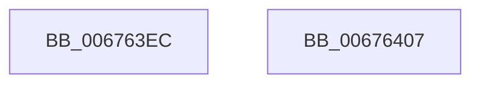

# MiHugeRangeIsZeroed

- RVA: `0x006763EC`–`0x00676408` (길이 `28` bytes)
- VA: `0x00000001406763EC`
- 실행 섹션: `.text`
- PDB 이름 있음: `예`; PDB Function 태그: `아니요`
- unwind 정보 RVA: `0x000DB714`
- 디코드: `8`개 명령, `28/28` bytes 표시
- 미해석 바이트: `0` (있으면 어셈블리에 `.byte`로 보존)

> 이 문서는 커널 이미지의 기계어와 PDB 기호를 분석해 생성했습니다. 4번과 5번은 함수 원형과 자료형을 바이너리 사용 방식에서 추정한 C 해석이며 원본 소스 복구 결과는 아닙니다.

## 1. Dependencies

- 직접 호출 지점: **0**; 고유 호출 대상: **0**
- 직접 호출자로 확인된 함수: **1**
- RIP 상대 이미지 참조: **1**

### Outgoing calls
- 직접 디코드된 call 명령이 없습니다.

### Direct callers
- [MiAllocatePartitionPhysicalPages](../../page/80/MiAllocatePartitionPhysicalPages_function_0080C9D4.md) at `0x0080CC5C`

### Static image references
- `0x006763EC` → RVA `0x00E300C0` (`.data`; read)

## 2. Other-region calls and transfers

- 다른 실행 섹션으로 향하는 call: **0**
- 별도 외부 분기/꼬리 이동을 확인하지 못했습니다.

## 3. Assembly (complete function range)

```asm
006763EC  48 8B 05 CD 9C 7B 00            mov rax, qword ptr [rip + 0x7b9ccd]
006763F3  81 E2 FF FF 3F 00               and edx, 0x3fffff
006763F9  48 8B 04 D0                     mov rax, qword ptr [rax + rdx*8]
006763FD  48 C1 E8 10                     shr rax, 0x10
00676401  F7 D0                           not eax
00676403  83 E0 01                        and eax, 1
00676406  C3                              ret
00676407  CC                              int3
```

## 4. C-style interpretation (structured pseudocode)

```c
__int64 __fastcall MiHugeRangeIsZeroed(__int64 a1, int a2)
{
    __int64 result;

    a2 = (unsigned int)((a2) & (0x3FFFFFULL));
    result = (*(unsigned __int64 *)(*(unsigned __int64 *)(v_rip + 8101069) + a2 * 8)) >> (16);
    result = (unsigned int)(~(result));
    result = (unsigned int)((result) & (1));
    return result;
}
```

## 5. (Beta) C Style

```c
int64_t MiHugeRangeIsZeroed(int64_t Arg1, int32_t Arg2)
{
    int64_t result;

    Arg2 = (uint32_t)((Arg2) & (0x3FFFFFULL));
    result = (*(uint64_t *)(*(uint64_t *)(v_rip + 0x7B9CCD) + Arg2 * 8)) >> (16);
    result = (uint32_t)(~(result));
    result = (uint32_t)((result) & (1));
    return result;
}
```

## 6. Execution-region graph

[열기: 2D/3D 그래프와 함수 탐색 컨트롤 패널](../../../control-panel.html?section=text&rva=0x006763EC&view=graph)

- 2D 그래프는 위에서 아래로 흐르고, 3D 그래프는 빈 공간을 드래그해 회전합니다. Shift+드래그는 이동, 휠은 확대·축소, 함수 노드 선택은 대상 보고서 이동입니다.

### Static fallback


