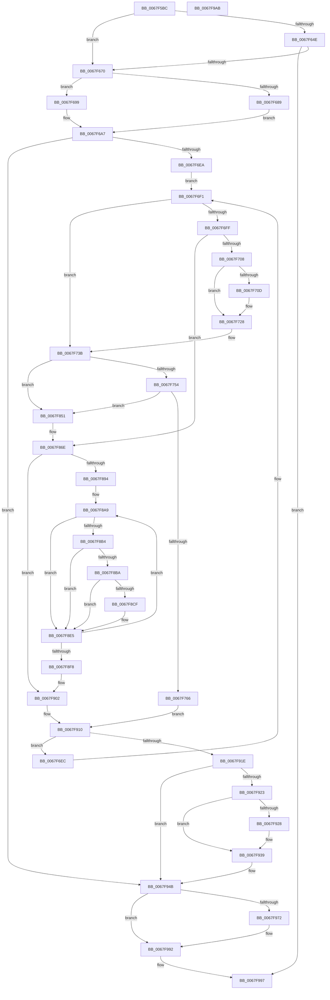

# MiInitializeDynamicBitmap

- RVA: `0x0067F5BC`–`0x0067F9AC` (길이 `1,008` bytes)
- VA: `0x000000014067F5BC`
- 실행 섹션: `.text`
- PDB 이름 있음: `예`; PDB Function 태그: `아니요`
- unwind 정보 RVA: `0x000D80CC`
- 디코드: `246`개 명령, `1,008/1,008` bytes 표시
- 미해석 바이트: `0` (있으면 어셈블리에 `.byte`로 보존)

> 이 문서는 커널 이미지의 기계어와 PDB 기호를 분석해 생성했습니다. 4번과 5번은 함수 원형과 자료형을 바이너리 사용 방식에서 추정한 C 해석이며 원본 소스 복구 결과는 아닙니다.

## 1. Dependencies

- 직접 호출 지점: **15**; 고유 호출 대상: **11**
- 직접 호출자로 확인된 함수: **5**
- RIP 상대 이미지 참조: **6**

### Outgoing calls
- `0x0067F663` → [MiMakeZeroedPageTables](../3B/MiMakeZeroedPageTables_function_003B4F6C.md) (function, `0x003B4F6C`)
- `0x0067F6B0` → [MiMakeValidPte](../2C/MiMakeValidPte_function_002C5590.md) (function, `0x002C5590`)
- `0x0067F6C0` → [MiGetAnyMultiplexedVm](../44/MiGetAnyMultiplexedVm_function_00448BD0.md) (function, `0x00448BD0`)
- `0x0067F717` → [MiIncreaseUsedPtes](../24/MiIncreaseUsedPtes_function_00243630.md) (function, `0x00243630`)
- `0x0067F731` → [MiUnlockWorkingSetOptimal](../23/MiUnlockWorkingSetOptimal_function_00238DFC.md) (function, `0x00238DFC`)
- `0x0067F792` → [MiLockWorkingSetOptimal](../23/MiLockWorkingSetOptimal_function_00238FC0.md) (function, `0x00238FC0`)
- `0x0067F7B4` → [MiTransformValidPteInPlace](../37/MiTransformValidPteInPlace_function_003765E0.md) (function, `0x003765E0`)
- `0x0067F7C6` → [MiUnlockWorkingSetOptimal](../23/MiUnlockWorkingSetOptimal_function_00238DFC.md) (function, `0x00238DFC`)
- `0x0067F7F8` → [MiInsertPageChainHead](../2A/MiInsertPageChainHead_function_002A24EC.md) (function, `0x002A24EC`)
- `0x0067F85C` → [MiLockWorkingSetOptimal](../23/MiLockWorkingSetOptimal_function_00238FC0.md) (function, `0x00238FC0`)
- `0x0067F8DB` → [MiCheckLinearProtectedPteAccessedBit](../29/MiCheckLinearProtectedPteAccessedBit_function_00292D80.md) (function, `0x00292D80`)
- `0x0067F934` → [MiIncreaseUsedPtes](../24/MiIncreaseUsedPtes_function_00243630.md) (function, `0x00243630`)
- `0x0067F946` → [MiUnlockWorkingSetOptimal](../23/MiUnlockWorkingSetOptimal_function_00238DFC.md) (function, `0x00238DFC`)
- `0x0067F977` → [MiReturnPfnList](MiReturnPfnList_function_0067FBEC.md) (function, `0x0067FBEC`)
- `0x0067F98D` → [MiReturnSystemCharges](../36/MiReturnSystemCharges_function_00367A48.md) (function, `0x00367A48`)

### Direct callers
- [MiBuildDynamicRegion](MiBuildDynamicRegion_function_0067F470.md) at `0x0067F56D`
- [MiCreatePfnBitMaps](../../page/80/MiCreatePfnBitMaps_function_0080BBC8.md) at `0x0080BCA4`
- [MiCreatePfnBitMaps](../../page/80/MiCreatePfnBitMaps_function_0080BBC8.md) at `0x0080BD5A`
- [MiCreatePfnBitMaps](../../page/80/MiCreatePfnBitMaps_function_0080BBC8.md) at `0x0080BDDD`
- [MiCreatePfnBitMaps](../../page/80/MiCreatePfnBitMaps_function_0080BBC8.md) at `0x0080BE9E`
- [MiCreatePfnBitMaps](../../page/80/MiCreatePfnBitMaps_function_0080BBC8.md) at `0x0080BF28`
- [MiCreatePfnBitMaps](../../page/80/MiCreatePfnBitMaps_function_0080BBC8.md) at `0x0080BF85`
- [MiInitializeMirroring](../../init/C6/MiInitializeMirroring_function_00C64730.md) at `0x00C6480E`
- [MiCreateRetpolineBitmap](../../init/C6/MiCreateRetpolineBitmap_function_00C66418.md) at `0x00C6647C`
- [MiInitializePteInfo](../../init/C6/MiInitializePteInfo_function_00C6A7E0.md) at `0x00C6A8C5`
- [MiInitializePteInfo](../../init/C6/MiInitializePteInfo_function_00C6A7E0.md) at `0x00C6A979`

### Static image references
- `0x0067F689` → RVA `0x00E37440` (`.data`; read)
- `0x0067F690` → RVA `0x00E37470` (`.data`; read)
- `0x0067F699` → RVA `0x00E37478` (`.data`; read)
- `0x0067F6A0` → RVA `0x00E374A8` (`.data`; read)
- `0x0067F801` → RVA `0x00E30088` (`.data`; read)
- `0x0067F8A9` → RVA `0x00FC6A88` (`ALMOSTRO`; read)

## 2. Other-region calls and transfers

- 다른 실행 섹션으로 향하는 call: **0**
- 별도 외부 분기/꼬리 이동을 확인하지 못했습니다.

## 3. Assembly (complete function range)

```asm
0067F5BC  48 8B C4                        mov rax, rsp
0067F5BF  44 89 48 20                     mov dword ptr [rax + 0x20], r9d
0067F5C3  4C 89 40 18                     mov qword ptr [rax + 0x18], r8
0067F5C7  48 89 50 10                     mov qword ptr [rax + 0x10], rdx
0067F5CB  48 89 48 08                     mov qword ptr [rax + 8], rcx
0067F5CF  53                              push rbx
0067F5D0  55                              push rbp
0067F5D1  56                              push rsi
0067F5D2  57                              push rdi
0067F5D3  41 54                           push r12
0067F5D5  41 55                           push r13
0067F5D7  41 56                           push r14
0067F5D9  41 57                           push r15
0067F5DB  48 81 EC 88 00 00 00            sub rsp, 0x88
0067F5E2  48 B8 F8 FF FF FF 7F 00 00 00   movabs rax, 0x7ffffffff8
0067F5EC  4C 8B F2                        mov r14, rdx
0067F5EF  49 C1 EE 09                     shr r14, 9
0067F5F3  41 8B D9                        mov ebx, r9d
0067F5F6  0F 57 C0                        xorps xmm0, xmm0
0067F5F9  4C 23 F0                        and r14, rax
0067F5FC  4D 8B C8                        mov r9, r8
0067F5FF  48 B8 00 00 00 00 80 F6 FF FF   movabs rax, 0xfffff68000000000
0067F609  4C 8B C2                        mov r8, rdx
0067F60C  0F 11 01                        movups xmmword ptr [rcx], xmm0
0067F60F  48 8B C0                        mov rax, rax
0067F612  49 8D 51 07                     lea rdx, [r9 + 7]
0067F616  41 8B C8                        mov ecx, r8d
0067F619  48 C1 EA 03                     shr rdx, 3
0067F61D  81 E1 FF 0F 00 00               and ecx, 0xfff
0067F623  44 8B FA                        mov r15d, edx
0067F626  81 C1 FF 0F 00 00               add ecx, 0xfff
0067F62C  41 81 E7 FF 0F 00 00            and r15d, 0xfff
0067F633  48 C1 EA 0C                     shr rdx, 0xc
0067F637  44 03 F9                        add r15d, ecx
0067F63A  4C 03 F0                        add r14, rax
0067F63D  49 C1 EF 0C                     shr r15, 0xc
0067F641  4C 03 FA                        add r15, rdx
0067F644  4C 89 7C 24 58                  mov qword ptr [rsp + 0x58], r15
0067F649  F6 C3 01                        test bl, 1
0067F64C  75 22                           jne 0x14067f670
0067F64E  41 B9 08 00 00 00               mov r9d, 8
0067F654  49 8D 56 F8                     lea rdx, [r14 - 8]
0067F658  4A 8D 14 FA                     lea rdx, [rdx + r15*8]
0067F65C  49 8B CE                        mov rcx, r14
0067F65F  45 8D 41 F9                     lea r8d, [r9 - 7]
0067F663  E8 04 59 D3 FF                  call 0x1403b4f6c
0067F668  85 C0                           test eax, eax
0067F66A  0F 84 27 03 00 00               je 0x14067f997
0067F670  33 C0                           xor eax, eax
0067F672  0F 57 C0                        xorps xmm0, xmm0
0067F675  48 21 44 24 50                  and qword ptr [rsp + 0x50], rax
0067F67A  48 89 44 24 70                  mov qword ptr [rsp + 0x70], rax
0067F67F  0F 11 44 24 60                  movups xmmword ptr [rsp + 0x60], xmm0
0067F684  F6 C3 02                        test bl, 2
0067F687  74 10                           je 0x14067f699
0067F689  48 8B 15 B0 7D 7B 00            mov rdx, qword ptr [rip + 0x7b7db0]
0067F690  48 8B 35 D9 7D 7B 00            mov rsi, qword ptr [rip + 0x7b7dd9]
0067F697  EB 0E                           jmp 0x14067f6a7
0067F699  48 8B 15 D8 7D 7B 00            mov rdx, qword ptr [rip + 0x7b7dd8]
0067F6A0  48 8B 35 01 7E 7B 00            mov rsi, qword ptr [rip + 0x7b7e01]
0067F6A7  41 B8 01 00 00 20               mov r8d, 0x20000001
0067F6AD  49 8B CE                        mov rcx, r14
0067F6B0  E8 DB 5E C4 FF                  call 0x1402c5590
0067F6B5  45 33 E4                        xor r12d, r12d
0067F6B8  48 8B F8                        mov rdi, rax
0067F6BB  41 8D 4C 24 04                  lea ecx, [r12 + 4]
0067F6C0  E8 0B 95 DC FF                  call 0x140448bd0
0067F6C5  45 33 ED                        xor r13d, r13d
0067F6C8  48 89 44 24 38                  mov qword ptr [rsp + 0x38], rax
0067F6CD  B2 11                           mov dl, 0x11
0067F6CF  4C 89 6C 24 40                  mov qword ptr [rsp + 0x40], r13
0067F6D4  33 ED                           xor ebp, ebp
0067F6D6  88 54 24 31                     mov byte ptr [rsp + 0x31], dl
0067F6DA  88 54 24 30                     mov byte ptr [rsp + 0x30], dl
0067F6DE  4C 8B C8                        mov r9, rax
0067F6E1  4D 85 FF                        test r15, r15
0067F6E4  0F 84 61 02 00 00               je 0x14067f94b
0067F6EA  EB 05                           jmp 0x14067f6f1
0067F6EC  4C 8B 4C 24 38                  mov r9, qword ptr [rsp + 0x38]
0067F6F1  49 8B DE                        mov rbx, r14
0067F6F4  81 E3 FF 0F 00 00               and ebx, 0xfff
0067F6FA  48 85 ED                        test rbp, rbp
0067F6FD  74 3C                           je 0x14067f73b
0067F6FF  48 85 DB                        test rbx, rbx
0067F702  0F 85 66 01 00 00               jne 0x14067f86e
0067F708  45 85 E4                        test r12d, r12d
0067F70B  74 1B                           je 0x14067f728
0067F70D  44 8D 4B 06                     lea r9d, [rbx + 6]
0067F711  45 8B C4                        mov r8d, r12d
0067F714  48 8B D5                        mov rdx, rbp
0067F717  E8 14 3F BC FF                  call 0x140243630
0067F71C  8A 54 24 31                     mov dl, byte ptr [rsp + 0x31]
0067F720  45 33 E4                        xor r12d, r12d
0067F723  4C 8B 4C 24 38                  mov r9, qword ptr [rsp + 0x38]
0067F728  44 8A C2                        mov r8b, dl
0067F72B  49 8B C9                        mov rcx, r9
0067F72E  48 8B D5                        mov rdx, rbp
0067F731  E8 C6 96 BB FF                  call 0x140238dfc
0067F736  4C 8B 4C 24 38                  mov r9, qword ptr [rsp + 0x38]
0067F73B  48 85 DB                        test rbx, rbx
0067F73E  0F 94 C1                        sete cl
0067F741  F6 84 24 E8 00 00 00 04         test byte ptr [rsp + 0xe8], 4
0067F749  0F 95 C0                        setne al
0067F74C  84 C8                           test al, cl
0067F74E  0F 84 FD 00 00 00               je 0x14067f851
0067F754  49 8B C7                        mov rax, r15
0067F757  49 2B C5                        sub rax, r13
0067F75A  48 3D 00 02 00 00               cmp rax, 0x200
0067F760  0F 82 EB 00 00 00               jb 0x14067f851
0067F766  48 B8 F8 FF FF FF 7F 00 00 00   movabs rax, 0x7ffffffff8
0067F770  49 C1 EE 09                     shr r14, 9
0067F774  4C 23 F0                        and r14, rax
0067F777  48 B8 00 00 00 00 80 F6 FF FF   movabs rax, 0xfffff68000000000
0067F781  48 8B C0                        mov rax, rax
0067F784  4C 03 F0                        add r14, rax
0067F787  4C 8D 44 24 30                  lea r8, [rsp + 0x30]
0067F78C  49 8B D6                        mov rdx, r14
0067F78F  49 8B C9                        mov rcx, r9
0067F792  E8 29 98 BB FF                  call 0x140238fc0
0067F797  49 8B 1E                        mov rbx, qword ptr [r14]
0067F79A  41 B9 60 00 00 00               mov r9d, 0x60
0067F7A0  4C 8B C6                        mov r8, rsi
0067F7A3  C7 44 24 20 01 00 00 00         mov dword ptr [rsp + 0x20], 1
0067F7AB  49 8B D6                        mov rdx, r14
0067F7AE  49 8B CE                        mov rcx, r14
0067F7B1  48 8B E8                        mov rbp, rax
0067F7B4  E8 27 6E CF FF                  call 0x1403765e0
0067F7B9  44 8A 44 24 30                  mov r8b, byte ptr [rsp + 0x30]
0067F7BE  48 8B D5                        mov rdx, rbp
0067F7C1  48 8B 4C 24 38                  mov rcx, qword ptr [rsp + 0x38]
0067F7C6  E8 31 96 BB FF                  call 0x140238dfc
0067F7CB  48 B8 FF FF FF FF FF 00 00 00   movabs rax, 0xffffffffff
0067F7D5  48 C1 EB 0C                     shr rbx, 0xc
0067F7D9  48 23 D8                        and rbx, rax
0067F7DC  33 ED                           xor ebp, ebp
0067F7DE  48 8D 14 5B                     lea rdx, [rbx + rbx*2]
0067F7E2  48 C1 E2 04                     shl rdx, 4
0067F7E6  48 B8 00 00 00 00 00 DE FF FF   movabs rax, 0xffffde0000000000
0067F7F0  48 03 D0                        add rdx, rax
0067F7F3  48 8D 4C 24 60                  lea rcx, [rsp + 0x60]
0067F7F8  E8 EF 2C C2 FF                  call 0x1402a24ec
0067F7FD  48 8B 42 28                     mov rax, qword ptr [rdx + 0x28]
0067F801  48 8B 0D 80 08 7B 00            mov rcx, qword ptr [rip + 0x7b0880]
0067F808  48 C1 E8 2B                     shr rax, 0x2b
0067F80C  25 FF 03 00 00                  and eax, 0x3ff
0067F811  49 C1 E6 19                     shl r14, 0x19
0067F815  48 8B 04 C1                     mov rax, qword ptr [rcx + rax*8]
0067F819  48 89 44 24 50                  mov qword ptr [rsp + 0x50], rax
0067F81E  48 B8 00 00 00 00 80 F6 FF FF   movabs rax, 0xfffff68000000000
0067F828  48 8B C0                        mov rax, rax
0067F82B  8A 54 24 30                     mov dl, byte ptr [rsp + 0x30]
0067F82F  48 C1 E0 19                     shl rax, 0x19
0067F833  4C 2B F0                        sub r14, rax
0067F836  88 54 24 31                     mov byte ptr [rsp + 0x31], dl
0067F83A  49 81 C6 00 00 00 10            add r14, 0x10000000
0067F841  49 C1 FE 10                     sar r14, 0x10
0067F845  49 81 C5 00 02 00 00            add r13, 0x200
0067F84C  E9 BF 00 00 00                  jmp 0x14067f910
0067F851  4C 8D 44 24 30                  lea r8, [rsp + 0x30]
0067F856  49 8B D6                        mov rdx, r14
0067F859  49 8B C9                        mov rcx, r9
0067F85C  E8 5F 97 BB FF                  call 0x140238fc0
0067F861  44 8A 44 24 30                  mov r8b, byte ptr [rsp + 0x30]
0067F866  48 8B E8                        mov rbp, rax
0067F869  44 88 44 24 31                  mov byte ptr [rsp + 0x31], r8b
0067F86E  49 8B C6                        mov rax, r14
0067F871  49 8B CF                        mov rcx, r15
0067F874  48 C1 E8 03                     shr rax, 3
0067F878  49 2B CD                        sub rcx, r13
0067F87B  25 FF 01 00 00                  and eax, 0x1ff
0067F880  BB 00 02 00 00                  mov ebx, 0x200
0067F885  48 2B D8                        sub rbx, rax
0067F888  48 3B CB                        cmp rcx, rbx
0067F88B  48 0F 46 D9                     cmovbe rbx, rcx
0067F88F  48 85 DB                        test rbx, rbx
0067F892  74 6E                           je 0x14067f902
0067F894  4D 8B EE                        mov r13, r14
0067F897  48 89 5C 24 48                  mov qword ptr [rsp + 0x48], rbx
0067F89C  48 8B CB                        mov rcx, rbx
0067F89F  49 BF 00 00 00 00 80 F6 FF FF   movabs r15, 0xfffff68000000000
0067F8A9  48 0F BA 25 D6 71 94 00 24      bt qword ptr [rip + 0x9471d6], 0x24
0067F8B2  73 31                           jae 0x14067f8e5
0067F8B4  40 F6 C7 20                     test dil, 0x20
0067F8B8  75 2B                           jne 0x14067f8e5
0067F8BA  49 8B C7                        mov rax, r15
0067F8BD  48 BA 00 00 00 00 40 00 00 00   movabs rdx, 0x4000000000
0067F8C7  48 03 C2                        add rax, rdx
0067F8CA  4C 3B E8                        cmp r13, rax
0067F8CD  72 16                           jb 0x14067f8e5
0067F8CF  41 B8 80 00 00 00               mov r8d, 0x80
0067F8D5  48 8B D7                        mov rdx, rdi
0067F8D8  49 8B CD                        mov rcx, r13
0067F8DB  E8 A0 34 C1 FF                  call 0x140292d80
0067F8E0  48 8B 4C 24 48                  mov rcx, qword ptr [rsp + 0x48]
0067F8E5  49 89 7D 00                     mov qword ptr [r13], rdi
0067F8E9  49 83 C5 08                     add r13, 8
0067F8ED  48 83 E9 01                     sub rcx, 1
0067F8F1  48 89 4C 24 48                  mov qword ptr [rsp + 0x48], rcx
0067F8F6  75 B1                           jne 0x14067f8a9
0067F8F8  4C 8B 7C 24 58                  mov r15, qword ptr [rsp + 0x58]
0067F8FD  4C 8B 6C 24 40                  mov r13, qword ptr [rsp + 0x40]
0067F902  8A 54 24 31                     mov dl, byte ptr [rsp + 0x31]
0067F906  4D 8D 34 DE                     lea r14, [r14 + rbx*8]
0067F90A  44 03 E3                        add r12d, ebx
0067F90D  4C 03 EB                        add r13, rbx
0067F910  4C 89 6C 24 40                  mov qword ptr [rsp + 0x40], r13
0067F915  4D 3B EF                        cmp r13, r15
0067F918  0F 82 CE FD FF FF               jb 0x14067f6ec
0067F91E  48 85 ED                        test rbp, rbp
0067F921  74 28                           je 0x14067f94b
0067F923  45 85 E4                        test r12d, r12d
0067F926  74 11                           je 0x14067f939
0067F928  41 B9 06 00 00 00               mov r9d, 6
0067F92E  45 8B C4                        mov r8d, r12d
0067F931  48 8B D5                        mov rdx, rbp
0067F934  E8 F7 3C BC FF                  call 0x140243630
0067F939  44 8A 44 24 31                  mov r8b, byte ptr [rsp + 0x31]
0067F93E  48 8B D5                        mov rdx, rbp
0067F941  48 8B 4C 24 38                  mov rcx, qword ptr [rsp + 0x38]
0067F946  E8 B1 94 BB FF                  call 0x140238dfc
0067F94B  48 83 7C 24 70 00               cmp qword ptr [rsp + 0x70], 0
0067F951  48 8B 8C 24 D0 00 00 00         mov rcx, qword ptr [rsp + 0xd0]
0067F959  48 8B 84 24 E0 00 00 00         mov rax, qword ptr [rsp + 0xe0]
0067F961  48 8B 94 24 D8 00 00 00         mov rdx, qword ptr [rsp + 0xd8]
0067F969  48 89 01                        mov qword ptr [rcx], rax
0067F96C  48 89 51 08                     mov qword ptr [rcx + 8], rdx
0067F970  74 20                           je 0x14067f992
0067F972  48 8D 4C 24 60                  lea rcx, [rsp + 0x60]
0067F977  E8 70 02 00 00                  call 0x14067fbec
0067F97C  48 8B 4C 24 50                  mov rcx, qword ptr [rsp + 0x50]
0067F981  41 B9 08 00 00 00               mov r9d, 8
0067F987  4C 8B C0                        mov r8, rax
0067F98A  48 8B D0                        mov rdx, rax
0067F98D  E8 B6 80 CE FF                  call 0x140367a48
0067F992  B8 01 00 00 00                  mov eax, 1
0067F997  48 81 C4 88 00 00 00            add rsp, 0x88
0067F99E  41 5F                           pop r15
0067F9A0  41 5E                           pop r14
0067F9A2  41 5D                           pop r13
0067F9A4  41 5C                           pop r12
0067F9A6  5F                              pop rdi
0067F9A7  5E                              pop rsi
0067F9A8  5D                              pop rbp
0067F9A9  5B                              pop rbx
0067F9AA  C3                              ret
0067F9AB  CC                              int3
```

## 4. C-style interpretation (structured pseudocode)

```c
__int64 __fastcall MiInitializeDynamicBitmap(__int64 a1, __int64 a2, __int64 a3, int a4)
{
    __int64 result;
    __int64 v_r12;
    __int64 v_r13;
    __int64 v_r14;
    __int64 v_r15;
    __int64 v_rbp;
    __int64 v_rbx;
    __int64 v_rsp;
    unsigned __int64 v_stack_m58;
    unsigned __int64 v_stack_m68;
    unsigned __int64 v_stack_m70;
    unsigned __int64 v_stack_m78;
    unsigned __int64 v_stack_m80;
    unsigned __int64 v_stack_m88;
    unsigned __int64 v_stack_m90;
    unsigned __int8 v_stack_m97;
    unsigned __int8 v_stack_m98;
    unsigned int v_stack_mA8;
    unsigned __int64 v_stack_p10;
    unsigned __int64 v_stack_p18;
    unsigned __int8 v_stack_p20;
    unsigned __int64 v_stack_p8;

    *(unsigned int *)(v_rsp + 32) = a4;
    *(unsigned __int64 *)(v_rsp + 24) = a3;
    *(unsigned __int64 *)(v_rsp + 16) = a2;
    *(unsigned __int64 *)(v_rsp + 8) = a1;
    v_rsp = (v_rsp) - (136);
    v_r14 = (a2) >> (9);
    v_r14 = (v_r14) & (v_rsp);
    *(unsigned __int64 *)(a1) = v_xmm0;
    a2 = (a3 + 7) >> (3);
    a1 = (unsigned int)(((unsigned int)((unsigned int)(a2))) & (0xFFFULL));
    a1 = (unsigned int)((a1) + (0xFFFULL));
    v_r15 = (unsigned int)(((unsigned int)((unsigned int)(a2))) & (0xFFFULL));
    a2 = (a2) >> (12);
    v_r15 = (unsigned int)((v_r15) + ((unsigned int)(a1)));
    v_r14 = (v_r14) + (v_rsp);
    v_r15 = (v_r15) >> (12);
    v_r15 = (v_r15) + (a2);
    v_stack_m70 = v_r15;
    if ((((unsigned __int8)((unsigned int)(a4))) & (1)) != 0) goto loc_0067F670;
    result = MiMakeZeroedPageTables(v_r14, v_r14 - 8 + v_r15 * 8, 8 - 7, 8);
    if ((unsigned int)(result) == 0) goto loc_0067F997;
loc_0067F670:
    result = 0;
    v_stack_m58 = 0;
    v_stack_m68 = v_xmm0;
    if ((((unsigned __int8)((unsigned int)(a4))) & (2)) == 0) goto loc_0067F699;
    goto loc_0067F6A7;
loc_0067F699:
loc_0067F6A7:
    result = MiMakeValidPte(v_r14, *(unsigned __int64 *)(v_rip + 8093144), (unsigned int)(0x20000001ULL), 8);
    v_r12 = 0;
    result = MiGetAnyMultiplexedVm(v_r12 + 4, *(unsigned __int64 *)(v_rip + 8093144), (unsigned int)(0x20000001ULL), 8);
    v_r13 = 0;
    v_stack_m90 = result;
    v_stack_m88 = 0;
    v_rbp = 0;
    v_stack_m97 = 17;
    v_stack_m98 = 17;
    if (v_r15 == 0) goto loc_0067F94B;
    goto loc_0067F6F1;
loc_0067F6EC:
loc_0067F6F1:
    v_rbx = (unsigned int)((v_r14) & (0xFFFULL));
    if (0 == 0) goto loc_0067F73B;
    if (v_rbx != 0) goto loc_0067F86E;
    if (0 != 0) {
        a4 = v_rbx + 6;
        a3 = 0;
        a2 = 0;
        result = MiIncreaseUsedPtes(v_r12 + 4, a2, a3, a4);
        a2 = v_stack_m97;
        v_r12 = 0;
        a4 = v_stack_m90;
    }
    result = MiUnlockWorkingSetOptimal(a4, 0, (unsigned __int8)(a2), a4);
loc_0067F73B:
    a1 = (v_rbx == 0) ? 1 : 0;
    result = (((v_stack_p20) & (4)) != 0) ? 1 : 0;
    if ((((unsigned __int8)(result)) & ((unsigned __int8)(a1))) == 0) goto loc_0067F851;
    result = (v_r15) - (0);
    if (result < 512) goto loc_0067F851;
    v_r14 = (v_r14) >> (9);
    v_r14 = (v_r14) & (result);
    v_r14 = (v_r14) + (result);
    result = MiLockWorkingSetOptimal(v_stack_m90, v_r14, v_stack_m98, v_stack_m90);
    v_stack_mA8 = 1;
    result = MiTransformValidPteInPlace(v_r14, v_r14, *(unsigned __int64 *)(v_rip + 8093185), 96);
    result = MiUnlockWorkingSetOptimal(v_stack_m90, result, v_stack_m98, 96);
    v_rbx = (*(unsigned __int64 *)(v_r14)) >> (12);
    v_rbx = (v_rbx) & (result);
    v_rbp = 0;
    a2 = (v_rbx + v_rbx * 2) << (4);
    a2 = (a2) + (result);
    result = MiInsertPageChainHead(v_stack_m68, a2, v_stack_m98, 96);
    result = (*(unsigned __int64 *)(a2 + 40)) >> (43);
    result = (unsigned int)((result) & (0x3FFULL));
    v_r14 = (v_r14) << (25);
    v_stack_m78 = *(unsigned __int64 *)(*(unsigned __int64 *)(v_rip + 8063104) + result * 8);
    result = (*(unsigned __int64 *)(*(unsigned __int64 *)(v_rip + 8063104) + result * 8)) << (25);
    v_r14 = (v_r14) - (result);
    v_stack_m97 = (unsigned __int8)(v_stack_m98);
    v_r14 = (v_r14) + (0x10000000ULL);
    v_r14 = (v_r14) >> (16);
    v_r13 = (v_r13) + (512);
    goto loc_0067F910;
loc_0067F851:
    result = MiLockWorkingSetOptimal(96, v_r14, v_stack_m98, 96);
    v_stack_m97 = (unsigned __int8)(v_stack_m98);
loc_0067F86E:
    result = (v_r14) >> (3);
    a1 = (v_r15) - (v_r13);
    result = (unsigned int)((result) & (511));
    v_rbx = (512) - (result);
    if (a1 <= v_rbx) { v_rbx = a1; }
    if (v_rbx == 0) goto loc_0067F902;
    v_stack_m80 = v_rbx;
loc_0067F8A9:
    if (condition_is_above_or_equal) goto loc_0067F8E5;
    if ((((unsigned __int8)(result)) & (32)) != 0) goto loc_0067F8E5;
    result = (v_r15) + (v_r14);
    if (v_r14 >= result) {
        a3 = 128;
        a2 = result;
        a1 = v_r14;
        result = MiCheckLinearProtectedPteAccessedBit(a1, a2, a3, 96);
        a1 = v_stack_m80;
    }
    *(unsigned __int64 *)(v_r14) = result;
    v_r13 = (v_r14) + (8);
    a1 = (a1) - (1);
    v_stack_m80 = a1;
    if (condition_is_not_equal) goto loc_0067F8A9;
loc_0067F902:
    v_r12 = (unsigned int)((v_r12) + ((unsigned int)(v_rbx)));
    v_r13 = (v_stack_m88) + (v_rbx);
loc_0067F910:
    v_stack_m88 = v_r13;
    if (v_r13 < v_stack_m70) goto loc_0067F6EC;
    if (result == 0) goto loc_0067F94B;
    if ((unsigned int)(v_r12) != 0) {
        a4 = 6;
        a3 = (unsigned int)(v_r12);
        a2 = result;
        result = MiIncreaseUsedPtes(a1, a2, a3, a4);
    }
    result = MiUnlockWorkingSetOptimal(v_stack_m90, result, v_stack_m97, a4);
loc_0067F94B:
    *(unsigned __int64 *)(v_stack_p8) = v_stack_p18;
    *(unsigned __int64 *)(v_stack_p8 + 8) = v_stack_p10;
    result = v_stack_p18;
    if (v_stack_m58 != 0) {
        a1 = v_stack_m68;
        result = MiReturnPfnList(a1, v_stack_p10, v_stack_m97, a4);
        a1 = v_stack_m78;
        a4 = 8;
        a3 = result;
        a2 = result;
        result = MiReturnSystemCharges(a1, a2, a3, a4);
    }
loc_0067F997:
    v_rsp = (v_rsp) + (136);
    return 1;
}
```

## 5. (Beta) C Style

```c
int64_t MiInitializeDynamicBitmap(void *Arg1, int64_t Arg2, void *Arg3, int32_t Arg4)
{
    uint8_t *arg1 = (uint8_t *)Arg1;
    uint8_t *arg3 = (uint8_t *)Arg3;

    int64_t result;
    int64_t local_r12;
    int64_t local_r13;
    int64_t local_r14;
    int64_t local_r15;
    int64_t local_rbp;
    int64_t local_rbx;
    int64_t local_rsp;
    uint64_t v_stack_m58;
    uint64_t v_stack_m68;
    uint64_t v_stack_m70;
    uint64_t v_stack_m78;
    uint64_t v_stack_m80;
    uint64_t v_stack_m88;
    uint64_t v_stack_m90;
    uint8_t v_stack_m97;
    uint8_t v_stack_m98;
    uint32_t v_stack_mA8;
    uint64_t v_stack_p10;
    uint64_t v_stack_p18;
    uint8_t v_stack_p20;
    uint64_t v_stack_p8;

    *(uint32_t *)(local_rsp + 0x20) = Arg4;
    *(void **)(local_rsp + 0x18) = Arg3;
    *(uint64_t *)(local_rsp + 0x10) = Arg2;
    *(void **)(local_rsp + 0x8) = Arg1;
    local_rsp = (local_rsp) - (136);
    local_r14 = (Arg2) >> (9);
    local_r14 = (local_r14) & (local_rsp);
    *(uint64_t *)(arg1) = v_xmm0;
    Arg2 = (Arg3 + 7) >> (3);
    Arg1 = (uint32_t)(((uint32_t)((uint32_t)(Arg2))) & (0xFFFULL));
    Arg1 = (uint32_t)((Arg1) + (0xFFFULL));
    local_r15 = (uint32_t)(((uint32_t)((uint32_t)(Arg2))) & (0xFFFULL));
    Arg2 = (Arg2) >> (12);
    local_r15 = (uint32_t)((local_r15) + ((uint32_t)(Arg1)));
    local_r14 = (local_r14) + (local_rsp);
    local_r15 = (local_r15) >> (12);
    local_r15 = (local_r15) + (Arg2);
    v_stack_m70 = local_r15;
    if ((((uint8_t)((uint32_t)(Arg4))) & (1)) != 0) goto loc_0067F670;
    result = MiMakeZeroedPageTables(local_r14, local_r14 - 8 + local_r15 * 8, 8 - 7, 8);
    if ((uint32_t)(result) == 0) goto loc_0067F997;
loc_0067F670:
    result = 0;
    v_stack_m58 = 0;
    v_stack_m68 = v_xmm0;
    if ((((uint8_t)((uint32_t)(Arg4))) & (2)) == 0) goto loc_0067F699;
    goto loc_0067F6A7;
loc_0067F699:
loc_0067F6A7:
    result = MiMakeValidPte(local_r14, *(uint64_t *)(v_rip + 0x7B7DD8), (uint32_t)(0x20000001ULL), 8);
    local_r12 = 0;
    result = MiGetAnyMultiplexedVm(local_r12 + 4, *(uint64_t *)(v_rip + 0x7B7DD8), (uint32_t)(0x20000001ULL), 8);
    local_r13 = 0;
    v_stack_m90 = result;
    v_stack_m88 = 0;
    local_rbp = 0;
    v_stack_m97 = 17;
    v_stack_m98 = 17;
    if (local_r15 == 0) goto loc_0067F94B;
    goto loc_0067F6F1;
loc_0067F6EC:
loc_0067F6F1:
    local_rbx = (uint32_t)((local_r14) & (0xFFFULL));
    if (0 == 0) goto loc_0067F73B;
    if (local_rbx != 0) goto loc_0067F86E;
    if (0 != 0) {
        Arg4 = local_rbx + 6;
        Arg3 = 0;
        Arg2 = 0;
        result = MiIncreaseUsedPtes(local_r12 + 4, Arg2, Arg3, Arg4);
        Arg2 = v_stack_m97;
        local_r12 = 0;
        Arg4 = v_stack_m90;
    }
    result = MiUnlockWorkingSetOptimal(Arg4, 0, (uint8_t)(Arg2), Arg4);
loc_0067F73B:
    Arg1 = (local_rbx == 0) ? 1 : 0;
    result = (((v_stack_p20) & (4)) != 0) ? 1 : 0;
    if ((((uint8_t)(result)) & ((uint8_t)(Arg1))) == 0) goto loc_0067F851;
    result = (local_r15) - (0);
    if (result < 512) goto loc_0067F851;
    local_r14 = (local_r14) >> (9);
    local_r14 = (local_r14) & (result);
    local_r14 = (local_r14) + (result);
    result = MiLockWorkingSetOptimal(v_stack_m90, local_r14, v_stack_m98, v_stack_m90);
    v_stack_mA8 = 1;
    result = MiTransformValidPteInPlace(local_r14, local_r14, *(uint64_t *)(v_rip + 0x7B7E01), 96);
    result = MiUnlockWorkingSetOptimal(v_stack_m90, result, v_stack_m98, 96);
    local_rbx = (*(uint64_t *)(local_r14)) >> (12);
    local_rbx = (local_rbx) & (result);
    local_rbp = 0;
    Arg2 = (local_rbx + local_rbx * 2) << (4);
    Arg2 = (Arg2) + (result);
    result = MiInsertPageChainHead(v_stack_m68, Arg2, v_stack_m98, 96);
    result = (*(uint64_t *)(Arg2 + 0x28)) >> (43);
    result = (uint32_t)((result) & (0x3FFULL));
    local_r14 = (local_r14) << (25);
    v_stack_m78 = *(uint64_t *)(*(uint64_t *)(v_rip + 0x7B0880) + result * 8);
    result = (*(uint64_t *)(*(uint64_t *)(v_rip + 0x7B0880) + result * 8)) << (25);
    local_r14 = (local_r14) - (result);
    v_stack_m97 = (uint8_t)(v_stack_m98);
    local_r14 = (local_r14) + (0x10000000ULL);
    local_r14 = (local_r14) >> (16);
    local_r13 = (local_r13) + (512);
    goto loc_0067F910;
loc_0067F851:
    result = MiLockWorkingSetOptimal(96, local_r14, v_stack_m98, 96);
    v_stack_m97 = (uint8_t)(v_stack_m98);
loc_0067F86E:
    result = (local_r14) >> (3);
    Arg1 = (local_r15) - (local_r13);
    result = (uint32_t)((result) & (511));
    local_rbx = (512) - (result);
    if (Arg1 <= local_rbx) { local_rbx = Arg1; }
    if (local_rbx == 0) goto loc_0067F902;
    v_stack_m80 = local_rbx;
loc_0067F8A9:
    if (condition_is_above_or_equal) goto loc_0067F8E5;
    if ((((uint8_t)(result)) & (32)) != 0) goto loc_0067F8E5;
    result = (local_r15) + (local_r14);
    if (local_r14 >= result) {
        Arg3 = 128;
        Arg2 = result;
        Arg1 = local_r14;
        result = MiCheckLinearProtectedPteAccessedBit(Arg1, Arg2, Arg3, 96);
        Arg1 = v_stack_m80;
    }
    *(uint64_t *)(local_r14) = result;
    local_r13 = (local_r14) + (8);
    Arg1 = (Arg1) - (1);
    v_stack_m80 = Arg1;
    if (condition_is_not_equal) goto loc_0067F8A9;
loc_0067F902:
    local_r12 = (uint32_t)((local_r12) + ((uint32_t)(local_rbx)));
    local_r13 = (v_stack_m88) + (local_rbx);
loc_0067F910:
    v_stack_m88 = local_r13;
    if (local_r13 < v_stack_m70) goto loc_0067F6EC;
    if (result == 0) goto loc_0067F94B;
    if ((uint32_t)(local_r12) != 0) {
        Arg4 = 6;
        Arg3 = (uint32_t)(local_r12);
        Arg2 = result;
        result = MiIncreaseUsedPtes(Arg1, Arg2, Arg3, Arg4);
    }
    result = MiUnlockWorkingSetOptimal(v_stack_m90, result, v_stack_m97, Arg4);
loc_0067F94B:
    *(uint64_t *)(v_stack_p8) = v_stack_p18;
    *(uint64_t *)(v_stack_p8 + 0x8) = v_stack_p10;
    result = v_stack_p18;
    if (v_stack_m58 != 0) {
        Arg1 = v_stack_m68;
        result = MiReturnPfnList(Arg1, v_stack_p10, v_stack_m97, Arg4);
        Arg1 = v_stack_m78;
        Arg4 = 8;
        Arg3 = result;
        Arg2 = result;
        result = MiReturnSystemCharges(Arg1, Arg2, Arg3, Arg4);
    }
loc_0067F997:
    local_rsp = (local_rsp) + (136);
    return 1;
}
```

### 관측된 메모리 오프셋

구조체 형식이 확인되지 않은 접근은 인자 기준의 오프셋으로만 기록했습니다.

| 기준 인자 | 오프셋 표현 | 폭 (bit) | 접근 |
|---|---:|---:|---|
| `Arg1` | `+ 0x0` | `128` | `R` |
| `Arg3` | `+ 0x7` | `64` | `R` |

## 6. Execution-region graph

[열기: 2D/3D 그래프와 함수 탐색 컨트롤 패널](../../../control-panel.html?section=text&rva=0x0067F5BC&view=graph)

- 2D 그래프는 위에서 아래로 흐르고, 3D 그래프는 빈 공간을 드래그해 회전합니다. Shift+드래그는 이동, 휠은 확대·축소, 함수 노드 선택은 대상 보고서 이동입니다.

### Static fallback


