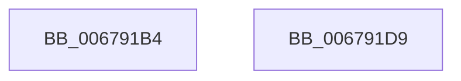

# MiInitializeFreeZeroPfnListHead

- RVA: `0x006791B4`–`0x006791DA` (길이 `38` bytes)
- VA: `0x00000001406791B4`
- 실행 섹션: `.text`
- PDB 이름 있음: `예`; PDB Function 태그: `아니요`
- unwind 정보 RVA: `0x000DB714`
- 디코드: `9`개 명령, `38/38` bytes 표시
- 미해석 바이트: `0` (있으면 어셈블리에 `.byte`로 보존)

> 이 문서는 커널 이미지의 기계어와 PDB 기호를 분석해 생성했습니다. 4번과 5번은 함수 원형과 자료형을 바이너리 사용 방식에서 추정한 C 해석이며 원본 소스 복구 결과는 아닙니다.

## 1. Dependencies

- 직접 호출 지점: **0**; 고유 호출 대상: **0**
- 직접 호출자로 확인된 함수: **1**
- RIP 상대 이미지 참조: **0**

### Outgoing calls
- 직접 디코드된 call 명령이 없습니다.

### Direct callers
- [MiInitializePartitionFreeZeroLists](../../page/7F/MiInitializePartitionFreeZeroLists_function_007FDA7C.md) at `0x007FDC1E`

### Static image references
- 디코드된 RIP-relative 메모리 참조가 없습니다.

## 2. Other-region calls and transfers

- 다른 실행 섹션으로 향하는 call: **0**
- 별도 외부 분기/꼬리 이동을 확인하지 못했습니다.

## 3. Assembly (complete function range)

```asm
006791B4  48 83 21 00                     and qword ptr [rcx], 0
006791B8  48 B8 FF FF FF FF 3F 00 00 00   movabs rax, 0x3fffffffff
006791C2  89 51 0C                        mov dword ptr [rcx + 0xc], edx
006791C5  44 89 41 08                     mov dword ptr [rcx + 8], r8d
006791C9  48 89 41 10                     mov qword ptr [rcx + 0x10], rax
006791CD  48 89 41 18                     mov qword ptr [rcx + 0x18], rax
006791D1  C7 41 20 00 00 00 00            mov dword ptr [rcx + 0x20], 0
006791D8  C3                              ret
006791D9  CC                              int3
```

## 4. C-style interpretation (structured pseudocode)

```c
__int64 __fastcall MiInitializeFreeZeroPfnListHead(__int64 a1, int a2, int a3)
{
    *(unsigned int *)(a1 + 12) = a2;
    *(unsigned int *)(a1 + 8) = a3;
    *(unsigned __int64 *)(a1 + 16) = result;
    *(unsigned __int64 *)(a1 + 24) = result;
    *(unsigned int *)(a1 + 32) = 0;
    return result;
}
```

## 5. (Beta) C Style

```c
int64_t MiInitializeFreeZeroPfnListHead(void *Arg1, int32_t Arg2, int32_t Arg3)
{
    uint8_t *arg1 = (uint8_t *)Arg1;

    *(uint32_t *)(arg1 + 0xC) = Arg2;
    *(uint32_t *)(arg1 + 0x8) = Arg3;
    *(uint64_t *)(arg1 + 0x10) = result;
    *(uint64_t *)(arg1 + 0x18) = result;
    *(uint32_t *)(arg1 + 0x20) = 0;
    return result;
}
```

### 관측된 메모리 오프셋

구조체 형식이 확인되지 않은 접근은 인자 기준의 오프셋으로만 기록했습니다.

| 기준 인자 | 오프셋 표현 | 폭 (bit) | 접근 |
|---|---:|---:|---|
| `Arg1` | `+ 0x0` | `64` | `R/W` |
| `Arg1` | `+ 0x8` | `32` | `W` |
| `Arg1` | `+ 0xC` | `32` | `W` |
| `Arg1` | `+ 0x10` | `64` | `W` |
| `Arg1` | `+ 0x18` | `64` | `W` |
| `Arg1` | `+ 0x20` | `32` | `W` |

## 6. Execution-region graph

[열기: 2D/3D 그래프와 함수 탐색 컨트롤 패널](../../../control-panel.html?section=text&rva=0x006791B4&view=graph)

- 2D 그래프는 위에서 아래로 흐르고, 3D 그래프는 빈 공간을 드래그해 회전합니다. Shift+드래그는 이동, 휠은 확대·축소, 함수 노드 선택은 대상 보고서 이동입니다.

### Static fallback


