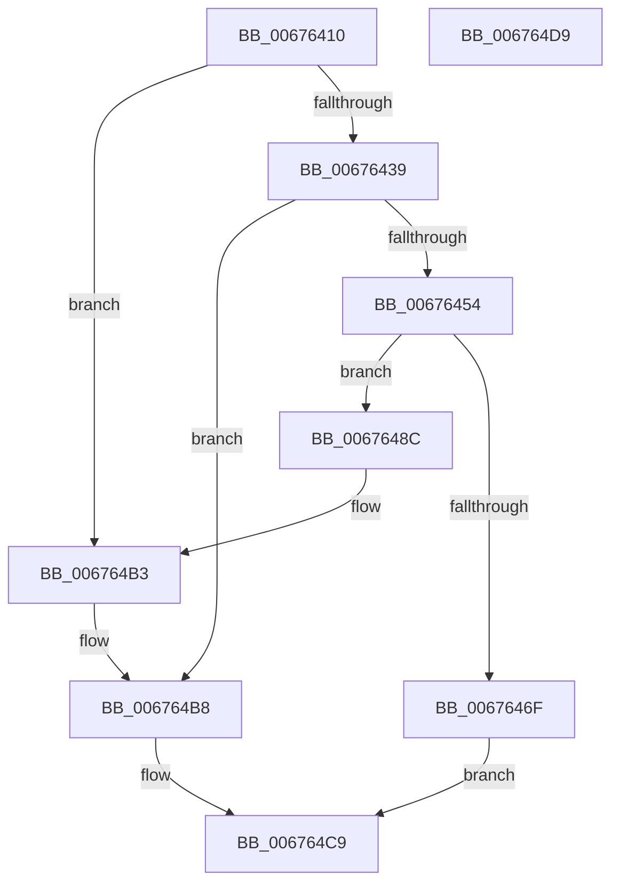

# MiInitializeHugePfnDatabase

- RVA: `0x00676410`–`0x006764DA` (길이 `202` bytes)
- VA: `0x0000000140676410`
- 실행 섹션: `.text`
- PDB 이름 있음: `예`; PDB Function 태그: `아니요`
- unwind 정보 RVA: `0x00060BC4`
- 디코드: `48`개 명령, `202/202` bytes 표시
- 미해석 바이트: `0` (있으면 어셈블리에 `.byte`로 보존)

> 이 문서는 커널 이미지의 기계어와 PDB 기호를 분석해 생성했습니다. 4번과 5번은 함수 원형과 자료형을 바이너리 사용 방식에서 추정한 C 해석이며 원본 소스 복구 결과는 아닙니다.

## 1. Dependencies

- 직접 호출 지점: **6**; 고유 호출 대상: **4**
- 직접 호출자로 확인된 함수: **3**
- RIP 상대 이미지 참조: **6**

### Outgoing calls
- `0x00676426` → [ExAcquireSpinLockExclusive](../24/ExAcquireSpinLockExclusive_function_00248690.md) (function, `0x00248690`)
- `0x00676447` → [MiAllocatePool](../35/MiAllocatePool_function_0035B540.md) (function, `0x0035B540`)
- `0x00676462` → [MiAllocatePool](../35/MiAllocatePool_function_0035B540.md) (function, `0x0035B540`)
- `0x00676479` → [MiReleaseSpinLockExclusive](../24/MiReleaseSpinLockExclusive_function_002482C0.md) (function, `0x002482C0`)
- `0x00676483` → [ExFreePoolWithTag](../../poolcode/B8/ExFreePoolWithTag_function_00B82870.md) (function, `0x00B82870`)
- `0x006764C2` → [MiReleaseSpinLockExclusive](../24/MiReleaseSpinLockExclusive_function_002482C0.md) (function, `0x002482C0`)

### Direct callers
- [MiInsertPartitionPages](../69/MiInsertPartitionPages_function_006911A0.md) at `0x006912F3`
- [MiHotAddHugeRange](../../page/7F/MiHotAddHugeRange_function_007FBF6C.md) at `0x007FBF9D`
- [MiCreateHugeIoRanges](../../init/C6/MiCreateHugeIoRanges_function_00C6437C.md) at `0x00C643E9`

### Static image references
- `0x0067641F` → RVA `0x00E30100` (`.data`; read)
- `0x00676430` → RVA `0x00E300C0` (`.data`; read)
- `0x00676493` → RVA `0x00E300C8` (`.data`; write)
- `0x0067649A` → RVA `0x00E300B8` (`.data`; write)
- `0x006764A1` → RVA `0x00E300B0` (`.data`; write)
- `0x006764AC` → RVA `0x00E300C0` (`.data`; write)

## 2. Other-region calls and transfers

- 다른 실행 섹션으로 향하는 call: **1**
  - `0x00676483` → [ExFreePoolWithTag](../../poolcode/B8/ExFreePoolWithTag_function_00B82870.md) (`.text` → `POOLCODE`)
- 별도 외부 분기/꼬리 이동을 확인하지 못했습니다.

## 3. Assembly (complete function range)

```asm
00676410  48 89 5C 24 08                  mov qword ptr [rsp + 8], rbx
00676415  48 89 74 24 10                  mov qword ptr [rsp + 0x10], rsi
0067641A  57                              push rdi
0067641B  48 83 EC 20                     sub rsp, 0x20
0067641F  48 8D 0D DA 9C 7B 00            lea rcx, [rip + 0x7b9cda]
00676426  E8 65 22 BD FF                  call 0x140248690
0067642B  33 DB                           xor ebx, ebx
0067642D  40 8A F0                        mov sil, al
00676430  48 39 1D 89 9C 7B 00            cmp qword ptr [rip + 0x7b9c89], rbx
00676437  75 7A                           jne 0x1406764b3
00676439  BA 00 00 10 00                  mov edx, 0x100000
0067643E  8D 4B 40                        lea ecx, [rbx + 0x40]
00676441  41 B8 4D 69 48 70               mov r8d, 0x7048694d
00676447  E8 F4 50 CE FF                  call 0x14035b540
0067644C  48 8B F8                        mov rdi, rax
0067644F  48 85 C0                        test rax, rax
00676452  74 64                           je 0x1406764b8
00676454  BA 00 00 00 02                  mov edx, 0x2000000
00676459  8D 4B 40                        lea ecx, [rbx + 0x40]
0067645C  41 B8 4D 69 48 70               mov r8d, 0x7048694d
00676462  E8 D9 50 CE FF                  call 0x14035b540
00676467  48 8B D0                        mov rdx, rax
0067646A  48 85 C0                        test rax, rax
0067646D  75 1D                           jne 0x14067648c
0067646F  40 8A D6                        mov dl, sil
00676472  48 8D 0D 87 9C 7B 00            lea rcx, [rip + 0x7b9c87]
00676479  E8 42 1E BD FF                  call 0x1402482c0
0067647E  33 D2                           xor edx, edx
00676480  48 8B CF                        mov rcx, rdi
00676483  E8 E8 C3 50 00                  call 0x140b82870
00676488  33 C0                           xor eax, eax
0067648A  EB 3D                           jmp 0x1406764c9
0067648C  48 8D 87 00 00 08 00            lea rax, [rdi + 0x80000]
00676493  48 89 3D 2E 9C 7B 00            mov qword ptr [rip + 0x7b9c2e], rdi
0067649A  48 89 05 17 9C 7B 00            mov qword ptr [rip + 0x7b9c17], rax
006764A1  48 C7 05 04 9C 7B 00 00 00 40 00  mov qword ptr [rip + 0x7b9c04], 0x400000
006764AC  48 89 15 0D 9C 7B 00            mov qword ptr [rip + 0x7b9c0d], rdx
006764B3  BB 01 00 00 00                  mov ebx, 1
006764B8  40 8A D6                        mov dl, sil
006764BB  48 8D 0D 3E 9C 7B 00            lea rcx, [rip + 0x7b9c3e]
006764C2  E8 F9 1D BD FF                  call 0x1402482c0
006764C7  8B C3                           mov eax, ebx
006764C9  48 8B 5C 24 30                  mov rbx, qword ptr [rsp + 0x30]
006764CE  48 8B 74 24 38                  mov rsi, qword ptr [rsp + 0x38]
006764D3  48 83 C4 20                     add rsp, 0x20
006764D7  5F                              pop rdi
006764D8  C3                              ret
006764D9  CC                              int3
```

## 4. C-style interpretation (structured pseudocode)

```c
__int64 __fastcall MiInitializeHugePfnDatabase(void)
{
    __int64 result;
    __int64 v_rbx;
    __int64 v_rsp;
    unsigned __int64 v_stack_p10;
    unsigned __int64 v_stack_p8;

    v_stack_p8 = v_rbx;
    v_stack_p10 = v_rsi;
    v_rsp = (v_rsp) - (32);
    result = ExAcquireSpinLockExclusive(v_rip + 8101082, a2, a3, a4);
    v_rbx = 0;
    if ((*(unsigned __int64 *)(v_rip + 8101001)) != 0) goto loc_006764B3;
    result = MiAllocatePool(v_rbx + 64, (unsigned int)(0x100000ULL), (unsigned int)(0x7048694DULL), a4);
    if (result == 0) goto loc_006764B8;
    result = MiAllocatePool(v_rbx + 64, (unsigned int)(0x2000000ULL), (unsigned int)(0x7048694DULL), a4);
    if (result != 0) goto loc_0067648C;
    result = MiReleaseSpinLockExclusive(v_rip + 8100999, (unsigned __int8)((unsigned __int8)(result)), (unsigned int)(0x7048694DULL), a4);
    a2 = 0;
    result = ExFreePoolWithTag(result, a2, (unsigned int)(0x7048694DULL), a4);
    result = 0;
    goto loc_006764C9;
loc_0067648C:
    *(unsigned __int64 *)(v_rip + 8100910) = 0;
    *(unsigned __int64 *)(v_rip + 8100887) = result + 524288;
    *(unsigned __int64 *)(v_rip + 8100868) = 0x400000ULL;
    *(unsigned __int64 *)(v_rip + 8100877) = 0;
loc_006764B3:
loc_006764B8:
    result = MiReleaseSpinLockExclusive(v_rip + 8100926, (unsigned __int8)((unsigned __int8)(result)), (unsigned int)(0x7048694DULL), a4);
loc_006764C9:
    v_rsp = (v_rsp) + (32);
    return 1;
}
```

## 5. (Beta) C Style

```c
void MiInitializeHugePfnDatabase(void)
{
    int64_t result;
    int64_t local_rbx;
    int64_t local_rsp;
    uint64_t v_stack_p10;
    uint64_t v_stack_p8;

    v_stack_p8 = local_rbx;
    v_stack_p10 = local_rsi;
    local_rsp = (local_rsp) - (32);
    result = ExAcquireSpinLockExclusive(v_rip + 8101082, a2, a3, a4);
    local_rbx = 0;
    if ((*(uint64_t *)(v_rip + 0x7B9C89)) != 0) goto loc_006764B3;
    result = MiAllocatePool(local_rbx + 64, (uint32_t)(0x100000ULL), (uint32_t)(0x7048694DULL), a4);
    if (result == 0) goto loc_006764B8;
    result = MiAllocatePool(local_rbx + 64, (uint32_t)(0x2000000ULL), (uint32_t)(0x7048694DULL), a4);
    if (result != 0) goto loc_0067648C;
    result = MiReleaseSpinLockExclusive(v_rip + 8100999, (uint8_t)((uint8_t)(result)), (uint32_t)(0x7048694DULL), a4);
    a2 = 0;
    result = ExFreePoolWithTag(result, a2, (uint32_t)(0x7048694DULL), a4);
    result = 0;
    goto loc_006764C9;
loc_0067648C:
    *(uint64_t *)(v_rip + 0x7B9C2E) = 0;
    *(uint64_t *)(v_rip + 0x7B9C17) = result + 524288;
    *(uint64_t *)(v_rip + 0x7B9C04) = 0x400000ULL;
    *(uint64_t *)(v_rip + 0x7B9C0D) = 0;
loc_006764B3:
loc_006764B8:
    result = MiReleaseSpinLockExclusive(v_rip + 8100926, (uint8_t)((uint8_t)(result)), (uint32_t)(0x7048694DULL), a4);
loc_006764C9:
    local_rsp = (local_rsp) + (32);
    return 1;
}
```

## 6. Execution-region graph

[열기: 2D/3D 그래프와 함수 탐색 컨트롤 패널](../../../control-panel.html?section=text&rva=0x00676410&view=graph)

- 2D 그래프는 위에서 아래로 흐르고, 3D 그래프는 빈 공간을 드래그해 회전합니다. Shift+드래그는 이동, 휠은 확대·축소, 함수 노드 선택은 대상 보고서 이동입니다.

### Static fallback


