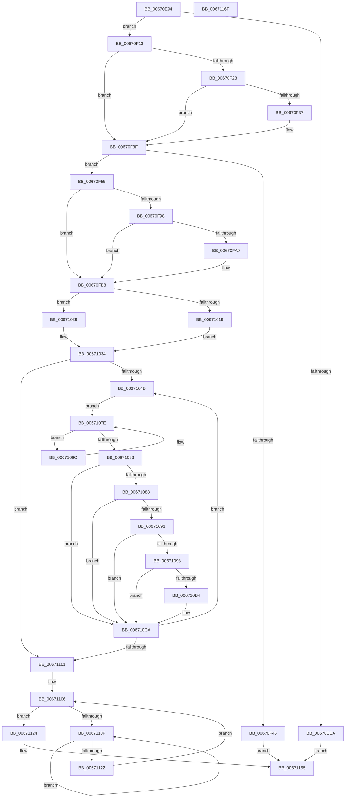

# MiInitializeNewPfns

- RVA: `0x00670E94`–`0x00671170` (길이 `732` bytes)
- VA: `0x0000000140670E94`
- 실행 섹션: `.text`
- PDB 이름 있음: `예`; PDB Function 태그: `아니요`
- unwind 정보 RVA: `0x000D77D4`
- 디코드: `177`개 명령, `732/732` bytes 표시
- 미해석 바이트: `0` (있으면 어셈블리에 `.byte`로 보존)

> 이 문서는 커널 이미지의 기계어와 PDB 기호를 분석해 생성했습니다. 4번과 5번은 함수 원형과 자료형을 바이너리 사용 방식에서 추정한 C 해석이며 원본 소스 복구 결과는 아닙니다.

## 1. Dependencies

- 직접 호출 지점: **11**; 고유 호출 대상: **11**
- 직접 호출자로 확인된 함수: **3**
- RIP 상대 이미지 참조: **2**

### Outgoing calls
- `0x00670F09` → [MiCreateInitialLargeLeafPfns](../44/MiCreateInitialLargeLeafPfns_function_004428E0.md) (function, `0x004428E0`)
- `0x00670F4B` → [MiCreateInitialPfns](MiCreateInitialPfns_function_00671774.md) (function, `0x00671774`)
- `0x00670F77` → [MiSwizzleInvalidPte](../28/MiSwizzleInvalidPte_function_0028F5E0.md) (function, `0x0028F5E0`)
- `0x00670FA0` → [MiDetermineNewPfnHeatState](../45/MiDetermineNewPfnHeatState_function_004586A8.md) (function, `0x004586A8`)
- `0x00670FAE` → [MiSetNonResidentPteHeat](../3F/MiSetNonResidentPteHeat_function_003FB8A0.md) (function, `0x003FB8A0`)
- `0x00670FE7` → [MiGetContainingPageTable](../34/MiGetContainingPageTable_function_003467F0.md) (function, `0x003467F0`)
- `0x0067100A` → [MiSetPfnContainingFrame](../36/MiSetPfnContainingFrame_function_00363FC0.md) (function, `0x00363FC0`)
- `0x00671022` → [MiMakeValidPte](../2C/MiMakeValidPte_function_002C5590.md) (function, `0x002C5590`)
- `0x0067102F` → [MiMakeTransitionPte](../36/MiMakeTransitionPte_function_00363F70.md) (function, `0x00363F70`)
- `0x006710C0` → [MiCheckLinearProtectedPteAccessedBit](../29/MiCheckLinearProtectedPteAccessedBit_function_00292D80.md) (function, `0x00292D80`)
- `0x00671114` → [KeYieldProcessorEx](../3F/KeYieldProcessorEx_function_003FBD00.md) (function, `0x003FBD00`)

### Direct callers
- [MiDoGangAssignment](../4D/MiDoGangAssignment_function_004DE270.md) at `0x004DE3FD`
- [MiInitializeDynamicPfns](MiInitializeDynamicPfns_function_00672BD0.md) at `0x00672E10`
- [MiCreateDescriptorPfns](../../init/C6/MiCreateDescriptorPfns_function_00C61D74.md) at `0x00C61ED3`
- [MiCreateDescriptorPfns](../../init/C6/MiCreateDescriptorPfns_function_00C61D74.md) at `0x00C61F3B`

### Static image references
- `0x00670F37` → RVA `0x00E2DCE8` (`.data`; read/write)
- `0x00671088` → RVA `0x00FC6A88` (`ALMOSTRO`; read)

## 2. Other-region calls and transfers

- 다른 실행 섹션으로 향하는 call: **0**
- 별도 외부 분기/꼬리 이동을 확인하지 못했습니다.

## 3. Assembly (complete function range)

```asm
00670E94  48 89 5C 24 10                  mov qword ptr [rsp + 0x10], rbx
00670E99  48 89 74 24 18                  mov qword ptr [rsp + 0x18], rsi
00670E9E  57                              push rdi
00670E9F  41 54                           push r12
00670EA1  41 55                           push r13
00670EA3  41 56                           push r14
00670EA5  41 57                           push r15
00670EA7  48 83 EC 40                     sub rsp, 0x40
00670EAB  4D 8B E8                        mov r13, r8
00670EAE  48 B8 00 00 00 00 00 DE FF FF   movabs rax, 0xffffde0000000000
00670EB8  4C 8B F2                        mov r14, rdx
00670EBB  48 8B F9                        mov rdi, rcx
00670EBE  48 8B C0                        mov rax, rax
00670EC1  44 8B 84 24 90 00 00 00         mov r8d, dword ptr [rsp + 0x90]
00670EC9  48 8B D9                        mov rbx, rcx
00670ECC  48 2B D8                        sub rbx, rax
00670ECF  48 B8 AB AA AA AA AA AA AA AA   movabs rax, 0xaaaaaaaaaaaaaaab
00670ED9  48 C1 FB 04                     sar rbx, 4
00670EDD  48 0F AF D8                     imul rbx, rax
00670EE1  41 F7 C0 00 30 00 00            test r8d, 0x3000
00670EE8  74 29                           je 0x140670f13
00670EEA  41 0F B7 01                     movzx eax, word ptr [r9]
00670EEE  48 8B CB                        mov rcx, rbx
00670EF1  83 64 24 28 00                  and dword ptr [rsp + 0x28], 0
00670EF6  41 B9 01 00 00 00               mov r9d, 1
00670EFC  41 C1 E8 0C                     shr r8d, 0xc
00670F00  41 83 E0 01                     and r8d, 1
00670F04  66 89 44 24 20                  mov word ptr [rsp + 0x20], ax
00670F09  E8 D2 19 DD FF                  call 0x1404428e0
00670F0E  E9 42 02 00 00                  jmp 0x140671155
00670F13  41 F7 C0 80 01 00 00            test r8d, 0x180
00670F1A  0F 95 C1                        setne cl
00670F1D  41 F6 C0 01                     test r8b, 1
00670F21  0F 94 C0                        sete al
00670F24  84 C8                           test al, cl
00670F26  74 17                           je 0x140670f3f
00670F28  F0 4D 01 B1 C0 4C 00 00         lock add qword ptr [r9 + 0x4cc0], r14
00670F30  41 0F BA E0 08                  bt r8d, 8
00670F35  73 08                           jae 0x140670f3f
00670F37  F0 4C 01 35 A9 CD 7B 00         lock add qword ptr [rip + 0x7bcda9], r14
00670F3F  41 F6 C0 02                     test r8b, 2
00670F43  75 10                           jne 0x140670f55
00670F45  4D 8B C5                        mov r8, r13
00670F48  48 8B CF                        mov rcx, rdi
00670F4B  E8 24 08 00 00                  call 0x140671774
00670F50  E9 00 02 00 00                  jmp 0x140671155
00670F55  48 8B 8C 24 98 00 00 00         mov rcx, qword ptr [rsp + 0x98]
00670F5D  4C 8D 61 20                     lea r12, [rcx + 0x20]
00670F61  48 C1 E1 0C                     shl rcx, 0xc
00670F65  41 8B 04 24                     mov eax, dword ptr [r12]
00670F69  83 E0 3E                        and eax, 0x3e
00670F6C  48 0B C8                        or rcx, rax
00670F6F  48 83 C9 40                     or rcx, 0x40
00670F73  48 C1 E1 04                     shl rcx, 4
00670F77  E8 64 E6 C1 FF                  call 0x14028f5e0
00670F7C  4C 8B D8                        mov r11, rax
00670F7F  48 89 44 24 30                  mov qword ptr [rsp + 0x30], rax
00670F84  41 0F B6 45 22                  movzx eax, byte ptr [r13 + 0x22]
00670F89  83 E0 07                        and eax, 7
00670F8C  89 84 24 90 00 00 00            mov dword ptr [rsp + 0x90], eax
00670F93  83 F8 02                        cmp eax, 2
00670F96  75 20                           jne 0x140670fb8
00670F98  45 33 C0                        xor r8d, r8d
00670F9B  8D 50 FF                        lea edx, [rax - 1]
00670F9E  33 C9                           xor ecx, ecx
00670FA0  E8 03 77 DE FF                  call 0x1404586a8
00670FA5  85 C0                           test eax, eax
00670FA7  74 0F                           je 0x140670fb8
00670FA9  48 8D 4C 24 30                  lea rcx, [rsp + 0x30]
00670FAE  E8 ED A8 D8 FF                  call 0x1403fb8a0
00670FB3  4C 8B 5C 24 30                  mov r11, qword ptr [rsp + 0x30]
00670FB8  4C 8B BC 24 A0 00 00 00         mov r15, qword ptr [rsp + 0xa0]
00670FC0  48 B9 00 00 00 00 00 00 00 80   movabs rcx, 0x8000000000000000
00670FCA  4D 89 5D 10                     mov qword ptr [r13 + 0x10], r11
00670FCE  49 8B 45 28                     mov rax, qword ptr [r13 + 0x28]
00670FD2  48 0B C1                        or rax, rcx
00670FD5  49 8B CF                        mov rcx, r15
00670FD8  49 89 45 28                     mov qword ptr [r13 + 0x28], rax
00670FDC  45 8B 24 24                     mov r12d, dword ptr [r12]
00670FE0  41 D1 EC                        shr r12d, 1
00670FE3  41 83 E4 1F                     and r12d, 0x1f
00670FE7  E8 04 58 CD FF                  call 0x1403467f0
00670FEC  48 B9 00 00 00 00 00 DE FF FF   movabs rcx, 0xffffde0000000000
00670FF6  48 8D 34 40                     lea rsi, [rax + rax*2]
00670FFA  48 C1 E6 04                     shl rsi, 4
00670FFE  48 8B C9                        mov rcx, rcx
00671001  48 03 F1                        add rsi, rcx
00671004  48 8B D0                        mov rdx, rax
00671007  49 8B CD                        mov rcx, r13
0067100A  E8 B1 2F CF FF                  call 0x140363fc0
0067100F  83 BC 24 90 00 00 00 06         cmp dword ptr [rsp + 0x90], 6
00671017  75 10                           jne 0x140671029
00671019  45 8B C4                        mov r8d, r12d
0067101C  48 8B D3                        mov rdx, rbx
0067101F  49 8B CF                        mov rcx, r15
00671022  E8 69 45 C5 FF                  call 0x1402c5590
00671027  EB 0B                           jmp 0x140671034
00671029  41 8B D4                        mov edx, r12d
0067102C  48 8B CB                        mov rcx, rbx
0067102F  E8 3C 2F CF FF                  call 0x140363f70
00671034  4F 8D 24 76                     lea r12, [r14 + r14*2]
00671038  48 8B D8                        mov rbx, rax
0067103B  49 C1 E4 04                     shl r12, 4
0067103F  4C 03 E7                        add r12, rdi
00671042  49 3B FC                        cmp rdi, r12
00671045  0F 84 B6 00 00 00               je 0x140671101
0067104B  4D 89 7D 08                     mov qword ptr [r13 + 8], r15
0067104F  48 8D 57 30                     lea rdx, [rdi + 0x30]
00671053  F3 41 0F 6F 45 00               movdqu xmm0, xmmword ptr [r13]
00671059  F3 41 0F 6F 4D 10               movdqu xmm1, xmmword ptr [r13 + 0x10]
0067105F  F3 41 0F 6F 55 20               movdqu xmm2, xmmword ptr [r13 + 0x20]
00671065  48 89 54 24 38                  mov qword ptr [rsp + 0x38], rdx
0067106A  EB 12                           jmp 0x14067107e
0067106C  F3 0F 7F 07                     movdqu xmmword ptr [rdi], xmm0
00671070  F3 0F 7F 4F 10                  movdqu xmmword ptr [rdi + 0x10], xmm1
00671075  F3 0F 7F 57 20                  movdqu xmmword ptr [rdi + 0x20], xmm2
0067107A  48 83 C7 30                     add rdi, 0x30
0067107E  48 3B FA                        cmp rdi, rdx
00671081  75 E9                           jne 0x14067106c
00671083  F6 C3 01                        test bl, 1
00671086  74 42                           je 0x1406710ca
00671088  48 0F BA 25 F7 59 95 00 24      bt qword ptr [rip + 0x9559f7], 0x24
00671091  73 37                           jae 0x1406710ca
00671093  F6 C3 20                        test bl, 0x20
00671096  75 32                           jne 0x1406710ca
00671098  48 B8 00 00 00 00 80 F6 FF FF   movabs rax, 0xfffff68000000000
006710A2  48 B9 00 00 00 00 40 00 00 00   movabs rcx, 0x4000000000
006710AC  48 03 C1                        add rax, rcx
006710AF  4C 3B F8                        cmp r15, rax
006710B2  72 16                           jb 0x1406710ca
006710B4  41 B8 80 00 00 00               mov r8d, 0x80
006710BA  48 8B D3                        mov rdx, rbx
006710BD  49 8B CF                        mov rcx, r15
006710C0  E8 BB 1C C2 FF                  call 0x140292d80
006710C5  48 8B 54 24 38                  mov rdx, qword ptr [rsp + 0x38]
006710CA  48 8B CB                        mov rcx, rbx
006710CD  49 89 1F                        mov qword ptr [r15], rbx
006710D0  48 8D 83 00 10 00 00            lea rax, [rbx + 0x1000]
006710D7  49 83 C7 08                     add r15, 8
006710DB  48 81 C3 00 10 00 00            add rbx, 0x1000
006710E2  48 8B FA                        mov rdi, rdx
006710E5  48 33 D9                        xor rbx, rcx
006710E8  48 B9 FF 0F 00 00 00 00 F0 FF   movabs rcx, 0xfff0000000000fff
006710F2  48 23 D9                        and rbx, rcx
006710F5  48 33 D8                        xor rbx, rax
006710F8  49 3B D4                        cmp rdx, r12
006710FB  0F 85 4A FF FF FF               jne 0x14067104b
00671101  83 64 24 70 00                  and dword ptr [rsp + 0x70], 0
00671106  F0 48 0F BA 6E 18 3F            lock bts qword ptr [rsi + 0x18], 0x3f
0067110D  73 15                           jae 0x140671124
0067110F  48 8D 4C 24 70                  lea rcx, [rsp + 0x70]
00671114  E8 E7 AB D8 FF                  call 0x1403fbd00
00671119  48 8B 46 18                     mov rax, qword ptr [rsi + 0x18]
0067111D  48 85 C0                        test rax, rax
00671120  78 ED                           js 0x14067110f
00671122  EB E2                           jmp 0x140671106
00671124  48 8B 46 18                     mov rax, qword ptr [rsi + 0x18]
00671128  4A 8D 0C 30                     lea rcx, [rax + r14]
0067112C  48 8B D1                        mov rdx, rcx
0067112F  48 33 D0                        xor rdx, rax
00671132  48 B8 00 00 00 00 00 00 00 C0   movabs rax, 0xc000000000000000
0067113C  48 23 D0                        and rdx, rax
0067113F  48 B8 FF FF FF FF FF FF FF 7F   movabs rax, 0x7fffffffffffffff
00671149  48 33 D1                        xor rdx, rcx
0067114C  48 89 56 18                     mov qword ptr [rsi + 0x18], rdx
00671150  F0 48 21 46 18                  lock and qword ptr [rsi + 0x18], rax
00671155  4C 8D 5C 24 40                  lea r11, [rsp + 0x40]
0067115A  49 8B 5B 38                     mov rbx, qword ptr [r11 + 0x38]
0067115E  49 8B 73 40                     mov rsi, qword ptr [r11 + 0x40]
00671162  49 8B E3                        mov rsp, r11
00671165  41 5F                           pop r15
00671167  41 5E                           pop r14
00671169  41 5D                           pop r13
0067116B  41 5C                           pop r12
0067116D  5F                              pop rdi
0067116E  C3                              ret
0067116F  CC                              int3
```

## 4. C-style interpretation (structured pseudocode)

```c
__int64 __fastcall MiInitializeNewPfns(__int64 a1, __int64 a2, __int64 a3, __int64 a4, unsigned int a5, __int64 a6, __int64 a7)
{
    __int64 result;
    __int64 v_r11;
    __int64 v_r12;
    __int64 v_r15;
    __int64 v_rbx;
    __int64 v_rdi;
    __int64 v_rsi;
    __int64 v_rsp;
    unsigned __int64 v_stack_m28;
    unsigned __int64 v_stack_m30;
    unsigned __int64 v_stack_m38;
    unsigned int v_stack_m40;
    unsigned __int16 v_stack_m48;
    unsigned __int64 v_stack_p10;
    unsigned __int64 v_stack_p18;
    unsigned int v_stack_p28;
    unsigned int v_stack_p8;

    v_stack_p10 = v_rbx;
    v_stack_p18 = v_rsi;
    v_rsp = (v_rsp) - (64);
    v_rbx = (a1) - (result);
    v_rbx = (v_rbx) >> (4);
    v_rbx = (v_rbx) * (result);
    if ((((unsigned int)((unsigned int)(a5))) & (0x3000ULL)) == 0) goto loc_00670F13;
    a3 = (unsigned int)(((unsigned int)(a5)) >> (12));
    a3 = (unsigned int)((a3) & (1));
    v_stack_m48 = (unsigned __int16)(*(unsigned __int16 *)(a4));
    result = MiCreateInitialLargeLeafPfns(v_rbx, a2, a3, 1);
    goto loc_00671155;
loc_00670F13:
    a1 = ((((unsigned int)(a3)) & (384)) != 0) ? 1 : 0;
    result = ((((unsigned __int8)(a3)) & (1)) == 0) ? 1 : 0;
    if ((((unsigned __int8)(result)) & ((unsigned __int8)(a1))) == 0) goto loc_00670F3F;
    if (!(condition_is_above_or_equal)) {
    }
    if ((((unsigned __int8)(a3)) & (2)) != 0) goto loc_00670F55;
    result = MiCreateInitialPfns(a1, a2, a3, 1);
    goto loc_00671155;
loc_00670F55:
    a1 = (a6) << (12);
    result = (unsigned int)(((unsigned int)(*(unsigned int *)(a6 + 32))) & (62));
    a1 = (a1) | (result);
    a1 = (a1) | (64);
    a1 = (a1) << (4);
    result = MiSwizzleInvalidPte(a1, a2, a3, 1);
    v_stack_m38 = result;
    result = (unsigned int)((*(unsigned __int8 *)(a3 + 34)) & (7));
    v_stack_p28 = (unsigned int)(result);
    if (((unsigned int)(result)) != 2) goto loc_00670FB8;
    a3 = 0;
    a1 = 0;
    result = MiDetermineNewPfnHeatState(a1, result - 1, a3, 1);
    v_r11 = result;
    if ((unsigned int)(result) != 0) {
        a1 = v_stack_m38;
        result = MiSetNonResidentPteHeat(a1, result - 1, a3, 1);
        v_r11 = v_stack_m38;
    }
    *(unsigned __int64 *)(a3 + 16) = v_r11;
    result = (*(unsigned __int64 *)(a3 + 40)) | (a1);
    *(unsigned __int64 *)(a3 + 40) = result;
    v_r12 = (unsigned int)(((unsigned int)(*(unsigned int *)(a6 + 32))) >> (1));
    v_r12 = (unsigned int)((v_r12) & (31));
    result = MiGetContainingPageTable(a7, result - 1, a3, 1);
    v_rsi = (result + result * 2) << (4);
    v_rsi = (v_rsi) + (a7);
    result = MiSetPfnContainingFrame(0, result, a3, 1);
    if (a5 != 6) goto loc_00671029;
    result = MiMakeValidPte(a7, v_rbx, (unsigned int)((unsigned int)(v_r12)), 1);
    goto loc_00671034;
loc_00671029:
    result = MiMakeTransitionPte(v_rbx, (unsigned int)((unsigned int)(v_r12)), (unsigned int)((unsigned int)(v_r12)), 1);
loc_00671034:
    v_r12 = (a2 + a2 * 2) << (4);
    v_r12 = (v_r12) + (a1);
    if (a1 == v_r12) goto loc_00671101;
loc_0067104B:
    *(unsigned __int64 *)(a3 + 8) = a7;
    v_stack_m30 = a1 + 48;
    goto loc_0067107E;
loc_0067106C:
    *(unsigned __int64 *)(a1) = v_xmm0;
    *(unsigned __int64 *)(a1 + 16) = v_xmm1;
    *(unsigned __int64 *)(a1 + 32) = v_xmm2;
    v_rdi = (a1) + (48);
loc_0067107E:
    if (v_rdi != (a1 + 48)) goto loc_0067106C;
    if ((((unsigned __int8)(result)) & (1)) == 0) goto loc_006710CA;
    if (condition_is_above_or_equal) goto loc_006710CA;
    if ((((unsigned __int8)(result)) & (32)) != 0) goto loc_006710CA;
    result = (result) + (v_rbx);
    if (a7 >= result) {
        a3 = 128;
        a2 = result;
        a1 = a7;
        result = MiCheckLinearProtectedPteAccessedBit(a1, a2, a3, 1);
        a2 = v_stack_m30;
    }
    *(unsigned __int64 *)(a7) = result;
    v_r15 = (a7) + (8);
    v_rbx = (result) + (0x1000ULL);
    v_rbx = (v_rbx) ^ (result);
    v_rbx = (v_rbx) & (result);
    v_rbx = (v_rbx) ^ (result + 4096);
    if (a2 != v_r12) goto loc_0067104B;
loc_00671101:
loc_00671106:
    if (a2 >= v_r12) goto loc_00671124;
loc_0067110F:
    result = KeYieldProcessorEx(v_stack_p8, a2, a3, 1);
    if (sign_flag) goto loc_0067110F;
    goto loc_00671106;
loc_00671124:
    a2 = (*(unsigned __int64 *)(v_rsi + 24) + a2 * 1) ^ (*(unsigned __int64 *)(v_rsi + 24));
    a2 = (a2) & (*(unsigned __int64 *)(v_rsi + 24));
    a2 = (a2) ^ (*(unsigned __int64 *)(v_rsi + 24) + a2 * 1);
    *(unsigned __int64 *)(v_rsi + 24) = a2;
loc_00671155:
    return *(unsigned __int64 *)(v_rsi + 24);
}
```

## 5. (Beta) C Style

```c
int64_t MiInitializeNewPfns(int64_t Arg1, void *Arg2, void *Arg3, void *Arg4, uint32_t Arg5, void *Arg6, int64_t Arg7)
{
    uint8_t *arg2 = (uint8_t *)Arg2;
    uint8_t *arg3 = (uint8_t *)Arg3;
    uint8_t *arg4 = (uint8_t *)Arg4;
    uint8_t *arg6 = (uint8_t *)Arg6;

    int64_t result;
    int64_t local_r11;
    int64_t local_r12;
    int64_t local_r15;
    int64_t local_rbx;
    int64_t local_rdi;
    int64_t local_rsi;
    int64_t local_rsp;
    uint64_t v_stack_m28;
    uint64_t v_stack_m30;
    uint64_t v_stack_m38;
    uint32_t v_stack_m40;
    uint16_t v_stack_m48;
    uint64_t v_stack_p10;
    uint64_t v_stack_p18;
    uint32_t v_stack_p28;
    uint32_t v_stack_p8;

    v_stack_p10 = local_rbx;
    v_stack_p18 = local_rsi;
    local_rsp = (local_rsp) - (64);
    local_rbx = (Arg1) - (result);
    local_rbx = (local_rbx) >> (4);
    local_rbx = (local_rbx) * (result);
    if ((((uint32_t)((uint32_t)(Arg5))) & (0x3000ULL)) == 0) goto loc_00670F13;
    Arg3 = (uint32_t)(((uint32_t)(Arg5)) >> (12));
    Arg3 = (uint32_t)((Arg3) & (1));
    v_stack_m48 = (uint16_t)(*(uint16_t *)(arg4));
    result = MiCreateInitialLargeLeafPfns(local_rbx, Arg2, Arg3, 1);
    goto loc_00671155;
loc_00670F13:
    Arg1 = ((((uint32_t)(Arg3)) & (384)) != 0) ? 1 : 0;
    result = ((((uint8_t)(Arg3)) & (1)) == 0) ? 1 : 0;
    if ((((uint8_t)(result)) & ((uint8_t)(Arg1))) == 0) goto loc_00670F3F;
    if (!(condition_is_above_or_equal)) {
    }
    if ((((uint8_t)(Arg3)) & (2)) != 0) goto loc_00670F55;
    result = MiCreateInitialPfns(Arg1, Arg2, Arg3, 1);
    goto loc_00671155;
loc_00670F55:
    Arg1 = (Arg6) << (12);
    result = (uint32_t)(((uint32_t)(*(uint32_t *)(arg6 + 0x20))) & (62));
    Arg1 = (Arg1) | (result);
    Arg1 = (Arg1) | (64);
    Arg1 = (Arg1) << (4);
    result = MiSwizzleInvalidPte(Arg1, Arg2, Arg3, 1);
    v_stack_m38 = result;
    result = (uint32_t)((*(uint8_t *)(arg3 + 0x22)) & (7));
    v_stack_p28 = (uint32_t)(result);
    if (((uint32_t)(result)) != 2) goto loc_00670FB8;
    Arg3 = 0;
    Arg1 = 0;
    result = MiDetermineNewPfnHeatState(Arg1, result - 1, Arg3, 1);
    local_r11 = result;
    if ((uint32_t)(result) != 0) {
        Arg1 = v_stack_m38;
        result = MiSetNonResidentPteHeat(Arg1, result - 1, Arg3, 1);
        local_r11 = v_stack_m38;
    }
    *(uint64_t *)(arg3 + 0x10) = local_r11;
    result = (*(uint64_t *)(arg3 + 0x28)) | (Arg1);
    *(uint64_t *)(arg3 + 0x28) = result;
    local_r12 = (uint32_t)(((uint32_t)(*(uint32_t *)(arg6 + 0x20))) >> (1));
    local_r12 = (uint32_t)((local_r12) & (31));
    result = MiGetContainingPageTable(Arg7, result - 1, Arg3, 1);
    local_rsi = (result + result * 2) << (4);
    local_rsi = (local_rsi) + (Arg7);
    result = MiSetPfnContainingFrame(0, result, Arg3, 1);
    if (Arg5 != 6) goto loc_00671029;
    result = MiMakeValidPte(Arg7, local_rbx, (uint32_t)((uint32_t)(local_r12)), 1);
    goto loc_00671034;
loc_00671029:
    result = MiMakeTransitionPte(local_rbx, (uint32_t)((uint32_t)(local_r12)), (uint32_t)((uint32_t)(local_r12)), 1);
loc_00671034:
    local_r12 = (Arg2 + Arg2 * 2) << (4);
    local_r12 = (local_r12) + (Arg1);
    if (Arg1 == local_r12) goto loc_00671101;
loc_0067104B:
    *(uint64_t *)(arg3 + 0x8) = Arg7;
    v_stack_m30 = Arg1 + 48;
    goto loc_0067107E;
loc_0067106C:
    *(uint64_t *)(Arg1) = v_xmm0;
    *(uint64_t *)(Arg1 + 0x10) = v_xmm1;
    *(uint64_t *)(Arg1 + 0x20) = v_xmm2;
    local_rdi = (Arg1) + (48);
loc_0067107E:
    if (local_rdi != (Arg1 + 48)) goto loc_0067106C;
    if ((((uint8_t)(result)) & (1)) == 0) goto loc_006710CA;
    if (condition_is_above_or_equal) goto loc_006710CA;
    if ((((uint8_t)(result)) & (32)) != 0) goto loc_006710CA;
    result = (result) + (local_rbx);
    if (Arg7 >= result) {
        Arg3 = 128;
        Arg2 = result;
        Arg1 = Arg7;
        result = MiCheckLinearProtectedPteAccessedBit(Arg1, Arg2, Arg3, 1);
        Arg2 = v_stack_m30;
    }
    *(uint64_t *)(Arg7) = result;
    local_r15 = (Arg7) + (8);
    local_rbx = (result) + (0x1000ULL);
    local_rbx = (local_rbx) ^ (result);
    local_rbx = (local_rbx) & (result);
    local_rbx = (local_rbx) ^ (result + 4096);
    if (Arg2 != local_r12) goto loc_0067104B;
loc_00671101:
loc_00671106:
    if (Arg2 >= local_r12) goto loc_00671124;
loc_0067110F:
    result = KeYieldProcessorEx(v_stack_p8, Arg2, Arg3, 1);
    if (sign_flag) goto loc_0067110F;
    goto loc_00671106;
loc_00671124:
    Arg2 = (*(uint64_t *)(local_rsi + 0x18) + Arg2 * 1) ^ (*(uint64_t *)(local_rsi + 0x18));
    Arg2 = (Arg2) & (*(uint64_t *)(local_rsi + 0x18));
    Arg2 = (Arg2) ^ (*(uint64_t *)(local_rsi + 0x18) + Arg2 * 1);
    *(void **)(local_rsi + 0x18) = Arg2;
loc_00671155:
    return *(uint64_t *)(local_rsi + 0x18);
}
```

### 관측된 메모리 오프셋

구조체 형식이 확인되지 않은 접근은 인자 기준의 오프셋으로만 기록했습니다.

| 기준 인자 | 오프셋 표현 | 폭 (bit) | 접근 |
|---|---:|---:|---|
| `Arg2` | `+ 0x0 + r14*2` | `64` | `R` |
| `Arg3` | `+ 0x0` | `128` | `R` |
| `Arg3` | `+ 0x8` | `64` | `W` |
| `Arg3` | `+ 0x10` | `64` | `W` |
| `Arg3` | `+ 0x10` | `128` | `R` |
| `Arg3` | `+ 0x20` | `128` | `R` |
| `Arg3` | `+ 0x22` | `8` | `R` |
| `Arg3` | `+ 0x28` | `64` | `R` |
| `Arg3` | `+ 0x28` | `64` | `W` |
| `Arg4` | `+ 0x0` | `16` | `R` |
| `Arg4` | `+ 0x4CC0` | `64` | `R/W` |
| `Arg6` | `+ 0x0` | `32` | `R` |
| `Arg6` | `+ 0x20` | `64` | `R` |

## 6. Execution-region graph

[열기: 2D/3D 그래프와 함수 탐색 컨트롤 패널](../../../control-panel.html?section=text&rva=0x00670E94&view=graph)

- 2D 그래프는 위에서 아래로 흐르고, 3D 그래프는 빈 공간을 드래그해 회전합니다. Shift+드래그는 이동, 휠은 확대·축소, 함수 노드 선택은 대상 보고서 이동입니다.

### Static fallback


