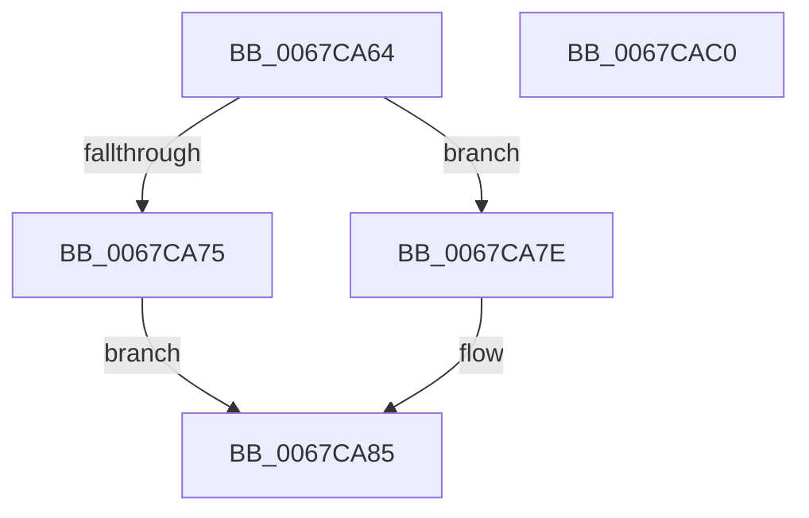

# MiInitializeNonPagedPoolThresholds

- RVA: `0x0067CA64`–`0x0067CAC1` (길이 `93` bytes)
- VA: `0x000000014067CA64`
- 실행 섹션: `.text`
- PDB 이름 있음: `예`; PDB Function 태그: `아니요`
- unwind 정보 RVA: `0x0005CF00`
- 디코드: `23`개 명령, `93/93` bytes 표시
- 미해석 바이트: `0` (있으면 어셈블리에 `.byte`로 보존)

> 이 문서는 커널 이미지의 기계어와 PDB 기호를 분석해 생성했습니다. 4번과 5번은 함수 원형과 자료형을 바이너리 사용 방식에서 추정한 C 해석이며 원본 소스 복구 결과는 아닙니다.

## 1. Dependencies

- 직접 호출 지점: **4**; 고유 호출 대상: **4**
- 직접 호출자로 확인된 함수: **2**
- RIP 상대 이미지 참조: **4**

### Outgoing calls
- `0x0067CA77` → [ExAcquireSpinLockExclusiveAtDpcLevel](../24/ExAcquireSpinLockExclusiveAtDpcLevel_function_00248E80.md) (function, `0x00248E80`)
- `0x0067CA7E` → [ExAcquireSpinLockExclusive](../24/ExAcquireSpinLockExclusive_function_00248690.md) (function, `0x00248690`)
- `0x0067CAA7` → [MiSignalNonPagedPoolWatchers](MiSignalNonPagedPoolWatchers_function_0067CAC8.md) (function, `0x0067CAC8`)
- `0x0067CAB5` → [MiReleaseSpinLockExclusive](../24/MiReleaseSpinLockExclusive_function_002482C0.md) (function, `0x002482C0`)

### Direct callers
- [MiPerformMemoryChange](MiPerformMemoryChange_function_006733A8.md) at `0x00673508`
- [MiInitializeNonPagedPool](../../init/C6/MiInitializeNonPagedPool_function_00C64A24.md) at `0x00C64C16`

### Static image references
- `0x0067CA6C` → RVA `0x00E3CC40` (`.data`; read)
- `0x0067CA85` → RVA `0x00E37658` (`.data`; read)
- `0x0067CA91` → RVA `0x00E3D550` (`.data`; read)
- `0x0067CAA0` → RVA `0x00E2CB40` (`.data`; write)

## 2. Other-region calls and transfers

- 다른 실행 섹션으로 향하는 call: **0**
- 별도 외부 분기/꼬리 이동을 확인하지 못했습니다.

## 3. Assembly (complete function range)

```asm
0067CA64  40 53                           push rbx
0067CA66  48 83 EC 20                     sub rsp, 0x20
0067CA6A  85 C9                           test ecx, ecx
0067CA6C  48 8D 0D CD 01 7C 00            lea rcx, [rip + 0x7c01cd]
0067CA73  74 09                           je 0x14067ca7e
0067CA75  B3 11                           mov bl, 0x11
0067CA77  E8 04 C4 BC FF                  call 0x140248e80
0067CA7C  EB 07                           jmp 0x14067ca85
0067CA7E  E8 0D BC BC FF                  call 0x140248690
0067CA83  8A D8                           mov bl, al
0067CA85  4C 8B 05 CC AB 7B 00            mov r8, qword ptr [rip + 0x7babcc]
0067CA8C  B9 01 00 00 00                  mov ecx, 1
0067CA91  4C 3B 05 B8 0A 7C 00            cmp r8, qword ptr [rip + 0x7c0ab8]
0067CA98  4C 0F 47 05 B0 0A 7C 00         cmova r8, qword ptr [rip + 0x7c0ab0]
0067CAA0  4C 89 05 99 00 7B 00            mov qword ptr [rip + 0x7b0099], r8
0067CAA7  E8 1C 00 00 00                  call 0x14067cac8
0067CAAC  8A D3                           mov dl, bl
0067CAAE  48 8D 0D 8B 01 7C 00            lea rcx, [rip + 0x7c018b]
0067CAB5  E8 06 B8 BC FF                  call 0x1402482c0
0067CABA  48 83 C4 20                     add rsp, 0x20
0067CABE  5B                              pop rbx
0067CABF  C3                              ret
0067CAC0  CC                              int3
```

## 4. C-style interpretation (structured pseudocode)

```c
__int64 __fastcall MiInitializeNonPagedPoolThresholds(int a1)
{
    __int64 result;
    __int64 v_rsp;

    v_rsp = (v_rsp) - (32);
    if (a1 == 0) goto loc_0067CA7E;
    result = ExAcquireSpinLockExclusiveAtDpcLevel(v_rip + 8126925, a2, a3, a4);
    goto loc_0067CA85;
loc_0067CA7E:
    result = ExAcquireSpinLockExclusive(v_rip + 8126925, a2, a3, a4);
loc_0067CA85:
    a3 = *(unsigned __int64 *)(v_rip + 8104908);
    if ((*(unsigned __int64 *)(v_rip + 8104908)) > (*(unsigned __int64 *)(v_rip + 8129208))) { a3 = *(unsigned __int64 *)(v_rip + 8129200); }
    *(unsigned __int64 *)(v_rip + 8061081) = a3;
    result = MiSignalNonPagedPoolWatchers(1, a2, a3, a4);
    result = MiReleaseSpinLockExclusive(v_rip + 8126859, (unsigned __int8)((unsigned __int8)(result)), a3, a4);
    v_rsp = (v_rsp) + (32);
    return result;
}
```

## 5. (Beta) C Style

```c
int64_t MiInitializeNonPagedPoolThresholds(int32_t Arg1)
{
    int64_t result;
    int64_t local_rsp;

    local_rsp = (local_rsp) - (32);
    if (Arg1 == 0) goto loc_0067CA7E;
    result = ExAcquireSpinLockExclusiveAtDpcLevel(v_rip + 8126925, a2, a3, a4);
    goto loc_0067CA85;
loc_0067CA7E:
    result = ExAcquireSpinLockExclusive(v_rip + 8126925, a2, a3, a4);
loc_0067CA85:
    a3 = *(uint64_t *)(v_rip + 0x7BABCC);
    if ((*(uint64_t *)(v_rip + 0x7BABCC)) > (*(uint64_t *)(v_rip + 0x7C0AB8))) { a3 = *(uint64_t *)(v_rip + 0x7C0AB0); }
    *(uint64_t *)(v_rip + 0x7B0099) = a3;
    result = MiSignalNonPagedPoolWatchers(1, a2, a3, a4);
    result = MiReleaseSpinLockExclusive(v_rip + 8126859, (uint8_t)((uint8_t)(result)), a3, a4);
    local_rsp = (local_rsp) + (32);
    return result;
}
```

## 6. Execution-region graph

[열기: 2D/3D 그래프와 함수 탐색 컨트롤 패널](../../../control-panel.html?section=text&rva=0x0067CA64&view=graph)

- 2D 그래프는 위에서 아래로 흐르고, 3D 그래프는 빈 공간을 드래그해 회전합니다. Shift+드래그는 이동, 휠은 확대·축소, 함수 노드 선택은 대상 보고서 이동입니다.

### Static fallback


