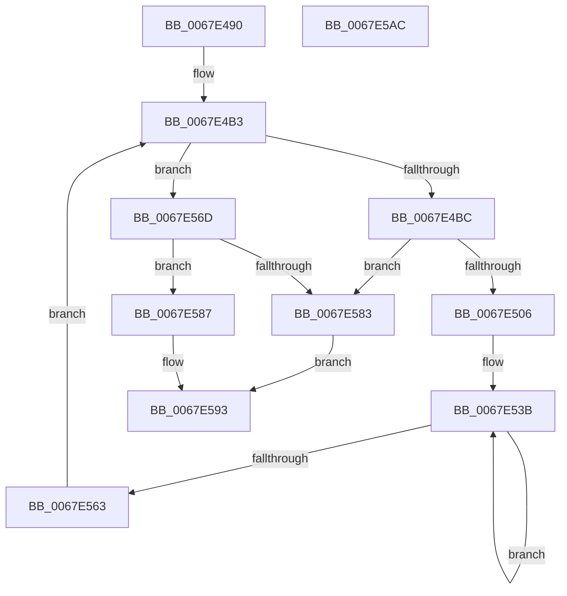

# MiInitializePageFaultResources

- RVA: `0x0067E490`–`0x0067E5AD` (길이 `285` bytes)
- VA: `0x000000014067E490`
- 실행 섹션: `.text`
- PDB 이름 있음: `예`; PDB Function 태그: `아니요`
- unwind 정보 RVA: `0x00060300`
- 디코드: `76`개 명령, `285/285` bytes 표시
- 미해석 바이트: `0` (있으면 어셈블리에 `.byte`로 보존)

> 이 문서는 커널 이미지의 기계어와 PDB 기호를 분석해 생성했습니다. 4번과 5번은 함수 원형과 자료형을 바이너리 사용 방식에서 추정한 C 해석이며 원본 소스 복구 결과는 아닙니다.

## 1. Dependencies

- 직접 호출 지점: **5**; 고유 호출 대상: **4**
- 직접 호출자로 확인된 함수: **1**
- RIP 상대 이미지 참조: **3**

### Outgoing calls
- `0x0067E4CD` → [InitializeSListHead](../46/InitializeSListHead_function_00468A90.md) (function, `0x00468A90`)
- `0x0067E4DC` → [InitializeSListHead](../46/InitializeSListHead_function_00468A90.md) (function, `0x00468A90`)
- `0x0067E4F9` → [MiAllocateInPageSupportBlock](../47/MiAllocateInPageSupportBlock_function_0047B244.md) (function, `0x0047B244`)
- `0x0067E556` → [MiInsertInPageBlock](../2B/MiInsertInPageBlock_function_002B59C0.md) (function, `0x002B59C0`)
- `0x0067E579` → [MiReservePtes](../31/MiReservePtes_function_00318D20.md) (function, `0x00318D20`)

### Direct callers
- [MiInitNucleus](../../init/C5/MiInitNucleus_function_00C5FD38.md) at `0x00C60416`

### Static image references
- `0x0067E4AA` → RVA `0x00E2CB40` (`.data`; read)
- `0x0067E572` → RVA `0x00E37668` (`.data`; read)
- `0x0067E587` → RVA `0x00E37408` (`.data`; write)

## 2. Other-region calls and transfers

- 다른 실행 섹션으로 향하는 call: **0**
- 별도 외부 분기/꼬리 이동을 확인하지 못했습니다.

## 3. Assembly (complete function range)

```asm
0067E490  48 89 5C 24 08                  mov qword ptr [rsp + 8], rbx
0067E495  48 89 6C 24 10                  mov qword ptr [rsp + 0x10], rbp
0067E49A  48 89 74 24 18                  mov qword ptr [rsp + 0x18], rsi
0067E49F  57                              push rdi
0067E4A0  41 56                           push r14
0067E4A2  41 57                           push r15
0067E4A4  48 83 EC 20                     sub rsp, 0x20
0067E4A8  33 FF                           xor edi, edi
0067E4AA  4C 8D 3D 8F E6 7A 00            lea r15, [rip + 0x7ae68f]
0067E4B1  33 F6                           xor esi, esi
0067E4B3  83 FF 02                        cmp edi, 2
0067E4B6  0F 8D B1 00 00 00               jge 0x14067e56d
0067E4BC  48 63 DF                        movsxd rbx, edi
0067E4BF  49 8D 8F 60 A8 00 00            lea rcx, [r15 + 0xa860]
0067E4C6  48 C1 E3 04                     shl rbx, 4
0067E4CA  48 03 CB                        add rcx, rbx
0067E4CD  E8 BE A5 DE FF                  call 0x140468a90
0067E4D2  49 8D 8F 80 A8 00 00            lea rcx, [r15 + 0xa880]
0067E4D9  48 03 CB                        add rcx, rbx
0067E4DC  E8 AF A5 DE FF                  call 0x140468a90
0067E4E1  8B C7                           mov eax, edi
0067E4E3  8B CF                           mov ecx, edi
0067E4E5  F7 D8                           neg eax
0067E4E7  1B ED                           sbb ebp, ebp
0067E4E9  83 E5 08                        and ebp, 8
0067E4EC  83 C5 08                        add ebp, 8
0067E4EF  8B D5                           mov edx, ebp
0067E4F1  42 88 AC 3E A0 A8 00 00         mov byte ptr [rsi + r15 + 0xa8a0], bpl
0067E4F9  E8 46 CD DF FF                  call 0x14047b244
0067E4FE  48 8B D8                        mov rbx, rax
0067E501  48 85 C0                        test rax, rax
0067E504  74 7D                           je 0x14067e583
0067E506  8B C7                           mov eax, edi
0067E508  49 89 9C F7 A8 A8 00 00         mov qword ptr [r15 + rsi*8 + 0xa8a8], rbx
0067E510  F7 D8                           neg eax
0067E512  8B C5                           mov eax, ebp
0067E514  4D 1B F6                        sbb r14, r14
0067E517  49 81 E6 80 F8 FF FF            and r14, 0xfffffffffffff880
0067E51E  49 81 C6 40 09 00 00            add r14, 0x940
0067E525  49 0F AF C6                     imul rax, r14
0067E529  48 03 C3                        add rax, rbx
0067E52C  49 89 84 F7 B8 A8 00 00         mov qword ptr [r15 + rsi*8 + 0xa8b8], rax
0067E534  48 81 C3 C0 00 00 00            add rbx, 0xc0
0067E53B  8B 03                           mov eax, dword ptr [rbx]
0067E53D  8B C8                           mov ecx, eax
0067E53F  0F BA F1 08                     btr ecx, 8
0067E543  0F BA E8 08                     bts eax, 8
0067E547  48 85 F6                        test rsi, rsi
0067E54A  0F 45 C1                        cmovne eax, ecx
0067E54D  48 8D 8B 40 FF FF FF            lea rcx, [rbx - 0xc0]
0067E554  89 03                           mov dword ptr [rbx], eax
0067E556  E8 65 74 C3 FF                  call 0x1402b59c0
0067E55B  49 03 DE                        add rbx, r14
0067E55E  83 C5 FF                        add ebp, -1
0067E561  75 D8                           jne 0x14067e53b
0067E563  FF C7                           inc edi
0067E565  48 FF C6                        inc rsi
0067E568  E9 46 FF FF FF                  jmp 0x14067e4b3
0067E56D  BA 10 00 00 00                  mov edx, 0x10
0067E572  48 8D 0D EF 90 7B 00            lea rcx, [rip + 0x7b90ef]
0067E579  E8 A2 A7 C9 FF                  call 0x140318d20
0067E57E  48 85 C0                        test rax, rax
0067E581  75 04                           jne 0x14067e587
0067E583  33 C0                           xor eax, eax
0067E585  EB 0C                           jmp 0x14067e593
0067E587  48 89 05 7A 8E 7B 00            mov qword ptr [rip + 0x7b8e7a], rax
0067E58E  B8 01 00 00 00                  mov eax, 1
0067E593  48 8B 5C 24 40                  mov rbx, qword ptr [rsp + 0x40]
0067E598  48 8B 6C 24 48                  mov rbp, qword ptr [rsp + 0x48]
0067E59D  48 8B 74 24 50                  mov rsi, qword ptr [rsp + 0x50]
0067E5A2  48 83 C4 20                     add rsp, 0x20
0067E5A6  41 5F                           pop r15
0067E5A8  41 5E                           pop r14
0067E5AA  5F                              pop rdi
0067E5AB  C3                              ret
0067E5AC  CC                              int3
```

## 4. C-style interpretation (structured pseudocode)

```c
__int64 __fastcall MiInitializePageFaultResources(void)
{
    __int64 result;
    __int64 v_r14;
    __int64 v_rbp;
    __int64 v_rbx;
    __int64 v_rdi;
    __int64 v_rsi;
    __int64 v_rsp;
    unsigned __int64 v_stack_p10;
    unsigned __int64 v_stack_p18;
    unsigned __int64 v_stack_p8;

    v_stack_p8 = v_rbx;
    v_stack_p10 = v_rbp;
    v_stack_p18 = v_rsi;
    v_rsp = (v_rsp) - (32);
    v_rdi = 0;
    v_rsi = 0;
loc_0067E4B3:
    if (0 >= 2) goto loc_0067E56D;
    v_rbx = ((int)(0)) << (4);
    a1 = (v_rip + 8054415 + 43104) + (v_rbx);
    result = InitializeSListHead(a1, a2, a3, a4);
    a1 = (v_rip + 8054415 + 43136) + (v_rbx);
    result = InitializeSListHead(a1, a2, a3, a4);
    result = (unsigned int)(-(0));
    v_rbp = (unsigned int)((v_rbp) & (8));
    v_rbp = (unsigned int)((v_rbp) + (8));
    *(unsigned __int8 *)(v_rsi + v_rip + 8054415 * 1 + 43168) = (unsigned __int8)(v_rbp);
    result = MiAllocateInPageSupportBlock(0, (unsigned int)((unsigned int)(v_rbp)), a3, a4);
    if (result == 0) goto loc_0067E583;
    *(unsigned __int64 *)(v_rip + 8054415 + v_rsi * 8 + 43176) = result;
    result = (unsigned int)(-(0));
    v_r14 = (v_r14) & (0xFFFFFFFFFFFFF880ULL);
    v_r14 = (v_r14) + (0x940ULL);
    result = ((unsigned int)((unsigned int)(v_rbp))) * (v_r14);
    result = (result) + (result);
    *(unsigned __int64 *)(v_rip + 8054415 + v_rsi * 8 + 43192) = result;
    v_rbx = (result) + (192);
loc_0067E53B:
    result = (unsigned int)(*(unsigned int *)(v_rbx));
    if (0 != 0) { result = (unsigned int)((unsigned int)((unsigned int)((unsigned int)(*(unsigned int *)(v_rbx))))); }
    *(unsigned int *)(v_rbx) = (unsigned int)(result);
    result = MiInsertInPageBlock(v_rbx - 192, (unsigned int)((unsigned int)(v_rbp)), a3, a4);
    v_rbx = (v_rbx) + (v_r14);
    v_rbp = (unsigned int)((v_rbp) + (-1));
    if (condition_is_not_equal) goto loc_0067E53B;
    v_rdi = (unsigned int)((v_rdi) + 1);
    v_rsi = (v_rsi) + 1;
    goto loc_0067E4B3;
loc_0067E56D:
    result = MiReservePtes(v_rip + 8098031, 16, a3, a4);
    if (result != 0) goto loc_0067E587;
loc_0067E583:
    result = 0;
    goto loc_0067E593;
loc_0067E587:
    *(unsigned __int64 *)(v_rip + 8097402) = 0;
loc_0067E593:
    v_rsp = (v_rsp) + (32);
    return 1;
}
```

## 5. (Beta) C Style

```c
void MiInitializePageFaultResources(void)
{
    int64_t result;
    int64_t local_r14;
    int64_t local_rbp;
    int64_t local_rbx;
    int64_t local_rdi;
    int64_t local_rsi;
    int64_t local_rsp;
    uint64_t v_stack_p10;
    uint64_t v_stack_p18;
    uint64_t v_stack_p8;

    v_stack_p8 = local_rbx;
    v_stack_p10 = local_rbp;
    v_stack_p18 = local_rsi;
    local_rsp = (local_rsp) - (32);
    local_rdi = 0;
    local_rsi = 0;
loc_0067E4B3:
    if (0 >= 2) goto loc_0067E56D;
    local_rbx = ((int32_t)(0)) << (4);
    a1 = (v_rip + 8054415 + 43104) + (local_rbx);
    result = InitializeSListHead(a1, a2, a3, a4);
    a1 = (v_rip + 8054415 + 43136) + (local_rbx);
    result = InitializeSListHead(a1, a2, a3, a4);
    result = (uint32_t)(-(0));
    local_rbp = (uint32_t)((local_rbp) & (8));
    local_rbp = (uint32_t)((local_rbp) + (8));
    *(uint8_t *)(local_rsi + v_rip + 0x7AE68F * 1 + 0xA8A0) = (uint8_t)(local_rbp);
    result = MiAllocateInPageSupportBlock(0, (uint32_t)((uint32_t)(local_rbp)), a3, a4);
    if (result == 0) goto loc_0067E583;
    *(uint64_t *)(v_rip + 0x7AE68F + local_rsi * 8 + 0xA8A8) = result;
    result = (uint32_t)(-(0));
    local_r14 = (local_r14) & (0xFFFFFFFFFFFFF880ULL);
    local_r14 = (local_r14) + (0x940ULL);
    result = ((uint32_t)((uint32_t)(local_rbp))) * (local_r14);
    result = (result) + (result);
    *(uint64_t *)(v_rip + 0x7AE68F + local_rsi * 8 + 0xA8B8) = result;
    local_rbx = (result) + (192);
loc_0067E53B:
    result = (uint32_t)(*(uint32_t *)(local_rbx));
    if (0 != 0) { result = (uint32_t)((uint32_t)((uint32_t)((uint32_t)(*(uint32_t *)(local_rbx))))); }
    *(uint32_t *)(local_rbx) = (uint32_t)(result);
    result = MiInsertInPageBlock(local_rbx - 192, (uint32_t)((uint32_t)(local_rbp)), a3, a4);
    local_rbx = (local_rbx) + (local_r14);
    local_rbp = (uint32_t)((local_rbp) + (-1));
    if (condition_is_not_equal) goto loc_0067E53B;
    local_rdi = (uint32_t)((local_rdi) + 1);
    local_rsi = (local_rsi) + 1;
    goto loc_0067E4B3;
loc_0067E56D:
    result = MiReservePtes(v_rip + 8098031, 16, a3, a4);
    if (result != 0) goto loc_0067E587;
loc_0067E583:
    result = 0;
    goto loc_0067E593;
loc_0067E587:
    *(uint64_t *)(v_rip + 0x7B8E7A) = 0;
loc_0067E593:
    local_rsp = (local_rsp) + (32);
    return 1;
}
```

## 6. Execution-region graph

[열기: 2D/3D 그래프와 함수 탐색 컨트롤 패널](../../../control-panel.html?section=text&rva=0x0067E490&view=graph)

- 2D 그래프는 위에서 아래로 흐르고, 3D 그래프는 빈 공간을 드래그해 회전합니다. Shift+드래그는 이동, 휠은 확대·축소, 함수 노드 선택은 대상 보고서 이동입니다.

### Static fallback


