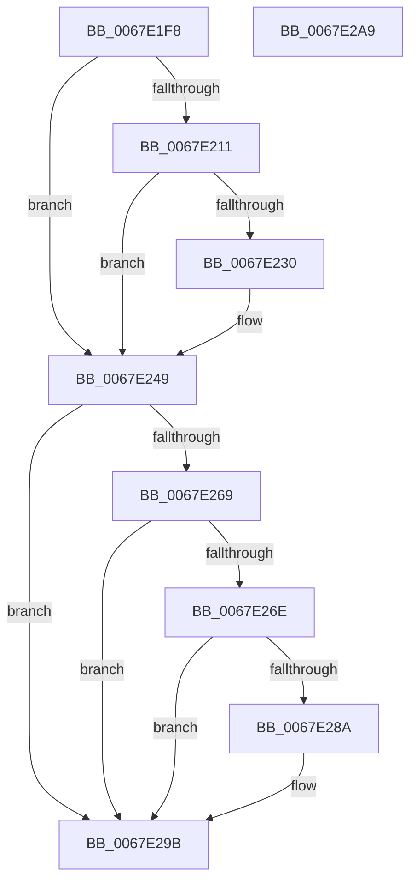

# MiInitializeSlowPte

- RVA: `0x0067E1F8`–`0x0067E2AA` (길이 `178` bytes)
- VA: `0x000000014067E1F8`
- 실행 섹션: `.text`
- PDB 이름 있음: `예`; PDB Function 태그: `아니요`
- unwind 정보 RVA: `0x0005CAAC`
- 디코드: `43`개 명령, `178/178` bytes 표시
- 미해석 바이트: `0` (있으면 어셈블리에 `.byte`로 보존)

> 이 문서는 커널 이미지의 기계어와 PDB 기호를 분석해 생성했습니다. 4번과 5번은 함수 원형과 자료형을 바이너리 사용 방식에서 추정한 C 해석이며 원본 소스 복구 결과는 아닙니다.

## 1. Dependencies

- 직접 호출 지점: **3**; 고유 호출 대상: **3**
- 직접 호출자로 확인된 함수: **1**
- RIP 상대 이미지 참조: **2**

### Outgoing calls
- `0x0067E241` → [MiMakeProtectionPfnCompatible](../22/MiMakeProtectionPfnCompatible_function_00229CD0.md) (function, `0x00229CD0`)
- `0x0067E256` → [MiMakeValidPte](../2C/MiMakeValidPte_function_002C5590.md) (function, `0x002C5590`)
- `0x0067E296` → [MiCheckLinearProtectedPteAccessedBit](../29/MiCheckLinearProtectedPteAccessedBit_function_00292D80.md) (function, `0x00292D80`)

### Direct callers
- [MiSlowRotateCopy](MiSlowRotateCopy_function_0067E2B0.md) at `0x0067E36D`
- [MiSlowRotateCopy](MiSlowRotateCopy_function_0067E2B0.md) at `0x0067E37C`

### Static image references
- `0x0067E202` → RVA `0x00E2DCE0` (`.data`; read)
- `0x0067E25B` → RVA `0x00FC6A88` (`ALMOSTRO`; read)

## 2. Other-region calls and transfers

- 다른 실행 섹션으로 향하는 call: **0**
- 별도 외부 분기/꼬리 이동을 확인하지 못했습니다.

## 3. Assembly (complete function range)

```asm
0067E1F8  48 89 5C 24 08                  mov qword ptr [rsp + 8], rbx
0067E1FD  57                              push rdi
0067E1FE  48 83 EC 20                     sub rsp, 0x20
0067E202  48 3B 15 D7 FA 7A 00            cmp rdx, qword ptr [rip + 0x7afad7]
0067E209  4C 8B CA                        mov r9, rdx
0067E20C  48 8B F9                        mov rdi, rcx
0067E20F  77 38                           ja 0x14067e249
0067E211  48 8D 0C 52                     lea rcx, [rdx + rdx*2]
0067E215  48 03 C9                        add rcx, rcx
0067E218  48 B8 28 00 00 00 00 DE FF FF   movabs rax, 0xffffde0000000028
0067E222  48 8B 04 C8                     mov rax, qword ptr [rax + rcx*8]
0067E226  48 C1 E8 36                     shr rax, 0x36
0067E22A  0F BA E0 00                     bt eax, 0
0067E22E  73 19                           jae 0x14067e249
0067E230  48 B8 00 00 00 00 00 DE FF FF   movabs rax, 0xffffde0000000000
0067E23A  48 8D 14 C8                     lea rdx, [rax + rcx*8]
0067E23E  41 8B C8                        mov ecx, r8d
0067E241  E8 8A BA BA FF                  call 0x140229cd0
0067E246  44 8B C0                        mov r8d, eax
0067E249  41 81 C8 00 00 00 A0            or r8d, 0xa0000000
0067E250  49 8B D1                        mov rdx, r9
0067E253  48 8B CF                        mov rcx, rdi
0067E256  E8 35 73 C4 FF                  call 0x1402c5590
0067E25B  48 0F BA 25 24 88 94 00 24      bt qword ptr [rip + 0x948824], 0x24
0067E264  48 8B D8                        mov rbx, rax
0067E267  73 32                           jae 0x14067e29b
0067E269  F6 C3 20                        test bl, 0x20
0067E26C  75 2D                           jne 0x14067e29b
0067E26E  48 B8 00 00 00 00 80 F6 FF FF   movabs rax, 0xfffff68000000000
0067E278  48 B9 00 00 00 00 40 00 00 00   movabs rcx, 0x4000000000
0067E282  48 03 C1                        add rax, rcx
0067E285  48 3B F8                        cmp rdi, rax
0067E288  72 11                           jb 0x14067e29b
0067E28A  41 B8 80 00 00 00               mov r8d, 0x80
0067E290  48 8B D3                        mov rdx, rbx
0067E293  48 8B CF                        mov rcx, rdi
0067E296  E8 E5 4A C1 FF                  call 0x140292d80
0067E29B  48 89 1F                        mov qword ptr [rdi], rbx
0067E29E  48 8B 5C 24 30                  mov rbx, qword ptr [rsp + 0x30]
0067E2A3  48 83 C4 20                     add rsp, 0x20
0067E2A7  5F                              pop rdi
0067E2A8  C3                              ret
0067E2A9  CC                              int3
```

## 4. C-style interpretation (structured pseudocode)

```c
__int64 __fastcall MiInitializeSlowPte(__int64 a1, __int64 a2, int a3)
{
    __int64 result;
    __int64 v_rsp;
    unsigned __int64 v_stack_p8;

    v_stack_p8 = v_rbx;
    v_rsp = (v_rsp) - (32);
    if (a2 > (*(unsigned __int64 *)(v_rip + 8059607))) goto loc_0067E249;
    a1 = (a2 + a2 * 2) + (a2 + a2 * 2);
    result = (*(unsigned __int64 *)(result + a1 * 8)) >> (54);
    if (!(condition_is_above_or_equal)) {
        a2 = result + a1 * 8;
        a1 = a3;
        result = MiMakeProtectionPfnCompatible(a1, a2, a3, a2);
        a3 = (unsigned int)(result);
    }
    a3 = (unsigned int)((a3) | (0xA0000000ULL));
    result = MiMakeValidPte(a1, a2, a3, a2);
    if (condition_is_above_or_equal) goto loc_0067E29B;
    if ((((unsigned __int8)(result)) & (32)) != 0) goto loc_0067E29B;
    result = (result) + (a1);
    if (a1 >= result) {
        a3 = 128;
        a2 = result;
        a1 = a1;
        result = MiCheckLinearProtectedPteAccessedBit(a1, a2, a3, a2);
    }
    *(unsigned __int64 *)(a1) = result;
    v_rsp = (v_rsp) + (32);
    return result;
}
```

## 5. (Beta) C Style

```c
int64_t MiInitializeSlowPte(int64_t Arg1, int64_t Arg2, int32_t Arg3)
{
    int64_t result;
    int64_t local_rsp;
    uint64_t v_stack_p8;

    v_stack_p8 = local_rbx;
    local_rsp = (local_rsp) - (32);
    if (Arg2 > (*(uint64_t *)(v_rip + 0x7AFAD7))) goto loc_0067E249;
    Arg1 = (Arg2 + Arg2 * 2) + (Arg2 + Arg2 * 2);
    result = (*(uint64_t *)(result + Arg1 * 8)) >> (54);
    if (!(condition_is_above_or_equal)) {
        Arg2 = result + Arg1 * 8;
        Arg1 = Arg3;
        result = MiMakeProtectionPfnCompatible(Arg1, Arg2, Arg3, Arg2);
        Arg3 = (uint32_t)(result);
    }
    Arg3 = (uint32_t)((Arg3) | (0xA0000000ULL));
    result = MiMakeValidPte(Arg1, Arg2, Arg3, Arg2);
    if (condition_is_above_or_equal) goto loc_0067E29B;
    if ((((uint8_t)(result)) & (32)) != 0) goto loc_0067E29B;
    result = (result) + (Arg1);
    if (Arg1 >= result) {
        Arg3 = 128;
        Arg2 = result;
        Arg1 = Arg1;
        result = MiCheckLinearProtectedPteAccessedBit(Arg1, Arg2, Arg3, Arg2);
    }
    *(uint64_t *)(Arg1) = result;
    local_rsp = (local_rsp) + (32);
    return result;
}
```

## 6. Execution-region graph

[열기: 2D/3D 그래프와 함수 탐색 컨트롤 패널](../../../control-panel.html?section=text&rva=0x0067E1F8&view=graph)

- 2D 그래프는 위에서 아래로 흐르고, 3D 그래프는 빈 공간을 드래그해 회전합니다. Shift+드래그는 이동, 휠은 확대·축소, 함수 노드 선택은 대상 보고서 이동입니다.

### Static fallback


