# MiInitializeWorkingSetManagerParameters

- RVA: `0x0067E7F8`–`0x0067EB3A` (길이 `834` bytes)
- VA: `0x000000014067E7F8`
- 실행 섹션: `.text`
- PDB 이름 있음: `예`; PDB Function 태그: `아니요`
- unwind 정보 RVA: `0x000D800C`
- 디코드: `208`개 명령, `834/834` bytes 표시
- 미해석 바이트: `0` (있으면 어셈블리에 `.byte`로 보존)

> 이 문서는 커널 이미지의 기계어와 PDB 기호를 분석해 생성했습니다. 4번과 5번은 함수 원형과 자료형을 바이너리 사용 방식에서 추정한 C 해석이며 원본 소스 복구 결과는 아닙니다.

## 1. Dependencies

- 직접 호출 지점: **5**; 고유 호출 대상: **5**
- 직접 호출자로 확인된 함수: **3**
- RIP 상대 이미지 참조: **10**

### Outgoing calls
- `0x0067E84D` → [MiAllocatePool](../35/MiAllocatePool_function_0035B540.md) (function, `0x0035B540`)
- `0x0067E8DC` → [ExAcquireSpinLockExclusive](../24/ExAcquireSpinLockExclusive_function_00248690.md) (function, `0x00248690`)
- `0x0067E900` → [MiReleaseSpinLockExclusive](../24/MiReleaseSpinLockExclusive_function_002482C0.md) (function, `0x002482C0`)
- `0x0067E9F5` → [MiSetTrimWhileAgingState](MiSetTrimWhileAgingState_function_0067ED14.md) (function, `0x0067ED14`)
- `0x0067EB19` → [KeGenericCallDpcEx](../2C/KeGenericCallDpcEx_function_002C99F4.md) (function, `0x002C99F4`)

### Direct callers
- [MiProcessWorkingSets](../34/MiProcessWorkingSets_function_0034E710.md) at `0x0034ED35`
- [MmCreatePartition](../../page/80/MmCreatePartition_function_0080DC3C.md) at `0x0080DD64`
- [MiInitSystem](../../init/C5/MiInitSystem_function_00C5E6C0.md) at `0x00C5E787`

### Static image references
- `0x0067E8B0` → RVA `0x00E38840` (`.data`; read)
- `0x0067E8C0` → RVA `0x00E2FE00` (`.data`; read)
- `0x0067E905` → RVA `0x00E38D00` (`.data`; read)
- `0x0067EA6C` → RVA `0x00E374C8` (`.data`; read/write)
- `0x0067EA74` → RVA `0x00E374D0` (`.data`; read)
- `0x0067EA7B` → RVA `0x00E374CC` (`.data`; read/write)
- `0x0067EA82` → RVA `0x00E374D8` (`.data`; write)
- `0x0067EA89` → RVA `0x00E374D0` (`.data`; write)
- `0x0067EA90` → RVA `0x00E374CA` (`.data`; write)
- `0x0067EB0D` → RVA `0x003BD050` (`MiUpdatePageThresholdsDpc`; read)

## 2. Other-region calls and transfers

- 다른 실행 섹션으로 향하는 call: **0**
- 별도 외부 분기/꼬리 이동을 확인하지 못했습니다.

## 3. Assembly (complete function range)

```asm
0067E7F8  4C 8B DC                        mov r11, rsp
0067E7FB  49 89 5B 10                     mov qword ptr [r11 + 0x10], rbx
0067E7FF  49 89 6B 18                     mov qword ptr [r11 + 0x18], rbp
0067E803  56                              push rsi
0067E804  57                              push rdi
0067E805  41 54                           push r12
0067E807  41 56                           push r14
0067E809  41 57                           push r15
0067E80B  48 83 EC 70                     sub rsp, 0x70
0067E80F  4C 8B B1 C0 44 00 00            mov r14, qword ptr [rcx + 0x44c0]
0067E816  33 C0                           xor eax, eax
0067E818  0F 57 C0                        xorps xmm0, xmm0
0067E81B  0F 57 C9                        xorps xmm1, xmm1
0067E81E  4C 8B F9                        mov r15, rcx
0067E821  0F 11 44 24 50                  movups xmmword ptr [rsp + 0x50], xmm0
0067E826  49 89 43 C8                     mov qword ptr [r11 - 0x38], rax
0067E82A  8D 58 01                        lea ebx, [rax + 1]
0067E82D  0F 11 4C 24 38                  movups xmmword ptr [rsp + 0x38], xmm1
0067E832  49 89 43 B0                     mov qword ptr [r11 - 0x50], rax
0067E836  4D 85 F6                        test r14, r14
0067E839  0F 85 90 00 00 00               jne 0x14067e8cf
0067E83F  BA 08 02 00 00                  mov edx, 0x208
0067E844  8D 48 40                        lea ecx, [rax + 0x40]
0067E847  41 B8 4D 6D 57 64               mov r8d, 0x64576d4d
0067E84D  E8 EE CC CD FF                  call 0x14035b540
0067E852  4C 8B F0                        mov r14, rax
0067E855  48 85 C0                        test rax, rax
0067E858  0F 84 C2 02 00 00               je 0x14067eb20
0067E85E  66 83 20 00                     and word ptr [rax], 0
0067E862  C6 40 02 06                     mov byte ptr [rax + 2], 6
0067E866  89 58 04                        mov dword ptr [rax + 4], ebx
0067E869  48 83 C0 08                     add rax, 8
0067E86D  48 89 40 08                     mov qword ptr [rax + 8], rax
0067E871  48 89 00                        mov qword ptr [rax], rax
0067E874  41 C7 46 24 00 01 00 00         mov dword ptr [r14 + 0x24], 0x100
0067E87C  41 8B 87 38 4A 00 00            mov eax, dword ptr [r15 + 0x4a38]
0067E883  89 84 24 A0 00 00 00            mov dword ptr [rsp + 0xa0], eax
0067E88A  24 F1                           and al, 0xf1
0067E88C  0A C3                           or al, bl
0067E88E  88 84 24 A0 00 00 00            mov byte ptr [rsp + 0xa0], al
0067E895  0F B7 84 24 A0 00 00 00         movzx eax, word ptr [rsp + 0xa0]
0067E89D  66 41 89 87 38 4A 00 00         mov word ptr [r15 + 0x4a38], ax
0067E8A5  41 8B 87 38 4A 00 00            mov eax, dword ptr [r15 + 0x4a38]
0067E8AC  24 0F                           and al, 0xf
0067E8AE  3A C3                           cmp al, bl
0067E8B0  48 8D 05 89 9F 7B 00            lea rax, [rip + 0x7b9f89]
0067E8B7  74 07                           je 0x14067e8c0
0067E8B9  49 8D 87 40 4A 00 00            lea rax, [r15 + 0x4a40]
0067E8C0  48 8D 0D 39 15 7B 00            lea rcx, [rip + 0x7b1539]
0067E8C7  44 8B E3                        mov r12d, ebx
0067E8CA  48 89 08                        mov qword ptr [rax], rcx
0067E8CD  EB 03                           jmp 0x14067e8d2
0067E8CF  45 33 E4                        xor r12d, r12d
0067E8D2  49 8D 9F C8 00 00 00            lea rbx, [r15 + 0xc8]
0067E8D9  48 8B CB                        mov rcx, rbx
0067E8DC  E8 AF 9D BC FF                  call 0x140248690
0067E8E1  49 8B B7 50 48 00 00            mov rsi, qword ptr [r15 + 0x4850]
0067E8E8  8A D0                           mov dl, al
0067E8EA  49 8B BF F0 40 00 00            mov rdi, qword ptr [r15 + 0x40f0]
0067E8F1  48 8B CB                        mov rcx, rbx
0067E8F4  49 8B AF F8 40 00 00            mov rbp, qword ptr [r15 + 0x40f8]
0067E8FB  41 C6 47 0C 00                  mov byte ptr [r15 + 0xc], 0
0067E900  E8 BB 99 BC FF                  call 0x1402482c0
0067E905  48 8D 05 F4 A3 7B 00            lea rax, [rip + 0x7ba3f4]
0067E90C  4C 3B F8                        cmp r15, rax
0067E90F  75 78                           jne 0x14067e989
0067E911  49 8B 86 00 02 00 00            mov rax, qword ptr [r14 + 0x200]
0067E918  48 3B F0                        cmp rsi, rax
0067E91B  76 05                           jbe 0x14067e922
0067E91D  48 2B F0                        sub rsi, rax
0067E920  EB 08                           jmp 0x14067e92a
0067E922  49 83 8E 00 02 00 00 FF         or qword ptr [r14 + 0x200], 0xffffffffffffffff
0067E92A  B8 00 10 02 00                  mov eax, 0x21000
0067E92F  48 3B F0                        cmp rsi, rax
0067E932  73 55                           jae 0x14067e989
0067E934  8B F0                           mov esi, eax
0067E936  B8 80 10 00 00                  mov eax, 0x1080
0067E93B  48 8B C8                        mov rcx, rax
0067E93E  BA 80 04 00 00                  mov edx, 0x480
0067E943  48 3B CA                        cmp rcx, rdx
0067E946  72 10                           jb 0x14067e958
0067E948  41 B8 00 00 40 00               mov r8d, 0x400000
0067E94E  48 8B D1                        mov rdx, rcx
0067E951  49 3B C8                        cmp rcx, r8
0067E954  49 0F 47 D0                     cmova rdx, r8
0067E958  49 89 96 38 01 00 00            mov qword ptr [r14 + 0x138], rdx
0067E95F  48 81 FE 00 00 08 00            cmp rsi, 0x80000
0067E966  76 11                           jbe 0x14067e979
0067E968  48 8D 86 00 00 F8 FF            lea rax, [rsi - 0x80000]
0067E96F  48 C1 E8 08                     shr rax, 8
0067E973  48 05 00 40 00 00               add rax, 0x4000
0067E979  41 B8 21 01 00 00               mov r8d, 0x121
0067E97F  49 3B C0                        cmp rax, r8
0067E982  73 29                           jae 0x14067e9ad
0067E984  41 8B C0                        mov eax, r8d
0067E987  EB 30                           jmp 0x14067e9b9
0067E989  48 8B C6                        mov rax, rsi
0067E98C  48 C1 E8 05                     shr rax, 5
0067E990  48 81 FE 00 00 20 00            cmp rsi, 0x200000
0067E997  76 A2                           jbe 0x14067e93b
0067E999  48 8D 8E 00 00 E0 FF            lea rcx, [rsi - 0x200000]
0067E9A0  48 C1 E9 07                     shr rcx, 7
0067E9A4  48 81 C1 00 00 01 00            add rcx, 0x10000
0067E9AB  EB 91                           jmp 0x14067e93e
0067E9AD  B9 00 00 10 00                  mov ecx, 0x100000
0067E9B2  48 3B C1                        cmp rax, rcx
0067E9B5  48 0F 47 C1                     cmova rax, rcx
0067E9B9  48 C1 EA 02                     shr rdx, 2
0067E9BD  49 3B D0                        cmp rdx, r8
0067E9C0  49 89 86 40 01 00 00            mov qword ptr [r14 + 0x140], rax
0067E9C7  49 89 86 48 01 00 00            mov qword ptr [r14 + 0x148], rax
0067E9CE  49 0F 42 D0                     cmovb rdx, r8
0067E9D2  C7 44 24 38 03 00 00 00         mov dword ptr [rsp + 0x38], 3
0067E9DA  49 89 96 30 01 00 00            mov qword ptr [r14 + 0x130], rdx
0067E9E1  45 85 E4                        test r12d, r12d
0067E9E4  74 07                           je 0x14067e9ed
0067E9E6  4D 89 B7 C0 44 00 00            mov qword ptr [r15 + 0x44c0], r14
0067E9ED  48 8D 54 24 38                  lea rdx, [rsp + 0x38]
0067E9F2  49 8B CF                        mov rcx, r15
0067E9F5  E8 1A 03 00 00                  call 0x14067ed14
0067E9FA  48 81 FE 88 8A 01 00            cmp rsi, 0x18a88
0067EA01  72 1F                           jb 0x14067ea22
0067EA03  48 B8 77 BE 9F 1A 2F DD 24 06   movabs rax, 0x624dd2f1a9fbe77
0067EA0D  48 F7 E6                        mul rsi
0067EA10  48 8B C6                        mov rax, rsi
0067EA13  48 2B C2                        sub rax, rdx
0067EA16  48 D1 E8                        shr rax, 1
0067EA19  48 03 C2                        add rax, rdx
0067EA1C  48 C1 E8 09                     shr rax, 9
0067EA20  EB 05                           jmp 0x14067ea27
0067EA22  B8 64 00 00 00                  mov eax, 0x64
0067EA27  BB 01 00 00 00                  mov ebx, 1
0067EA2C  48 3B C6                        cmp rax, rsi
0067EA2F  76 0A                           jbe 0x14067ea3b
0067EA31  48 8B C6                        mov rax, rsi
0067EA34  48 D1 E8                        shr rax, 1
0067EA37  48 0F 44 C3                     cmove rax, rbx
0067EA3B  49 89 46 38                     mov qword ptr [r14 + 0x38], rax
0067EA3F  45 85 E4                        test r12d, r12d
0067EA42  74 53                           je 0x14067ea97
0067EA44  41 83 66 64 00                  and dword ptr [r14 + 0x64], 0
0067EA49  49 8D 46 68                     lea rax, [r14 + 0x68]
0067EA4D  66 41 C7 46 60 01 00            mov word ptr [r14 + 0x60], 1
0067EA54  41 C6 46 62 06                  mov byte ptr [r14 + 0x62], 6
0067EA59  48 89 40 08                     mov qword ptr [rax + 8], rax
0067EA5D  48 89 00                        mov qword ptr [rax], rax
0067EA60  48 8D 05 99 A2 7B 00            lea rax, [rip + 0x7ba299]
0067EA67  4C 3B F8                        cmp r15, rax
0067EA6A  75 2B                           jne 0x14067ea97
0067EA6C  66 83 25 54 8A 7B 00 00         and word ptr [rip + 0x7b8a54], 0
0067EA74  48 8D 05 55 8A 7B 00            lea rax, [rip + 0x7b8a55]
0067EA7B  83 25 4A 8A 7B 00 00            and dword ptr [rip + 0x7b8a4a], 0
0067EA82  48 89 05 4F 8A 7B 00            mov qword ptr [rip + 0x7b8a4f], rax
0067EA89  48 89 05 40 8A 7B 00            mov qword ptr [rip + 0x7b8a40], rax
0067EA90  C6 05 33 8A 7B 00 06            mov byte ptr [rip + 0x7b8a33], 6
0067EA97  48 85 FF                        test rdi, rdi
0067EA9A  75 32                           jne 0x14067eace
0067EA9C  49 8B BE 38 01 00 00            mov rdi, qword ptr [r14 + 0x138]
0067EAA3  48 8D 04 3F                     lea rax, [rdi + rdi]
0067EAA7  48 3B C6                        cmp rax, rsi
0067EAAA  77 05                           ja 0x14067eab1
0067EAAC  48 8B F8                        mov rdi, rax
0067EAAF  EB 1D                           jmp 0x14067eace
0067EAB1  48 85 F6                        test rsi, rsi
0067EAB4  74 15                           je 0x14067eacb
0067EAB6  48 3B F7                        cmp rsi, rdi
0067EAB9  72 10                           jb 0x14067eacb
0067EABB  48 8B C6                        mov rax, rsi
0067EABE  48 2B C7                        sub rax, rdi
0067EAC1  48 D1 E8                        shr rax, 1
0067EAC4  74 05                           je 0x14067eacb
0067EAC6  48 03 F8                        add rdi, rax
0067EAC9  EB 03                           jmp 0x14067eace
0067EACB  48 8B FB                        mov rdi, rbx
0067EACE  48 89 7C 24 20                  mov qword ptr [rsp + 0x20], rdi
0067EAD3  48 85 ED                        test rbp, rbp
0067EAD6  75 1F                           jne 0x14067eaf7
0067EAD8  48 8B EF                        mov rbp, rdi
0067EADB  48 3B FE                        cmp rdi, rsi
0067EADE  77 23                           ja 0x14067eb03
0067EAE0  48 8D 2C 3F                     lea rbp, [rdi + rdi]
0067EAE4  48 3B EE                        cmp rbp, rsi
0067EAE7  76 1A                           jbe 0x14067eb03
0067EAE9  48 8B EE                        mov rbp, rsi
0067EAEC  48 2B EF                        sub rbp, rdi
0067EAEF  48 D1 ED                        shr rbp, 1
0067EAF2  48 03 EF                        add rbp, rdi
0067EAF5  EB 0C                           jmp 0x14067eb03
0067EAF7  48 3B EF                        cmp rbp, rdi
0067EAFA  48 0F 42 FD                     cmovb rdi, rbp
0067EAFE  48 89 7C 24 20                  mov qword ptr [rsp + 0x20], rdi
0067EB03  48 8D 54 24 20                  lea rdx, [rsp + 0x20]
0067EB08  48 89 6C 24 28                  mov qword ptr [rsp + 0x28], rbp
0067EB0D  48 8D 0D 3C E5 D3 FF            lea rcx, [rip - 0x2c1ac4]
0067EB14  4C 89 7C 24 30                  mov qword ptr [rsp + 0x30], r15
0067EB19  E8 D6 AE C4 FF                  call 0x1402c99f4
0067EB1E  8B C3                           mov eax, ebx
0067EB20  4C 8D 5C 24 70                  lea r11, [rsp + 0x70]
0067EB25  49 8B 5B 38                     mov rbx, qword ptr [r11 + 0x38]
0067EB29  49 8B 6B 40                     mov rbp, qword ptr [r11 + 0x40]
0067EB2D  49 8B E3                        mov rsp, r11
0067EB30  41 5F                           pop r15
0067EB32  41 5E                           pop r14
0067EB34  41 5C                           pop r12
0067EB36  5F                              pop rdi
0067EB37  5E                              pop rsi
0067EB38  C3                              ret
0067EB39  CC                              int3
```

## 4. C-style interpretation (structured pseudocode)

```c
__int64 __fastcall MiInitializeWorkingSetManagerParameters(__int64 a1)
{
    __int64 result;
    __int64 v_r12;
    __int64 v_rbp;
    __int64 v_rdi;
    __int64 v_rsi;
    __int64 v_rsp;
    unsigned __int64 v_stack_m28;
    unsigned __int64 v_stack_m48;
    unsigned __int64 v_stack_m60;
    unsigned __int64 v_stack_m68;
    unsigned __int64 v_stack_m70;
    unsigned __int64 v_stack_m78;
    unsigned int v_stack_p8;

    *(unsigned __int64 *)(v_rsp + 16) = v_rbx;
    *(unsigned __int64 *)(v_rsp + 24) = v_rbp;
    v_rsp = (v_rsp) - (112);
    result = 0;
    v_stack_m48 = v_xmm0;
    *(unsigned __int64 *)(v_rsp - 56) = 0;
    v_stack_m60 = v_xmm1;
    *(unsigned __int64 *)(v_rsp - 80) = 0;
    if (*(unsigned __int64 *)(a1 + 17600) != 0) goto loc_0067E8CF;
    result = MiAllocatePool(result + 64, 520, (unsigned int)(0x64576D4DULL), a4);
    if (result == 0) goto loc_0067EB20;
    *(unsigned __int8 *)(result + 2) = 6;
    *(unsigned int *)(result + 4) = (unsigned int)(result + 1);
    result = (result) + (8);
    *(unsigned __int64 *)(result + 8) = result;
    *(unsigned __int64 *)(result) = result;
    *(unsigned int *)(result + 36) = 256;
    v_stack_p8 = (unsigned int)((unsigned int)(*(unsigned int *)(a1 + 19000)));
    result = (unsigned __int8)(((unsigned int)(*(unsigned int *)(a1 + 19000))) & (241));
    result = (unsigned __int8)((result) | ((unsigned __int8)(result + 1)));
    v_stack_p8 = (unsigned __int8)(result);
    *(unsigned __int16 *)(a1 + 19000) = (unsigned __int16)(v_stack_p8);
    result = (unsigned __int8)(((unsigned int)(*(unsigned int *)(a1 + 19000))) & (15));
    result = v_rip + 8101769;
    if (((unsigned __int8)(result)) != ((unsigned __int8)(result + 1))) {
        result = a1 + 19008;
    }
    *(unsigned __int64 *)(result) = v_rip + 8066361;
    goto loc_0067E8D2;
loc_0067E8CF:
    v_r12 = 0;
loc_0067E8D2:
    result = ExAcquireSpinLockExclusive(a1 + 200, 520, (unsigned int)(0x64576D4DULL), a4);
    *(unsigned __int8 *)(a1 + 12) = 0;
    result = MiReleaseSpinLockExclusive(a1 + 200, (unsigned __int8)(result), (unsigned int)(0x64576D4DULL), a4);
    if (a1 != (v_rip + 8102900)) goto loc_0067E989;
    if ((*(unsigned __int64 *)(a1 + 18512)) <= (*(unsigned __int64 *)(result + 512))) goto loc_0067E922;
    v_rsi = (*(unsigned __int64 *)(a1 + 18512)) - (*(unsigned __int64 *)(result + 512));
    goto loc_0067E92A;
loc_0067E922:
loc_0067E92A:
    if (v_rsi >= ((unsigned int)(0x21000ULL))) goto loc_0067E989;
loc_0067E93B:
loc_0067E93E:
    if (((unsigned int)(0x1080ULL)) >= ((unsigned int)(0x480ULL))) {
        a3 = 0x400000ULL;
        a2 = (unsigned int)(0x1080ULL);
        if (((unsigned int)(0x1080ULL)) > a3) { a2 = a3; }
    }
    *(unsigned __int64 *)(result + 312) = a2;
    result = (unsigned int)(0x1080ULL);
    if (((unsigned int)((unsigned int)((unsigned int)(0x21000ULL)))) >= = 0x80000ULL) {
        result = (unsigned int)((unsigned int)((unsigned int)(0x21000ULL))) - 524288;
        result = (result) >> (8);
        result = (result) + (0x4000ULL);
    }
    if (result >= 289) goto loc_0067E9AD;
    goto loc_0067E9B9;
loc_0067E989:
    result = ((unsigned int)((unsigned int)((unsigned int)(0x21000ULL)))) >> (5);
    if (((unsigned int)((unsigned int)((unsigned int)(0x21000ULL)))) <= 0x200000ULL) goto loc_0067E93B;
    a1 = ((unsigned int)((unsigned int)((unsigned int)(0x21000ULL))) - 2097152) >> (7);
    a1 = (a1) + (0x10000ULL);
    goto loc_0067E93E;
loc_0067E9AD:
    if (result > ((unsigned int)(0x100000ULL))) { result = (unsigned int)(0x100000ULL); }
loc_0067E9B9:
    a2 = (a2) >> (2);
    *(unsigned __int64 *)(result + 320) = result;
    *(unsigned __int64 *)(result + 328) = result;
    if (a2 < 289) { a2 = 289; }
    v_stack_m60 = 3;
    *(unsigned __int64 *)(result + 304) = a2;
    if (0 != 0) {
        *(unsigned __int64 *)(a1 + 17600) = result;
    }
    result = MiSetTrimWhileAgingState(a1, v_stack_m60, 289, a4);
    if (((unsigned int)((unsigned int)((unsigned int)(0x21000ULL)))) < 0x18A88ULL) goto loc_0067EA22;
    result = ((unsigned int)((unsigned int)((unsigned int)(0x21000ULL)))) - (v_stack_m60);
    result = (result) >> (1);
    result = (result) + (v_stack_m60);
    result = (result) >> (9);
    goto loc_0067EA27;
loc_0067EA22:
loc_0067EA27:
    result = 100;
    if (100 >= = ((unsigned int)((unsigned int)((unsigned int)(0x21000ULL))))) {
        result = (unsigned int)((unsigned int)((unsigned int)(0x21000ULL)));
        result = (result) >> (1);
        if (condition_is_equal) { result = 1; }
    }
    *(unsigned __int64 *)(result + 56) = result;
    if (0 == 0) goto loc_0067EA97;
    *(unsigned __int16 *)(result + 96) = 1;
    *(unsigned __int8 *)(result + 98) = 6;
    *(unsigned __int64 *)(result + 104 + 8) = result + 104;
    *(unsigned __int64 *)(result + 104) = result + 104;
    result = v_rip + 8102553;
    if (a1 == (v_rip + 8102553)) {
        result = v_rip + 8096341;
        *(unsigned __int64 *)(v_rip + 8096335) = result;
        *(unsigned __int64 *)(v_rip + 8096320) = result;
        *(unsigned __int8 *)(v_rip + 8096307) = 6;
    }
    if (*(unsigned __int64 *)(a1 + 16624) != 0) goto loc_0067EACE;
    if ((*(unsigned __int64 *)(result + 312) + *(unsigned __int64 *)(result + 312) * 1) > ((unsigned int)((unsigned int)((unsigned int)(0x21000ULL))))) goto loc_0067EAB1;
    goto loc_0067EACE;
loc_0067EAB1:
    if ((unsigned int)((unsigned int)((unsigned int)(0x21000ULL))) == 0) goto loc_0067EACB;
    if (((unsigned int)((unsigned int)((unsigned int)(0x21000ULL)))) < (*(unsigned __int64 *)(result + 312) + *(unsigned __int64 *)(result + 312) * 1)) goto loc_0067EACB;
    result = ((unsigned int)((unsigned int)((unsigned int)(0x21000ULL)))) - (*(unsigned __int64 *)(result + 312) + *(unsigned __int64 *)(result + 312) * 1);
    result = (result) >> (1);
    if (condition_is_equal) goto loc_0067EACB;
    v_rdi = (*(unsigned __int64 *)(result + 312) + *(unsigned __int64 *)(result + 312) * 1) + (result);
    goto loc_0067EACE;
loc_0067EACB:
loc_0067EACE:
    v_stack_m78 = 1;
    if (*(unsigned __int64 *)(a1 + 16632) != 0) goto loc_0067EAF7;
    if (1 > ((unsigned int)((unsigned int)((unsigned int)(0x21000ULL))))) goto loc_0067EB03;
    if ((1 + 1 * 1) <= ((unsigned int)((unsigned int)((unsigned int)(0x21000ULL))))) goto loc_0067EB03;
    v_rbp = ((unsigned int)((unsigned int)((unsigned int)(0x21000ULL)))) - (1);
    v_rbp = (v_rbp) >> (1);
    v_rbp = (v_rbp) + (1);
    goto loc_0067EB03;
loc_0067EAF7:
    v_rdi = 1;
    if (v_rbp < 1) { v_rdi = v_rbp; }
    v_stack_m78 = v_rdi;
loc_0067EB03:
    v_stack_m70 = v_rbp;
    v_stack_m68 = a1;
    result = KeGenericCallDpcEx(v_rip - 2890436, v_stack_m78, 289, a4);
loc_0067EB20:
    return 1;
}
```

## 5. (Beta) C Style

```c
int64_t MiInitializeWorkingSetManagerParameters(void *Arg1)
{
    uint8_t *arg1 = (uint8_t *)Arg1;

    int64_t result;
    int64_t local_r12;
    int64_t local_rbp;
    int64_t local_rdi;
    int64_t local_rsi;
    int64_t local_rsp;
    uint64_t v_stack_m28;
    uint64_t v_stack_m48;
    uint64_t v_stack_m60;
    uint64_t v_stack_m68;
    uint64_t v_stack_m70;
    uint64_t v_stack_m78;
    uint32_t v_stack_p8;

    *(uint64_t *)(local_rsp + 0x10) = local_rbx;
    *(uint64_t *)(local_rsp + 0x18) = local_rbp;
    local_rsp = (local_rsp) - (112);
    result = 0;
    v_stack_m48 = v_xmm0;
    *(uint64_t *)(local_rsp - 0x38) = 0;
    v_stack_m60 = v_xmm1;
    *(uint64_t *)(local_rsp - 0x50) = 0;
    if (*(uint64_t *)(arg1 + 0x44C0) != 0) goto loc_0067E8CF;
    result = MiAllocatePool(result + 64, 520, (uint32_t)(0x64576D4DULL), a4);
    if (result == 0) goto loc_0067EB20;
    *(uint8_t *)(result + 0x2) = 6;
    *(uint32_t *)(result + 0x4) = (uint32_t)(result + 1);
    result = (result) + (8);
    *(uint64_t *)(result + 0x8) = result;
    *(uint64_t *)(result) = result;
    *(uint32_t *)(result + 0x24) = 256;
    v_stack_p8 = (uint32_t)((uint32_t)(*(uint32_t *)(arg1 + 0x4A38)));
    result = (uint8_t)(((uint32_t)(*(uint32_t *)(arg1 + 0x4A38))) & (241));
    result = (uint8_t)((result) | ((uint8_t)(result + 1)));
    v_stack_p8 = (uint8_t)(result);
    *(uint16_t *)(arg1 + 0x4A38) = (uint16_t)(v_stack_p8);
    result = (uint8_t)(((uint32_t)(*(uint32_t *)(arg1 + 0x4A38))) & (15));
    result = v_rip + 8101769;
    if (((uint8_t)(result)) != ((uint8_t)(result + 1))) {
        result = Arg1 + 19008;
    }
    *(uint64_t *)(result) = v_rip + 8066361;
    goto loc_0067E8D2;
loc_0067E8CF:
    local_r12 = 0;
loc_0067E8D2:
    result = ExAcquireSpinLockExclusive(Arg1 + 200, 520, (uint32_t)(0x64576D4DULL), a4);
    *(uint8_t *)(arg1 + 0xC) = 0;
    result = MiReleaseSpinLockExclusive(Arg1 + 200, (uint8_t)(result), (uint32_t)(0x64576D4DULL), a4);
    if (Arg1 != (v_rip + 8102900)) goto loc_0067E989;
    if ((*(uint64_t *)(arg1 + 0x4850)) <= (*(uint64_t *)(result + 0x200))) goto loc_0067E922;
    local_rsi = (*(uint64_t *)(arg1 + 0x4850)) - (*(uint64_t *)(result + 0x200));
    goto loc_0067E92A;
loc_0067E922:
loc_0067E92A:
    if (local_rsi >= ((uint32_t)(0x21000ULL))) goto loc_0067E989;
loc_0067E93B:
loc_0067E93E:
    if (((uint32_t)(0x1080ULL)) >= ((uint32_t)(0x480ULL))) {
        a3 = 0x400000ULL;
        a2 = (uint32_t)(0x1080ULL);
        if (((uint32_t)(0x1080ULL)) > a3) { a2 = a3; }
    }
    *(uint64_t *)(result + 0x138) = a2;
    result = (uint32_t)(0x1080ULL);
    if (((uint32_t)((uint32_t)((uint32_t)(0x21000ULL)))) >= = 0x80000ULL) {
        result = (uint32_t)((uint32_t)((uint32_t)(0x21000ULL))) - 524288;
        result = (result) >> (8);
        result = (result) + (0x4000ULL);
    }
    if (result >= 289) goto loc_0067E9AD;
    goto loc_0067E9B9;
loc_0067E989:
    result = ((uint32_t)((uint32_t)((uint32_t)(0x21000ULL)))) >> (5);
    if (((uint32_t)((uint32_t)((uint32_t)(0x21000ULL)))) <= 0x200000ULL) goto loc_0067E93B;
    Arg1 = ((uint32_t)((uint32_t)((uint32_t)(0x21000ULL))) - 2097152) >> (7);
    Arg1 = (Arg1) + (0x10000ULL);
    goto loc_0067E93E;
loc_0067E9AD:
    if (result > ((uint32_t)(0x100000ULL))) { result = (uint32_t)(0x100000ULL); }
loc_0067E9B9:
    a2 = (a2) >> (2);
    *(uint64_t *)(result + 0x140) = result;
    *(uint64_t *)(result + 0x148) = result;
    if (a2 < 289) { a2 = 289; }
    v_stack_m60 = 3;
    *(uint64_t *)(result + 0x130) = a2;
    if (0 != 0) {
        *(uint64_t *)(arg1 + 0x44C0) = result;
    }
    result = MiSetTrimWhileAgingState(Arg1, v_stack_m60, 289, a4);
    if (((uint32_t)((uint32_t)((uint32_t)(0x21000ULL)))) < 0x18A88ULL) goto loc_0067EA22;
    result = ((uint32_t)((uint32_t)((uint32_t)(0x21000ULL)))) - (v_stack_m60);
    result = (result) >> (1);
    result = (result) + (v_stack_m60);
    result = (result) >> (9);
    goto loc_0067EA27;
loc_0067EA22:
loc_0067EA27:
    result = 100;
    if (100 >= = ((uint32_t)((uint32_t)((uint32_t)(0x21000ULL))))) {
        result = (uint32_t)((uint32_t)((uint32_t)(0x21000ULL)));
        result = (result) >> (1);
        if (condition_is_equal) { result = 1; }
    }
    *(uint64_t *)(result + 0x38) = result;
    if (0 == 0) goto loc_0067EA97;
    *(uint16_t *)(result + 0x60) = 1;
    *(uint8_t *)(result + 0x62) = 6;
    *(uint64_t *)(result + 0x68 + 0x8) = result + 104;
    *(uint64_t *)(result + 0x68) = result + 104;
    result = v_rip + 8102553;
    if (Arg1 == (v_rip + 8102553)) {
        result = v_rip + 8096341;
        *(uint64_t *)(v_rip + 0x7B8A4F) = result;
        *(uint64_t *)(v_rip + 0x7B8A40) = result;
        *(uint8_t *)(v_rip + 0x7B8A33) = 6;
    }
    if (*(uint64_t *)(arg1 + 0x40F0) != 0) goto loc_0067EACE;
    if ((*(uint64_t *)(result + 0x138) + *(uint64_t *)(result + 0x138) * 1) > ((uint32_t)((uint32_t)((uint32_t)(0x21000ULL))))) goto loc_0067EAB1;
    goto loc_0067EACE;
loc_0067EAB1:
    if ((uint32_t)((uint32_t)((uint32_t)(0x21000ULL))) == 0) goto loc_0067EACB;
    if (((uint32_t)((uint32_t)((uint32_t)(0x21000ULL)))) < (*(uint64_t *)(result + 0x138) + *(uint64_t *)(result + 0x138) * 1)) goto loc_0067EACB;
    result = ((uint32_t)((uint32_t)((uint32_t)(0x21000ULL)))) - (*(uint64_t *)(result + 0x138) + *(uint64_t *)(result + 0x138) * 1);
    result = (result) >> (1);
    if (condition_is_equal) goto loc_0067EACB;
    local_rdi = (*(uint64_t *)(result + 0x138) + *(uint64_t *)(result + 0x138) * 1) + (result);
    goto loc_0067EACE;
loc_0067EACB:
loc_0067EACE:
    v_stack_m78 = 1;
    if (*(uint64_t *)(arg1 + 0x40F8) != 0) goto loc_0067EAF7;
    if (1 > ((uint32_t)((uint32_t)((uint32_t)(0x21000ULL))))) goto loc_0067EB03;
    if ((1 + 1 * 1) <= ((uint32_t)((uint32_t)((uint32_t)(0x21000ULL))))) goto loc_0067EB03;
    local_rbp = ((uint32_t)((uint32_t)((uint32_t)(0x21000ULL)))) - (1);
    local_rbp = (local_rbp) >> (1);
    local_rbp = (local_rbp) + (1);
    goto loc_0067EB03;
loc_0067EAF7:
    local_rdi = 1;
    if (local_rbp < 1) { local_rdi = local_rbp; }
    v_stack_m78 = local_rdi;
loc_0067EB03:
    v_stack_m70 = local_rbp;
    v_stack_m68 = Arg1;
    result = KeGenericCallDpcEx(v_rip - 2890436, v_stack_m78, 289, a4);
loc_0067EB20:
    return 1;
}
```

### 관측된 메모리 오프셋

구조체 형식이 확인되지 않은 접근은 인자 기준의 오프셋으로만 기록했습니다.

| 기준 인자 | 오프셋 표현 | 폭 (bit) | 접근 |
|---|---:|---:|---|
| `Arg1` | `+ 0xC` | `8` | `W` |
| `Arg1` | `+ 0xC8` | `64` | `R` |
| `Arg1` | `+ 0x40F0` | `64` | `R` |
| `Arg1` | `+ 0x40F8` | `64` | `R` |
| `Arg1` | `+ 0x44C0` | `64` | `R` |
| `Arg1` | `+ 0x4850` | `64` | `R` |
| `Arg1` | `+ 0x4A38` | `16` | `W` |
| `Arg1` | `+ 0x4A38` | `32` | `R` |
| `Arg1` | `+ 0x4A40` | `64` | `R` |

## 6. Execution-region graph

[열기: 2D/3D 그래프와 함수 탐색 컨트롤 패널](../../../control-panel.html?section=text&rva=0x0067E7F8&view=graph)

- 2D 그래프는 위에서 아래로 흐르고, 3D 그래프는 빈 공간을 드래그해 회전합니다. Shift+드래그는 이동, 휠은 확대·축소, 함수 노드 선택은 대상 보고서 이동입니다.

### Static fallback

```mermaid
flowchart TD
  bb_0067E7F8[BB_0067E7F8]
  bb_0067E83F[BB_0067E83F]
  bb_0067E85E[BB_0067E85E]
  bb_0067E8B9[BB_0067E8B9]
  bb_0067E8C0[BB_0067E8C0]
  bb_0067E8CF[BB_0067E8CF]
  bb_0067E8D2[BB_0067E8D2]
  bb_0067E911[BB_0067E911]
  bb_0067E91D[BB_0067E91D]
  bb_0067E922[BB_0067E922]
  bb_0067E92A[BB_0067E92A]
  bb_0067E934[BB_0067E934]
  bb_0067E93B[BB_0067E93B]
  bb_0067E93E[BB_0067E93E]
  bb_0067E948[BB_0067E948]
  bb_0067E958[BB_0067E958]
  bb_0067E968[BB_0067E968]
  bb_0067E979[BB_0067E979]
  bb_0067E984[BB_0067E984]
  bb_0067E989[BB_0067E989]
  bb_0067E999[BB_0067E999]
  bb_0067E9AD[BB_0067E9AD]
  bb_0067E9B9[BB_0067E9B9]
  bb_0067E9E6[BB_0067E9E6]
  bb_0067E9ED[BB_0067E9ED]
  bb_0067EA03[BB_0067EA03]
  bb_0067EA22[BB_0067EA22]
  bb_0067EA27[BB_0067EA27]
  bb_0067EA31[BB_0067EA31]
  bb_0067EA3B[BB_0067EA3B]
  bb_0067EA44[BB_0067EA44]
  bb_0067EA6C[BB_0067EA6C]
  bb_0067EA97[BB_0067EA97]
  bb_0067EA9C[BB_0067EA9C]
  bb_0067EAAC[BB_0067EAAC]
  bb_0067EAB1[BB_0067EAB1]
  bb_0067EAB6[BB_0067EAB6]
  bb_0067EABB[BB_0067EABB]
  bb_0067EAC6[BB_0067EAC6]
  bb_0067EACB[BB_0067EACB]
  bb_0067EACE[BB_0067EACE]
  bb_0067EAD8[BB_0067EAD8]
  bb_0067EAE0[BB_0067EAE0]
  bb_0067EAE9[BB_0067EAE9]
  bb_0067EAF7[BB_0067EAF7]
  bb_0067EB03[BB_0067EB03]
  bb_0067EB20[BB_0067EB20]
  bb_0067EB39[BB_0067EB39]
  bb_0067E7F8 -->|branch| bb_0067E8CF
  bb_0067E7F8 -->|fallthrough| bb_0067E83F
  bb_0067E83F -->|branch| bb_0067EB20
  bb_0067E83F -->|fallthrough| bb_0067E85E
  bb_0067E85E -->|branch| bb_0067E8C0
  bb_0067E85E -->|fallthrough| bb_0067E8B9
  bb_0067E8B9 -->|flow| bb_0067E8C0
  bb_0067E8C0 -->|branch| bb_0067E8D2
  bb_0067E8CF -->|flow| bb_0067E8D2
  bb_0067E8D2 -->|branch| bb_0067E989
  bb_0067E8D2 -->|fallthrough| bb_0067E911
  bb_0067E911 -->|branch| bb_0067E922
  bb_0067E911 -->|fallthrough| bb_0067E91D
  bb_0067E91D -->|branch| bb_0067E92A
  bb_0067E922 -->|flow| bb_0067E92A
  bb_0067E92A -->|branch| bb_0067E989
  bb_0067E92A -->|fallthrough| bb_0067E934
  bb_0067E934 -->|flow| bb_0067E93B
  bb_0067E93B -->|flow| bb_0067E93E
  bb_0067E93E -->|branch| bb_0067E958
  bb_0067E93E -->|fallthrough| bb_0067E948
  bb_0067E948 -->|flow| bb_0067E958
  bb_0067E958 -->|branch| bb_0067E979
  bb_0067E958 -->|fallthrough| bb_0067E968
  bb_0067E968 -->|flow| bb_0067E979
  bb_0067E979 -->|branch| bb_0067E9AD
  bb_0067E979 -->|fallthrough| bb_0067E984
  bb_0067E984 -->|branch| bb_0067E9B9
  bb_0067E989 -->|branch| bb_0067E93B
  bb_0067E989 -->|fallthrough| bb_0067E999
  bb_0067E999 -->|branch| bb_0067E93E
  bb_0067E9AD -->|flow| bb_0067E9B9
  bb_0067E9B9 -->|branch| bb_0067E9ED
  bb_0067E9B9 -->|fallthrough| bb_0067E9E6
  bb_0067E9E6 -->|flow| bb_0067E9ED
  bb_0067E9ED -->|branch| bb_0067EA22
  bb_0067E9ED -->|fallthrough| bb_0067EA03
  bb_0067EA03 -->|branch| bb_0067EA27
  bb_0067EA22 -->|flow| bb_0067EA27
  bb_0067EA27 -->|branch| bb_0067EA3B
  bb_0067EA27 -->|fallthrough| bb_0067EA31
  bb_0067EA31 -->|flow| bb_0067EA3B
  bb_0067EA3B -->|branch| bb_0067EA97
  bb_0067EA3B -->|fallthrough| bb_0067EA44
  bb_0067EA44 -->|branch| bb_0067EA97
  bb_0067EA44 -->|fallthrough| bb_0067EA6C
  bb_0067EA6C -->|flow| bb_0067EA97
  bb_0067EA97 -->|branch| bb_0067EACE
  bb_0067EA97 -->|fallthrough| bb_0067EA9C
  bb_0067EA9C -->|branch| bb_0067EAB1
  bb_0067EA9C -->|fallthrough| bb_0067EAAC
  bb_0067EAAC -->|branch| bb_0067EACE
  bb_0067EAB1 -->|branch| bb_0067EACB
  bb_0067EAB1 -->|fallthrough| bb_0067EAB6
  bb_0067EAB6 -->|branch| bb_0067EACB
  bb_0067EAB6 -->|fallthrough| bb_0067EABB
  bb_0067EABB -->|branch| bb_0067EACB
  bb_0067EABB -->|fallthrough| bb_0067EAC6
  bb_0067EAC6 -->|branch| bb_0067EACE
  bb_0067EACB -->|flow| bb_0067EACE
  bb_0067EACE -->|branch| bb_0067EAF7
  bb_0067EACE -->|fallthrough| bb_0067EAD8
  bb_0067EAD8 -->|branch| bb_0067EB03
  bb_0067EAD8 -->|fallthrough| bb_0067EAE0
  bb_0067EAE0 -->|branch| bb_0067EB03
  bb_0067EAE0 -->|fallthrough| bb_0067EAE9
  bb_0067EAE9 -->|branch| bb_0067EB03
  bb_0067EAF7 -->|flow| bb_0067EB03
  bb_0067EB03 -->|flow| bb_0067EB20
```


